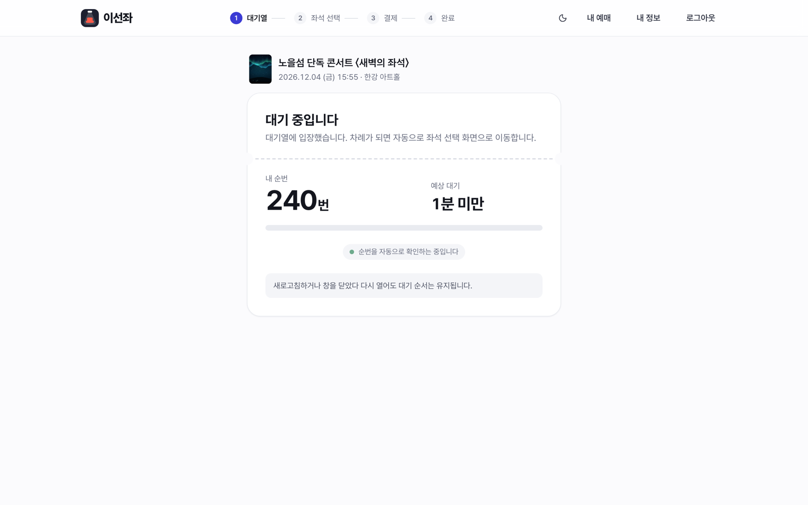
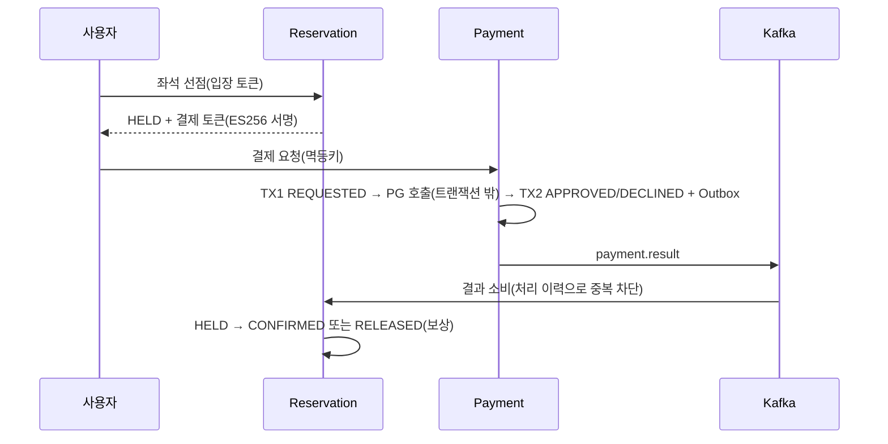
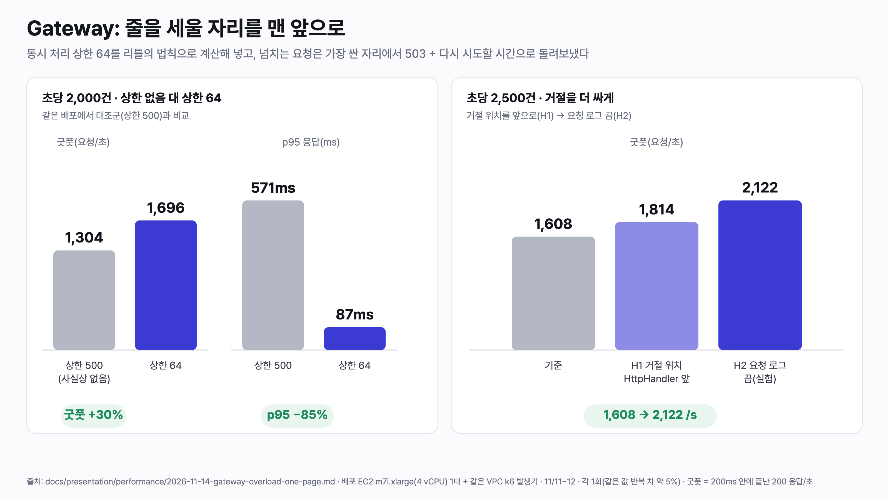
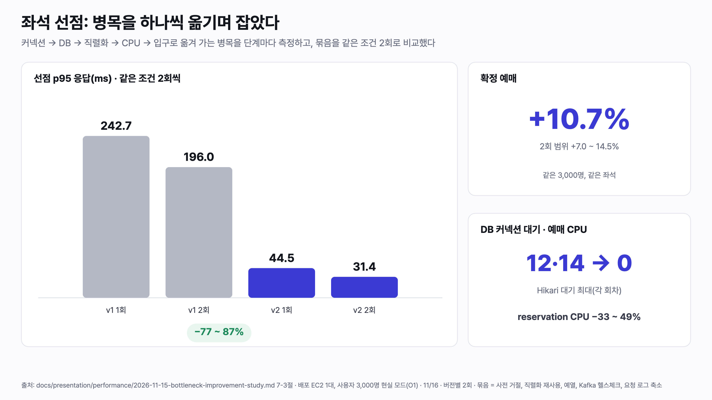
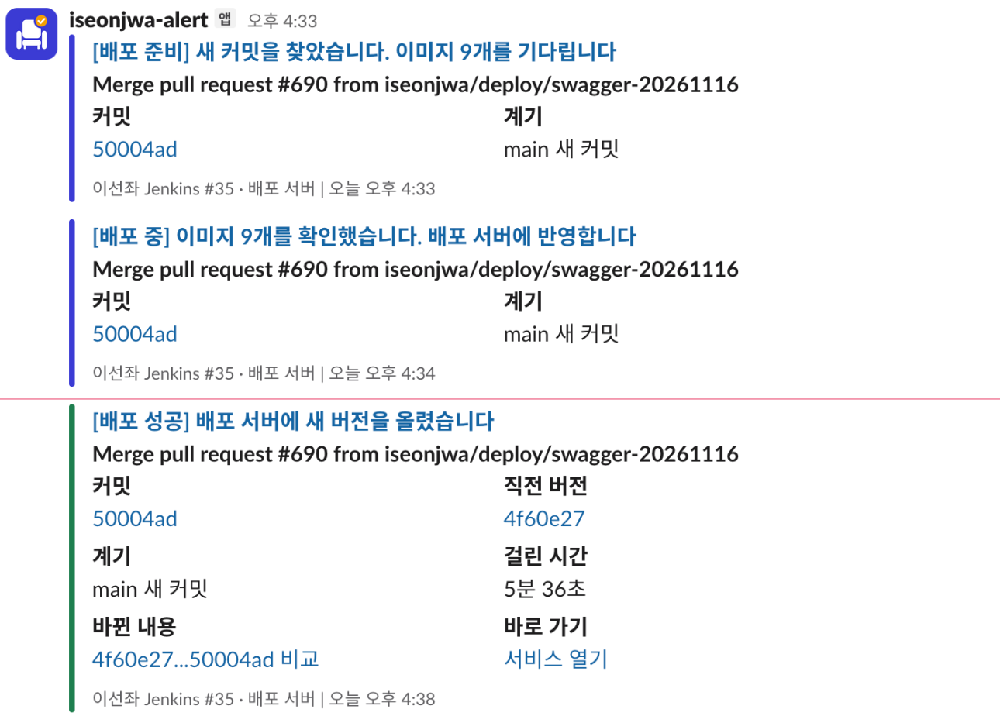
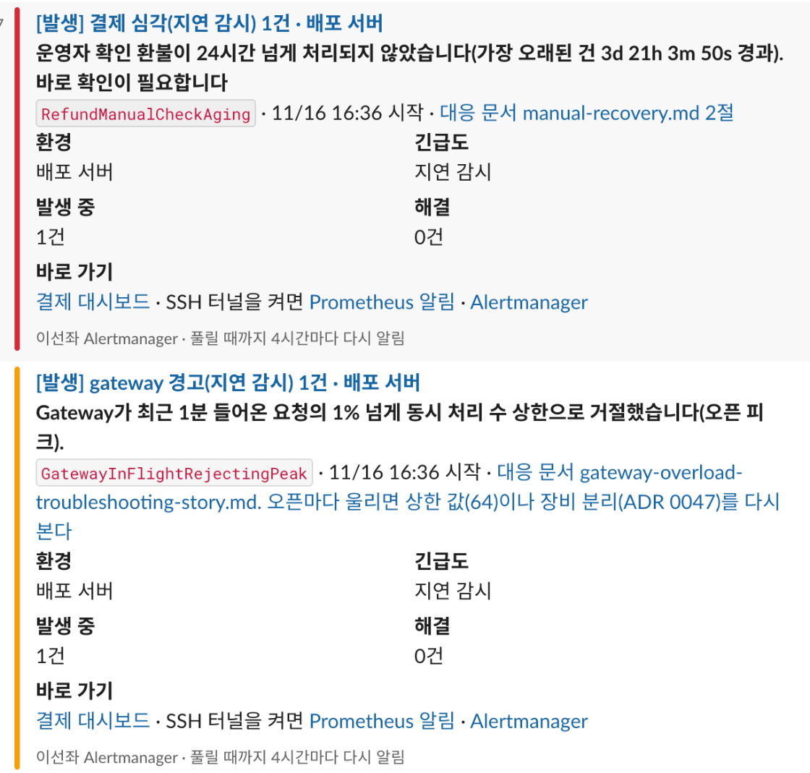
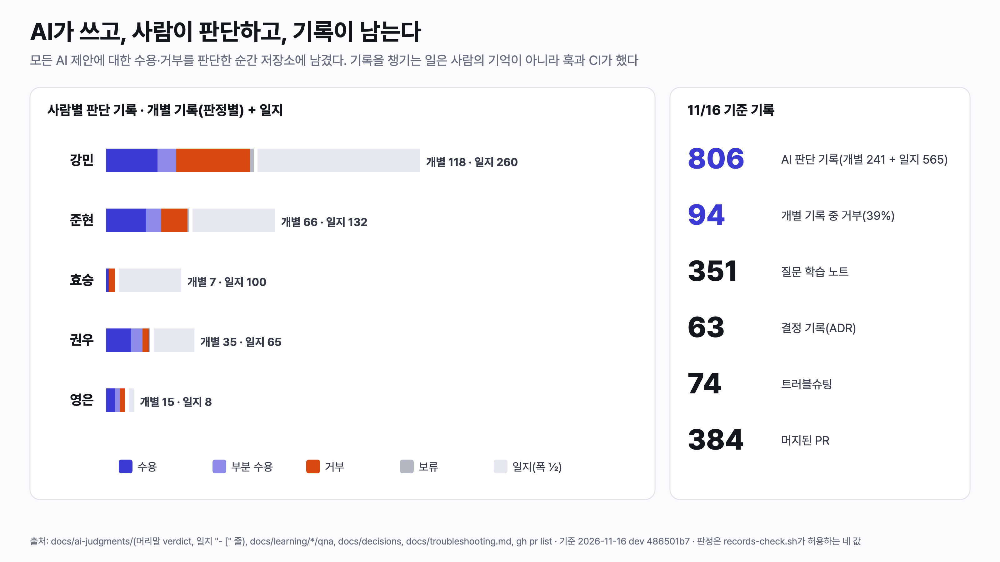

# 이선좌: 몰려도 정확한 티켓팅

티켓 오픈 정각에 접속이 몰려도 한 좌석은 한 사람에게만 팔고, 손이 빠르지 않더라도 추첨과 자동결제로 예매할 기회를 만드는 콘서트 예매 서버다. 내일배움캠프 Spring 심화 10기 최종 프로젝트 5조 "이선좌"의 저장소다. "이선좌"는 티켓팅을 하다 보면 자주 보게 되는 "이미 선택된 좌석입니다"의 줄임말이다.

| 바로 열어 보기 | 주소 |
|---|---|
| 서비스(배포 서버, HTTPS) | https://52.63.10.174 |
| API 문서(Swagger UI) | https://52.63.10.174/api/docs |
| 실시간 지표(Grafana, 로그인 없이 보기) | https://52.63.10.174/grafana/ |
| 최종 발표회 브로셔 | [노션 [5조] 이선좌](https://app.notion.com/p/teamsparta/5-4132dc3ef51480cc8559f3f3778e0f1b) |
| 설계 정본 | [SA MASTER v3.3](https://app.notion.com/p/6867bd823b7583f9896c81d8881f0004), 저장소 사본 [`docs/core/SA MASTER.md`](docs/core/SA%20MASTER.md) |

기간은 2026.10.26 ~ 11.19(약 4주), 인원은 5명이다. 서비스 3개(User·Reservation·Payment)와 API Gateway, AI 상담 서비스로 이루어진다.


## 한눈에 보기

| 숫자 | 의미 |
|---|---|
| **중복 판매 0건** | 모든 배포 측정에서 확정 예매 수 = 결제 승인 수 = 판매된 좌석 수 |
| **굿풋 +30%, p95 −85%** | 초당 2,000건에서 Gateway 동시 처리 상한 64를 넣기 전후(같은 배포에서 비교) |
| **자동결제 10분 안 100%** | 추첨 당첨 약 2,000건, 개선 전 92.4~93.4% |
| **PG 원장 34건 = DB 34건** | 결제 서버를 강제로 종료한 장애 주입에서도 중복 승인 0건 |
| **테스트 2,020개** | Java `@Test` 1,968개와 매개변수 테스트 52개, 프론트엔드 약 1,230개 |
| **AI 판단 기록 806건** | 개별 기록 241건 중 94건(39%)은 AI 제안을 거부했다 |
| **ADR 63건 · 트러블슈팅 74건** | 되돌리기 어려운 결정과 막혔던 문제를 모두 저장소에 남겼다 |
| **알림 규칙 37개** | promtool 테스트 64건으로 알림이 제때 울리는지까지 검사한다 |

성능 수치는 모두 배포 서버(EC2 m7i.xlarge, 4 vCPU 1대)와, 같은 VPC에 둔 별도 부하 발생기(k6)로 측정했다. 로컬 PC에서 잰 값은 따로 "로컬"이라고 적었고, 측정한 날이 다른 결과끼리는 %로 비교하지 않았다.

## 무엇을 만들었나

| 예매 방식 | 사용자 경험 |
|---|---|
| **선착순 예매** | 대기열에서 내 순번과 예상 대기 시간을 보다가 입장하면 구역·매수·좌석을 고른다. 여러 사람이 같은 좌석을 동시에 누르면 한 사람만 성공하고, 나머지에게는 "이미 선택된 좌석입니다"가 표시된다. 선택을 마치면 5분 안에 결제한다 |
| **추첨 예매** | 응모하면서 자동결제 카드를 등록해 둔다. 추첨이 끝나면 당첨자에게 좌석이 자동으로 배정되고 등록한 카드로 결제된다. 결제에 실패하면 예비 당첨자가 자리를 이어받는다 |
| **AI 예매 상담** | 취소·환불·추첨 규정을 물으면 규정 문서에서 찾은 근거와 함께 답한다. 상담 서비스가 멈춰도 예매와 결제는 그대로 동작한다 |

| 대기열 | 좌석 선택 |
|---|---|
|  |  |
| **같은 좌석을 먼저 선택한 사람이 있을 때** | **예매 확정과 모바일 티켓** |
|  |  |
| **추첨 응모** | **AI 예매 상담** |
|  |  |

화면 32장은 [`docs/presentation/demo/2026-11-16-screens/`](docs/presentation/demo/2026-11-16-screens/)에 있다.

## 구조

- **요청 경로**: 사용자 → nginx(HTTPS) → API Gateway. Gateway는 동시 처리 상한 → JWT 검증 → 로그아웃된 토큰 확인(Redis) → 입장 토큰 검증을 거쳐 각 서비스로 보낸다. 외부에서 내부 API(`/internal/**`)를 부르면 404를 돌려준다.
- **서비스**: User, Reservation(공연·대기열·선점·예매·추첨 모듈의 모듈러 모놀리스), Payment, Assistant(AI 상담), Mock PG. DB는 서비스마다 따로 둔다(PostgreSQL 17 × 3).
- **서비스 경계를 3개로 정한 이유**: 처음 안은 5개였다. 대기열은 자체 데이터가 없고 멈추면 예매도 멈추므로 떼어 내도 장애가 격리되지 않고, 추첨석은 `LOTTERY` 등급으로 나누면 같은 DB 안에서도 실시간 선점과 충돌하지 않는다. 그래서 둘 다 예매 서비스 안의 모듈로 두고, 분리할 조건을 측정 지표로 정해 두었다(SA 7-1).
- **이벤트**: `payment.result`, `payment.command`, `seat-hold.request`와 각각의 DLQ. 모든 발행은 Outbox를 거친다.



| 영역 | 기술 |
|---|---|
| 백엔드 | Java 21, Spring Boot 4.1.2, Spring Cloud 2025.1.4(Gateway·Eureka·Config), Resilience4j, JPA·Flyway |
| 데이터·메시징 | PostgreSQL 17, Redis 8, Kafka 4.1.1(KRaft) |
| 프론트엔드 | React 19, Vite, TanStack Query, MSW, Playwright |
| 배포 | GitHub Actions → GHCR → Jenkins → EC2 한 대(컨테이너 21개), 실패하면 자동 되돌림 |
| 관측 | Prometheus·Grafana(대시보드 6개), Loki·Alloy, Zipkin, Alertmanager → Slack |
| 부하·AI | k6 1.0.0, Claude API(`anthropic-java`), springdoc(Swagger UI) |

## 성능: 측정으로 확인한 것

| 영역 | 개선 전 → 후 | 조건 |
|---|---|---|
| Gateway 과부하 | 굿풋 1,304 → 1,696/s, p95 571 → 87ms, 메모리 초과 재시작 3 → 0회 | 초당 2,000건, 같은 배포에서 상한 500 대 64(각 1회) |
| 좌석 선점 | p95 77~87% 감소, 확정 예매 10.7% 증가, DB 커넥션 대기 12·14 → 0 | 사용자 3,000명 현실 모드, 버전별 2회 |
| 추첨 자동결제 | 10분 안 완료율 92.4~93.4% → 100%, 처리 속도 초당 3.2 → 9.4건 | 당첨 약 2,000건, 개선 전 3회·후 2회(날이 달라 참고값) |
| 결제 처리량 | 승인 한도 초당 31.2 → 91.5건(계산값 약 94) | PG 동시 호출 허가 10 → 30, PG 지연 300ms |
| Synthetic Data | 균일 부하 대비 대기열 진입 최대 353 → 2,792/s, 409 비율 48.1% → 11.7% | LLM이 설계한 페르소나 8개로 만든 3,000명, 각 1회 |




자세한 과정은 [Gateway 과부하 한 장 요약](docs/presentation/performance/2026-11-14-gateway-overload-one-page.md), [좌석 선점 병목 개선](docs/presentation/performance/2026-11-15-bottleneck-improvement-study.md), [추첨 측정](docs/design/lottery/numbers-and-measurement.md), [Synthetic Data](docs/design/infra/synthetic-data.md)에 있다.

## 정합성: 돈이 걸린 곳

- **판매 판정은 DB가 한다**: 좌석 ID 순으로 조건부 UPDATE를 걸어 고른 좌석을 한 번에 모두 선점하거나 하나도 선점하지 않고, 부분 유니크 인덱스가 마지막 방어선이 된다. Redis는 대기열·캐시·로그아웃 목록에만 쓴다.
- **결과를 모르면 "결과 모름"으로 둔다**: PG 응답 시간 초과는 실패가 아니라 UNKNOWN으로 두고 다시 조회해 확정한다. 재시도 요청이 기존 결제를 이어받지 않게 해 이중 승인을 막았다(ADR 0048).
- **유실과 중복을 함께 막는다**: Outbox, 처리 이력, DLQ, `Idempotency-Key`, 예매 한 건당 결제 한 건 제약, "이전 상태일 때만" 바꾸는 조건부 갱신.
- **대사는 고치지 않고 알린다**: 5분마다 결제와 예매를 8가지 규칙(RC-1~RC-8)으로 대조하고, 불일치는 기록과 알림만 남긴다(ADR 0029).
- **키를 나눈다**: 결제 토큰은 ES256으로 예매 서비스만 서명하고, 빌링키는 AES-256-GCM으로 암호화해 키는 환경 변수로만 넣는다.

## 운영: 배포와 알림

main에 머지하면 GitHub Actions가 이미지 9개를 커밋 번호로 빌드하고, 별도 Jenkins 서버가 배포 서버에 반영한 뒤 헬스 체크와 스모크 테스트를 돌린다. 실패하면 직전 성공 커밋으로 자동으로 되돌린다(11/11에 실제로 한 번 동작했다, TS-55). 배포 단계, 장애 경보, 측정 모드는 모두 Slack으로 알린다.

| 배포 알림 | 장애 경보 |
|---|---|
|  |  |

## AI와 일하는 방식

코드 대부분을 AI(Claude Code, codex)와 함께 썼다. 그래서 처음부터 "AI가 쓴 코드를 어떻게 믿을 것인가"를 고민했고, 답은 **AI가 쓰고, 사람이 판단하고, 그 판단은 기록으로 남긴다**였다.

- **기본 프롬프트 제약**: 모든 AI가 먼저 읽는 [`AGENTS.md`](AGENTS.md)에 대전제 11개를 두었다. AI 판단은 모두 기록하고, 검증 근거 없이 완료라고 말하지 않으며, 팀이 합의한 설계를 AI 판단으로 덮어쓰지 않는다.
- **장치**: 입력할 때마다 "판단이면 기록하라"고 다시 알리는 훅, 작업을 마치기 전과 PR마다 기록 구조를 검사하는 `records-check`(종료 훅·CI), 공용 스킬 4개, PR 템플릿의 "AI 활용 기록" 칸, Claude와 codex로 PR을 읽기 전용 리뷰하는 [`script/ai-review.sh`](script/ai-review.sh).
- **다섯 겹 검토**: 설계 기준(L0) → 실패 테스트와 일부러 넣은 결함(L1) → 다른 세션·다른 모델 리뷰(L2) → CI(L3) → 배포·관측(L4). 각 겹이 실제로 잡은 결함은 [`docs/guides/ai-code-review.md`](docs/guides/ai-code-review.md)에 있다.
- **AI가 틀린 것을 숫자로 바로잡았다**: "Gateway에는 bulkhead가 없다"는 바이트코드로 기본값 25를 확인해 뒤집었고, "SKIP LOCKED의 손해는 드물다"는 측정에서 성공 83 → 56건이 나와 거부했다.



판단 기록은 [`docs/ai-judgments/`](docs/ai-judgments/), 질문 노트 351개는 [`docs/learning/`](docs/learning/), 설계 검증 로그 11건은 SA 14장에 있다.

## 기술적 의사결정

| 결정 | 이유 | 근거 |
|---|---|---|
| 서비스 3개, 대기열·추첨은 예매 안의 모듈 | 떼어 내도 장애가 격리되지 않음. AI의 Queue 분리 권고는 거부 | SA 7-1, 14장 #1 |
| 판매 판정은 DB 조건부 갱신 + 부분 유니크 | Redis가 느려지거나 데이터를 잃어도 판매 기록은 틀어지지 않음 | SA 8-4 |
| Gateway 맨 앞 동시 처리 상한 64 | 리틀의 법칙으로 계산한 60~67, 128은 차이가 측정 편차 안이라 거부 | ADR 0050·0052 |
| 입장 토큰은 선점 성공 순간 사용 처리 | "선점 → 만료 → 다시 선점"으로 좌석을 붙잡는 것을 막음 | ADR 0053 |
| 오케스트레이션 대신 코레오그래피 SAGA | 일반 예매 참여 서비스가 예매·결제 둘뿐 | SA 14장 #3 |
| 결과 모름(UNKNOWN) + 재시도 이어받기 거부 | 이전 요청이 PG를 부르지 않았다고 확인할 수 없음 | ADR 0018·0048 |
| 자동결제 소비자 3 + 전용 PG 허가 | 원인이 소비자 하나의 직렬 대기임을 측정으로 확인 | ADR 0051 |
| 좌석 배치 캐시는 서비스 메모리에 | p95 Redis 38.3ms 대 로컬 7.0ms, CPU 약 4.5배 | ADR 0054 |
| AI 상담은 벡터 DB 없이 키워드 검색 + 출처 인용 | 문서가 수천 토큰이라 충분, 임베딩 비용·기간 절약 | ADR 0049 |
| 잠금 대기 50ms(SKIP LOCKED 거부) | SKIP LOCKED는 곧 풀릴 좌석까지 실패로 돌려보냄 | ADR 0061, TS-73 |

결정 기록 63건은 [`docs/decisions/`](docs/decisions/), 트러블슈팅 74건은 [`docs/troubleshooting.md`](docs/troubleshooting.md)에 있다.

## 알려진 한계

- 장비 한 대(4 vCPU)와 Kafka 브로커 1대로 운영해, 상한과 커넥션 풀 조정은 요청이 기다리는 위치만 바꾼다.
- 오픈 순간의 대기열 진입 요청 일부가 Gateway 상한에 막힌다. 추첨 직후에는 일반 선점 p95가 90% 늘어 목표(20% 이하)에 못 미쳤다.
- 부하 측정은 Mock PG로만 했고, 토스페이먼츠는 일반 결제 테스트 모드까지만 연결했다.
- RAG 상담은 검색 정확도(골든 질문 10개)까지만 확인했고 답변 품질은 평가하지 못했다.

## 팀

| 팀원 | 맡은 영역 | GitHub |
|---|---|---|
| 안준현 | 결제·Mock PG·이벤트 신뢰성 공통 모듈, 프론트엔드, AI 상담, 배포·관측, 저장소 AI 규칙과 기록 체계 | [@alloy31](https://github.com/alloy31) |
| 최권우 | 동기형·접수형 좌석 선점과 동시성 검증 | [@KWON-WOO](https://github.com/KWON-WOO) |
| 이강민 | 사용자·공통 모듈, 추첨과 자동결제, Gateway 과부하 측정과 개선, 발표 | [@GGangMY](https://github.com/GGangMY) |
| 반효승 | 공연·좌석 조회, 예매 상태·발권·보상, 취소, 좌석 캐시 | [@hyos1](https://github.com/hyos1) |
| 권영은 | 대기열과 입장 토큰, 부하 테스트와 Synthetic Data | [@alreadysolved](https://github.com/alreadysolved) |

## 저장소 구성

| 경로 | 내용 |
|---|---|
| `gateway/`, `eureka/`, `config-server/`, `config-repo/` | 진입점, 서비스 발견, 설정 서버와 설정 |
| `user-service/`, `reservation-service/`, `payment-service/`, `assistant-service/`, `mock-pg/` | 서비스 |
| `common/` | 공통 모듈(공통 응답 형식, Outbox·처리 이력·DLQ 등) |
| `frontend/` | React 화면과 MSW 목, Playwright E2E |
| `infra/`, `compose*.yml`, `Jenkinsfile` | 관측 설정, 로컬·배포 compose, 배포 파이프라인 |
| `loadtest/` | k6 시나리오와 Synthetic Data 생성기 |
| `docs/` | 설계, 결정, 트러블슈팅, AI 판단 기록, 학습 노트, 발표 자료 |

---

## 팀원을 위한 안내

### 처음 시작하기

clone한 뒤 아래 세 가지를 한다. 3분이면 끝난다.

1. Claude Code를 쓰면 스킬을 연결한다. 저장소 루트에서 `script/setup-agents.sh`를 실행한다. 공용 스킬(`.agents/skills/`)이 `.claude/skills/`에 연결된다. pull로 스킬이 바뀌면 다시 실행한다. Windows는 Git Bash에서 실행한다. 심볼릭 링크를 못 만들면 복사로 대신하며, 이때는 원본이 바뀔 때마다 다시 실행해야 한다.
2. 내 폴더는 에이전트가 만든다. 처음 질문하거나 AI 판단을 내리면 에이전트가 `docs/learning/<이름>/`과 `docs/ai-judgments/<이름>/`을 만들어 준다. `<이름>`은 팀원 영문 이름(예: junhyun)이다. 다른 사람 폴더는 고치지 않는다.
3. Claude Code는 저장소 루트에서 연다. `.claude/settings.json`의 훅이 자동으로 적용된다. 별도 설정은 없다. Codex는 훅이 없고 `AGENTS.md`를 읽고 따른다.

### 기록은 에이전트가 남긴다

| 상황 | 기록 위치 | 스킬 |
|---|---|---|
| 개념·방법을 물었다 | `docs/learning/<이름>/qna/` | `learning-note` |
| AI의 응답·제안을 수용·거부·보류·선택했다 | `docs/ai-judgments/<이름>/` | `ai-judgment` |
| 되돌리기 어려운 결정을 했다 | `docs/decisions/` | `adr` |
| 막혔던 문제를 해결했다 | `docs/troubleshooting.md` | `troubleshooting` |

- 에이전트는 동의를 기다리지 않고 기록하고 답 끝에 `기록: <경로>`를 남긴다. 사람은 PR에서 기록을 검토하고 고친다.
- 팀이 함께 알아야 할 AI 판단은 기록 머리말에 `shared: 예`를 쓰고 [`docs/ai-judgments/README.md`](docs/ai-judgments/README.md)의 "팀 공통 판단" 표에 올린다.
- 판단 근거는 사용자가 말한 대로 적는다. 말하지 않았으면 `미기재`로 남고, 판단자가 나중에 채운다.
- 기록 구조는 `script/records-check.sh`로 확인한다. Claude Code는 종료 전에 자동으로, GitHub는 PR마다 검사한다.
- 비밀값(`.env`, 토큰, 실제 비밀번호)은 커밋하지 않는다.

### 개발 워크스페이스

Java 21, Spring Boot 4.1.2, Spring Cloud 2025.1.4 기반의 앱 8개(Config Server·Eureka·Gateway·User·Reservation·Payment·Assistant·Mock PG)와 공통 라이브러리, 전체 인프라를 준비한다. 검증·개발 도구는 Java·Gradle로 통일하며 Python 설치는 필요 없다.

```bash
./gradlew initLocalEnv
docker compose -f compose.yml -f compose.local.yml up -d --build --wait --wait-timeout 180
./gradlew :system-tests:systemTest -PredisFailure=true --no-daemon
```

전체 검사는 `./gradlew verifyWorkspace --no-daemon`으로 실행한다. 환경·앱 실행은 [워크스페이스 가이드](docs/guides/workspace.md), JUnit 위치와 실행 범위는 [테스트 가이드](docs/guides/testing.md)를 따른다.

### PR

`.github/pull_request_template.md`가 자동으로 채워진다. STAR(상황·과제·행동·결과) 형식이고, 이 PR에 쓴 AI 판단 기록 링크를 적는 칸이 있다.

### 문서 지도

[`docs/README.md`](docs/README.md)에서 시작한다. 에이전트 공통 규칙의 정본은 [`AGENTS.md`](AGENTS.md)이고, Claude Code 전용 기능은 [`CLAUDE.md`](CLAUDE.md)에 있다.
