<div align="center">


# 이선좌

**티켓 오픈 정각에 수천 명이 몰려도, 한 좌석은 한 사람에게만 파는 콘서트 예매 서버**


<sub>내일배움캠프 Spring 심화 10기 최종 프로젝트 · 5조 · 2026.10.26 ~ 11.19 · 5명</sub>

</div>

<br>

> "이선좌"는 티켓팅을 하다 보면 자주 보게 되는 "**이**미 **선**택된 **좌**석입니다"의 줄임말이다. 그 문구가 정확히 한 사람을 뺀 모두에게만 뜨게 하는 것이 이 프로젝트의 목표였다.

> [!NOTE]
> 배포 서버는 최종 발표 주간까지만 운영하고 내린다. 실제 화면은 이 문서의 캡처로 볼 수 있고, 전체 시스템은 [로컬에서 실행하기](#로컬에서-실행하기)로 직접 띄울 수 있다.

## 목차

- [왜 어려운가](#왜-어려운가): 티켓 오픈 순간에 생기는 네 가지 문제
- [둘러보기](#둘러보기): 사용자가 보는 화면
- [구조](#구조): 서비스 경계와 요청 경로
- [문제를 어떻게 풀었나](#문제를-어떻게-풀었나): 네 문제의 설계와 측정 결과
- [운영과 관측](#운영과-관측): 배포 파이프라인, 장애 주입, 추적
- [AI와 함께 만든 방식](#ai와-함께-만든-방식): AI가 쓰고 사람이 판단한 기록
- [로컬에서 실행하기](#로컬에서-실행하기): 명령 세 줄로 전체 시스템 띄우기

## 왜 어려운가

인기 공연의 티켓 오픈은 평소 트래픽이 거의 없다가 정각 1초에 수천 명이 같은 버튼을 누르는 일이다. 서버를 늘리는 것만으로는 풀리지 않는 문제가 네 가지 있다.

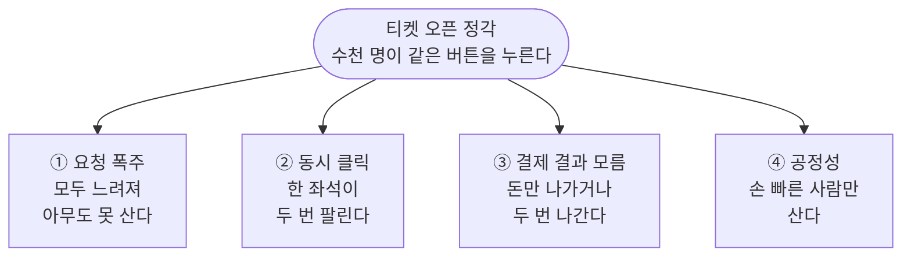

| 문제 | 이선좌의 답 | 확인한 결과 |
|---|---|---|
| ① 요청 폭주 | 대기열로 입장 순서를 정하고, Gateway가 동시에 처리하는 요청 수를 64로 묶어 넘친 요청은 바로 돌려보낸다 | 초당 2,000건에서 p95 571 → 87ms, 굿풋 +30% |
| ② 같은 좌석 동시 클릭 | 판매 판정을 Redis가 아니라 DB의 조건부 UPDATE에 맡기고, 부분 유니크 인덱스를 마지막 방어선으로 둔다 | 모든 배포 측정에서 중복 판매 0건 |
| ③ 결제 결과를 모름 | 응답이 없으면 실패로 단정하지 않고 "결과 모름(UNKNOWN)"으로 둔 뒤 다시 조회한다. 예매와 결제는 이벤트(SAGA)로만 만난다 | 결제 서버를 강제 종료해도 PG 원장 34건 = 결제 DB 34건 |
| ④ 공정성 | 추첨 예매를 두고, 당첨되면 미리 등록한 카드로 자동결제한다. 실패하면 예비 당첨자가 이어받는다 | 당첨 약 2,000건이 10분 안에 100% 결제 |

> 성능 수치는 모두 배포 서버(EC2 m7i.xlarge, 4 vCPU 1대)에, 같은 VPC의 별도 부하 발생기(k6)로 요청을 보내 측정했다. 측정한 날이 다른 결과끼리는 %로 비교하지 않았다.

## 둘러보기

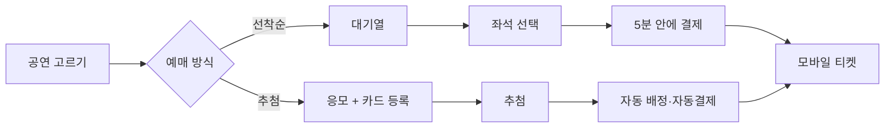

<table>
  <tr>
    <td width="50%">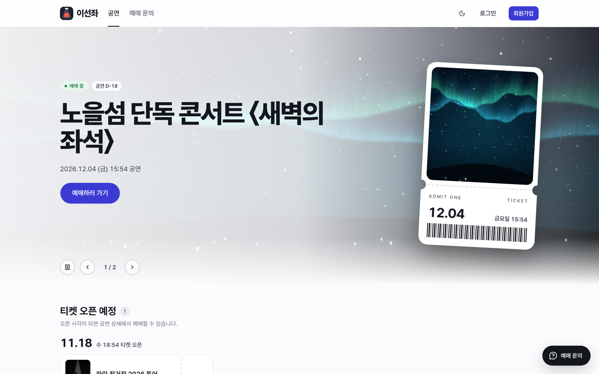</td>
    <td width="50%"></td>
  </tr>
  <tr>
    <td align="center"><b>공연 목록</b> · 오픈 예정 공연과 카운트다운</td>
    <td align="center"><b>대기열</b> · 내 순번과 예상 대기 시간</td>
  </tr>
  <tr>
    <td>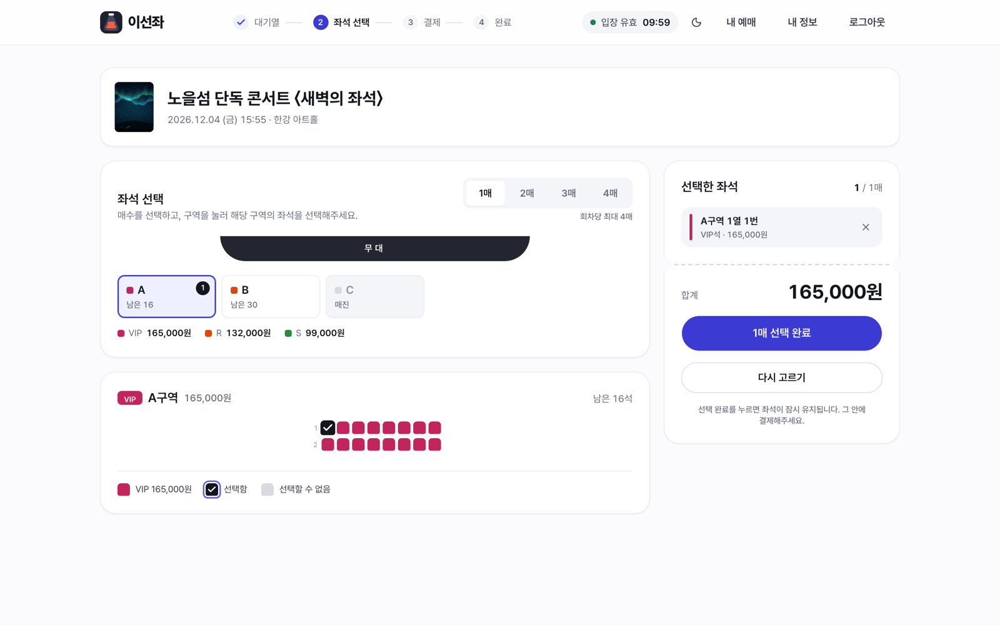</td>
    <td>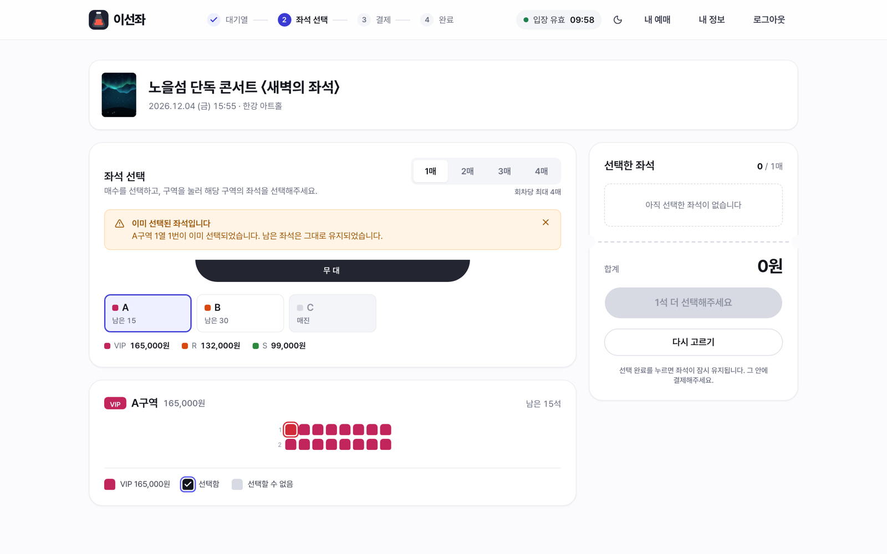</td>
  </tr>
  <tr>
    <td align="center"><b>좌석 선택</b> · 구역·매수·좌석</td>
    <td align="center"><b>이미 선택된 좌석입니다</b> · 동시에 누르면 한 명만 성공</td>
  </tr>
  <tr>
    <td>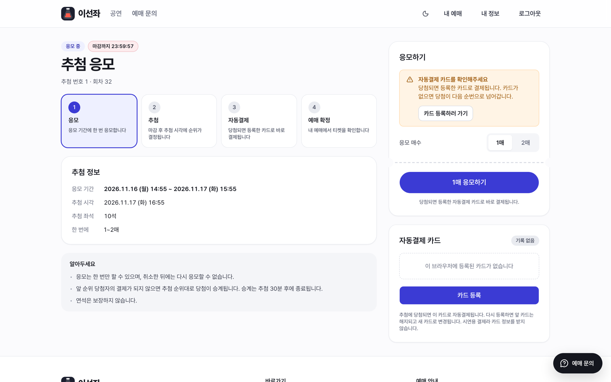</td>
    <td>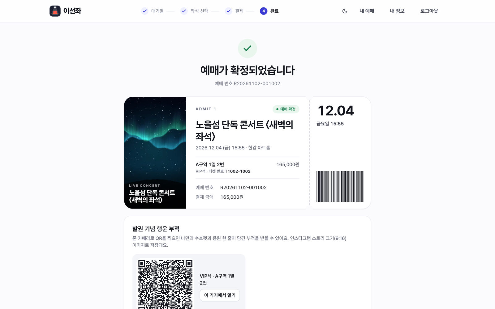</td>
  </tr>
  <tr>
    <td align="center"><b>추첨 응모</b> · 자동결제 카드를 미리 등록</td>
    <td align="center"><b>예매 확정</b> · 좌석별 모바일 티켓</td>
  </tr>
</table>

<details>
<summary><b>더 보기: AI 예매 상담, 화면마다 실패하면 어디로 가는지</b></summary>

<br>

취소·환불·추첨 규정을 물으면 규정 문서에서 찾은 근거를 인용해 답한다. 상담 서비스가 멈춰도 예매와 결제는 그대로 동작한다.

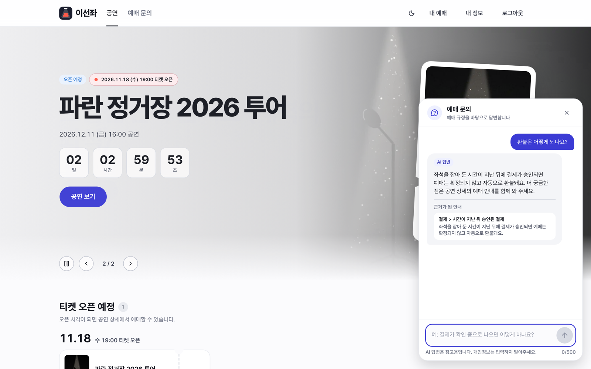

화면마다 성공·경고·오류일 때 어디로 가는지 그린 일반 예매 유저 플로우다.

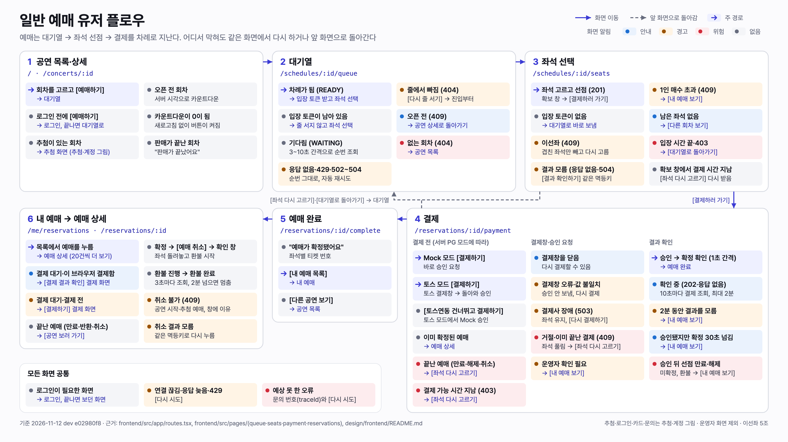

추첨·로그인·카드 화면은 [추첨·계정 유저 플로우](docs/presentation/architecture/2026-11-12-user-flow-lottery-account.png), 화면 32장은 [`docs/presentation/demo/2026-11-16-screens/`](docs/presentation/demo/2026-11-16-screens/)에 있다.

</details>

## 구조

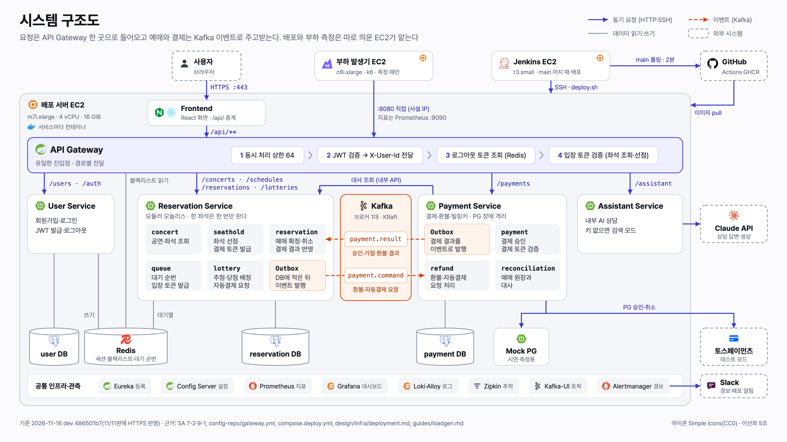

| 구성 | 역할 |
|---|---|
| **API Gateway** | 모든 요청의 입구. 동시 처리 상한, JWT 검증, 로그아웃 토큰 확인, 입장 토큰 검증 |
| **User** | 가입, 로그인, 토큰 재발급, 로그아웃 |
| **Reservation** | 공연·대기열·좌석 선점·예매·추첨 모듈을 담은 모듈러 모놀리스 |
| **Payment** | 결제, 자동결제(빌링키), 환불, 결제·예매 대사 |
| **Assistant** | 규정 문서 근거로 답하는 AI 예매 상담 |
| **Mock PG** | 부하 측정과 장애 주입용 가짜 PG. 실제 결제는 토스페이먼츠 테스트 모드로 연결 |

DB는 서비스마다 따로 둔다(PostgreSQL 17 × 3). 서비스끼리는 `payment.command`, `payment.result`, `seat-hold.request` 이벤트로 결과를 주고받고, 모든 발행은 Outbox를 거친다.

> [!TIP]
> **서비스를 5개가 아니라 3개로 나눈 이유.** 처음 안은 대기열과 추첨도 서비스로 떼는 5개였다. 그러나 대기열은 자체 데이터가 없고, 멈추면 예매도 멈추므로 떼어 내도 장애가 격리되지 않는다. 추첨석은 `LOTTERY` 등급으로 나누면 같은 DB 안에서도 실시간 선점과 부딪치지 않는다. 그래서 둘 다 예매 서비스 안의 모듈로 두고, 나중에 떼어 낼 조건을 측정 지표로 정해 두었다. AI가 권한 대기열 분리안은 이 근거로 거부했다.

## 문제를 어떻게 풀었나

### ① 몰려도 버틴다: 대기열과 Gateway 동시 처리 상한

대기열이 순서대로 입장 토큰을 나눠 주고, 토큰이 있는 사람만 좌석 화면에 들어간다. 그래도 정각 1초에 몰리는 요청은 남는다. 그래서 Gateway 맨 앞에 동시 처리 상한을 두어, 넘친 요청은 인증 같은 비싼 일을 하기 전에 바로 돌려보낸다. 이미 받은 요청이 끝까지 처리될 자리를 지키려는 것이다.

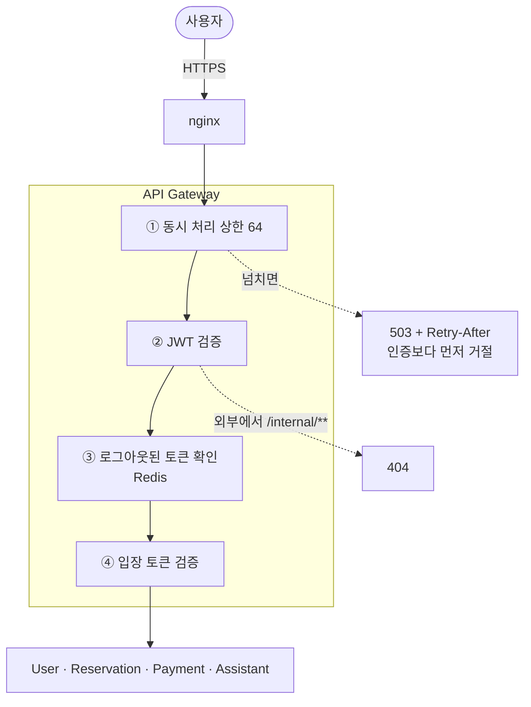

- **상한 64는 계산으로 정했다.** 리틀의 법칙(동시 처리 수 = 처리율 × 응답 시간)으로 60~67을 얻었다. 128도 재 봤지만 차이가 측정 편차 안이라 고르지 않았다.
- **결과**: 초당 2,000건에서 상한 500과 64를 같은 배포에서 각 1회 비교했다.

| 지표 | 상한 500 | 상한 64 |
|---|---|---|
| 굿풋(제때 성공한 요청) | 1,304/s | **1,696/s** |
| p95 응답 시간 | 571ms | **87ms** |
| 메모리 초과로 다시 시작 | 3회 | **0회** |

과정은 [Gateway 과부하 한 장 요약](docs/presentation/performance/2026-11-14-gateway-overload-one-page.md)에 있다.

### ② 한 좌석은 한 사람에게: DB가 판정한다

Redis로 좌석을 먼저 잡는 방법도 있지만, Redis가 느려지거나 데이터를 잃으면 판매 기록이 틀어진다. 그래서 판매 판정은 DB 한 문장이 한다. 고른 좌석을 ID 순으로 잠그고 `AVAILABLE`인 좌석만 `HELD`로 바꾼 뒤, 바꾼 행 수가 고른 좌석 수와 다르면 통째로 되돌린다.

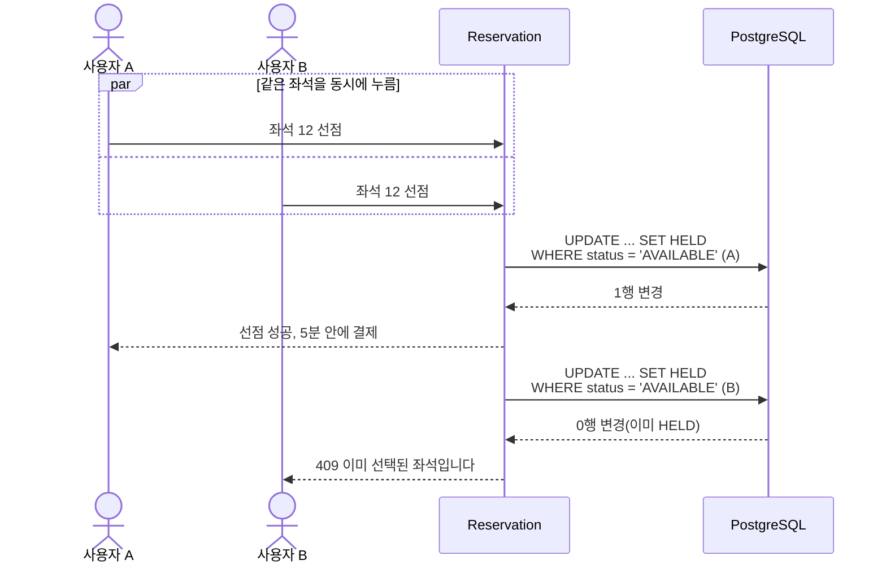

- 여러 좌석을 고르면 전부 잡거나 하나도 잡지 않는다. 좌석 ID 순으로 잠가 교착을 피한다.
- 마지막 방어선은 부분 유니크 인덱스다. `reservation_seats(schedule_seat_id) WHERE status IN ('HELD', 'CONFIRMED')`라서 코드에 실수가 있어도 한 좌석에 살아 있는 예매가 둘이 될 수 없다.
- 잠금 대기는 50ms로 짧게 둔다. `SKIP LOCKED`도 측정했지만 곧 풀릴 좌석까지 실패로 돌려보내 성공이 83 → 56건으로 줄어 거부했다.
- **결과**: 모든 배포 측정에서 확정 예매 수 = 결제 승인 수 = 판매된 좌석 수. 개선 묶음(v1 → v2)으로 선점 p95가 77~87% 줄고 확정 예매가 10.7% 늘었다(사용자 3,000명, 버전별 2회). 과정은 [좌석 선점 병목 개선](docs/presentation/performance/2026-11-15-bottleneck-improvement-study.md)에 있다.

### ③ 돈은 정확히 한 번: 결과 모름과 SAGA

예매와 결제는 서로의 DB를 건드리지 않는다. 결제 서비스는 결과를 Outbox에 이벤트로 남기고, 예매 서비스가 그 이벤트를 받아 자기 상태를 바꾼다. PG 호출은 DB 트랜잭션 밖에서 한다.

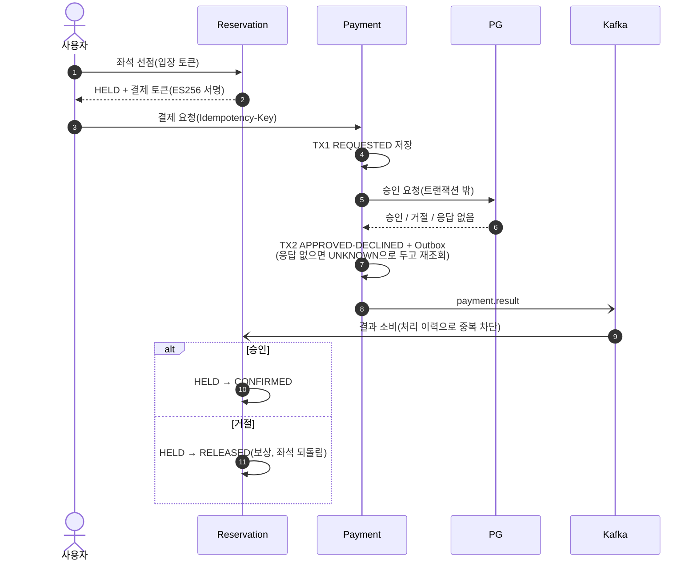

상태는 "이전 상태일 때만" 바꾸는 조건부 갱신으로 옮긴다. 늦게 온 이벤트나 중복 이벤트가 이미 끝난 상태를 되돌리지 못한다.

**예매 상태**

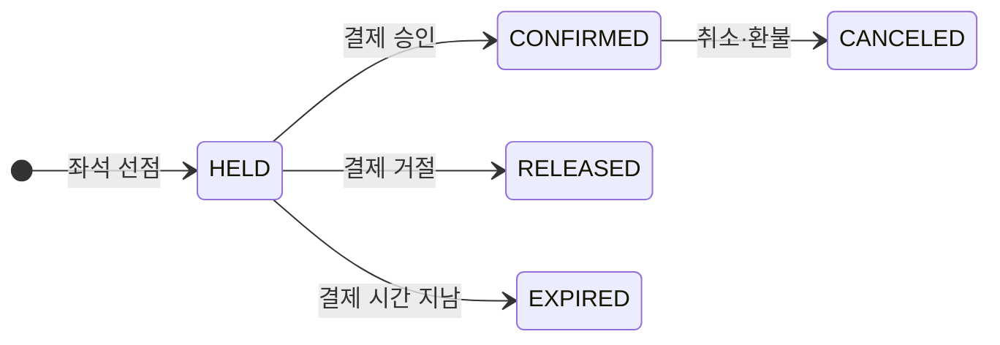

**결제 상태**

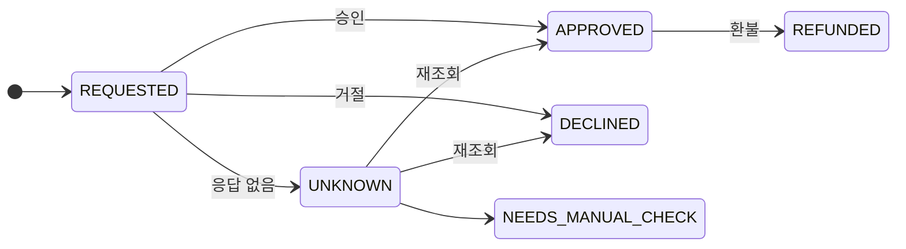

| 장치 | 막는 것 |
|---|---|
| UNKNOWN + 재조회 | PG가 응답하지 않았다고 실패로 처리했는데 실제로는 돈이 나간 경우 |
| 재시도가 기존 결제를 이어받지 않음 | 이전 요청이 PG를 불렀는지 모르는 채 다시 불러 두 번 승인되는 경우 |
| `Idempotency-Key`, 예매 한 건당 결제 한 건 제약 | 같은 결제 요청이 두 번 들어오는 경우 |
| Outbox, 처리 이력, DLQ | 이벤트 유실과 중복 소비 |
| 5분마다 대사(규칙 8가지) | 위 장치를 모두 지나 남은 불일치. 고치지 않고 기록하고 알린다 |

**결과**: 결제 서버를 강제로 종료하는 장애 주입에서도 PG 원장 34건과 결제 DB 34건이 같았고 중복 승인은 0건이었다.

<details>
<summary><b>배포 서버에서 실제로 돌린 거절 보상: 결제 거절을 기록하고 약 0.14초 뒤 좌석이 돌아옴</b></summary>


</details>

### ④ 손이 느려도 기회가 있다: 추첨과 자동결제

추첨 당첨은 "시스템이 대신 선점한 일반 예매"로 다룬다. 당첨자에게 일반 예매와 같은 `HELD` 예매를 만들고 같은 결제 경로로 보내므로, 확정·만료·환불을 추첨용으로 새로 만들지 않았다.

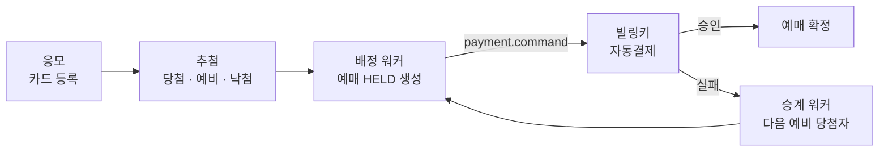

- **병목을 측정으로 찾았다.** 처음에는 당첨 약 2,000건 중 10분 안에 결제된 비율이 92.4~93.4%였다. PG 지연을 바꿔 가며 재 보니 원인은 결제 명령을 받는 소비자 하나의 직렬 대기였다.
- 소비자를 3개로 늘리고 자동결제 전용 PG 호출 허가를 따로 두었다. 일반 결제와 허가를 나눠, 추첨이 일반 결제를 503으로 밀어내지 않게 했다.
- **결과**: 10분 안 완료율 100%, 처리 속도 초당 3.2 → 9.4건(개선 전 3회·후 2회, 날이 달라 참고값). 자세한 흐름은 [추첨 설계](docs/design/lottery/README.md)와 [추첨 측정](docs/design/lottery/numbers-and-measurement.md)에 있다.

## 운영과 관측

### 배포: 실패하면 스스로 되돌린다

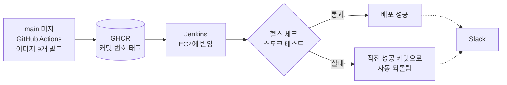

자동 되돌림은 11/11에 실제로 한 번 동작했다. 배포 단계, 장애 경보(알림 규칙 37개, promtool 테스트 64건), 부하 측정 모드는 모두 Slack으로 알린다.

### 장애를 일부러 걸어 본다

운영자 화면의 시연 장애 패널로 Mock PG에 결제 거절, PG 응답 지연, 승인 응답 유실, PG 서버 오류를 건다. ③에서 설계한 장치가 실제로 돈을 한 번만 나가게 하는지 화면에서 바로 확인한다.

<table>
  <tr>
    <td width="50%">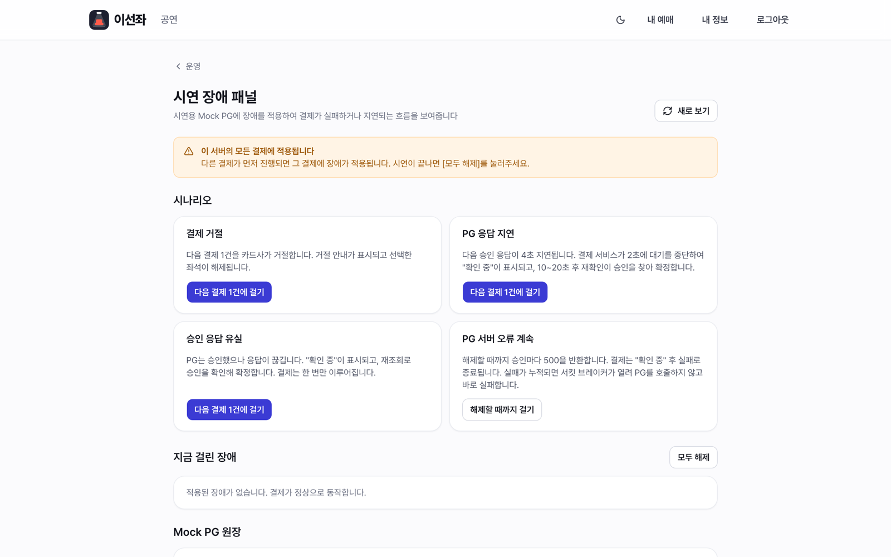</td>
    <td width="50%">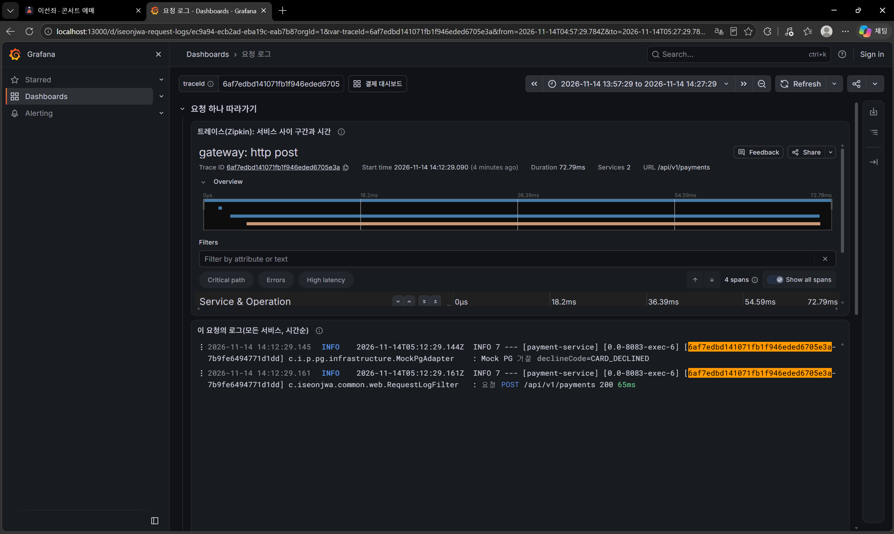</td>
  </tr>
  <tr>
    <td align="center"><b>시연 장애 패널</b> · 다음 결제 1건에 장애 걸기</td>
    <td align="center"><b>요청 하나 따라가기</b> · traceId로 트레이스와 로그를 함께</td>
  </tr>
</table>

관측은 Prometheus·Grafana(대시보드 6개), Loki·Alloy(로그), Zipkin(트레이스), Alertmanager → Slack(경보)으로 한다.

## AI와 함께 만든 방식

코드 대부분을 AI(Claude Code, codex)와 함께 썼다. 그래서 처음부터 "AI가 쓴 코드를 어떻게 믿을 것인가"를 정하고 시작했다.

> **AI가 쓰고, 사람이 판단하고, 그 판단은 기록으로 남긴다.**

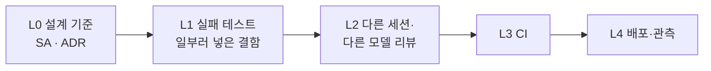

- 모든 AI가 먼저 읽는 [`AGENTS.md`](AGENTS.md)에 규칙 11개를 두었다. 판단은 모두 기록하고, 검증 근거 없이 완료라고 말하지 않으며, 팀 합의를 AI 판단으로 덮어쓰지 않는다.
- AI 제안에 대한 판단 806건을 [`docs/ai-judgments/`](docs/ai-judgments/)에 남겼다. 개별 기록 241건 중 94건(39%)은 AI 제안을 거부한 것이다.
- AI가 틀린 것은 숫자로 바로잡았다. "Gateway에는 bulkhead가 없다"는 바이트코드에서 기본값 25를 찾아 뒤집었고, "SKIP LOCKED의 손해는 드물다"는 측정에서 성공이 83 → 56건으로 줄어 거부했다.
- 각 검토 단계가 실제로 잡은 결함은 [AI 코드 리뷰 가이드](docs/guides/ai-code-review.md)에 있다.

## 기술적 의사결정

되돌리기 어려운 결정 63건은 [`docs/decisions/`](docs/decisions/)에, 막혔던 문제 74건은 [`docs/troubleshooting.md`](docs/troubleshooting.md)에 남겼다. 그중 대표적인 것이다.

| 결정 | 이유 | 기록 |
|---|---|---|
| 서비스 3개, 대기열·추첨은 예매 안의 모듈 | 떼어 내도 장애가 격리되지 않음 | SA 7-1 |
| 판매 판정은 DB 조건부 갱신 + 부분 유니크 | Redis가 느려지거나 데이터를 잃어도 판매 기록은 틀어지지 않음 | SA 8-4 |
| Gateway 맨 앞 동시 처리 상한 64 | 리틀의 법칙으로 계산한 60~67, 128은 차이가 측정 편차 안 | ADR 0050·0052 |
| 입장 토큰은 선점 성공 순간 사용 처리 | "선점 → 만료 → 다시 선점"으로 좌석을 붙잡아 두는 것을 막음 | ADR 0053 |
| 오케스트레이션 대신 코레오그래피 SAGA | 일반 예매에 참여하는 서비스가 예매·결제 둘뿐 | SA 14장 |
| 결과 모름(UNKNOWN) + 재시도 이어받기 거부 | 이전 요청이 PG를 부르지 않았다고 확인할 수 없음 | ADR 0018·0048 |
| 자동결제 소비자 3 + 전용 PG 허가 | 원인이 소비자 하나의 직렬 대기임을 측정으로 확인 | ADR 0051 |
| 좌석 배치 캐시는 서비스 메모리에 | p95 Redis 38.3ms 대 로컬 7.0ms | ADR 0054 |
| AI 상담은 벡터 DB 없이 키워드 검색 + 출처 인용 | 규정 문서가 수천 토큰이라 충분, 임베딩 비용과 기간 절약 | ADR 0049 |

## 한계와 다음 단계

- 장비 한 대(4 vCPU)와 Kafka 브로커 1대로 운영했다. 이 규모에서 상한과 커넥션 풀 조정은 요청이 기다리는 위치를 바꿀 뿐이고, 처리량을 더 올리려면 장비를 늘려야 한다.
- 오픈 순간 대기열 진입 요청 일부가 Gateway 상한에 막힌다. 추첨 직후 2분 동안 일반 선점 p95가 11.06 → 21.0ms(+90%)로 늘어 목표(20% 이하)에 못 미쳤다. 미리 정한 기준으로는 추첨을 서비스로 떼어 낼 근거가 되지만, 늘어난 폭이 약 10ms이고 오류가 0이며 1회 측정이라 분리 여부는 정하지 않았다.
- 부하 측정은 Mock PG로만 했고, 토스페이먼츠는 일반 결제 테스트 모드까지만 연결했다.
- AI 상담은 검색 정확도(골든 질문 10개)까지만 확인했고 답변 품질은 평가하지 못했다.

## 로컬에서 실행하기

Docker와 JDK 21이 있으면 저장소 루트에서 전체 시스템(앱 8개와 DB·Redis·Kafka·관측 도구)을 띄울 수 있다. Python 설치는 필요 없다.

```bash
./gradlew initLocalEnv            # .env와 결제 토큰 키 쌍을 만든다(있으면 빠진 키만 더함)
docker compose -f compose.yml -f compose.local.yml up -d --build --wait --wait-timeout 180
./gradlew :system-tests:systemTest -PredisFailure=true --no-daemon   # 전체 흐름 확인
```

| 열어 볼 곳 | 주소 |
|---|---|
| 예매 화면 | http://localhost:8000 |
| API 문서(Swagger UI) | http://localhost:8000/api/docs |
| Grafana | http://localhost:3000 (관리자 비밀번호는 `.env`의 `GRAFANA_ADMIN_PASSWORD`) |
| Kafka UI · Prometheus · Zipkin | http://localhost:8085 · http://localhost:9090 · http://localhost:9411 |

모든 포트는 `127.0.0.1`에만 열린다. 끌 때는 `docker compose -f compose.yml -f compose.local.yml stop`을 쓴다. 앱을 JVM으로 따로 띄우는 방법은 [워크스페이스 가이드](docs/guides/workspace.md), 테스트 범위는 [테스트 가이드](docs/guides/testing.md)에 있다. 전체 검사는 `./gradlew verifyWorkspace --no-daemon`이다.

## 기술 스택

| 영역 | 기술 |
|---|---|
| 백엔드 | Java 21, Spring Boot 4.1.2, Spring Cloud 2025.1.4(Gateway·Eureka·Config), Resilience4j, JPA·Flyway |
| 데이터·메시징 | PostgreSQL 17, Redis 8, Kafka 4.1.1(KRaft) |
| 프론트엔드 | React 19, Vite, TanStack Query, MSW, Playwright |
| 배포 | GitHub Actions → GHCR → Jenkins → EC2(컨테이너 21개) |
| 관측 | Prometheus, Grafana, Loki, Alloy, Zipkin, Alertmanager |
| 테스트·부하 | JUnit(Java 테스트 2,020개), Vitest·Playwright(프론트엔드 약 1,230개), k6 |
| AI | Claude API(`anthropic-java`), springdoc(Swagger UI) |

## 팀

<table>
  <tr>
    <td align="center" width="20%"><a href="https://github.com/alloy31"><br><b>안준현</b></a></td>
    <td align="center" width="20%"><a href="https://github.com/KWON-WOO"><br><b>최권우</b></a></td>
    <td align="center" width="20%"><a href="https://github.com/GGangMY"><br><b>이강민</b></a></td>
    <td align="center" width="20%"><a href="https://github.com/hyos1"><br><b>반효승</b></a></td>
    <td align="center" width="20%"><a href="https://github.com/alreadysolved"><br><b>권영은</b></a></td>
  </tr>
  <tr>
    <td valign="top"><sub>결제·Mock PG·이벤트 신뢰성 공통 모듈, 프론트엔드, AI 상담, 배포·관측, AI 규칙과 기록 체계</sub></td>
    <td valign="top"><sub>동기형·접수형 좌석 선점과 동시성 검증</sub></td>
    <td valign="top"><sub>사용자·공통 모듈, 추첨과 자동결제, Gateway 과부하 측정과 개선, 발표</sub></td>
    <td valign="top"><sub>공연·좌석 조회, 예매 상태·발권·보상, 취소, 좌석 캐시</sub></td>
    <td valign="top"><sub>대기열과 입장 토큰, 부하 테스트와 Synthetic Data</sub></td>
  </tr>
</table>

## 저장소 구성

```text
.
├── gateway/  eureka/  config-server/  config-repo/   진입점, 서비스 발견, 설정 서버와 설정
├── user-service/  reservation-service/  payment-service/
│   assistant-service/  mock-pg/                      서비스
├── common/                                           공통 응답 형식, Outbox·처리 이력·DLQ
├── frontend/                                         React 화면, MSW 목, Playwright E2E
├── infra/  compose*.yml  Jenkinsfile                 관측 설정, 로컬·배포 compose, 배포 파이프라인
├── loadtest/                                         k6 시나리오와 Synthetic Data 생성기
└── docs/                                             설계, 결정, 트러블슈팅, AI 판단 기록, 학습 노트
```

설계 정본은 [SA MASTER](docs/core/SA%20MASTER.md)이고, 문서는 [`docs/README.md`](docs/README.md)에서 시작한다.

---

<details>
<summary><b>팀원을 위한 안내</b></summary>

### 처음 시작하기

1. Claude Code를 쓰면 저장소 루트에서 `script/setup-agents.sh`를 실행한다. 공용 스킬(`.agents/skills/`)이 `.claude/skills/`에 연결된다. pull로 스킬이 바뀌면 다시 실행한다. Windows는 Git Bash에서 실행하고, 심볼릭 링크를 못 만들면 복사로 대신하므로 원본이 바뀔 때마다 다시 실행한다.
2. 내 폴더는 에이전트가 만든다. 처음 질문하거나 AI 판단을 내리면 `docs/learning/<이름>/`과 `docs/ai-judgments/<이름>/`이 생긴다. `<이름>`은 팀원 영문 이름(예: junhyun)이다. 다른 사람 폴더는 고치지 않는다.
3. Claude Code는 저장소 루트에서 연다. `.claude/settings.json`의 훅이 자동으로 적용된다. Codex는 훅이 없고 `AGENTS.md`를 읽고 따른다.

### 기록은 에이전트가 남긴다

| 상황 | 기록 위치 | 스킬 |
|---|---|---|
| 개념·방법을 물었다 | `docs/learning/<이름>/qna/` | `learning-note` |
| AI의 응답·제안을 수용·거부·보류·선택했다 | `docs/ai-judgments/<이름>/` | `ai-judgment` |
| 되돌리기 어려운 결정을 했다 | `docs/decisions/` | `adr` |
| 막혔던 문제를 해결했다 | `docs/troubleshooting.md` | `troubleshooting` |

- 에이전트는 동의를 기다리지 않고 기록하고 답 끝에 `기록: <경로>`를 남긴다. 사람은 PR에서 기록을 검토하고 고친다.
- 팀이 함께 알아야 할 AI 판단은 머리말에 `shared: 예`를 쓰고 [`docs/ai-judgments/README.md`](docs/ai-judgments/README.md)의 "팀 공통 판단" 표에 올린다.
- 판단 근거는 사용자가 말한 대로 적는다. 말하지 않았으면 `미기재`로 남고 판단자가 나중에 채운다.
- 기록 구조는 `script/records-check.sh`로 확인한다. Claude Code는 종료 전에, GitHub는 PR마다 검사한다.
- 비밀값(`.env`, 토큰, 실제 비밀번호)은 커밋하지 않는다.

### PR

`.github/pull_request_template.md`가 자동으로 채워진다. STAR(상황·과제·행동·결과) 형식이고, 이 PR에 쓴 AI 판단 기록 링크를 적는 칸이 있다. 에이전트 공통 규칙의 정본은 [`AGENTS.md`](AGENTS.md), Claude Code 전용 기능은 [`CLAUDE.md`](CLAUDE.md)에 있다.

</details>
