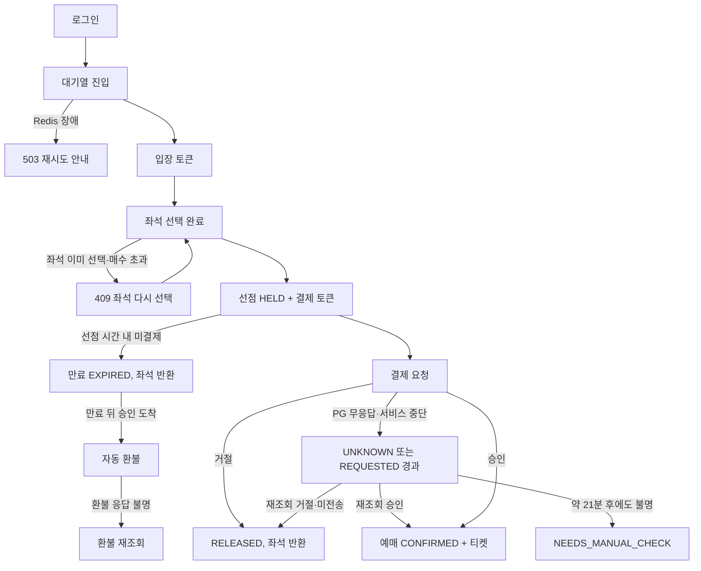
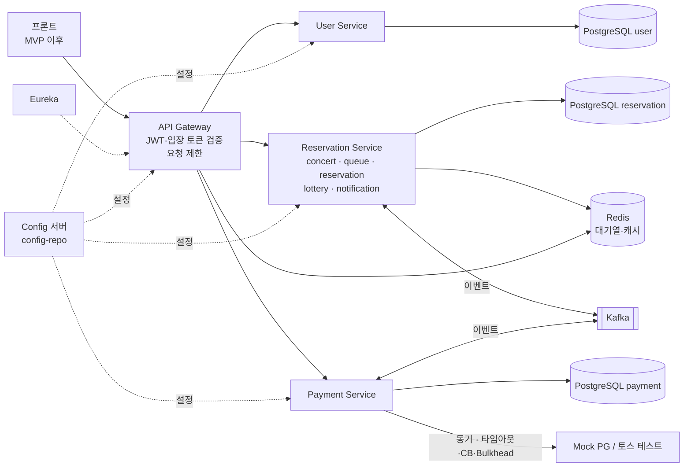
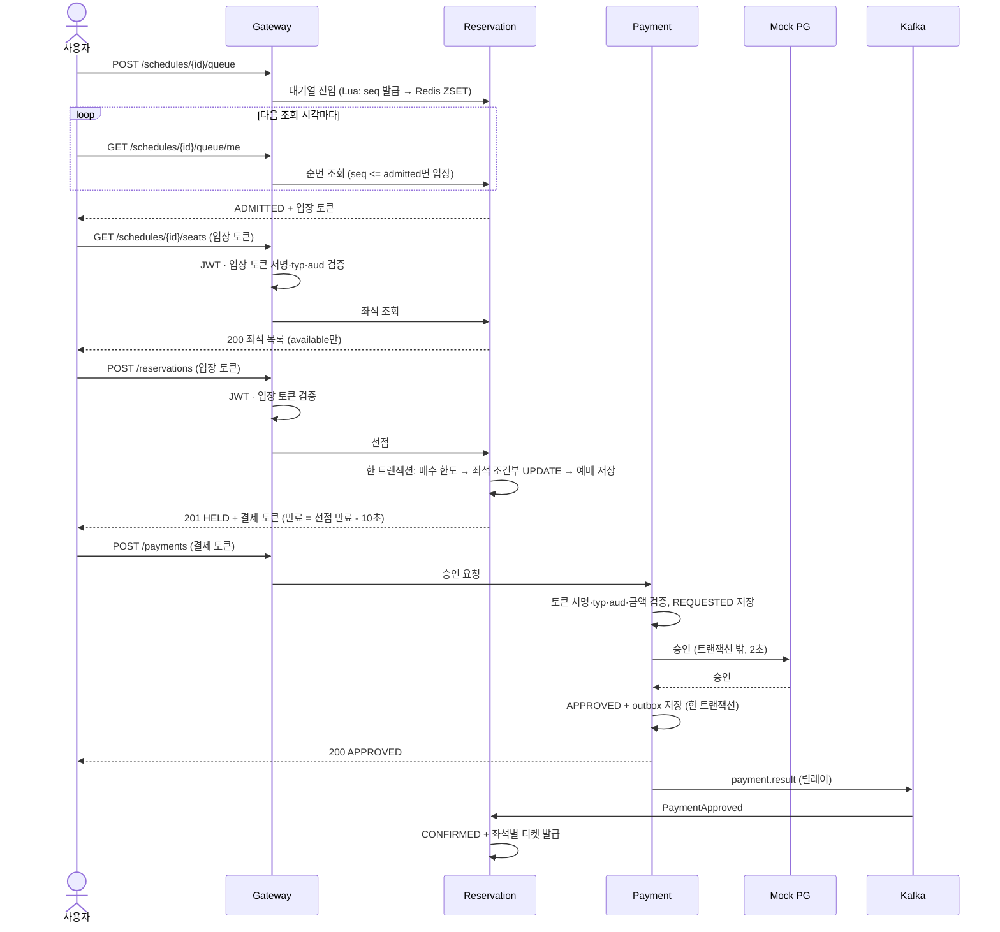
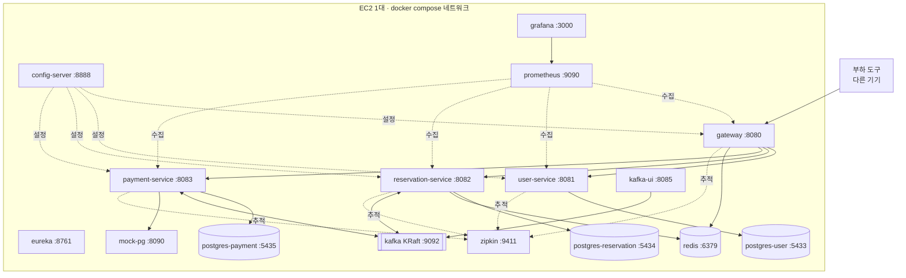
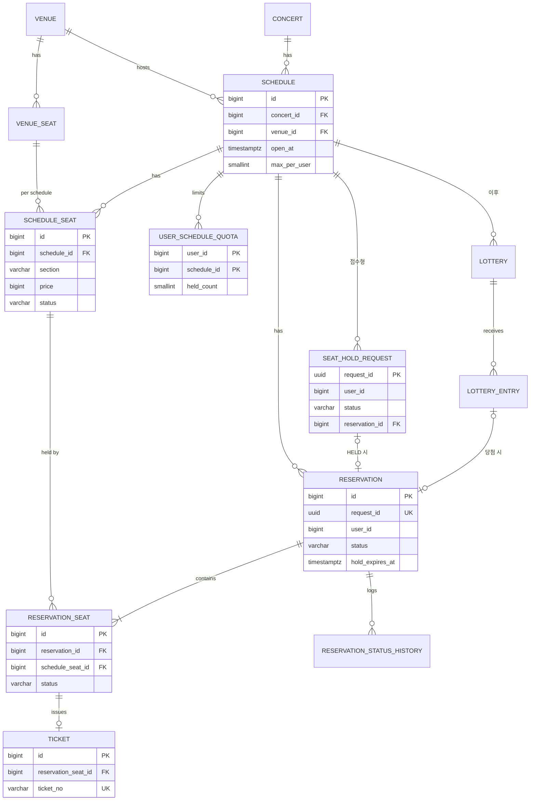
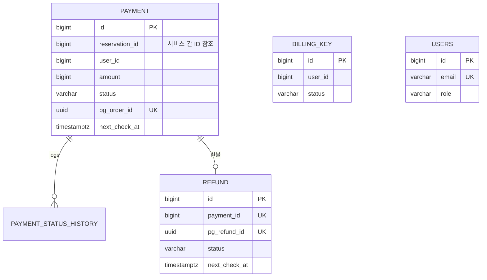

# SA MASTER v3.1 (결정 기록 반영)

> **SA MASTER v3.1 (결정 기록 반영)** · 2026년 10월 26일 · 5조 이선좌
>
> - 이 문서 하나가 설계 기준이다. 아래 문서들은 근거 보관용으로 남긴다.
> - 근거: SA MASTER v3 (통합, 10/26 17:38) · 「SA 기획·설계 결정 기록」 DB (10/26 19:53 기준) · 프로젝트 일정관리 마일스톤 M1~M4 · [261026 1차 피드백 내용 모음](https://app.notion.com/p/261026-1-4057bd823b7580d9b0ebf4d0b721a2a6?pvs=21) · [261026 피드백 반영 개선안](https://app.notion.com/p/261026-4057bd823b7581a78143c148826fe0bc?pvs=21) · [SA v2](https://app.notion.com/p/SA-v2-85d7bd823b75835f8a7b0110360f0b2b?pvs=21) · [SA MASTER](https://app.notion.com/p/SA-MASTER-4027bd823b75808bb67efd7dbd1f7c53?pvs=21)
> - v3에서 "제안"으로 적었던 10/26 피드백 변경은 결정 기록에 모두 반영됐다. 이 문서는 그 결과에 맞춰 제안 표시를 없애고 확정된 내용으로 고쳤다. 바뀐 결정은 결정 기록 각 항목의 "수정 내역"에 이전 안과 함께 남아 있다.
> - 표기: `[가정]` 측정·조사 후 바꿀 숫자 · `(팀 확인)` 담당자가 확인할 칸 · `⚠ 미해결` 아직 정하지 않은 것 · `#번호` 결정 기록 ID
> - 결정 기록 54건: 결정 15 · 잠정 결정 37 · 보류 2. 잠정 결정은 Claude 추천을 기본안으로 채택한 것이고, 팀이 확인하면 결정으로 바꾼다. 내용이 크게 바뀌지 않으면 기존 항목 본문을 고치고 수정 내역을 남긴다.

### 10/26 바뀐 점

| # | 변경 | 위치 | 결정 기록 |
| --- | --- | --- | --- |
| 1 | 대기열 순번을 진입 시각 대신 `seq` 카운터로 발급하고, 입장 판정을 `seq <= admitted`로 정함 | 12-8 | #27 결정 |
| 2 | 응답 형식을 성공·실패 다른 형태로 감싸고 둘 다 `traceId` 포함, 본문 없는 성공도 200 + `data: null`, 실패 사유 필드 `reasonCode` | 11-2 | #19 결정 |
| 3 | 토큰 서명 키 분리, `typ`·`aud` 검증, 결제 토큰을 선점 만료 10초 전에 만료 | 7-3 | #56, #35 잠정 |
| 4 | 접수형 선점에 접수 요청 테이블 + outbox(동기형도 요청 행), 환불 테이블과 재확인 스케줄러 | 12-3, 12-4, 10-5 | #33, #46, #16, #28, #13 잠정 |
| 5 | Redis 타임아웃·서킷 브레이커와 기능별 fail-open/closed, 보안그룹과 SSH 터널, 메모리 예산 | 9장 | #48, #57 잠정 |
| 6 | 측정 목표를 고정 처리량 대신 포화점 비교로, 입장 속도는 측정값에서 역산 | 3장 | #47, #45 잠정 |
| 7 | 서비스 3개 확정(대기열·추첨·알림은 Reservation 안 모듈), 4계층 확정, 역할 분담 확정 | 7-1, 13장, 6장 | #10, #22, #9 결정 |
| 8 | 부분 유니크 인덱스와 레이스 컨디션 해결 방식을 결정 기록으로 남김 | 15장 | #58, #59 잠정 |
| 9 | Java 25 대신 Java 21(Boot 4.1.x·Spring Cloud 2025.1.x 유지, 가상 스레드 기본 끔). Junhyun An 결정, 이유 미기재, 팀 전체 합의로 표기하지 않음 | 9-1 | #30 잠정 |
| 10 | Config 서버를 둠(native 백엔드, 모노레포 `config-repo/`, 포트 8888 내부 전용) | 7-1, 9-1, 9-6 | #30 잠정 |


---

# Part 1. 기획

## 1. 프로젝트 소개

**아이돌 콘서트 티켓 판매 대행 서비스: 오픈 정각에 몰리는 예매를 중복 판매 없이, 결과를 확실하게 처리하고, 빠른 손이 아니어도 기회가 있는 예매 플랫폼**

- **전제**: 우리는 기획사에게 공연을 위탁받아 파는 티켓 판매 대행사다. 기획사가 공연 정보를 넘기면 운영자가 등록하고, 팬에게 공정하고 정확하게 판다. 판매자 역할은 두지 않는다.
- **차별화 (Should)**: 추첨 배분(럭키드로우). 좌석 일부를 추첨용으로 떼고, 응모 때 빌링키를 등록한 당첨자는 자동 배정·자동결제·발권된다.
- **티켓팅을 고른 이유**: 발제 필수 요구사항이 이 도메인에서는 실제로 풀어야 하는 문제다.
    - 트래픽 스파이크: 오픈 시각에 요청 집중 → 대기열, 캐싱, 비동기 처리, 부하 테스트
    - 동시성: 한정 좌석에 동시 요청 → 중복 판매 방지
    - 분산 트랜잭션: 예매와 결제가 서비스 경계를 넘음 → SAGA, 보상 트랜잭션
    - 장애 격리: 외부 PG 지연·장애, 이벤트 유실·중복 → Circuit Breaker, Outbox, 멱등 처리
- **범위 원칙**
    1. 기능은 "티켓팅 서비스라고 부를 수 있는 최소 기능"만 만든다.
    2. 깊이는 기능 개수가 아니라 기능별 고도화(트래픽·동시성·장애 대응)로 만든다.
    3. 우리만의 기능은 추첨 배분 하나이고, 일반 예매가 끝까지 돈 뒤에 얹는다.

### 1-1. 문제 정의

| 칸 | 내용 |
| --- | --- |
| 상황 | 인기 아이돌 콘서트의 일반 예매 오픈 정각 |
| 원인 | 좌석은 한정돼 있는데 수많은 사람이 같은 순간에 같은 좌석을 노린다 |
| 영향받는 사람 | 관람객: 결과를 알 수 없음, 고른 좌석이 이미 팔림(이선좌) 반복, 결제 중 좌석이 풀림 / 대행사: 중복 판매·결제 불일치 시 환불·응대, 기획사 정산 분쟁 |
| 현재 대안 | 여러 기기 접속, 새로고침 연타, 매크로 |
| 그 방식의 한계 | 요청이 더 몰려 서버가 느려지고, 연타가 중복 요청을 만들고, 매크로·회선 속도가 순서를 정한다 |

### 1-2. 문제별 해법

| 문제 | 영향 (관람객 / 대행사) | 우리의 방식 |
| --- | --- | --- |
| 정각 접속 폭주 | 결과를 알 수 없음 / 서버 과부하 | 대기열로 입장 속도를 조절하고 순번·예상 시간을 보여 줌 |
| 같은 좌석 경합 | 이선좌 반복 / 중복 판매·환불 응대 | 선택 완료 때 일괄 선점, 판매 기록은 DB가 기준이라 중복 판매를 DB 제약으로 막음 |
| 결제와 예매 불일치 | 결제 중 좌석이 풀림 / 정산 분쟁 | 결제 결과를 Kafka 이벤트로 전달, Outbox·멱등 처리로 유실·중복 방지, PG 무응답은 UNKNOWN으로 두고 조회로 확정 |
| 빠른 손·매크로 경쟁 | 연타·매크로가 순서를 정함 | 좌석 일부를 추첨으로 배분, 매수 제한, 입장 토큰 |

## 2. 사용자와 시나리오

사용자 역할은 관람객(USER)과 운영자(ADMIN) 두 가지다. 공연 운영과 플랫폼 운영 모두 운영자 하나로 처리한다(결정 기록 #4). P3·P4는 둘 다 ADMIN이고 하는 일만 다르다.

### 2-1. 역할별 시나리오

| 역할 | 주요 시나리오 |
| --- | --- |
| USER (관람객) | 로그인 → 공연·회차 조회(서버 시각) → 대기열 → 입장 → 좌석 조회·선택 → 선점 → 결제 → 확정·티켓 |
| USER (추첨) | 응모 + 빌링키 등록 → 마감·추첨 → 자동 배정·자동결제·발권 → 실패 시 예비자 승계 |
| ADMIN (운영자) | 공연·회차·좌석 등록, 추첨 설정, Grafana·Zipkin·Kafka-UI 모니터링 |

### 2-2. 페르소나

| 페르소나 | 상황 | 바라는 것 | 우리의 대응 | 유저스토리 |
| --- | --- | --- | --- | --- |
| P1 도예린 (29, 직장인 팬) | 평일 오후 8시 `[가정]` 오픈, 퇴근 후 PC로 대기, 친구와 2매 | 되든 안 되든 지금 상태를 정확히 알고 싶다. 결제 화면까지 갔으면 내 자리는 지켜졌으면 | 대기 순번·예상 시간, 선점 5분 `[가정]`, 결과를 확실히 알려 주는 화면 | 친구와 앉을 2석을 잡으려 오픈 시각에 대기한다. 내 순번과 예상 시간이 보이고, 입장하면 한 번에 2석을 잡는다. 이미 팔린 좌석이면 줄을 다시 서지 않고 좌석만 다시 고른다. 결제가 불확실하면 "확인 중"이라고 알려 주고 결과를 반드시 알려 준다 |
| P2 오민재 (22, 대학생 팬) | 오픈 시각에 수업, 모바일 | 공정한 기회만 있으면. 당첨되면 알아서 결제까지 | 추첨 응모 + 자동결제 | 오픈 시각에 접속할 수 없다. 응모 기간에 응모하고 결제 수단을 등록해 두면 당첨 시 자동 결제와 발권을 기대한다. 결제가 실패하면 자리를 잃지 않았는지 알림으로 알 수 있어야 한다 |
| P3 서유진 (34, 공연 운영자) | 공연·회차·좌석 등록, 오픈 시각 설정 | 같은 좌석이 두 번 팔리는 일만은 없었으면 | DB 제약 이중 방어, 판매 기록은 지우지 않고 상태로 남김 | 공연·회차·좌석을 등록하고, 판매 기록이 지워지지 않고 상태로 남아 정산 분쟁 때 근거가 되길 기대한다 |
| P4 한도운 (31, 플랫폼 운영자) | 오픈 시각에 대시보드 앞에서 대기, 결제 실패·처리 못 한 이벤트 확인 | 어디가 먼저 막히는지 숫자로 보이고, 실패한 결제·이벤트를 추적할 수 있었으면 | Grafana, Zipkin, Kafka-UI, DLQ | 대기열 길이, 오류율, 결제 불명 건수를 본다. 처리 못 한 건(DLQ, 수동 확인 대기)이 쌓이면 바로 알아채고 원인을 추적한다 |

### 2-3. 핵심 흐름

```
일반 예매  로그인 → 공연·회차 조회(서버 시각) → 대기열 진입 → 입장 토큰 → 매수 선택 → 좌석 선택
           → [선택 완료] 일괄 선점 (동기형: 바로 결과 + 결제 토큰 / 접수형: 202 접수 → 결과 조회)
           → 결제(동기 승인) → 결제 결과 이벤트 → 예매 확정·발권 (→ 알림은 Could)
              └ 이선좌·매수 초과 → 좌석 다시 선택 (대기열로 돌아가지 않음)
              └ 미결제 만료·결제 거절 → 좌석 반환 / 만료 뒤 승인 → 자동 환불
              └ PG 무응답 → UNKNOWN → 재조회로 확정 (끝내 모르면 수동 확인)
추첨 예매  로그인 → 응모(202 접수) + 빌링키 등록 → 마감·추첨(시드 기록) → 좌석 자동 배정
  (Should) → 자동결제 요청 이벤트 → 결제 → 발권
              └ 결제 실패 → 같은 조건 예비자 승계 → 승계 마감 후 남은 좌석은 일반 예매로
```

### 2-4. 시연 시나리오 (일반 예매)

1. 예린이 로그인하고 공연을 고른다. 오픈 전이라 [예매하기]는 비활성이고, 서버 시각 기준 카운트다운이 보인다.
2. 오픈 시각에 [예매하기] → 대기열 순번과 예상 시간을 확인한다.
3. 입장하면 인원(매수)을 먼저 고르고 좌석을 선택한 뒤 [선택 완료]를 누른다.
4. 선점에 성공하면 결제 화면(남은 시간 표시)으로 이동해 결제한다 → 예매 확정, 좌석별 티켓 번호 발급, 내 예매에서 확정 확인.

MVP 시연은 화면 없이 API 호출(HTTP 요청 파일·Swagger)과 Grafana·Zipkin 화면으로 진행하고, 화면은 MVP 이후에 붙인다(결정).

### 2-5. 예외 시나리오 (시연·테스트 케이스)

| # | 상황 | 기대 결과 |
| --- | --- | --- |
| E1 | 두 사람이 같은 좌석을 동시에 선택 완료 | 1명만 선점, 다른 1명은 "이미 선택된 좌석입니다"(409). 중복 판매 0건 |
| E2 | 선택 완료·결제 버튼 연타 | 예매·결제는 1건만 (Idempotency-Key) |
| E3 | 회차당 매수 초과 | 거절 (409) |
| E4 | 오픈 전에 API 직접 호출 | 거절 (서버 시계 기준) |
| E5 | 입장 토큰 없이 좌석 API 호출 | Gateway에서 차단 |
| E6 | 결제 거절 | 예매 해제 + 좌석 반환 (보상) |
| E7 | 선점 시간 안에 결제하지 않음 | 좌석 자동 반환 |
| E8 | 선점 만료 뒤 결제 승인 도착 | 좌석은 이미 반환됨 → 자동 환불 |
| E9 | PG 응답 없음 (타임아웃) | 결제 상태 UNKNOWN → PG 조회로 확정한 뒤에만 다음 단계 |
| E10 | PG 장애 지속 | Circuit Breaker OPEN → 결제 요청 즉시 거절, 선점·예매 생성은 정상, 미결제 좌석은 만료로 반환, 복구 후 HALF_OPEN → CLOSED |
| E11 | Redis 응답 지연 주입 | 서킷 OPEN, 대기열은 503, 조회·결제는 정상 |
| E12 | Payment가 PG 호출 중 중단 | 10초 넘은 `REQUESTED`가 재조회로 확정 |
| E13 | 같은 결제에 환불 요청 중복 | PG 환불 1회, 환불 행 1건 |
| E14 | 입장 토큰으로 결제 API 호출, 결제 토큰으로 좌석 API 호출 | 모두 403 |
| E15 | 접수형 소비 실패로 DLQ 도달 | 접수 결과 조회가 `REJECTED(PROCESSING_FAILED)` |
| E16 | 처음 접속한 사용자의 첫 선점 | quota 행이 만들어지고 정상 선점 |

### 2-6. 서비스 플로우 차트 (실패 분기 포함)



## 3. 목표와 검증 기준

| 목표 | 검증 기준 | 발제 요구사항 |
| --- | --- | --- |
| 좌석 정합성 | 같은 좌석 동시 요청 중 1건만 성공, 중복 판매 0건 (E1) | 최소 구현 체크리스트 |
| 대용량 트래픽 | 좌석 선점 API를 동시 100명 · 1초 안에 시작 · 각 10회로 측정. 지표: 평균 응답 시간·처리량·성공률(+p95). 목표는 고정 처리량이 아니라 같은 환경에서 동기형 → 접수형 개선 전·후 비교와 포화점(3-1). 측정 환경 기록표 첨부 | 대용량 트래픽 |
| 오류 정의 | 409(이미 선택된 좌석·매수 초과)는 정상 거절로 집계, 5xx·타임아웃만 오류. 접수형(202)은 접수 응답 시간과 접수 → 처리 완료 시간(컨슈머 랙)을 따로 기록 | 대용량 트래픽 |
| 분산 트랜잭션 | 결제 거절·선점 만료 시 좌석·예매·결제 상태 자동 원복, 만료 뒤 승인은 자동 환불, PG 타임아웃은 조회로 확정. 실패를 일부러 주입해 재현 (E6–E9, E12–E13) | SAGA 1개 이상 |
| 메시지 신뢰성 | 커밋 직후 프로듀서 중단 · 처리 중 컨슈머 강제 종료 · 같은 이벤트 재발행을 주입하고, outbox·처리 이력·예매 상태를 대사 쿼리로 맞춰 유실 0건·중복 처리 0건 확인. 브로커 1대라 브로커 자체 유실은 범위 밖 | Kafka 실패·중복·유실 대응 |
| 장애 격리 | PG 장애 중에도 선점·예매 생성 정상, 결제는 CB OPEN으로 즉시 거절, 복구 후 CLOSED (E10). Redis 지연 시 대기열만 503 (E11) | 장애 처리 |
| 관측성 | Grafana: 처리량·평균/p95 응답·오류율·대기열 길이·결제 성공률·컨슈머 랙·이선좌율·CPU·메모리, Redis 지연 p95·서킷 상태·수동 확인 대기 건수·DLQ 건수. Zipkin: 느린 요청의 구간(Gateway → Reservation → DB → Kafka → Payment) | 모니터링 |
| 우리만의 기능 (Should) | 추첨 당첨자는 추가 행동 없이 결제·발권, 결제 실패 시 같은 조건 예비자에게 자동 승계 | — |
| AI 활용 | 설계 검증 로그 3건 이상(거부 1건 이상, 4계층 검증 포함), 인기 회차·좌석 쏠림을 반영한 Synthetic Data로 부하 테스트 | AI 필수 2종 |

**팀 목표**: 팀원 모두가 자기 담당 고도화를 1개 이상 "무엇이 문제였고, 무엇과 비교해, 왜 이 방식을 골랐는지"로 설명할 수 있게 한다.

### 3-1. 측정 방식 (#47)

장비 사양에 따라 결과가 달라진다는 10/26 피드백을 반영했다.

- 대상: 좌석 선점 API. 동기형 기준선 → 병목 확인(Grafana·Zipkin) → 접수형 개선 → 재측정, Synthetic Data 시나리오.
- 목표는 고정 수치(이전 200/sec)가 아니라 같은 환경에서 동기형 → 접수형 비교와 포화점(동시 사용자를 늘려 처리량이 멈추고 p95가 급증하는 지점)이다.
- 결과마다 측정 환경 기록표를 남긴다: 대상 장비(CPU·메모리·OS·EC2 타입) · 부하 도구 장비·네트워크 · Docker 할당 · JVM 힙(`-Xmx`)·컨테이너 메모리 상한 · 커넥션 풀·스레드 수 · 데이터 규모 · 시나리오 · 커밋 해시.
- 준비: 가상 사용자 토큰 사전 발급, 측정마다 좌석 초기화 스크립트, loadtest 프로필(요청 제한 완화, 추적 샘플링 낮춤). 부하 도구는 다른 기기에서 실행하고, 측정 전에 보안그룹에 그 IP를 허용한다(9-2).

### 3-2. 숫자 근거 (계산 틀)

계산 틀을 먼저 맞추고 숫자는 `[가정]`으로 둔 뒤 기준선 측정 후 갱신한다. 실제 공연 수치는 출처를 확인한 것만 적는다(결정 기록 #41).

| 단계 | 계산 | 값 |
| --- | --- | --- |
| 모수 | 공연장 좌석 수 × 회차 수 | `[가정]` |
| 동시 접속 | 판매 좌석 수 × 경쟁률 | `[가정, 출처 확인 후]` |
| 사용자 행동 | 조회 : 선점 : 결제 비율 | `[가정]` |
| 피크 요청 | 동시 접속 × 행동 비율 ÷ 오픈 후 N초 | `[가정]` |
| 로컬 연결 | 피크를 로컬 장비 규모로 줄인 비율 → 100명 × 10회 측정과 연결 | `[가정]` |
| 테이블 크기 | 회차 좌석 행 = 좌석 수 × 회차 수 | 12-9 |

**참고 수치 (10/24 조사, 기사·공식 자료)**

| 항목 | 수치 | 출처 |
| --- | --- | --- |
| 공연장 규모 | KSPO DOME 약 15,000석 / 고척스카이돔 16,601석(공연 시 최대 약 25,000) | 공연장 공식 자료 |
| 오픈 직후 접속 | 임영웅 2023 전국투어: 오픈 1분 안에 약 370만 트래픽, 대기 20만 명 이상 | 레이디경향 |
| 동시 접속 | NCT DREAM 2022 고척 공연: 동시 접속 약 160만 명 | Soompi |

`⚠ 미해결` 참고 수치를 계산 틀에 넣어 피크 요청과 로컬 측정 규모를 잇는 작업 (U2)

### 3-3. 입장 속도 역산 (#45)

- 숫자 기준의 "최대 동시 입장 = N × T"는 리틀의 법칙 `L = λ × W`(시스템 안의 평균 인원 = 도착률 × 체류 시간)에서 W를 토큰 유효 시간 T(상한)로 둔 식이라 L의 상한(50 × 600초 = 30,000명)이다. 이 상한은 KSPO DOME 좌석 약 15,000석의 2배다.
- 입장 속도는 선점 API가 감당할 동시 사용자 수에서 역산한다. 입장자 한 명이 평균 r(요청/초)을 내고 선점 API의 포화 처리량이 μ(요청/초)이면 `L_max = μ / r`, 입장 속도 `λ = L_max / W`(W는 평균 체류 시간)다.
- 계산 예(모든 값 `[가정]`): μ = 200, r = 0.2, W = 150초 → L_max = 1,000, λ ≈ 6.7명/초. 초안의 50명/초는 이 예보다 훨씬 크다.
- 50명/초는 기준선 측정 전 임시값이다. 동기형 기준선에서 포화점 μ와 실제 W를 측정한 뒤 N을 역산하고, T는 W의 몇 배로 정한다.

## 4. 기능 정의

### 4-1. 기능 목록

| 도메인 | 기본 기능 | 고도화 |
| --- | --- | --- |
| **F1 회원·인증** | F1-1 회원가입(이메일·비밀번호·닉네임) · F1-2 로그인·로그아웃(Access + Refresh) · F1-3 역할 기반 접근(USER/ADMIN, 운영자 계정은 초기 데이터) | **H1** Gateway 인증 일원화, 로그아웃 블랙리스트(Redis), 사용자 단위 요청 제한 |
| **F2 공연·좌석** | F2-1 [운영자] 공연·회차·좌석 등록(등급·가격·오픈 시각) · F2-2 공연 목록·상세(serverTime 포함) · F2-3 회차별 좌석 상태 조회 | **H2** 공연 정보·좌석 상태 캐싱 |
| **F3 대기열** | F3-1 진입 · F3-2 내 순번·예상 시간(다음 조회 시각 안내) · F3-3 서명 입장 토큰 발급 · F3-4 Gateway 토큰 검증 | **H3** 전역 카운터로 일정 속도 입장, 계정당 1자리, 회차 단위 격리, 이탈 판정 |
| **F4 예매·발권** | F4-1 매수 선택 → 좌석 선택 → 선택 완료 시 일괄 선점(5분 `[가정]`) · F4-2 선점 만료 → 반환 · F4-3 결제 결과로 확정 + 티켓 발급 · F4-4 내 예매 · F4-5 취소(좌석 반환 + 티켓 무효화 + 환불 요청) | **H4** 동기형 조건부 UPDATE + 부분 유니크 인덱스 → 접수형 Kafka 접수 + 회차·구역 파티션 순차 처리 · **H5** 예매↔결제 SAGA(Choreography)와 보상 |
| **F5 결제** | F5-1 결제 승인(동기, 서명 결제 토큰) · F5-2 결제 결과 조회 · F5-3 환불 · F5-4 빌링키 등록 · F5-5 빌링키 자동결제 | **H6** 결제 멱등키·서버 금액 검증 · **H7** 타임아웃·Circuit Breaker·Bulkhead, UNKNOWN → 조회, 결제·환불 재확인 스케줄러 · **H8** Outbox·처리 이력·재시도·DLQ (공통 모듈) |
| **F6 추첨 배분 (Should)** | F6-1 [운영자] 추첨 설정 · F6-2 응모(202 접수) · F6-3 추첨(시드 기록) · F6-4 자동 배정 → 자동결제 → 발권 · F6-5 예비 승계 · F6-6 미배정 좌석 반환 · F6-7 결과 조회 | **H9** 응모 Kafka 접수, 1인 1응모 유니크 제약, 자동결제 요청을 Kafka로 나눠 처리 |
| **F7 알림 (Could)** | F7-1 알림함 조회 | 결제 결과·추첨 결과 이벤트 구독 → 알림함 저장 (알림 실패가 본 흐름을 막지 않음) |
| **F8 내부 AI 상담 (Could)** | F8-1 공연·예매 문의 답변 (오픈 시각·매수 제한·취소·환불 규정·대기열 안내) | 문서 검색 기반 답변 + 출처 표시, 예매·결제와 분리된 읽기 전용 모듈 |

**공통 고도화**

- **H10** 관측: Prometheus·Grafana + Micrometer Tracing·Zipkin (MVP부터), 로그 수집(Loki)은 고도화
- **H11** 부하 테스트: 동기형 기준선 → 병목 구간 확인(Grafana·Zipkin) → 개선 → 재측정, Synthetic Data 시나리오
- 선점 방식 명칭(#19): 이전 표기 v1/v2를 동기형(sync)/접수형(async)으로 바꿨다. 경로의 `/api/v1`과 혼동되기 때문이다. 설정 키는 `seat-hold.mode` 값 sync 또는 async다.

> Mock PG: 응답 지연·거절·승인 후 응답 유실을 설정할 수 있는 모의 서버다. 실제 PG로는 타임아웃·결제 실패를 원하는 때에 재현할 수 없어서 쓴다.
> 

### 4-2. Kafka를 쓰는 곳과 이유 (결정 기록 #44)

| # | 쓰는 곳 | 이유 |
| --- | --- | --- |
| ① | 결제 결과 → 예매 확정·좌석 반환·환불·알림 | 서비스 경계를 넘고, 한 사건을 여러 곳이 각자 처리하며, 실패하면 다시 읽어야 함 |
| ② | 좌석 선점 접수 (접수형) | 오픈 정각 요청을 DB가 감당할 속도로 줄 세우고, 같은 구역 요청을 한 파티션에서 순서대로 처리해 락 경합을 줄임 |
| ③ | 추첨 응모 접수 | 결과가 바로 필요 없고 마감 직전에 몰림 |
| ④ | 추첨 결과 → 자동결제 요청 | 당첨자 결제를 Payment가 감당할 속도로 나눠 처리하고 실패 건만 재시도 |
| ⑤ | 알림 구독 (Could) | 알림이 실패해도 예매·결제가 막히지 않음 |
| 쓰지 않음 | 결제 승인 요청 · 대기열 순번 · 조회 | 결제는 사용자가 결과를 기다림, 순번 표시·이탈 처리는 Redis가 맞음 |

### 4-3. 추첨 배분 상세 (차별화, Should)

- **무엇**: 회차 좌석 일부를 일반 예매와 분리해 추첨용으로 할당한다. 응모할 때 빌링키를 등록하면 당첨 즉시 좌석이 자동 배정되고 결제·발권까지 끝난다.
- **진행 순서**: 응모 기간 → 응모 마감 → 추첨·자동결제 → 일반 예매 오픈. 추첨과 실시간 선점이 겹치지 않는다.
- **가치**: 광클·매크로 대신 공정한 기회 / 실패 좌석을 예비자에게 바로 넘겨 판매율 유지 / 수요 일부가 응모 기간으로 분산되어 피크 감소
- **규칙 (초안)**: 1인 1회차 1응모, 등급별 1–2매, 연석 미보장, 마감 전 응모 취소 가능, 같은 조건 예비자 순번 승계, 승계 마감 후 남은 좌석은 일반 예매로. 추첨 시드를 기록해 재현 가능하게 한다. 세부(실패 유형별 승계·결제수단 확인·늦은 응모)는 추첨 시작 때 확정한다 (U9).
- 자동결제 방식은 빌링키(잠정)다. 대안이던 가승인은 쓰지 않는다.

### 4-4. 기능 흐름 팀 결정 (10/23, 이후 변경 반영)

| 결정 | 반영 위치 | 상태 |
| --- | --- | --- |
| 최대 인원수를 정해놓고 좌석을 자유롭게 클릭해서 고름 | F4-1 | 유지 (회차당 4매 `[가정]`) |
| 좌석 점유 시점 → 선택 완료 버튼을 눌렀을 때 | F4-1 | 유지 (일괄 선점) |
| 일부 좌석 럭키드로우로 빼서 추첨식으로 배분 | F6 | 유지, Should로 조정 |
| 대기열 시스템 무조건 필요 | F3 | 유지, 별도 서비스가 아니라 Reservation 안 모듈 |
| 보안문자 → 프론트에서 처리 | — | 정정: 보류. 도입 시 외부 서비스 + 서버 검증 |

### 4-5. 제외 범위 (Won't)

- 판매자(기획사) 셀프 등록·정산 → 운영자 등록으로 대체
- 운영자 부가 기능(사용자 관리, 매출 통계, 다운로드), 구매자 부가 기능(정보 수정, 비밀번호 재설정, 검색·필터, 티켓 다운로드)
- 추천 시스템, 가중치 추첨(공정성 설명이 어려워짐)
- 외화 결제(원화만), 실제 본인 인증, 행동 기반 매크로 탐지
- 회의 메모 아이디어: 쿠폰, 공동구매, 로컬 AI
- **보류** (조건이 되면 다시 봄): 보안문자(도입 시 외부 서비스 + 서버 검증), 팬클럽 선예매(등급별 오픈 시각으로 재사용 가능)
- RAG 고객 응대 챗봇(발제 도전 과제)은 F8 내부 AI 상담(Could)으로, 필수 항목을 모두 끝낸 뒤 진행한다.

## 5. 우선순위와 일정

수직 슬라이스 방식으로 진행한다(결정 기록 #6). 기능마다 최소한만 만들어 일반 예매 한 흐름(로그인 → 대기열 → 선점 → 결제 → 확정)을 먼저 끝까지 연결하고, 그다음 취소·추첨·고도화를 하나씩 더한다.

### 5-1. MoSCoW

| 구분 | 항목 |
| --- | --- |
| **Must** | F1 회원·인증(Gateway 인증 필터) · F2 공연·좌석 · F3 대기열 + 입장 토큰 검증 필터 · F4 동기형 선점·만료·확정·발권 · F5-1·2 결제(Mock PG) · H5 SAGA(결제 결과 이벤트 + 보상) · H6 결제 멱등·서버 금액 검증 · H7 타임아웃·CB(UNKNOWN 포함) · 만료 뒤 승인 자동 환불(E8) · H8 Outbox 2경로(결제 결과·환불 요청) + 처리 이력 · H10 Prometheus·Grafana·Zipkin · H11 기준선 측정 + Synthetic Data 1차본 · docker-compose · 배포 1회 |
| **Should** | 최소 화면(프론트) · H4 접수형 Kafka 접수 → 재측정 · F4-5 취소 + 취소 환불 · H8 나머지 토픽 확장·DLQ 재처리 · F6 추첨 배분 + F5-4·5 빌링키 + H9 · H2 캐싱 · H3 대기열 고도화 · 토스페이먼츠 테스트 모드 어댑터 |
| **Could** | F8 내부 AI 상담 · F7 알림함 · 사전 대기실 + 무작위 순번 · 좌석 자동 배정 · 취소표 지연 공개 · 보안문자 · 팬클럽 선예매 · Loki 로그 수집 |
| **Won't** | 4-5 제외 범위 |

10/26 결정으로 Must에 함께 들어간 것: 환불 테이블과 재확인 스케줄러(E8·H7에 필요), Gateway의 Redis 타임아웃·서킷 브레이커(H1), 보안그룹과 관리자 UI 바인딩(배포 1회), 토큰 키 분리(F3·F5).

### 5-2. 일정

프로젝트 일정관리 DB의 마일스톤과 맞춘다. 각 마일스톤의 범위·완료 기준은 일정관리 페이지에 있다.

| 기간 | 마일스톤 | 목표 |
| --- | --- | --- |
| 10/26~10/29 | M1. 공통 모듈 + 인증 기반 | 10/27 계약 합의(인증 헤더·응답·에러·이벤트 형식·패키지 구조) → 공통 모듈을 각자 구현해 비교 후 하나로 합침 → 인증·Gateway·compose. 완료 기준은 걷는 뼈대: compose 한 번으로 Gateway → User → Prometheus·Zipkin |
| 10/30~11/3 | M2. 일반 예매 한 흐름 연결 | 입장 → 선점 → 결제 → `payment.result` → 확정·발권을 API 호출로 연결 + 동기형 기준선 1회 측정 |
| 11/4~11/6 | M3. MVP 완성·배포 | 실패 경로(거절·만료·PG 장애·재확인 스케줄러), Mock PG 장애 주입, Synthetic Data 1차본, EC2 배포 1회, 11/6 MVP 시연 |
| 11/9~11/16 | M4. 고도화 + 트러블슈팅 | 접수형 → 재측정, 대기열 고도화·입장 속도 역산, 취소·캐싱, 추첨 + 빌링키, 장애 주입·대사 정리 |
| 11/16~11/19 | 발표 준비 | 발표 자료 준비(11/16), 제출 마감(11/18), 발표(11/19) |

### 5-3. 10/26 결정 적용 순서

| 시기 | 항목 | 이유 |
| --- | --- | --- |
| M1 (10/27 계약 합의) | 입장 판정(12-8), 토큰 규칙(7-3), 응답 형식(11-2), 접수 요청 테이블(12-3), 환불 모델(12-4) | 서비스 사이 계약(토큰, 선점 결과, 결제 결과 이벤트, 응답)과 테이블 구조에 들어간다. 늦어지면 구현을 다시 한다 |
| M1~M3 | Redis 정책(9-5), 보안그룹(9-2), 메모리 예산(9-3), 환불·재확인 스케줄러, quota 대사, 플로우 차트 | 각 담당 영역 안의 구현이거나 배포 전에 필요 |
| M2 기준선 측정 후 | 입장 속도 역산(3-3) | 측정값이 있어야 역산 가능 |
| M4 이후 | 페르소나 보강, 적재량 재추정, 법률 조사, 비대칭 토큰 서명 | 설계 변경으로 이어질 가능성이 낮거나 발표 소재 |

## 6. 기능 분담

10/25 팀 합의: 서비스·모듈 경계를 따라 기능 단위로 담당을 나누고, 실행 환경·유저는 다 같이 맡는다. 기간은 MVP(~11/6)와 MVP 이후(11/9~)로 나눈다. API 경로·요청·응답은 11장을 따른다.

### 6-1. 한눈에 보기

| 영역 | 담당 | MVP (~11/6) | MVP 이후 (11/9~) |
| --- | --- | --- | --- |
| 실행 환경·유저 | 다 같이 (Linear 이슈를 가져간 사람이 작업, 마감 10/29) | docker-compose, Gateway·Eureka, 로그인·인증, 시드, 공통 규칙, 배포 1회 | — |
| 대기열 | 권영은 | 진입·순번·입장 토큰·일정 속도 입장, 입장 토큰 검증 필터, 부하 테스트 기준선 | 대기열 고도화, 부하 테스트·Synthetic Data 주관 |
| 좌석 선점 | 최권우 | 동기형 일괄 선점·중복 판매 방지·만료·멱등 | 접수형 Kafka 접수 → 재측정 |
| 공연·좌석 조회 → 예매 흐름 | 반효승 | 공연·좌석 등록·조회 → 예매 상태·확정·발권·결제 토큰·보상 | 예매 취소, 캐싱 (알림함 보류) |
| 결제 | 안준현 | 결제 승인·장애 처리, 만료 뒤 승인 환불, 이벤트 신뢰성 공통 모듈, 환불 상태·재확인 스케줄러 | 취소 환불, 토스 테스트 모드 어댑터 |
| Mock PG → 추첨 | 이강민 | Mock PG·장애 주입·결제 조회 연동, 망취소, 환불 조회·멱등 | 추첨 전체 + 빌링키 자동결제 |
| 프론트 | 안준현 | — | 최소 화면 (AI 도구로 생성) |
| 내부 AI 상담 | 안준현 | — | Could, 필수 기능과 측정이 끝난 뒤 |

### 6-2. 공통: 실행 환경·유저 (다 같이)

여유가 되는 사람이 이슈를 가져가서 처리한다. 가져간 사람만 작업하고, 마감은 10/29 걷는 뼈대다.

| 기능 | API · 산출물 | 우선순위 |
| --- | --- | --- |
| docker-compose (PostgreSQL×3·Redis·Kafka·Kafka-UI·Prometheus·Grafana·Zipkin), `.env.example` | 관리자 UI는 `127.0.0.1` 바인딩, 내부 서비스는 `expose`만 (9-2) | Must |
| Config 서버 + `config-repo/`(공통·서비스·프로필별 설정) | 9-6, 서비스는 `spring.config.import`로 연결 | Must |
| Gateway 라우팅 + JWT 검증 → `X-User-Id`·`X-User-Role` 전달, Eureka | Redis 호출 타임아웃·서킷 브레이커 (9-5) | Must |
| 회원가입·로그인·토큰 재발급·로그아웃(블랙리스트) | POST `/api/v1/users` · POST `/api/v1/auth/login` · `/auth/refresh` · `/auth/logout` · GET `/api/v1/users/me` | Must |
| 운영자 계정 초기 데이터 | 시드 스크립트 | Must |
| 공통 규칙: 4계층 패키지 구조, 응답·에러 형식, 이벤트 공통 필드 | 10/27 합의 문서, `common` 모듈의 `response`·`web` 패키지 (11-2) | Must |
| 사용자 단위 요청 제한 | Gateway 필터 | Should |
| 배포 1회 (EC2 + compose) | 보안그룹 규칙표·SSH 터널 매뉴얼 (9-2) | Must (~11/6) |

### 6-3. 대기열: 권영은

| 기간 | 기능 | API · 이벤트 |
| --- | --- | --- |
| MVP | 대기열 진입(계정당 1자리, Lua로 seq 발급), 내 순번·예상 시간·다음 조회 시각 | POST `/api/v1/schedules/{id}/queue` · GET `/api/v1/schedules/{id}/queue/me` |
| MVP | 서명 입장 토큰 발급(7-3), 전역 카운터로 일정 속도 입장(`seq <= admitted`), 회차 단위 격리 | 위 GET 응답에 입장 토큰 포함 |
| MVP | 입장 토큰 검증 필터 (Gateway, 좌석·예매 API 앞) | — |
| MVP | 부하 테스트 기준선: 가상 사용자 토큰 사전 발급, 좌석 초기화 스크립트, 측정 환경 기록표 | 스크립트 |
| 이후 | 이탈 판정, 대기 취소 | DELETE `/api/v1/schedules/{id}/queue/me` |
| 이후 | 부하 테스트 주관: Synthetic Data 시나리오(인기 회차·좌석 쏠림), 접수형 재측정 비교, Grafana 대시보드, 입장 속도 역산(3-3) | 스크립트·대시보드 |

### 6-4. 좌석 선점: 최권우

| 기간 | 기능 | API · 이벤트 |
| --- | --- | --- |
| MVP | 매수 선택 후 좌석 일괄 선점: 매수 한도 행 보장 + 조건부 UPDATE(D1) → 좌석 ID 정렬 조건부 UPDATE(전부 아니면 전부) → 예매 저장 (12-7) | POST `/api/v1/reservations` → 201 HELD + 결제 토큰 · 409 `SEAT_ALREADY_HELD`·`PURCHASE_LIMIT_EXCEEDED` |
| MVP | 부분 유니크 인덱스(판매 중 좌석만, D2), 선점 만료 스케줄러(SKIP LOCKED), 좌석 상태·보유 매수 대사 쿼리 | — |
| MVP | 멱등키 처리 (멱등키 = requestId) | `Idempotency-Key` 헤더 |
| 이후 | 접수형: API가 `seat_hold_request(REQUESTED)`와 outbox를 한 트랜잭션으로 저장 → 소비자가 선점 후 HELD·REJECTED 기록 (회차+구역 키) | POST `/api/v1/reservations` → 202 · GET `/api/v1/reservations/requests/{requestId}` · 토픽 `seat-hold.request` |
| 이후 | 동기형 대비 접수형 재측정 (부하 테스트 담당과 함께), 병목 구간 분석(Zipkin) | — |

### 6-5. 공연·좌석 조회 → 예매 흐름: 반효승

첫 주에 공연·좌석을 먼저 만든다. 좌석 데이터가 있어야 좌석 선점을 테스트할 수 있다. 그다음 예매 흐름으로 넘어간다.

| 기간 | 기능 | API · 이벤트 |
| --- | --- | --- |
| MVP (첫 주) | 공연장·공연장 좌석 배치 시드 데이터 (KSPO DOME 규모) | Flyway 시드 |
| MVP (첫 주) | [운영자] 공연·회차 등록, 회차 좌석 생성(등급별 가격) | POST `/api/v1/admin/concerts` · `/admin/concerts/{id}/schedules` · `/admin/schedules/{id}/seats` |
| MVP (첫 주) | 공연 목록·상세(serverTime, 판매 오픈 판정), 회차 좌석 상태(입장 토큰 필요) | GET `/api/v1/concerts` · `/concerts/{id}` · GET `/api/v1/schedules/{id}/seats` |
| MVP | 예매 상태 머신·이력, 좌석별 티켓 발급, 결제 토큰 발급(7-3 규칙, 만료 = 선점 만료 − 10초) | GET `/api/v1/reservations/{id}` · GET `/api/v1/reservations/me` |
| MVP | 결제 결과 이벤트 소비 → 확정·발권 / 거절 시 좌석 반환 / 만료 뒤 승인은 환불 요청 발행 | 구독 `payment.result` · 발행 `payment.command`(RefundRequested, Outbox) |
| 이후 | 예매 취소: 좌석 반환 + 티켓 무효화 + 환불 요청 | POST `/api/v1/reservations/{id}/cancel` → 202 |
| 이후 | 공연 정보·좌석 상태 캐싱 | — |
| 보류 | 알림함: 결제 결과·추첨 결과 구독 → 저장·조회 (시간이 남으면) | GET `/api/v1/notifications` |

### 6-6. 결제: 안준현

| 기간 | 기능 | API · 이벤트 |
| --- | --- | --- |
| MVP | 결제 승인(동기): 결제 토큰 서명·`typ`·`aud` 검증, 서버 금액 검증, 멱등키, 같은 예매 중복 결제 방지(D3) | POST `/api/v1/payments` → 200 승인·거절 / 202 UNKNOWN(확인 중) |
| MVP | PG 호출: 트랜잭션 밖, 타임아웃·Circuit Breaker·Bulkhead, UNKNOWN → PG 조회로 확정 | GET `/api/v1/payments/{id}` |
| MVP | 결제 결과 이벤트 발행(Outbox) | 발행 `payment.result`(PaymentApproved·Declined·Refunded) |
| MVP | 이벤트 신뢰성 공통 모듈: Outbox 릴레이, 처리 이력(processed_event), 재시도 3회 + DLQ | 각 토픽 `.dlq` |
| MVP | 만료 뒤 승인 환불 (E8), 환불 테이블·상태·멱등(12-4) | 구독 `payment.command`(RefundRequested) → 발행 `payment.result`(PaymentRefunded) |
| MVP | 재확인 스케줄러: REQUESTED 경과·UNKNOWN 결제와 REQUESTED·UNKNOWN 환불을 단계별 간격으로 재조회, 끝내 모르면 `NEEDS_MANUAL_CHECK` (10-5) | — |
| 이후 | 예매 취소 환불 (같은 처리기 재사용) | 구독 `payment.command`(RefundRequested, reason CANCELED) |
| 이후 | 토스페이먼츠 테스트 모드 어댑터 | — |
| 이후 | 빌링키 등록·자동결제 (추첨 담당과 함께) | POST `/api/v1/payments/billing-keys` · 구독 `payment.command`(BillingPaymentRequested) |

### 6-7. Mock PG → 추첨: 이강민

MVP 기간에는 결제 쪽 Mock PG를 맡고, 결제 승인 → 결과 이벤트 → 예매 확정이 끝까지 돌고 Mock 장애 주입으로 거절·타임아웃이 재현되면 추첨으로 넘어간다(대략 11/3~11/6).

| 기간 | 기능 | API · 이벤트 |
| --- | --- | --- |
| MVP | Mock PG 서버: 승인·조회·환불, 멱등 승인, 망취소(같은 주문번호 취소 후 승인 거부), 환불 조회와 환불 멱등 | POST `/mock-pg/payments` · GET `/mock-pg/payments/{orderId}` · POST `/mock-pg/refunds` · GET `/mock-pg/refunds/{refundId}` |
| MVP | 장애 주입 모드: 지연·거절·승인 후 응답 유실 | POST `/mock-pg/faults` (측정·테스트 프로필 전용) |
| MVP | 결제 재확인 스케줄러 (결제 담당과 함께) | — |
| 이후 | [운영자] 추첨 설정 (등급·좌석 수·응모 기간·추첨 시각) | POST `/api/v1/admin/schedules/{id}/lotteries` |
| 이후 | 응모(Kafka 접수, 1인 1응모) + 빌링키 등록 확인 | POST `/api/v1/lotteries/{id}/entries` → 202 · 토픽 `lottery.entry` |
| 이후 | 추첨(시드 기록) → 자동 배정 → 자동결제 요청 → 실패 시 예비자 승계 → 남은 좌석 반환 | 발행 `payment.command`(BillingPaymentRequested) · 구독 `payment.result` |
| 이후 | 응모 결과 조회 | GET `/api/v1/lotteries/{id}/entries/me` |

### 6-8. 프론트 + 내부 AI 상담: 안준현

| 기간 | 기능 | 비고 |
| --- | --- | --- |
| 이후 | 최소 화면 (AI 도구로 생성, 기술 선택은 담당자): 로그인 → 공연 상세(카운트다운) → 대기열 → 좌석 배치도·매수 선택 → 결제 → 결과·내 예매 | 11장 API와 에러 코드가 정해진 뒤 생성. 접수형(202)은 "처리 중 → 결과 조회" 화면 포함 |
| 이후 | 내부 AI 상담 (형식은 담당자가 정함) | 아래 범위 안에서 Could로 진행 |

내부 AI 상담 범위 (MVP 이후, Could) `(팀 확인)`

- 목적: 예매 문의(오픈 시각, 매수 제한, 취소·환불 규정, 대기열 안내)를 사람이 답하지 않아도 되게 하는 판매 대행사 고객 응대
- 방식 예: 공연 정보·FAQ·환불 규정 문서를 검색해 출처와 함께 답하는 RAG(예: pgvector + Spring AI), 또는 내 예매 상태를 함께 보여 주는 상담
- 경계: 예매·결제 흐름과 분리된 모듈로 두고 읽기만 한다. 오픈 순간 트래픽이나 장애가 상담 기능 때문에 커지지 않게 한다
- API 예: POST `/api/v1/assistant/messages` (질문 → 답변 + 출처)

### 6-9. 연동 순서와 공통 규칙

- **10/27 계약 통보**: 형식을 소유한 담당이 정해 공유하고 소비하는 쪽이 리뷰한다. 입장 토큰(대기열 → Gateway·좌석 선점), 선점 결과(좌석 선점 → 예매 흐름), 결제 토큰(예매 흐름 → 결제), 결제 결과 이벤트(결제 → 예매 흐름). 공통 응답·에러 형식은 #19로 결정됨. 진행 방식은 형식을 소유한 서비스 담당자가 정해서 통보하고, 소비하는 쪽이 리뷰한다(10/26 메모).
- **첫 주 순서**: 공연·좌석 데이터 → 좌석 선점 → 예매 흐름 ↔ 결제, 대기열은 병렬
- 각자 담당 영역의 AI 검증 항목을 1개 이상 로그에 남긴다.
- `⚠ 미해결` 안준현 님은 MVP 기간 결제 + 이벤트 공통 모듈(환불·재확인 스케줄러 포함)이라 부담이 크다. 결제가 밀리면 이강민 님이 추첨으로 넘어가는 시점을 늦춰 결제를 돕는다. 공통 이슈는 10/29까지 매일 스크럼에서 확인한다.

---

# Part 2. 설계

설계 초안이다. 10/25 자체 검수에서 찾은 설계 결함 4건(D1–D4)과 10/26 피드백과 그에 따른 결정 기록 수정을 반영했다. 10/27 SA 2차 피드백 전에 담당별로 확인한다. 숫자는 모두 `[가정]`이고 측정 후 바꾼다.

### 10/25 설계 결함 반영 요약

| # | 문제 | 반영 | 위치 |
| --- | --- | --- | --- |
| D1 | 같은 사용자가 선점 요청을 동시에 보내면 둘 다 매수 검사를 통과해 회차당 매수 제한을 넘음 | 사용자·회차별 보유 수 행(`user_schedule_quota`)을 먼저 보장하고 조건부 UPDATE로 막음 | 12-3, 12-7 |
| D2 | `schedule_seat.status`와 `reservation_seat` 부분 유니크가 둘 다 좌석 상태를 들고 있어 기준이 두 곳 | 판매 여부의 기준은 `reservation_seat` 부분 유니크. `schedule_seat.status`는 선점 1차 판정·조회용으로 같은 트랜잭션에서 함께 바꾸고, 어긋나면 `reservation_seat` 기준으로 대사 | 12-3, 12-7 |
| D3 | 멱등키는 같은 요청 재전송만 막아, 다른 키로 같은 예매를 두 번 결제하는 경우를 못 막음 | `payment`에 부분 유니크 `UNIQUE(reservation_id) WHERE status IN ('REQUESTED','UNKNOWN','APPROVED')` | 12-4 |
| D4 | 접수형에서 예매 행 저장과 Kafka 발행이 원자적이지 않아 "처리 중"으로 남는 행이 생길 수 있음 | API가 접수 요청 행(`seat_hold_request`)과 outbox를 한 트랜잭션으로 저장하고 릴레이가 발행. 이전 안은 "행 없이 바로 발행"(부록 C) | 10-1, 12-3 |

## 7. 서비스 구성과 시스템 구조도

### 7-1. 서비스 경계

| 서비스 | 책임 | 소유 데이터 | 나눈 이유 |
| --- | --- | --- | --- |
| **User** | 회원가입·로그인·권한 | user DB | 모든 서비스가 인증을 쓰지만 회원 데이터는 공유하지 않음 |
| **Reservation** | 공연·좌석 조회, 대기열, 선점·예매·발권, 추첨, 알림 | reservation DB, Redis | "한 좌석은 한 번만 팔린다"를 한 트랜잭션 경계 안에서 지킴 |
| **Payment** | 결제·환불·빌링키, PG 연동 | payment DB | 외부 PG 지연·장애 격리 |
- **5개 → 3개로 줄인 근거**: 응모 → 추첨 → 일반 오픈 순서라 추첨과 실시간 선점이 겹치지 않는다. Queue는 자기 데이터가 없고, 멈추면 예매도 멈춰 장애 격리가 성립하지 않는다(AI 검증 #1).
- **모듈별 분리 근거 (측정, #10·#14 결정·잠정)**: queue는 순번 조회 부하가 선점 API p95를 늘리면, notification은 알림 채널이 늘면, lottery는 응모·자동결제 처리 중 일반 예매 선점 p95가 늘면 서비스로 분리한다. 그 전까지는 Reservation 안 모듈로 경계를 지킨다.
- **Reservation 안 모듈 규칙** (결정 기록 #14, 모듈러 모놀리스 방식): reservation·lottery는 직접 호출 허용 / queue는 인터페이스로만 / notification은 Kafka 이벤트로만 / concert 조회는 읽기 직접 허용
- **공통 인프라** (서비스 수에 미포함): API Gateway, Eureka, Config 서버, Kafka, Kafka-UI, Redis, PostgreSQL ×3, Prometheus, Grafana, Zipkin, Mock PG. 모두 docker-compose로 한 번에 기동한다.

### 7-2. 시스템 구조도



| 구간 | 방식 | 이유 |
| --- | --- | --- |
| 클라이언트 → 서비스 | Gateway가 JWT 검증 → `X-User-Id`·`X-User-Role` 전달. 좌석 조회(GET)와 선점(POST)은 입장 토큰도 검증 | 몰리는 순간 인증이 서비스 호출 없이 끝남. 좌석 조회를 열어 두면 대기열을 우회한 조회 트래픽이 생김 |
| 선점 요청 | 동기형 / 접수형(Reservation 안 Kafka 접수) | 측정으로 전환 |
| 결제 승인 | 사용자 → Payment 동기 (서명 결제 토큰) | 사용자가 결과를 바로 봐야 함 |
| Reservation ↔ Payment | Kafka 이벤트 (결제 결과·환불 요청·자동결제 요청) | 서비스 경계, 여러 소비자, 재처리 |
| Payment → PG | 동기, 트랜잭션 밖 | 외부 의존 격리 |
| 서비스 간 데이터 | ID 값만 참조, 서비스 사이 FK 없음 (서비스 DB 안에서는 FK 사용) | DB가 서비스마다 따로 |
| 토큰 서명 | 입장 토큰: Reservation 발급 → Gateway 검증 / 결제 토큰: Reservation 발급 → Payment 검증. HMAC-SHA256, 키는 토큰마다 분리(7-3) | 서비스 사이 호출 없이 검증 |

### 7-3. 토큰 규칙 (#56)

| 항목 | 입장 토큰 | 결제 토큰 |
| --- | --- | --- |
| 발급 | Reservation | Reservation |
| 검증 | Gateway | Payment |
| 서명 키 | `ENTRY_TOKEN_SECRET` | `PAYMENT_TOKEN_SECRET` |
| 필수 claim | `typ=entry`, `aud=gateway`, `sub`(userId), 회차 ID, `exp`, `jti` | `typ=payment`, `aud=payment-service`, `sub`(userId), 예매 ID, 금액, `exp`, `jti` |
| 만료 | 발급 후 10분 `[가정]` | `hold_expires_at - 10초` `[가정]` |
| 검증 규칙 | 서명, `typ`, `aud`, `exp` 모두 통과 + 회차 ID가 요청 회차와 같아야 함 | 서명, `typ`, `aud`, `exp`  • 예매 ID·금액을 서버 값과 대조, `sub`가 `X-User-Id`와 달라도 거절 |
- 키를 분리하면 Gateway는 결제 키를, Payment는 입장 키를 갖지 않아 서로의 토큰을 위조할 수 없다. `typ`·`aud`는 키가 실수로 같아져도 교차 사용을 막는 이중 방어다.
- HMAC은 검증 키로 서명도 할 수 있다. "Gateway·Payment도 토큰을 만들 수 있다"는 피드백은 이 구조의 한계다. 비대칭 서명(발급자 개인키, 검증자 공개키)으로 풀 수 있으나 키 관리 비용이 늘어 MVP 이후로 둔다.
- 결제 토큰의 10초는 Gateway 요청 타임아웃 3초 + 결제 결과의 예매 반영 2초 + 여유 5초다. 토큰 검증을 통과한 정상 승인이 선점 만료 뒤에 도착하는 경우를 줄인다. 사용자의 결제 가능 시간은 5분에서 4분 50초로 준다.
- PG 타임아웃으로 UNKNOWN이 된 결제는 나중에 APPROVED가 될 수 있으므로 만료 뒤 승인(E8)은 사라지지 않는다. 자동 환불은 그대로 필요하다.
- `jti`는 추적·로그용으로만 쓰고 폐기 목록은 만들지 않는다. 입장 토큰은 좌석 조회·선점에 여러 번 쓰여 1회용이 될 수 없고, 유효 시간이 짧다.
- claim 이름(예: 회차 ID를 `sid`로 쓸지)은 형식을 소유한 담당(입장 토큰: 대기열, 결제 토큰: 예매 흐름)이 정해 통보한다(6-9). 이전 안은 입장 `{sub, sid, exp}`, 결제 `{rid, uid, amt, exp=holdExpiresAt}`였다(부록 C).

## 8. 흐름과 상태

### 8-1. 일반 예매 시퀀스 (동기형)



- 선점 응답에 결제 토큰을 같이 준다. 이전에는 HELD 뒤에 `GET /reservations/{id}`를 한 번 더 불러야 했다. 조회 API는 그대로 남는다.
- PG 타임아웃이면 `UNKNOWN`으로 저장하고 202를 돌려준다. 재확인 스케줄러가 PG에 물어 APPROVED·DECLINED로 확정한 뒤에만 이벤트를 발행한다(10-5).
- Payment가 PG 호출 중에 죽어 `REQUESTED`로 남은 결제도 10초가 지나면 같은 재조회 대상이다. `pg_order_id`를 PG 호출 전에 저장하므로 PG에 물어볼 수 있다.
- 결제 결과 이벤트가 도착했을 때 예매가 이미 EXPIRED면 확정하지 않고 `RefundRequested`를 발행한다(E8).
- 좌석 조회는 `available`만 내려 준다. 누가 선점 중인지(HELD·SOLD) 노출하지 않는다.

### 8-2. 상태 머신

```
접수 요청   REQUESTED → HELD · REQUESTED → REJECTED              (seat_hold_request, 동기형·접수형 모두)
예매        HELD → CONFIRMED
            HELD → EXPIRED (미결제 만료) · HELD → RELEASED (결제 거절)
            CONFIRMED → CANCELED (취소)
예매 좌석    HELD → CONFIRMED · HELD → RELEASED · CONFIRMED → RELEASED (취소)
회차 좌석    AVAILABLE → HELD → SOLD · HELD → AVAILABLE · SOLD → AVAILABLE
티켓        ISSUED → VOID
결제        REQUESTED → APPROVED | DECLINED | UNKNOWN
            REQUESTED(10초 경과) · UNKNOWN → 재조회 → APPROVED | DECLINED | NEEDS_MANUAL_CHECK
            APPROVED → REFUNDED (환불 완료 시)
환불        REQUESTED → REFUNDED | FAILED | UNKNOWN                                           (refund)
            UNKNOWN → 재조회 → REFUNDED | FAILED | NEEDS_MANUAL_CHECK
추첨        OPEN → CLOSED → DRAWN → DONE
응모        (REQUESTED: 응답 상태) → ENTERED → WON | WAITLISTED | LOST
            WAITLISTED → WON (승계) · WON → PAID | FAILED
```

### 8-3. 전이 표

| 전이 | 함께 바뀌는 것 (한 트랜잭션) | 누가 |
| --- | --- | --- |
| 예매 → HELD | 매수 한도 +n → 회차 좌석 HELD → 예매·예매 좌석 HELD | 선점 API (동기형) · 선점 소비자 (접수형) |
| 접수 요청 → HELD / REJECTED | 위 선점과 같은 트랜잭션에서 `seat_hold_request` 갱신 + `processed_event` 기록 | 선점 소비자 (접수형) |
| 접수 요청 → REJECTED(PROCESSING_FAILED·TIMEOUT) | `seat_hold_request`만 | DLQ 처리기 / 재확인 스케줄러(30초 경과) |
| 예매 HELD → CONFIRMED | 예매 좌석 CONFIRMED, 회차 좌석 SOLD, 좌석별 티켓 ISSUED | PaymentApproved 소비자 |
| 예매 HELD → EXPIRED / RELEASED | 예매 좌석 RELEASED, 회차 좌석 AVAILABLE, 매수 한도 −n | 만료 스케줄러 / PaymentDeclined 소비자 |
| 예매 CONFIRMED → CANCELED | 예매 좌석 RELEASED, 회차 좌석 AVAILABLE, 티켓 VOID, 매수 한도 −n, RefundRequested(Outbox) | 취소 API |
| EXPIRED에 PaymentApproved 도착 | 예매는 그대로, RefundRequested(Outbox) | PaymentApproved 소비자 (E8) |
| 결제·환불 재조회 | 상태 확정 또는 `next_check_at` 갱신, 확정 시 outbox | 재확인 스케줄러 |

### 8-4. 전이 규칙

- 모든 전이는 `WHERE status = 이전상태` 조건부 UPDATE이고, 예매·결제는 상태 이력 테이블에 남긴다.
- **잠금 순서**: 매수 한도 → 회차 좌석(좌석 ID 오름차순) → 예매. 모든 트랜잭션이 같은 순서로 잠가 교착을 막는다. 만료 스케줄러는 만료 대상 ID만 `SKIP LOCKED`로 뽑고, 처리는 건별 트랜잭션에서 같은 순서로 한다.
- **만료와 결제의 경합** (#35, #13): 결제 토큰이 선점보다 10초 먼저 만료되므로, 토큰 검증을 통과한 결제는 대부분 선점 만료 전에 끝난다. 그래도 결제 중에 만료되면 만료가 먼저이고, 늦게 온 승인은 자동 환불한다. AI 피드백의 "결제 진행 중(PAYING) 예매는 만료에서 제외" 안 대신 이 규칙을 쓴다. 상태가 하나 줄고 Choreography와 맞는다 (U3).

## 9. 인프라

### 9-1. 인프라 구조도



| 구성 요소 | 로컬 (개발) | 로컬 (측정) | 배포 (EC2 1대) |
| --- | --- | --- | --- |
| config-server | compose (IntelliJ 앱이 `localhost:8888`로 접속) | compose | compose |
| gateway · eureka · user · reservation · payment · mock-pg | IntelliJ 실행 | compose | compose |
| PostgreSQL × 3 (user · reservation · payment) | compose | compose | compose |
| Redis · Kafka (KRaft, 브로커 1) · Kafka-UI | compose | compose | compose |
| Prometheus · Grafana · Zipkin | compose | compose (추적 샘플링 낮춤) | compose |
| 부하 도구 | — | 다른 기기에서 실행 | — |
- 기술 스택 (#30 잠정, Config 서버 유지는 10/27 통합 회의에서 확정): Java 21 LTS(Temurin) · Spring Boot 4.1.x · Spring Cloud 2025.1.x · Gradle 9.x(툴체인 21), 라이브러리 버전은 BOM을 따른다. 컨테이너 기본 이미지는 `eclipse-temurin:21-jre`. 저장소는 모노레포(Gradle 멀티모듈, Groovy DSL)이고 설정은 Config 서버(9-6)로 관리한다. 구현 버전은 Spring Boot 4.1.2 · Spring Cloud 2025.1.4 · Gradle 9.8.2 · PostgreSQL 17이다. Lombok은 쓸 수 있다.
- 변경 이력: 2026-10-26 Junhyun An이 Java 25 대신 Java 21을 사용하기로 결정했다. 선택 이유는 미기재다. 팀 전체 합의로 표기하지 않는다.
- Java 21에서는 가상 스레드가 `synchronized` 안에서 캐리어 스레드에 고정되므로(JDK 24에서 해결) 가상 스레드는 기본으로 끈다. 고도화에서 켜 볼 때는 고정 지점을 먼저 확인한다. Java 22 이후 기능은 쓰지 않는다.
- 프로필: local · test · loadtest(Mock PG, 요청 제한 완화, 샘플링 낮춤) · prod. 프로필별 값은 `config-repo/{서비스}-{프로필}.yml`에 둔다(9-6).
- 비밀값(DB 비밀번호, JWT 서명 키, `ENTRY_TOKEN_SECRET`·`PAYMENT_TOKEN_SECRET`)은 `.env`, 저장소에는 `.env.example`만 둔다. `config-repo`에는 `${DB_PASSWORD}` 같은 자리표시자만 쓴다.
- 포트 번호는 `(팀 확인)` (U12).

### 9-2. 외부 노출과 접근 (#57)

| 포트 | 대상 | 인바운드 허용 | 비고 |
| --- | --- | --- | --- |
| 22 | SSH | 팀원 IP만 | 키 인증만 허용 |
| 8080 | gateway | 전체(0.0.0.0/0). 부하 측정 중에는 측정 기기 IP로 제한 | 유일한 서비스 진입점 |
| 3000 | grafana | 허용 없음 | SSH 터널로만 접근 |
| 8085, 9090, 9411, 8761 | kafka-ui, prometheus, zipkin, eureka | 허용 없음 | 같음 |
| 8081~8083, 8090, 8888, 5433~5435, 6379, 9092 | 서비스, mock-pg, config-server, DB, Redis, Kafka | 허용 없음 | compose 내부 네트워크 전용 |
- 이중 방어: compose에서 관리자 UI는 `127.0.0.1:3000:3000`처럼 로컬에만 바인딩하고, 내부 전용 서비스는 `ports`를 열지 않고 `expose`만 쓴다. 보안그룹 설정이 틀려도 호스트 밖으로 열리지 않는다.
- 접근 매뉴얼(초안): `ssh -L 3000:localhost:3000 -L 8085:localhost:8085 -L 9411:localhost:9411 <user>@<ec2>` 후 브라우저에서 `localhost:3000`을 연다. 시연도 발표자 노트북에서 터널을 열고 보여 주면 포트를 공개할 필요가 없다.
- 요청 차단 계층: 보안그룹(포트·IP) → Gateway(JWT, 입장 토큰, 요청 제한, 오픈 전 시각 검사) → 서비스(권한, 도메인 규칙) → DB(제약).
- 이전 안은 "외부 공개는 gateway(8080)와 grafana(3000)"였다(부록 C). 보안그룹 규칙표 작성은 배포 이슈 담당이 맡는다.

### 9-3. 메모리 예산 (#57)

Java는 서비스마다 힙을 따로 잡으므로 서비스별 상한을 정하고 EC2 메모리 안에 들어가는지 계산한다. 아래는 시작값 `[가정]`이며 `docker stats`로 부하 중 사용량을 측정해 바꾼다.

| 구성 | 힙 상한(`-Xmx`) | 컨테이너 상한 |
| --- | --- | --- |
| gateway | 512m | 768m |
| eureka | 256m | 512m |
| config-server | 256m | 512m |
| user-service | 384m | 640m |
| reservation-service | 768m | 1,152m |
| payment-service | 512m | 768m |
| mock-pg | 256m | 512m |
| postgres × 3 (reservation 1,024m, 나머지 512m씩) | - | 2,048m |
| redis (`maxmemory` 약 400m) | - | 512m |
| kafka (KRaft, 힙 1g) | 1,024m | 1,536m |
| kafka-ui | - | 512m |
| prometheus | - | 768m |
| grafana | - | 384m |
| zipkin | - | 768m |
| 합계 |  | 11,392m (약 11.1GB) |
- 합계를 EC2 메모리의 75% 이하로 두면 필요 메모리는 약 14.8GB이고, 16GB급 인스턴스가 최소다. 8GB급을 써야 하면 zipkin·kafka-ui·prometheus를 빼거나 상한을 줄이는 대안을 따로 정한다 (U10).
- 컨테이너 상한이 힙보다 큰 이유는 메타스페이스, 스레드 스택, 네이티브 메모리 때문이다. 간격(약 256~384m)이 충분한지는 측정으로 확인한다.
- 측정 PC에서 로컬로 돌릴 때도 같은 표를 쓰고 PC 메모리와 비교한다.
- **단일 EC2 한계**: 배포는 EC2 1대의 docker compose다. 서비스 단위 장애 격리는 컨테이너 수준이며 인스턴스 장애 시 전체가 중단된다. 운영 환경이라면 서비스별 다중 인스턴스와 매니지드 DB·Redis·Kafka로 분리한다. 프로젝트 범위에서는 컨테이너 분리까지만 한다(10/26 피드백 답변).

### 9-4. 숫자 기준 `[가정]`

기다림의 상한을 먼저 정하고, 측정값이 크게 다르면 표를 갱신하고 이유를 남긴다(결정 기록 #45). 컴퓨터 성능 기반으로 측정한 뒤 수정한다.

| 항목 | 초기값 | 근거 |
| --- | --- | --- |
| 요청 전체 타임아웃 (Gateway) | 3초 | 사용자가 기다릴 상한 |
| PG 호출 타임아웃 | 연결 0.5초 · 응답 2초 | 전체 3초 중 나머지 1초는 DB·이벤트 저장 |
| 선점 DB `lock_timeout` | 500ms | 오래 기다리기보다 바로 "이미 선택된 좌석" 안내 |
| 선점 유지 | 5분 | 결정 기록 #35 |
| 결제 토큰 유효 | 선점 만료 − 10초 | 7-3 |
| 회차당 매수 | 4매 | 결정 기록 #35 |
| 입장 토큰 유효 시간 T | 10분 | 좌석 고르기 + 결제 5분 |
| 초당 입장 수 N | 50명 (임시값) | 기준선 측정 후 3-3 식으로 역산 |
| 대기열 폴링 간격 | 기본 3초, 순번이 멀수록 길게 (최대 10초) | 폴링 부하 상한 |
| Access / Refresh 토큰 | 30분 / 14일 | 짧은 Access + Refresh |
| 결제 → 예매 확정 반영 | 2초 이내 (Outbox 폴링 500ms) | 결과 화면 지연 상한 |
| 접수형 접수 → 처리 완료 | 2초 이내 (outbox 폴링 500ms + 컨슈머 랙) | 202 처리량과 실제 처리량을 함께 봄 |
| 접수 요청 최종 시한 | 30초 넘으면 `REJECTED(TIMEOUT)` | 고아 접수 방지 |
| 결제 REQUESTED 경과 | 10초 넘으면 재조회 대상 | PG 응답 타임아웃 2초 + 여유 |
| 재조회 간격 (결제 UNKNOWN·환불) | 10초 × 6회 → 1분 → 5분 → 15분 → `NEEDS_MANUAL_CHECK` (총 약 21분) | 이전: 10초 간격 6회 후 운영 확인 |
| Kafka 소비 재시도 | 3회, 1·2·4초 지수 백오프 → DLQ | 결정 기록 #46 |
| Redis 호출 타임아웃 | 100ms | 9-5 |
| Redis 서킷 브레이커 | 최근 20회 중 50% 실패 또는 50ms 초과 시 OPEN, 10초 뒤 HALF_OPEN 5회 시험 | 9-5 |
| 멱등키 보관 | 24시간 | 재시도 창보다 충분히 길게 |
| 커넥션 풀 | 서비스당 20 | 측정 후 조정 |
| 캐시 TTL (H2 도입 시) | 공연 정보 5분 · 좌석 상태 1초 | 결정 기록 #45 |

### 9-5. Redis 장애·느려짐 정책 (#48)

Redis는 죽는 것보다 느려지는 것이 더 위험하다. 느려진 Redis에 Gateway가 물리면 전체가 느려진다(10/26 피드백). Redis는 기준 저장소가 아니다. 캐시는 DB로 복구하고, 대기열은 다시 줄을 서는 것으로 끝난다.

- Gateway(블랙리스트·요청 제한)와 Reservation(대기열·캐시)의 모든 Redis 호출에 타임아웃 100ms를 둔다. 정상 Redis 응답은 1ms 안팎이라 100ms는 이상 징후다.
- Redis 호출을 Resilience4j 서킷 브레이커로 감싼다(9-4 기준). OPEN 동안은 Redis에 가지 않고 아래 정책을 즉시 적용한다.

| 기능 | OPEN 시 정책 | 응답 | 이유와 감수하는 위험 |
| --- | --- | --- | --- |
| 대기열 진입·입장 판정 | closed | 503 + `Retry-After` | 속도 통제 없이 입장시키면 선점 API가 폭주를 받는다 |
| 좌석 조회·선점의 입장 토큰 검증 | 서명 검증은 Redis 없이 통과 | 정상 | 입장 토큰은 서명과 `exp`로 자체 검증된다 |
| 로그아웃 블랙리스트 확인 | closed | 503 + `Retry-After` | 2026-10-27 통합 회의에서 closed로 정했다([ADR 0005](../decisions/0005-auth-redis-fail-closed.md)). 로그아웃된 토큰이 통하는 것보다 Redis 장애 동안 로그인 사용자 요청을 막는 쪽을 택했다. 이 때문에 생기는 문제는 따로 고친다. 이전 안은 open이었다(결제는 별도 결제 토큰이 있어 피해가 제한된다) (#48) |
| 사용자 요청 제한 | 인스턴스 로컬 카운터로 낮춰 open | 정상 | 정확도는 떨어지지만 뒷단 보호는 유지 |
| 공연 정보·좌석 캐시 | open, DB 조회로 대체 | 정상 | DB 보호를 위해 대체 조회는 초당 상한을 둔다 |
- 검증: E11. 지연 주입 도구는 정하지 않았다. Toxiproxy 같은 프록시나 Redis `DEBUG SLEEP`이 후보다 (U17).
- 지표: Redis 명령 지연 p95, 서킷 상태, OPEN 횟수를 Grafana에 둔다.
- 이전 안은 "Redis 장애 시 입장 중단"만 있었고 U7로 미해결이었다(부록 C).

### 9-6. Config 서버 (#30)

설정을 서비스마다 흩어 두지 않고 Config 서버 한 곳에서 프로필별로 관리한다. 측정하며 자주 바꾸는 숫자 기준(9-4)과 loadtest 프로필 전환을 한 곳에서 처리하려는 목적이다.

| 항목 | 정한 내용 | 이유 |
| --- | --- | --- |
| 백엔드 | native(파일). 모노레포 `config-repo/`를 config-server 컨테이너에 마운트, `search-locations=file:/config-repo` | 별도 Git 저장소·인증 없이 설정 변경도 PR 리뷰와 git 이력을 그대로 탐 |
| 파일 구성 | `application.yml`(공통: Kafka·Zipkin·Actuator·숫자 기준) · `{서비스}.yml` · `{서비스}-{프로필}.yml` | 공통 값은 한 번만, 서비스·프로필 차이만 따로 |
| 클라이언트 연결 | `spring.config.import=configserver:http://config-server:8888`, `fail-fast` + 재시도 | 고정 주소로 연결(Eureka 경유 discovery-first는 기동 순서를 더 복잡하게 함) |
| 로컬 개발 | config-server는 compose로 띄우고 IntelliJ 앱은 `localhost:8888`로 접속. test 프로필은 `spring.cloud.config.enabled=false` | 개발·측정·배포가 같은 설정을 읽음. 단위 테스트는 Config 서버 없이 |
| 비밀값 | `config-repo`에 넣지 않고 자리표시자만. 실제 값은 `.env`로 각 컨테이너에 주입 | 저장소에 비밀값이 남지 않음 |
| 갱신 | 기본은 서비스 재시작. 측정 중 자주 바꾸는 값만 `@RefreshScope` + `/actuator/refresh` | Spring Cloud Bus는 서비스 3개 규모에 과함 |
| 기동 순서 | config-server → eureka → 서비스 (compose healthcheck + `depends_on: condition: service_healthy`) | 설정을 못 읽은 채 서비스가 뜨는 것을 막음 |
| 노출·자원 | 포트 8888 내부 전용(`expose`), 힙 256m · 컨테이너 512m `[가정]` | 9-2, 9-3 |

- 대가: 컨테이너가 하나 늘고 서비스 기동이 Config 서버에 묶인다. 기동 실패나 설정 추적 문제가 반복되면 .env + 프로필로 되돌린다.
- 이전 안: Config 서버 없이 `.env` + 프로필(10/24 #30 잠정, 1차 AI 피드백의 "Config 서버는 발제상 선택이라 과잉" 지적 반영). 10/26 GGangMY 판단으로 두기로 바꿨다. 근거는 흩어진 설정 파일을 한 곳으로 통합하자는 의견이다.

## 10. 이벤트 명세

### 10-1. 토픽

| 토픽 | 이벤트 | 키 | 발행 → 구독 (컨슈머 그룹) | 발행 방식 | 단계 |
| --- | --- | --- | --- | --- | --- |
| `payment.result` | PaymentApproved · PaymentDeclined · PaymentRefunded | reservationId | Payment → `reservation.payment-result` | Outbox | MVP |
| `payment.command` | RefundRequested · BillingPaymentRequested | reservationId | Reservation → `payment.command` | Outbox | RefundRequested는 MVP (E8), 자동결제는 이후 |
| `seat-hold.request` | SeatHoldRequested | `{scheduleId}:{section}` | Reservation API → `reservation.seat-hold` | Outbox (`seat_hold_request`와 한 트랜잭션) | 접수형 |
| `lottery.entry` | LotteryEntryRequested | userId | Reservation API → `reservation.lottery-entry` | 직접 발행 (acks=all, 실패 시 503) | 이후 |
| `{토픽}.dlq` | 처리 실패 이벤트 | 원본 키 | 재시도 3회 후 | — | MVP |
- Outbox는 업무 변경과 이벤트가 함께 저장돼야 하는 곳에 쓴다: 결제 결과(①), 환불 요청·자동결제 요청(④), 접수형 선점(②).
- 접수형 선점을 Outbox로 바꾸면 접수 → 처리 완료 시간에 outbox 폴링(500ms)이 더해진다. 이전 안이 직접 발행을 고른 이유가 이 지연을 측정에 섞지 않기 위해서였다(AI 검증 #8). 재측정에서 동기형, 직접 발행, outbox 세 경우를 같은 환경에서 비교한다.
- 응모(`lottery.entry`)는 아직 직접 발행이다. 접수형 선점과 같은 "실패 상태를 저장할 곳이 없다" 문제가 있으므로 추첨 시작 때 같은 방식으로 바꿀지 정한다 (U19).
- 자동결제도 추첨 모듈이 당첨자 예매(HELD)를 먼저 만들고 그 reservationId로 요청한다. 결제는 일반 예매와 같은 키·같은 중복 결제 방지(D3)를 쓴다.

### 10-2. 공통 봉투

```json
{
  "eventId": "7f3c2a9e-1b4d-4c8e-9a51-3e0f6b2d9c11",
  "eventType": "PaymentApproved",
  "version": 1,
  "occurredAt": "2026-11-02T11:00:01.123Z",
  "producer": "payment-service",
  "traceId": "4bf92f3577b34da6a3ce929d0e0e4736",
  "payload": { }
}
```

### 10-3. 페이로드

| 이벤트 | 필드 |
| --- | --- |
| PaymentApproved | paymentId, reservationId, userId, amount, approvedAt |
| PaymentDeclined | paymentId, reservationId, userId, reasonCode |
| PaymentRefunded | paymentId, reservationId, userId, amount, refundedAt |
| RefundRequested | reservationId, paymentId, reason (`EXPIRED_AFTER_APPROVAL` · `CANCELED`) |
| BillingPaymentRequested | reservationId, userId, amount, lotteryEntryId |
| SeatHoldRequested | requestId, userId, scheduleId, section, seatIds, requestedAt |
| LotteryEntryRequested | requestId, lotteryId, userId, quantity |

### 10-4. 소비 규칙

- 컨슈머 그룹 이름은 `{구독 서비스}.{용도}`다.
- 소비자는 `processed_event(event_id, consumer_group)` 기록과 업무 변경을 한 트랜잭션으로 처리한다. 이미 기록된 eventId는 건너뛴다.
- 순서는 같은 키 안에서만 보장된다. 상태 전이는 조건부 UPDATE라, 순서가 뒤바뀐 이벤트는 0행 갱신 → 기록만 하고 건너뛴다.
- 형식 변경은 필드 추가만 허용하고, 의미가 바뀌면 `version`을 올린다.

### 10-5. 재확인 경로 (#46, #28)

10/26 피드백 "몇 초 안에 재확인할 것은 Kafka로, 몇 분 이상 걸릴 것은 스케줄러로"를 이렇게 반영한다.

- 몇 초 단위의 일시 실패는 Kafka 소비 재시도(1·2·4초)가 맡는다.
- 그래도 확정되지 않으면 DB 행의 상태가 남아 있으므로 재확인 스케줄러가 이어받는다. 상태의 기준은 항상 DB 행이라 둘 중 하나가 빠져도 건이 사라지지 않는다.
- 재확인 스케줄러 하나가 `next_check_at <= now()`인 결제 `REQUESTED`(10초 경과분)·`UNKNOWN`과 환불 `REQUESTED`·`UNKNOWN`을 `SKIP LOCKED`로 집어 처리한다. 간격은 9-4.
- PG 재조회 결과: 승인이면 `APPROVED`, 거절이면 `DECLINED`, 주문 자체를 모르면(`NOT_FOUND`) 같은 주문번호로 망취소를 보내 PG가 늦게 승인하는 경우를 막은 뒤 `DECLINED`(reasonCode `NOT_SENT`)로 닫는다(docs/sa-review/02).
- `NEEDS_MANUAL_CHECK`는 종결 상태다. Grafana에 건수 지표와 알림 기준을 두고, 운영자가 PG 콘솔에서 확인해 수동으로 닫는다.
- 접수형 선점 소비가 재시도 3회 뒤 DLQ로 가면 DLQ 처리기가 `seat_hold_request`를 `REJECTED(PROCESSING_FAILED)`로 바꿔 조회할 수 있게 한다(E15). REQUESTED가 30초 `[가정]` 넘게 남으면 재확인 스케줄러가 `REJECTED(TIMEOUT)`으로 닫고, 그 뒤 늦게 도착한 메시지는 조건부 갱신 0행이라 좌석을 잡지 않고 건너뛴다.
- 환불이 `FAILED`(PG가 명확히 거절)면 재시도해도 같은 결과라 바로 `NEEDS_MANUAL_CHECK`로 보내고 운영자에게 알린다(#16).

## 11. API 명세

### 11-1. 공통 규칙

결정 기록 #19 API 공통 규칙, #17 멱등키

| 항목 | 규칙 |
| --- | --- |
| 경로 | `/api/v1`, 운영자 API는 `/api/v1/admin/**` (ADMIN만) |
| 시간·금액 | 저장은 UTC, 응답은 ISO 8601 `+09:00` / 금액은 원 단위 숫자(Java `BigDecimal`, 소수 자리 0) |
| 인증 헤더 | `Authorization: Bearer {accessToken}`. Gateway가 검증 후 `X-User-Id`·`X-User-Role`을 붙이고, 클라이언트가 보낸 같은 이름의 헤더는 지운다 |
| 입장 토큰 | `X-Entry-Token`: 좌석 조회·선점 API에 필수 |
| 멱등키 | `Idempotency-Key` (UUID): 선점·결제·응모·취소에 필수. 같은 키 + 같은 본문 → 저장된 응답 그대로, 같은 키 + 다른 본문 → 409 |
| 응답 형식 | 성공·실패 다른 형태, 둘 다 `traceId` 포함 (11-2, #19 결정). 이전 안은 성공은 본문 그대로, 실패는 ProblemDetail(부록 C) |
| 페이지 | `?page=0&size=20` → `data`에 `{content, page, size, totalElements}` |
| 결제 거절 | 에러가 아니라 200 + `data.status: DECLINED`. 요청은 정상 처리됐고 결과가 거절이기 때문이다 |

### 11-2. 응답 형식 (#19 결정)

성공 응답과 실패 응답을 다른 형태로 감싸고, 둘 다 추적 ID(`traceId`)를 포함한다.

| 구분 | 형태 | 규칙 |
| --- | --- | --- |
| 성공 | `{ status, message, data, traceId }` | `status` = HTTP 상태 코드(200·201·202). 업무 상태는 `data.status`. 본문 없는 성공(로그아웃, 대기 취소)도 200 + `data: null` |
| 실패 | `{ status, code, message, errors, traceId }` | `status` = HTTP 상태 코드(4xx·5xx). `code` = 도메인 에러 코드(11-3). `errors`는 검증 실패일 때만 `[{field, reason}]` |

```json
// 성공
{ "status": 201, "message": "선점되었습니다",
  "data": { "reservationId": 501, "status": "HELD", "holdExpiresAt": "2026-11-02T20:05:03+09:00", "paymentToken": "eyJ..." },
  "traceId": "4bf92f3577b34da6a3ce929d0e0e4736" }

// 실패 (업무 에러)
{ "status": 409, "code": "SEAT_ALREADY_HELD", "message": "이미 선택된 좌석입니다",
  "traceId": "4bf92f3577b34da6a3ce929d0e0e4736" }

// 실패 (검증 에러)
{ "status": 400, "code": "VALIDATION_FAILED", "message": "요청 값이 올바르지 않습니다",
  "errors": [ { "field": "seatIds", "reason": "1~4개여야 합니다" } ],
  "traceId": "4bf92f3577b34da6a3ce929d0e0e4736" }
```

- 고른 이유: 상태와 예외가 많아 개발 중 실수가 나올 수밖에 없는데, 성공과 실패의 형태가 다르면 잘못 감싼 응답을 받는 쪽에서 바로 알아챌 수 있다. 추적 ID는 성공·실패 모두에 있어야 문의나 장애를 어느 응답에서든 Zipkin·로그로 따라갈 수 있다.
- HTTP 상태 코드는 정확히 유지한다. 409는 정상 거절, 5xx·타임아웃만 오류로 집계한다(3장 오류 정의).
- 결제 거절은 실패 응답이 아니라 성공 응답 + `data.status: DECLINED`, `data.reasonCode`다.
- 202는 `Location` 헤더 + `data.nextPollAfterSeconds`를 준다.
- 실패 사유 필드는 `reasonCode`로 통일한다(이전 `rejectCode`·`declineCode`).
- 한 응답으로 다음 화면을 정할 수 있게 한다. 선점 HELD 응답에 결제 토큰을 넣고, 접수 결과 조회는 HELD면 예매 블록을 함께 준다(11-5).
- Gateway가 응답하는 401·403·429도 실패 형태로 만든다(WebFlux 전용 처리기). Spring 기본 `/error`(404·405), 깨진 JSON, 처리 안 된 예외까지 실패 형태로 나오는지 형식 검사 테스트로 확인한다.
- 공통 모듈: `common` 하나의 `response` 패키지(응답 DTO·ErrorCode 인터페이스, Gateway도 사용)와 `web` 패키지(MVC 예외 처리기, Gateway 제외). 업무 에러 코드는 각 서비스 enum.
- 감싸지 않는 것: Actuator·Prometheus, Mock PG 내부 API, Kafka 이벤트(공통 봉투의 `traceId`를 씀).
- 아래 11-5 예시는 성공 응답의 `data` 안의 내용만 적는다.

### 11-3. 에러 코드

| 코드 | HTTP | 언제 |
| --- | --- | --- |
| `VALIDATION_FAILED` | 400 | 요청 형식·값 오류 |
| `UNAUTHORIZED` · `TOKEN_EXPIRED` · `TOKEN_REVOKED` | 401 | 토큰 없음·만료·로그아웃된 토큰 |
| `FORBIDDEN` | 403 | 권한 없음 (USER가 운영자 API 호출 등) |
| `ENTRY_TOKEN_INVALID` | 403 | 입장 토큰 없음·위조·만료·다른 회차, `typ`·`aud`가 맞지 않는 토큰 (E5, E14) |
| `NOT_FOUND` | 404 | 대상 없음 |
| `IDEMPOTENCY_KEY_REUSED` | 409 | 같은 멱등키에 다른 본문 |
| `RATE_LIMITED` | 429 | 사용자 단위 요청 제한 |
| `SERVICE_UNAVAILABLE` | 503 | 의존 장애 (Kafka 발행 실패, Redis 서킷 OPEN으로 입장 중단) |
| `EMAIL_DUPLICATED` | 409 | 가입 이메일 중복 |
| `INVALID_CREDENTIALS` | 401 | 로그인 실패 |
| `SALE_NOT_OPEN` | 409 | 오픈 전 진입·선점 (E4) |
| `QUEUE_NOT_JOINED` | 404 | 대기열에 없는 사용자의 순번 조회 |
| `SEAT_COUNT_MISMATCH` | 400 | 좌석 수가 1–4매 범위 밖이거나 중복 |
| `SEAT_ALREADY_HELD` | 409 | 요청 좌석 중 하나라도 이미 선택됨, 잠금 대기 초과 포함 (E1) |
| `PURCHASE_LIMIT_EXCEEDED` | 409 | 회차당 매수 초과 (E3, D1) |
| `RESERVATION_NOT_PAYABLE` | 409 | HELD가 아닌 예매 |
| `RESERVATION_NOT_CANCELABLE` | 409 | 취소할 수 없는 상태·기한 |
| `PAYMENT_TOKEN_INVALID` | 403 | 결제 토큰 서명 오류·만료, `typ`·`aud`가 맞지 않는 토큰 (E14) |
| `PAYMENT_AMOUNT_MISMATCH` | 400 | 요청 금액 ≠ 토큰 금액 |
| `PAYMENT_ALREADY_EXISTS` | 409 | 같은 예매에 진행 중·완료된 결제 있음 (D3) |
| `PG_UNAVAILABLE` | 503 | Circuit Breaker OPEN·Bulkhead 초과 (E10) |
| `LOTTERY_NOT_OPEN` · `LOTTERY_ALREADY_ENTERED` · `BILLING_KEY_REQUIRED` | 409 | 응모 기간 밖 · 중복 응모 · 빌링키 없음 |

### 11-4. API 목록

| 단계 | 서비스 | 메서드 · 경로 | 헤더 | 설명 | 응답 | 담당 |
| --- | --- | --- | --- | --- | --- | --- |
| MVP | User | POST `/api/v1/users` | — | 회원가입 | 201 | 공통 |
| MVP | User | POST `/api/v1/auth/login` | — | 로그인 | 200 | 공통 |
| MVP | User | POST `/api/v1/auth/refresh` | — | 토큰 재발급 | 200 | 공통 |
| MVP | User | POST `/api/v1/auth/logout` | 인증 | 로그아웃 (블랙리스트) | 200 (`data: null`) | 공통 |
| MVP | User | GET `/api/v1/users/me` | 인증 | 내 정보 | 200 | 공통 |
| MVP | Reservation | POST `/api/v1/admin/concerts` | ADMIN | 공연 등록 | 201 | 반효승 |
| MVP | Reservation | POST `/api/v1/admin/concerts/{concertId}/schedules` | ADMIN | 회차 등록 | 201 | 반효승 |
| MVP | Reservation | POST `/api/v1/admin/schedules/{scheduleId}/seats` | ADMIN | 회차 좌석 생성 (등급별 가격) | 201 | 반효승 |
| MVP | Reservation | GET `/api/v1/concerts` · `/api/v1/concerts/{concertId}` | — | 공연 목록·상세 (serverTime) | 200 | 반효승 |
| MVP | Reservation | GET `/api/v1/schedules/{scheduleId}/seats` | 인증 · 입장 | 회차 좌석 배치·상태 | 200 | 반효승 |
| MVP | Reservation | POST `/api/v1/schedules/{scheduleId}/queue` | 인증 | 대기열 진입 | 200 | 권영은 |
| MVP | Reservation | GET `/api/v1/schedules/{scheduleId}/queue/me` | 인증 | 순번·입장 토큰 | 200 | 권영은 |
| MVP | Reservation | POST `/api/v1/reservations` | 인증 · 입장 · 멱등 | 좌석 일괄 선점 | 동기형 201 / 접수형 202 | 최권우 |
| 이후 | Reservation | GET `/api/v1/reservations/requests/{requestId}` | 인증 | 접수형 접수 결과 | 200 | 최권우 |
| MVP | Reservation | GET `/api/v1/reservations/{reservationId}` | 인증 | 예매 상세 (결제 토큰·티켓) | 200 | 반효승 |
| MVP | Reservation | GET `/api/v1/reservations/me` | 인증 | 내 예매 목록 | 200 | 반효승 |
| MVP | Payment | POST `/api/v1/payments` | 인증 · 멱등 | 결제 승인 | 200 / 202 (UNKNOWN) | 안준현 |
| MVP | Payment | GET `/api/v1/payments/{paymentId}` | 인증 | 결제 상태 | 200 | 안준현 |
| MVP | Mock PG | POST `/mock-pg/payments` · GET `/mock-pg/payments/{orderId}` · POST `/mock-pg/refunds` · GET `/mock-pg/refunds/{refundId}` | 내부 | 승인·조회·환불·환불 조회 | 200 | 이강민 |
| MVP | Mock PG | POST `/mock-pg/faults` | 내부 (test·loadtest 프로필) | 장애 주입 설정 | 200 | 이강민 |
| 이후 | Reservation | POST `/api/v1/reservations/{reservationId}/cancel` | 인증 · 멱등 | 예매 취소 | 202 | 반효승 |
| 이후 | Reservation | DELETE `/api/v1/schedules/{scheduleId}/queue/me` | 인증 | 대기 취소 | 200 (`data: null`) | 권영은 |
| 이후 | Reservation | POST `/api/v1/admin/schedules/{scheduleId}/lotteries` | ADMIN | 추첨 설정 | 201 | 이강민 |
| 이후 | Reservation | POST `/api/v1/lotteries/{lotteryId}/entries` | 인증 · 멱등 | 응모 | 202 | 이강민 |
| 이후 | Reservation | GET `/api/v1/lotteries/{lotteryId}/entries/me` | 인증 | 응모 결과 | 200 | 이강민 |
| 이후 | Payment | POST `/api/v1/payments/billing-keys` | 인증 | 빌링키 등록 | 201 | 안준현 |
| 보류 | Reservation | GET `/api/v1/notifications` | 인증 | 알림함 | 200 | — |
| Could | Assistant | POST `/api/v1/assistant/messages` | 인증 | AI 상담 | 200 | 안준현 |

### 11-5. MVP API 요청·응답 (`data` 안의 내용)

**회원·인증**

| API | 요청 | 응답 `data` |
| --- | --- | --- |
| POST `/users` | `{email, password, nickname}` | 201 `{userId, email, nickname}` |
| POST `/auth/login` | `{email, password}` | 200 `{accessToken, refreshToken, accessTokenExpiresIn}` |
| POST `/auth/refresh` | `{refreshToken}` | 200 로그인과 같음 (Refresh도 새로 발급) |
| POST `/auth/logout` | — | 200 `null` |
| GET `/users/me` | — | 200 `{userId, email, nickname, role}` |

**공연·좌석**

| API | 요청 | 응답 `data` |
| --- | --- | --- |
| POST `/admin/concerts` | `{title, description}` | 201 `{concertId}` |
| POST `/admin/concerts/{id}/schedules` | `{venueId, startsAt, openAt, maxPerUser, holdMinutes}` | 201 `{scheduleId}` |
| POST `/admin/schedules/{id}/seats` | `{prices: [{grade, price}]}` (공연장 좌석 배치에서 회차 좌석 생성) | 201 `{scheduleId, createdSeats}` |
| GET `/concerts` | `?page&size` | 200 `{content: [{concertId, title, nextStartsAt, nextOpenAt}], ...}` |
| GET `/concerts/{id}` | — | 200 `{concertId, title, description, serverTime, schedules: [{scheduleId, venueName, startsAt, openAt, maxPerUser, saleStatus}]}` · saleStatus = `BEFORE_OPEN` · `ON_SALE` · `CLOSED` |

```json
// GET /api/v1/schedules/31/seats  →  200, data
{
  "scheduleId": 31,
  "serverTime": "2026-11-02T20:00:03+09:00",
  "sections": [
    { "section": "A", "grade": "VIP", "price": 165000,
      "seats": [ { "seatId": 1023, "row": "1", "number": 7, "available": true } ] }
  ]
}
```

- 좌석은 `available`만 내려 준다. HELD·SOLD를 구분해 보여 주지 않는다(누가 선점 중인지 노출하지 않음).

**대기열**

```json
// POST /api/v1/schedules/31/queue  →  200, data  (이미 줄에 있으면 같은 순번)
{ "status": "WAITING", "position": 15234, "estimatedWaitSeconds": 305, "nextPollAfterSeconds": 10 }

// GET /api/v1/schedules/31/queue/me  →  200, data
{ "status": "ADMITTED", "entryToken": "eyJ...", "entryTokenExpiresAt": "2026-11-02T20:15:03+09:00" }
```

- `position`은 `max(0, seq - admitted)`로 계산한다(12-8). 이탈자 번호가 포함돼 실제보다 클 수 있다.
- 입장 토큰 claim은 7-3을 따른다.

**선점**

```json
// POST /api/v1/reservations   X-Entry-Token, Idempotency-Key
{ "scheduleId": 31, "seatIds": [1023, 1024] }

// 동기형 → 201, data
{ "requestId": "c0a8...", "reservationId": 501, "reservationNo": "R20261102-000501",
  "status": "HELD", "holdExpiresAt": "2026-11-02T20:05:03+09:00", "totalAmount": 330000,
  "paymentToken": "eyJ...", "paymentTokenExpiresAt": "2026-11-02T20:04:53+09:00" }

// 접수형 → 202, Location: /api/v1/reservations/requests/c0a8..., data
{ "requestId": "c0a8...", "status": "REQUESTED", "nextPollAfterSeconds": 1 }

// GET /api/v1/reservations/requests/c0a8...  →  200, data
{ "requestId": "c0a8...", "status": "HELD",
  "reservation": { "reservationId": 501, "holdExpiresAt": "...", "totalAmount": 330000, "paymentToken": "eyJ..." } }
// 처리 전: status REQUESTED / 거절: status REJECTED, reasonCode SEAT_ALREADY_HELD
```

- 동기형 201과 접수 결과 HELD에 결제 토큰을 함께 준다. 클라이언트는 `data.status`가 HELD(즉시)인지 REQUESTED(접수)인지만 처리한다. 모드는 서버 설정이라 한 시점에는 한 방식만 동작한다.
- `requestId`는 멱등키와 같은 값을 쓴다. 같은 요청 재전송이 같은 결과로 이어진다.

**예매 조회**

```json
// GET /api/v1/reservations/501  →  200, data
{
  "reservationId": 501, "reservationNo": "R20261102-000501", "scheduleId": 31,
  "status": "HELD", "holdExpiresAt": "2026-11-02T20:05:03+09:00", "totalAmount": 330000,
  "seats": [ { "seatId": 1023, "section": "A", "row": "1", "number": 7, "grade": "VIP", "price": 165000 } ],
  "paymentToken": "eyJ...",
  "tickets": []
}
```

- `paymentToken`은 HELD일 때만, `tickets`(`[{ticketNo, seatId}]`)는 CONFIRMED일 때만 채워진다.
- `GET /reservations/me`의 `data`는 `{content: [{reservationId, reservationNo, concertTitle, startsAt, status, totalAmount}], ...}`다.

**결제**

```json
// POST /api/v1/payments   Idempotency-Key
{ "paymentToken": "eyJ...", "amount": 330000, "method": "CARD" }

// 승인·거절 → 200, data
{ "paymentId": 9001, "reservationId": 501, "status": "APPROVED", "amount": 330000, "approvedAt": "..." }
{ "paymentId": 9001, "reservationId": 501, "status": "DECLINED", "reasonCode": "CARD_LIMIT_EXCEEDED" }

// PG 응답 없음 → 202, Location: /api/v1/payments/9001, data
{ "paymentId": 9001, "reservationId": 501, "status": "UNKNOWN", "nextPollAfterSeconds": 10 }
```

- 결제 토큰 claim과 검증은 7-3을 따른다.
- `GET /payments/{id}`의 `data`는 `{paymentId, reservationId, status, amount, approvedAt, refundedAt}`다. status에 `NEEDS_MANUAL_CHECK`가 올 수 있다.

**Mock PG (내부, 감싸지 않음)**

| API | 요청 | 응답 |
| --- | --- | --- |
| POST `/mock-pg/payments` | `{orderId, amount}` (orderId = 우리 결제의 `pg_order_id`, 멱등) | `{pgTxId, status: APPROVED·DECLINED, declineCode}` |
| GET `/mock-pg/payments/{orderId}` | — | 승인 응답과 같음, 없으면 404 |
| POST `/mock-pg/refunds` | `{pgTxId, amount, refundId}` (`refundId` = 우리 환불의 `pg_refund_id`, 멱등) | `{pgTxId, status: REFUNDED}` |
| GET `/mock-pg/refunds/{refundId}` | — | 환불 응답과 같음, 없으면 404 |
| POST `/mock-pg/payments/{orderId}/cancel` | — | 망취소: 이후 같은 주문의 승인을 거부 `(팀 확인: 경로)` |
| POST `/mock-pg/faults` | `{mode: NONE·DELAY·DECLINE·DROP_RESPONSE, delayMs, rate}` | 현재 설정 |
- `DROP_RESPONSE`는 승인은 저장하고 응답만 버린다. UNKNOWN → 조회로 APPROVED를 확인하는 E9를 재현한다.

## 12. 데이터 설계

### 12-1. 공통 규칙

결정 기록 #15 데이터 공통 규칙: PK IDENTITY + 고객용 번호 별도, 예매·결제는 삭제 없이 상태로, 공연은 논리 삭제, 생성·수정·삭제의 시각과 사람(Auditing), version은 운영자가 수정하는 공연·회차만, Flyway, 이벤트 ID는 UUID.

- 타입: PK `BIGINT GENERATED ALWAYS AS IDENTITY` · 금액 `NUMERIC(15,0)`(원, Java `BigDecimal`) · 시간 `TIMESTAMPTZ`(UTC) · 상태 `VARCHAR(20)` + CHECK
- 고객용 번호를 PK와 따로 둔다. 순번 PK를 밖에 노출하지 않아 열거형 공격을 막는다(10/26 피드백에서 긍정 평가).
- 서비스 DB 안에서는 FK를 걸고, 서비스 사이는 ID 값만 저장한다(`user_id` 등).
- 금액은 도메인의 `Money` 값 객체(내부 `BigDecimal`)로만 다룬다: 소수 자리 0 고정(`setScale(0)`), 비교는 `compareTo`, 음수 금지, 생성은 `BigDecimal.valueOf`·문자열로만. 비율 계산이 생기면 `RoundingMode`를 명시한다.

| 공통 클래스 | 컬럼 | 적용 테이블 |
| --- | --- | --- |
| `BaseEntity` | created_at · created_by · updated_at · updated_by · deleted_at · deleted_by | 업무 테이블 전부: users, venue, venue_seat, concert, schedule, schedule_seat, user_schedule_quota, reservation, reservation_seat, seat_hold_request, ticket, lottery, lottery_entry, payment, refund, billing_key |
| 없음 | created_at만 | 기록용 테이블: `*_status_history`, outbox, processed_event, idempotency_record |
- 사람 컬럼은 `BIGINT` 사용자 ID다. 요청이면 `X-User-Id`로 채우고(JPA Auditing), Kafka 소비자·스케줄러가 바꾸면 NULL = 시스템이다. 왜 바뀌었는지는 상태 이력의 `reason`에 남긴다.
- soft delete는 운영자가 내리는 데이터(공연장·공연·회차)에만 쓴다. 조회는 기본 필터(`deleted_at IS NULL`)를 걸고, 유니크가 필요하면 `WHERE deleted_at IS NULL` 부분 유니크로 둔다.
- 예매·결제·좌석·티켓·응모·환불은 soft delete를 쓰지 않고 상태 전이로만 처리한다. 만료·거절·취소를 구분해야 하고(E8 자동 환불 판단), 취소 내역도 고객에게 보여야 하고, 중복 판매 방지 부분 유니크가 `status` 기준이기 때문이다.
- **보관 기간**: 결제·계약 기록은 전자상거래법상 5년 보관 대상이라 판매 기록은 지우지 않고 상태로 남긴다(10/26). outbox·processed_event는 7일, idempotency_record는 24시간 뒤 정리한다.

### 12-2. user DB

**users**

| 컬럼 | 타입 | 제약 | 설명 |
| --- | --- | --- | --- |
| id | BIGINT | PK |  |
| email | VARCHAR(255) | NOT NULL, UNIQUE | 로그인 ID |
| password_hash | VARCHAR(100) | NOT NULL | BCrypt |
| nickname | VARCHAR(30) | NOT NULL |  |
| role | VARCHAR(10) | NOT NULL, DEFAULT 'USER', CHECK (USER·ADMIN) | 운영자 계정은 시드 |
- Refresh 토큰과 로그아웃 블랙리스트는 Redis에 둔다(12-8).

### 12-3. reservation DB

**venue** (공연장, 시드 데이터)

| 컬럼 | 타입 | 제약 | 설명 |
| --- | --- | --- | --- |
| id | BIGINT | PK |  |
| name | VARCHAR(100) | NOT NULL | 예: KSPO DOME |

**venue_seat** (공연장 좌석 배치, 시드 데이터)

| 컬럼 | 타입 | 제약 | 설명 |
| --- | --- | --- | --- |
| id | BIGINT | PK |  |
| venue_id | BIGINT | NOT NULL, FK |  |
| section | VARCHAR(10) | NOT NULL | 구역 (접수형 파티션 키에 쓰임) |
| row_no | VARCHAR(5) | NOT NULL | 열 |
| seat_no | INT | NOT NULL | 번호 |
| grade | VARCHAR(10) | NOT NULL | VIP·R·S 등 |
|  |  | UNIQUE(venue_id, section, row_no, seat_no) |  |

**concert**

| 컬럼 | 타입 | 제약 | 설명 |
| --- | --- | --- | --- |
| id | BIGINT | PK |  |
| title | VARCHAR(200) | NOT NULL |  |
| description | TEXT |  |  |
| version | BIGINT | NOT NULL | 운영자 동시 수정 방지 |

**schedule** (회차)

| 컬럼 | 타입 | 제약 | 설명 |
| --- | --- | --- | --- |
| id | BIGINT | PK |  |
| concert_id | BIGINT | NOT NULL, FK | INDEX |
| venue_id | BIGINT | NOT NULL, FK |  |
| starts_at | TIMESTAMPTZ | NOT NULL | 공연 시작 |
| open_at | TIMESTAMPTZ | NOT NULL | 예매 오픈 (서버 시각과 비교) |
| max_per_user | SMALLINT | NOT NULL, DEFAULT 4 | 회차당 매수 |
| hold_minutes | SMALLINT | NOT NULL, DEFAULT 5 | 선점 유지 |
| version | BIGINT | NOT NULL |  |

**schedule_seat** (회차 좌석: 선점 1차 판정·조회용)

| 컬럼 | 타입 | 제약 | 설명 |
| --- | --- | --- | --- |
| id | BIGINT | PK | API의 seatId |
| schedule_id | BIGINT | NOT NULL, FK |  |
| venue_seat_id | BIGINT | NOT NULL, FK |  |
| section | VARCHAR(10) | NOT NULL | 조회·파티션용 복사 |
| grade | VARCHAR(10) | NOT NULL |  |
| price | NUMERIC(15,0) | NOT NULL | 등급별 가격 |
| status | VARCHAR(10) | NOT NULL, CHECK (AVAILABLE·HELD·SOLD) | 선점 조건부 UPDATE 대상 |
|  |  | UNIQUE(schedule_id, venue_seat_id), INDEX(schedule_id, section) |  |

**user_schedule_quota** (D1: 사용자·회차별 보유 매수)

| 컬럼 | 타입 | 제약 | 설명 |
| --- | --- | --- | --- |
| user_id | BIGINT | PK(user_id, schedule_id) |  |
| schedule_id | BIGINT | FK |  |
| held_count | SMALLINT | NOT NULL, DEFAULT 0, CHECK (held_count ≥ 0) | HELD + CONFIRMED 좌석 수 |

**reservation**

| 컬럼 | 타입 | 제약 | 설명 |
| --- | --- | --- | --- |
| id | BIGINT | PK |  |
| reservation_no | VARCHAR(20) | NOT NULL, UNIQUE | 고객용 번호 |
| request_id | UUID | NOT NULL, UNIQUE | 멱등키 = 접수 ID |
| user_id | BIGINT | NOT NULL | User 서비스 ID |
| schedule_id | BIGINT | NOT NULL, FK |  |
| status | VARCHAR(20) | NOT NULL, CHECK (HELD·CONFIRMED·EXPIRED·RELEASED·CANCELED) | REJECTED는 `seat_hold_request`로 옮김 (#13) |
| quantity | SMALLINT | NOT NULL |  |
| total_amount | NUMERIC(15,0) | NOT NULL | 서버가 좌석 가격으로 계산 |
| hold_expires_at | TIMESTAMPTZ |  | HELD일 때 |
| payment_id | BIGINT |  | 승인된 결제 (환불 요청에 사용) |
| source | VARCHAR(10) | NOT NULL, DEFAULT 'GENERAL', CHECK (GENERAL·LOTTERY) | 일반·추첨 |
|  |  | INDEX(status, hold_expires_at), INDEX(user_id, created_at) | 만료 스케줄러, 내 예매 |
- 이전 안의 `reject_code` 컬럼과 REJECTED 상태는 접수 요청 테이블로 옮겨 제거했다. 거절은 예매 행을 만들지 않고 `seat_hold_request`에 기록한다 (U15).

**reservation_seat**

| 컬럼 | 타입 | 제약 | 설명 |
| --- | --- | --- | --- |
| id | BIGINT | PK |  |
| reservation_id | BIGINT | NOT NULL, FK |  |
| schedule_seat_id | BIGINT | NOT NULL, FK |  |
| price | NUMERIC(15,0) | NOT NULL | 선점 시점 가격 |
| status | VARCHAR(10) | NOT NULL, CHECK (HELD·CONFIRMED·RELEASED) |  |
|  |  | UNIQUE(schedule_seat_id) WHERE status IN ('HELD','CONFIRMED') | 판매 여부의 기준 (D2) |

**seat_hold_request** (선점 접수 요청, 동기형·접수형 공통, #33)

| 컬럼 | 타입 | 제약 | 설명 |
| --- | --- | --- | --- |
| request_id | UUID | PK | Idempotency-Key에서 파생. 같은 키 재요청은 PK 충돌로 기존 행 반환 |
| user_id | BIGINT | NOT NULL |  |
| schedule_id | BIGINT | NOT NULL, FK |  |
| seat_ids | BIGINT[] | NOT NULL |  |
| status | VARCHAR(20) | NOT NULL, CHECK (REQUESTED·HELD·REJECTED) |  |
| reservation_id | BIGINT | FK | HELD일 때 |
| reason_code | VARCHAR(40) |  | REJECTED일 때 (예: SEAT_ALREADY_HELD, PROCESSING_FAILED, TIMEOUT) |
|  |  | INDEX(status, created_at) | 30초 넘은 REQUESTED 정리 |
- API 한 트랜잭션: `seat_hold_request(REQUESTED)` INSERT + `outbox(SeatHoldRequested)` INSERT. 이 경로에서는 좌석 행을 잠그지 않는다.
- 소비자 한 트랜잭션: 선점 시도(quota → 좌석 → 예매) 후 `seat_hold_request`를 HELD 또는 REJECTED로 갱신하고 `processed_event`를 기록한다.
- 동기형도 같은 행을 남긴다. 조회·멱등 경로가 하나가 되고, 선점 API의 멱등은 이 행의 PK가 맡는다(#17).
- REQUESTED가 30초 `[가정]` 넘으면 재확인 스케줄러가 `REJECTED(TIMEOUT)`으로 닫는다. 소비자는 `WHERE status='REQUESTED'` 조건부로 갱신하므로 닫힌 뒤 늦게 온 메시지는 좌석을 잡지 않는다.
- 대가: API 경로에 INSERT 2건(접수형), 1건(동기형)이 생긴다. 처리량 영향은 측정 전이다(10-1).

**reservation_status_history**

| 컬럼 | 타입 | 제약 | 설명 |
| --- | --- | --- | --- |
| id | BIGINT | PK |  |
| reservation_id | BIGINT | NOT NULL, FK, INDEX |  |
| from_status · to_status | VARCHAR(20) | to NOT NULL |  |
| reason | VARCHAR(50) |  | 예: PAYMENT_DECLINED |

**ticket** (좌석당 1장)

| 컬럼 | 타입 | 제약 | 설명 |
| --- | --- | --- | --- |
| id | BIGINT | PK |  |
| ticket_no | VARCHAR(20) | NOT NULL, UNIQUE |  |
| reservation_seat_id | BIGINT | NOT NULL, FK, UNIQUE |  |
| status | VARCHAR(10) | NOT NULL, CHECK (ISSUED·VOID) |  |

**lottery** (이후)

| 컬럼 | 타입 | 제약 | 설명 |
| --- | --- | --- | --- |
| id | BIGINT | PK |  |
| schedule_id | BIGINT | NOT NULL, FK |  |
| grade | VARCHAR(10) | NOT NULL | 등급별 추첨 |
| seat_count | INT | NOT NULL | 추첨 배정 좌석 수 |
| max_per_entry | SMALLINT | NOT NULL, CHECK (1–2) |  |
| entry_start_at · entry_end_at · draw_at | TIMESTAMPTZ | NOT NULL |  |
| seed | BIGINT |  | 추첨 재현용 |
| status | VARCHAR(10) | NOT NULL, CHECK (OPEN·CLOSED·DRAWN·DONE) | 재실행 방지 |
|  |  | UNIQUE(schedule_id, grade) |  |

**lottery_entry** (이후)

| 컬럼 | 타입 | 제약 | 설명 |
| --- | --- | --- | --- |
| id | BIGINT | PK |  |
| lottery_id | BIGINT | NOT NULL, FK |  |
| request_id | UUID | NOT NULL, UNIQUE | 접수 ID |
| user_id | BIGINT | NOT NULL |  |
| quantity | SMALLINT | NOT NULL |  |
| status | VARCHAR(12) | NOT NULL, CHECK (ENTERED·WON·WAITLISTED·LOST·PAID·FAILED) |  |
| draw_rank | INT |  | 추첨 순위 (예비 승계 순서) |
| reservation_id | BIGINT | FK | 당첨 시 만든 예매 |
|  |  | UNIQUE(lottery_id, user_id) | 1인 1응모 |
- 당첨 배정으로 만드는 예매도 일반 예매와 같은 매수 한도(`user_schedule_quota`)를 거친다.

**notification** (보류): user_id, type, message, read_at

### 12-4. payment DB

**payment**

| 컬럼 | 타입 | 제약 | 설명 |
| --- | --- | --- | --- |
| id | BIGINT | PK |  |
| payment_no | VARCHAR(20) | NOT NULL, UNIQUE | 고객용 번호 |
| reservation_id | BIGINT | NOT NULL | Reservation 서비스 ID |
| user_id | BIGINT | NOT NULL |  |
| amount | NUMERIC(15,0) | NOT NULL | 토큰 금액과 검증한 값 |
| method | VARCHAR(10) | NOT NULL, CHECK (CARD·BILLING) |  |
| status | VARCHAR(20) | NOT NULL, CHECK (REQUESTED·APPROVED·DECLINED·UNKNOWN·REFUNDED·NEEDS_MANUAL_CHECK) |  |
| pg_order_id | UUID | NOT NULL, UNIQUE | PG에 보내는 주문 ID (PG 멱등·조회 키). PG 호출 전에 저장 |
| pg_tx_id | VARCHAR(64) |  | PG 거래 ID |
| decline_code | VARCHAR(30) |  | 응답에서는 `reasonCode`로 내보냄. 미전송(망취소 후)은 `NOT_SENT` |
| unknown_retry_count | SMALLINT | NOT NULL, DEFAULT 0 | 재조회 횟수 (REQUESTED 경과분 포함) |
| next_check_at | TIMESTAMPTZ |  | 다음 재조회 시각 |
| approved_at · refunded_at | TIMESTAMPTZ |  |  |
|  |  | UNIQUE(reservation_id) WHERE status IN ('REQUESTED','UNKNOWN','APPROVED') | 같은 예매 중복 결제 방지 (D3) |
|  |  | INDEX(next_check_at) WHERE status IN ('REQUESTED','UNKNOWN') | 재확인 스케줄러 (이전: INDEX(status, updated_at)) |
- `NEEDS_MANUAL_CHECK`도 D3 부분 유니크에 넣는다. 결과가 확정되지 않은 결제라, 확인 전에 같은 예매로 새 결제가 시작되면 이중 결제가 될 수 있다(#58).

**payment_status_history**: id, payment_id(FK), from_status, to_status, reason

**refund** (#16)

| 컬럼 | 타입 | 제약 | 설명 |
| --- | --- | --- | --- |
| id | BIGINT | PK |  |
| payment_id | BIGINT | NOT NULL, UNIQUE, FK | 결제 1건당 환불 1건 (전액 환불만) |
| pg_refund_id | UUID | NOT NULL, UNIQUE | PG 호출 전에 생성해 PG 멱등키로 사용 |
| amount | NUMERIC(15,0) | NOT NULL |  |
| reason | VARCHAR(30) | NOT NULL | EXPIRED_AFTER_APPROVAL, CANCELED |
| status | VARCHAR(20) | NOT NULL, CHECK (REQUESTED·REFUNDED·FAILED·UNKNOWN·NEEDS_MANUAL_CHECK) |  |
| attempt | SMALLINT | NOT NULL, DEFAULT 0 | 재조회 횟수 |
| next_check_at | TIMESTAMPTZ |  | 다음 재조회 시각 |
|  |  | INDEX(next_check_at) WHERE status IN ('REQUESTED','UNKNOWN') | 재확인 스케줄러 |
- 멱등: `RefundRequested`를 소비할 때 `INSERT ... ON CONFLICT (payment_id) DO NOTHING`. 만료 뒤 승인(E8)과 사용자 취소가 같은 결제에 동시에 환불을 요청해도 한 건만 생긴다(E13).
- 환불은 결제가 APPROVED로 확정된 뒤에만 시작한다. 결제가 UNKNOWN인 동안 만료되면 나중에 PaymentApproved가 오고 Reservation이 RefundRequested를 내므로 순서가 지켜진다.
- 결제의 REFUNDED 전이는 환불이 REFUNDED가 될 때 한다. 환불 상태 이력은 `payment_status_history`에 reason과 함께 남긴다 `(팀 확인)`.
- 환불 `FAILED`(PG가 명확히 거절)는 재시도해도 같은 결과라 바로 `NEEDS_MANUAL_CHECK`로 보내고 운영자에게 알린다.

**billing_key** (이후)

| 컬럼 | 타입 | 제약 | 설명 |
| --- | --- | --- | --- |
| id | BIGINT | PK |  |
| user_id | BIGINT | NOT NULL |  |
| billing_key_enc | VARCHAR(512) | NOT NULL | 암호화 저장 |
| card_last4 | CHAR(4) |  | 화면 표시용 |
| status | VARCHAR(10) | NOT NULL, CHECK (ACTIVE·REVOKED) |  |
|  |  | UNIQUE(user_id) WHERE status = 'ACTIVE' | 사용자당 활성 1개 |

### 12-5. 공통 테이블 (reservation·payment DB 각각)

**outbox**

| 컬럼 | 타입 | 제약 | 설명 |
| --- | --- | --- | --- |
| id | BIGINT | PK | 릴레이 순서 |
| event_id | UUID | NOT NULL, UNIQUE |  |
| topic · message_key · event_type | VARCHAR(100) | NOT NULL |  |
| payload | JSONB | NOT NULL | 10-2 봉투 전체 |
| status | VARCHAR(10) | NOT NULL, CHECK (PENDING·SENT·FAILED) |  |
| attempts | SMALLINT | NOT NULL, DEFAULT 0 |  |
| sent_at | TIMESTAMPTZ |  |  |
|  |  | INDEX(id) WHERE status = 'PENDING' | 릴레이 폴링 |

**processed_event**

| 컬럼 | 타입 | 제약 | 설명 |
| --- | --- | --- | --- |
| event_id | UUID | PK(event_id, consumer_group) |  |
| consumer_group | VARCHAR(100) |  |  |
| processed_at | TIMESTAMPTZ | NOT NULL |  |

**idempotency_record**

| 컬럼 | 타입 | 제약 | 설명 |
| --- | --- | --- | --- |
| user_id | BIGINT | PK(user_id, idem_key) | 사용자 단위로 키 구분 |
| idem_key | UUID |  |  |
| request_hash | CHAR(64) | NOT NULL | 본문 SHA-256 (다른 본문 판별) |
| response_status | SMALLINT |  | 처리 중이면 NULL |
| response_body | JSONB |  |  |
| expires_at | TIMESTAMPTZ | NOT NULL | 24시간 |
- 결제는 멱등 기록과 결제 저장을 같은 트랜잭션으로 처리한다(결정 기록 #17).
- 선점의 멱등은 동기형·접수형 모두 `seat_hold_request` PK가 맡는다. 결제·응모·취소는 `idempotency_record`.

### 12-6. ERD





- user DB(USERS)와 payment DB는 서로, 그리고 reservation DB와 FK 없이 ID 값으로만 이어진다. outbox·processed_event·idempotency_record는 그림에서 생략했다.

### 12-7. 핵심 쿼리: 동기형 선점 (D1·D2)

```sql
-- 한 트랜잭션, SET LOCAL lock_timeout = '500ms'
-- ① 매수 한도 (D1): 행을 먼저 보장한 뒤 같은 사용자의 동시 요청을 이 행 하나에서 줄 세움
INSERT INTO user_schedule_quota (user_id, schedule_id, held_count)
VALUES (:userId, :scheduleId, 0) ON CONFLICT (user_id, schedule_id) DO NOTHING;

UPDATE user_schedule_quota
   SET held_count = held_count + :n, updated_at = now()
 WHERE user_id = :userId AND schedule_id = :scheduleId
   AND held_count + :n <= :maxPerUser;
-- 0행 → 롤백, 409 PURCHASE_LIMIT_EXCEEDED (행은 위에서 보장되므로 0행은 한도 초과만 뜻함)

-- ② 좌석 조건부 UPDATE: 좌석 ID 오름차순으로 잠가 교착 방지
UPDATE schedule_seat SET status = 'HELD', updated_at = now()
 WHERE id IN (SELECT id FROM schedule_seat
               WHERE schedule_id = :scheduleId AND id = ANY(:seatIds)
                 AND status = 'AVAILABLE'
               ORDER BY id FOR UPDATE);
-- 바뀐 행 수 ≠ :n → 롤백, 409 SEAT_ALREADY_HELD (전부 아니면 전부)
-- lock_timeout 초과도 409 SEAT_ALREADY_HELD

-- ③ reservation(HELD) · reservation_seat(HELD) INSERT
--    reservation_seat 부분 유니크가 ②를 비켜 간 경우의 마지막 방어선 (D2)
```

- 같은 사용자의 동시 요청이 INSERT에서 부딪혀도 한쪽은 대기 후 `DO NOTHING`이 되고, 이어지는 UPDATE의 행 락이 직렬화한다.
- 대사 쿼리 (D2): `schedule_seat.status`와 활성 `reservation_seat`가 어긋난 좌석을 찾아 `reservation_seat` 기준으로 고친다. `held_count`와 활성 `reservation_seat` 수의 불일치도 검사한다(만료·취소·거절 때 감소가 빠지면 한도가 새기 때문). 장애 주입 후 검증(3장 메시지 신뢰성)에 함께 쓴다.

### 12-8. Redis 키

| 키 | 타입 | TTL | 용도 | 담당 |
| --- | --- | --- | --- | --- |
| `queue:{scheduleId}:seq` | 문자열 (카운터) | 회차 판매 종료까지 | 진입 순번 발급 (INCR) | 권영은 |
| `queue:{scheduleId}:waiting` | ZSET (점수 = 진입 순번 seq) | 같음 | 계정당 1자리, 이탈 제거(ZREM) | 권영은 |
| `queue:{scheduleId}:admitted` | 문자열 (카운터) | 같음 | 지금까지 입장시킨 순번 (전역 카운터, 초당 N씩 증가) | 권영은 |
| `auth:refresh:{userId}` | 문자열 | 14일 | Refresh 토큰 | 공통 |
| `auth:blacklist:{jti}` | 문자열 | Access 남은 시간 | 로그아웃된 Access | 공통 |
| `ratelimit:{userId}` | 문자열 (카운터) | 1초 | 사용자 단위 요청 제한 | 공통 |
| `cache:concert:{id}` | 문자열 (JSON) | 5분 | 공연 정보 캐시 (H2) | 반효승 |
- 대기열 진입은 Lua 스크립트 하나로 처리한다. 이미 줄에 있으면 기존 순번을 반환하고, 없으면 seq를 INCR해 그 값을 점수로 ZADD한다. 연타로 순번을 두 번 받지 않고, 정렬 기준이 Redis 도착 순서 하나라 서버 시계와 무관하다(결정 기록 #27, 10/26 변경).
- 입장 판정: `seq <= admitted`로 확정했다(#27). 이탈한 사람이 줄에서 빠지면 ZRANK는 앞당겨지지만 `admitted`는 입장시킨 번호까지만 올라가므로 ZRANK와 비교하면 어긋난다(10/26 피드백: "현 구조라면 seq 기준이 맞다").
- 표시용 순번은 `max(0, seq - admitted)`로 O(1) 계산한다.
- 알려진 비용: 이탈자의 번호도 `admitted`가 지나가므로 그 슬롯만큼 실제 입장 속도가 N보다 낮아진다. 이탈이 많으면 N을 높여 보정한다.
- Redis 장애·느려짐 정책은 9-5다.

### 12-9. 적재량 추정 `[가정]`

1공연 2회차, 회차당 15,000석 기준이다.

| 테이블 | 추정 행 수 | 산식 |
| --- | --- | --- |
| venue_seat | 15,000 | 시드 |
| schedule_seat | 30,000 | 15,000 × 2회차 |
| reservation | 12,000~40,000 | 확정 약 12,000(30,000석 ÷ 평균 2.5매) + 만료·실패는 확정의 최대 2배 |
| reservation_seat | 30,000~100,000 | reservation × 평균 2.5매 |
| reservation_status_history | 36,000~120,000 | reservation × 평균 3회 전이 |
| ticket | 30,000 이하 | 확정 좌석 수 |
| user_schedule_quota | 입장자 수 × 회차 | 입장자 50,000명이면 100,000행 |
| seat_hold_request | 선점 요청 수 | 선점 시도 수와 같음 |
| payment / history | 15,000 / 45,000 | 확정 + 거절·UNKNOWN 소수, 이력 평균 3건 |
| outbox, processed_event, idempotency_record | 수만 건 | 7일(멱등 24시간) 후 정리하므로 보관 기간치 이벤트 수 |
- 이 규모의 용량은 1GB를 넘지 않을 것으로 보인다(행 크기는 미측정). 적재량 추정의 용도는 용량보다 보관·정리 정책과 인덱스 크기 확인이다. 병목은 용량이 아니라 같은 좌석 행에 몰리는 쓰기 동시성이다.
- 회차 좌석 3만 행은 `INDEX(schedule_id, section)`으로 구역 단위 조회가 돼서 좌석 상태 조회에 별도 집계 테이블은 두지 않는다. 측정에서 좌석 조회가 병목이면 H2 캐시로 간다.

## 13. 패키지 구조 (4계층)

결정 기록 #22 계층 구조 (10/26 결정): 표현·응용·도메인·인프라 4계층, 도메인 엔티티에 JPA 직접 사용, Kafka 발행·구독은 인프라 계층. 저장소는 모노레포(Gradle 멀티모듈).

```
high-quality-ticketing-system/
├─ common/              공통 모듈 하나. 패키지 com.iseonjwa.common.* (서비스 코드에 의존 금지)
│  ├─ identity/ response/   사용자 헤더 이름·역할, 성공·실패 응답 DTO·ErrorCode (Gateway 포함 전 서비스)
│  ├─ auth/                 JWT 검증 (Gateway·User)
│  ├─ web/                  MVC 예외 처리기, 사용자 헤더 필터, @RequireRole (Gateway 제외)
│  ├─ persistence/ event/   BaseEntity·감사, 이벤트 봉투
│  └─ messaging/            Kafka 설정. Outbox 릴레이, processed_event, 재시도·DLQ는 결제 담당이 추가
├─ gateway/  eureka/  config-server/  mock-pg/
├─ config-repo/         Config 서버가 읽는 설정 파일 (application.yml, {서비스}-{프로필}.yml)
├─ user-service/
├─ payment-service/
└─ reservation-service/
   └─ src/main/java/.../reservation/
      ├─ concert/
      │  ├─ presentation/     ConcertController, 요청·응답 DTO
      │  ├─ application/      ConcertService (트랜잭션 경계, 유스케이스)
      │  ├─ domain/           Concert, Schedule, ScheduleSeat, 저장소 인터페이스
      │  └─ infrastructure/   JPA 저장소 구현
      ├─ queue/               presentation · application · domain · infrastructure(Redis)
      ├─ reservation/         … infrastructure/messaging (PaymentResultConsumer, SeatHoldConsumer)
      ├─ lottery/
      └─ global/              보안 헤더 해석, 설정
```

| 계층 | 담는 것 | 의존 |
| --- | --- | --- |
| presentation | 컨트롤러, 요청·응답 DTO, 입력 검증 | → application |
| application | 유스케이스, 트랜잭션 경계, 다른 모듈 호출 | → domain |
| domain | 엔티티와 규칙 (상태 전이, 금액 계산, 매수 한도), 저장소 인터페이스 | 아무것도 의존하지 않음 (JPA 애너테이션만 예외) |
| infrastructure | JPA 구현, Redis, Kafka Producer·Consumer, PG 클라이언트 | → domain 인터페이스 구현 |
- 엔티티를 응답으로 바로 내보내지 않는다(DTO 분리).
- 발행: 도메인 이벤트 → 인프라의 Outbox 저장. 구독: 인프라 Consumer → application 서비스 호출. Kafka 코드는 domain·application에 들어가지 않는다.
- 서비스 모듈끼리 직접 의존 금지, `common`에는 형식·유틸만 둔다.
- 공통 모듈은 2026-10-27 통합 회의에서 하나로 정했다([ADR 0013](../decisions/0013-single-common-module.md)). 웹·JPA·Kafka 라이브러리는 `compileOnly`로 두고 쓰는 서비스가 직접 선언하며, 설정은 서비스가 `@Import`로 가져온다. Gateway가 이 라이브러리를 받지 않는지는 `GatewayClasspathTest`가 확인한다.
- 패키지 이름은 `com.iseonjwa`다(2026-10-27 통합 회의, U12 해소).
- AI 설계 검증 #7(계층형 아키텍처)은 이 구조로 실행한다.

---

# Part 3. 검증과 관리

## 14. AI 활용 설계 검증 로그

> 제출 기준: 검증 항목 3개 이상, 그중 1개 이상은 AI 피드백을 거부하고 근거를 쓴다. 계층형 아키텍처(4계층) 검증은 모든 팀 필수, DDD는 선택. 프롬프트와 AI 답변 원문은 아래 토글과 「1차 AI SA 피드백」 페이지에 보관해 발표용 대표 사례(2건 이상)로 쓴다. 잠정 결정(10/26 기준 37건)은 팀이 시간 안에 판단하기 어려운 항목을 Claude 추천안으로 우선 채택한 것이며, 팀 검토를 거치면 결정으로 바꾼다.

직접 설계 → AI 검증 요청 → 수용·거부와 근거 기록 순서로 진행한다. 1차 AI SA 피드백(10/23, codex + Claude 교차 검토 후 종합)을 검증 1회차로 기록하고, 결정 기록에서 피드백과 다르게 정한 곳은 거부로 남긴다.

| # | 검증 항목 | AI 피드백 (요약) | 수용 여부 | 판단 근거 |
| --- | --- | --- | --- | --- |
| 1 | 서비스 경계 | Lottery는 Reservation에 병합(두 리뷰어 공통), Queue는 조건부 유지(4개 권고) | Lottery 병합 **수용** / Queue 분리 **거부** | 응모 → 추첨 → 일반 오픈 순서라 추첨과 실시간 선점이 겹치지 않음. Queue는 자기 데이터가 없고 Queue가 멈추면 예매도 멈춰 장애 격리가 성립하지 않음(피드백도 인정) → 모듈로 두고 "순번 조회가 선점 응답을 늘리면 분리"를 측정 조건으로 둠 |
| 2 | PG 타임아웃 | 타임아웃은 실패가 아니라 "결과 모름", UNKNOWN + 조회로 확정, 만료 뒤 승인은 자동 환불 | **수용** | 확인 전에 좌석을 돌려주면 돈만 빠지는 고객이 생김 |
| 3 | SAGA 방식 | Reservation 조정자(Orchestration) + `POST /reservations/{id}/payment` 경유 권고 | **거부** (Choreography) | 일반 예매 참여자가 2개라 결과 이벤트 구독으로 충분. 결제 진입 경합(결제 요청이 예매보다 먼저 도착)은 Reservation이 선점 후 발급한 서명 결제 토큰으로 막음. 흩어진 흐름은 Zipkin 추적과 이벤트 흐름도로 보완 |
| 4 | 응모 처리 | 응모 Kafka 접수·자동결제 파티셔닝은 과하다, 1인 1응모는 유니크 제약으로 충분 | 유니크 제약 **수용** / 응모 동기 처리 **거부** | 응모는 결과가 바로 필요 없고 마감 직전에 몰림. 접수만 받고 나중에 처리하는 편이 안정적이고, 같은 패턴을 결제 결과와 공유함 |
| 5 | Kafka 파티션 키 | 파티션 순서를 정합성 수단으로 쓰지 말고 키는 userId/reservationId로 | 원칙 **수용** / 키 선택 **부분 거부** | 정합성은 DB 조건부 UPDATE가 지킴(수용). 다만 접수형 선점 키는 회차 + 구역: 같은 구역 요청을 한 줄로 처리해 락 경합을 줄이려는 목적이고, 인기 회차 하나가 파티션 하나에 몰리지 않게 구역까지 포함 |
| 6 | Outbox·DLQ 범위 | Outbox·DLQ 전부를 필수로 볼 필요는 없다, 최소 경로부터 | **부분 거부** | 결제 결과가 사라지면 돈과 예매가 어긋나 고객 피해가 가장 큼. 수신 실패를 보관(DLQ)하지 않으면 원인 추적도 못 함 → 공통 모듈로 한 번 만들어 모든 토픽에 적용 |
| 7 | [필수] 계층형 아키텍처 | (실행 예정) 도메인 응집, 의존 역전, DTO-엔티티 분리, Fat Service, Kafka·Redis 인프라 격리 | 예정 | 4계층은 10/26 확정(#22). M1 공통 모듈의 패키지 예시가 나오면 아래 토글의 #7 프롬프트 실행 |
| 8 | 2차 설계 자체 검수 (10/25) | 동시 요청으로 매수 제한 우회(D1), 좌석 상태 기준 두 곳(D2), 다른 멱등키로 중복 결제(D3), 접수형 저장·발행 비원자(D4) | **수용** | 네 건 모두 중복 판매·이중 결제·유실로 이어지는 정합성 문제라 구현 전에 막음. D4는 당시 Outbox 대신 "행 없이 바로 발행"을 골라 측정에 폴링 지연이 섞이지 않게 했으나, 10/26 피드백으로 접수 요청 행 + outbox로 바꿈(#33, 10-1) |
| 9 | API 응답 형식 (10/26) | 기존 형식 유지(성공 본문 그대로 + ProblemDetail) 추천 → 균일 형식 요청에 성공·실패 공통 6키 제안. 두 형태 래퍼 검토 시 실패 응답에 traceId·Gateway 처리기·HTTP 코드 유지 지적 | 유지·6키 **거부** / 검토 지적 **수용** | 한 형식이면 개발자가 실수로 잘못 감싼 응답을 받는 쪽이 판단하기 어려움 → 성공·실패 다른 형태 + 둘 다 traceId (#19) |
| 10 | 대기열 순번 (10/26) | 팀원이 지적한 진입 시각 동점 문제를 검증: 동점은 멤버 사전순, 인스턴스 시계 차이 → seq 카운터 + Lua 추천 | **수용** | 같은 ms 요청이 정상인 오픈 정각에 순번 공정성을 지키려면 Redis 도착 순서 하나를 기준으로 (#27) |
- 거부 사례 4건(#1 Queue, #3, #4, #9) · 부분 거부 2건(#5, #6) · 수용 4건 · 예정 1건
- 발표용 대표 사례 후보: #1(교차 검토 → 원문 대조 → 종합 과정), #3(권고를 근거를 갖고 거부), #9(AI 제안 두 번을 받지 않고 검토 지적만 수용). 개인 판단 기록 원문은 저장소 `docs/ai-judgments/`
- 이전 #0(작성 요청)은 검증이 아니라 작성 요청이어서 제외하고, 1차 AI SA 피드백을 검증 1회차로 재구성했다.
- 10/26 멘토 피드백은 AI 검증이 아니라 사람 피드백이라 이 표에 넣지 않고 부록 B에 둔다.
- 검증 프롬프트 원문 (복사해서 사용하고, 실행 후 AI 답변 원문을 아래에 붙여 둔다)
    
    **#7 [필수] 계층형 아키텍처 — 2차 설계 후 실행**
    
    ```
    Reservation 서비스를 표현/응용/도메인/인프라 4계층으로 설계했어. (계층별 클래스와 책임 붙여넣기)
    1) 좌석 선점 가능 여부, 선점 만료 규칙 같은 비즈니스 규칙이 응용 계층으로 새지 않고 도메인 계층에 모여 있는지
    2) Redis·Kafka 접근이 인프라 계층에 격리되고, 도메인·응용 계층은 인터페이스에만 의존하는지 (의존 역전)
    3) 표현 계층 DTO와 도메인 엔티티가 직접 결합되어 있지 않은지
    4) ReservationService가 너무 많은 책임을 가진 Fat Service가 아닌지
    검토해줘.
    ```
    
    **좌석 선점 동시성 (참고 프롬프트)**
    
    ```
    티켓 오픈 직후 같은 좌석에 수백 건의 선점 요청이 동시에 들어와. 선점은 5분 뒤 만료되고, 결제가 끝나면 확정돼.
    다음 세 방식을 중복 판매 0건, 처리량, Redis 장애 시 동작 측면에서 비교해줘.
    1) DB 비관적 락
    2) Redis SET NX + TTL로 선점하고 DB 유니크 제약으로 이중 방어
    3) 좌석 선점 요청을 Kafka에 적재하고 파티션 키 단위로 순차 처리
    특히 선점 만료 직전에 결제 승인이 도착하는 경합 상황에서 생기는 엣지 케이스를 짚어줘.
    ```
    
    **추첨 자동결제 방식 (참고 프롬프트)**
    
    ```
    추첨 예매에서 응모할 때 결제수단을 등록받아 빌링키를 발급해 두고, 추첨 후 당첨자에게 좌석을 자동 배정하고 빌링키로 자동 결제해.
    결제가 실패하면 예비 당첨자에게 순서대로 넘겨. 대안으로 응모 시점에 가승인을 걸어 두는 방식도 고민 중이야.
    1) 빌링키 방식과 가승인 방식의 장단점
    2) 당첨자 수천 명의 자동결제를 Kafka로 처리할 때 중복 결제와 유실을 막는 방법
    3) 예비 승계 중에 같은 좌석이 두 사람에게 배정될 위험
    4) 추첨 결과의 공정성을 나중에 검증할 수 있게 만드는 방법
    을 검토하고, 무조건 동의하지 말고 더 단순한 대안이 있으면 제시해줘.
    ```
    
    **이벤트 신뢰성 (참고 프롬프트)**
    
    ```
    결제 완료 이벤트를 Kafka로 발행할 때, DB 커밋과 메시지 발행 사이의 유실은 Transactional Outbox로,
    중복 수신은 이벤트 ID 기반 처리 이력 테이블로, 처리 실패는 재시도 후 DLQ로 대응하려 해.
    이 조합에서도 남는 위험(Outbox 폴링 지연, 이벤트 순서 역전, DLQ 재처리 시 중복)이 무엇인지,
    우리 규모(서비스 3개, 2주 개발)에서 과한 부분은 없는지 검토해줘.
    ```
    

## 15. 설계 결정 기록

총 54건 · 결정 15 · 잠정 결정 37 · 보류 2 (10/26 기준, ID는 자동 증가라 #51~#55는 비어 있음). 원본은 팀 워크스페이스 「SA 기획·설계 결정 기록」 DB다. 결정이 바뀌면 기존 항목 본문을 고치고 끝에 수정 내역(바뀐 점·이전 결정)을 남긴다. 새 주제만 새 항목으로 만든다.

| 분류 | 결정 | 잠정 결정 · 보류 |
| --- | --- | --- |
| 기획·범위 | #1 도메인 선정 · #4 운영자·판매자 역할 · #7 프론트 범위·기술 · #9 역할 분담 · #36 추첨 배분 도입 | #6 MoSCoW · #8 알림 범위 · 보류 #11 팬클럽 선예매 |
| 원칙·구조 | #2 결합도 원칙 · #3 동기·비동기 판단 원칙 · #10 서비스 구성 · #22 계층 구조 · #26 저장소 구성 | #14 모듈 경계·분리 조건 · #30 기술 스택 · #34 DB 분리 · #38 로컬 실행·배포 · #40 관측 구성 · #42 메시지 브로커 · #44 Kafka 적용 범위 · #48 인프라 장애 시 동작 · #57 외부 노출과 관리자 접근 |
| 대기열 | #25 대기열 도입 · #27 대기열 설계 | #37 판매 오픈 판정 · 보류 #49 보안문자 |
| 좌석·예매 | #29 좌석 선택 방식 · #31 좌석 점유 시점 | #5 기준 저장소 · #13 상태 머신 · #16 취소·환불 정책 · #33 좌석 선점·중복 판매 방지 · #35 예매 제한 값 · #50 좌석·예매 데이터 모델 · #58 부분 유니크 인덱스 · #59 레이스 컨디션 해결 방식 |
| 결제 | — | #12 결제 승인 방식 · #20 결제 금액 처리 · #24 SAGA 방식 · #28 PG 장애 처리 · #32 PG 구성 · #43 자동결제 방식 · #46 이벤트 신뢰성 |
| 추첨 | — | #18 추첨 모듈 위치 · #39 추첨 규칙 |
| 공통 규칙 | #19 API 공통 규칙 | #15 데이터 공통 규칙 · #17 멱등키 · #21 인증 토큰 · #23 회원·관리자 계정 · #41 숫자 근거 · #45 숫자 기준 초기값 · #47 부하 테스트 설계 · #56 입장·결제 토큰 규칙 |

**10/26에 바뀐 결정 기록**

| 결정 기록 | 바뀐 점 | 이 문서 위치 |
| --- | --- | --- |
| #30 기술 스택 | 잠정 유지, 내용 변경: Java 25 → 21(Junhyun An 결정, 이유 미기재, 팀 전체 합의로 표기하지 않음). Boot 4.1.x·Spring Cloud 2025.1.x·Gradle 9.x 유지, 가상 스레드 기본 끔. Config 서버를 둠(GGangMY 판단, 설정 파일 통합) | 9-1, 9-6 |
| #9 역할 분담 · #10 서비스 구성 · #22 계층 구조 | 잠정 → 결정. #9는 공통 부문을 Linear로 가시화, #10은 모듈별 분리 근거 추가 | 6장, 7-1, 13장 |
| #19 API 공통 규칙 | 결정: 성공·실패 다른 형태 + traceId, 본문 없는 성공 200 + data null, `reasonCode`, 동기형/접수형 명칭 | 11-1, 11-2 |
| #27 대기열 설계 | 결정: seq 카운터, 입장 판정 `seq <= admitted` | 12-8 |
| #13 상태 머신 | 접수 요청·환불·NEEDS_MANUAL_CHECK 상태, 중간 상태 정리표 | 8-2, 8-3 |
| #14 모듈 경계·분리 조건 | 모듈러 모놀리스, 모듈별 분리 근거(lottery 포함) | 7-1 |
| #15 데이터 공통 규칙 | 법정 보관(전자상거래 5년) 근거, 고객용 번호의 열거형 공격 방어 | 12-1 |
| #16 취소·환불 정책 | refund 테이블·상태 5개·멱등, FAILED → 수동 확인 | 12-4 |
| #17 멱등키 | 선점 멱등은 접수 요청 행 PK | 12-3, 12-5 |
| #28 PG 장애 처리 | 10초 넘은 REQUESTED 재조회, 단계별 간격, NOT_FOUND 망취소 | 10-5, 12-4 |
| #33 좌석 선점 | 접수 요청 행 + outbox, 동기형도 요청 행, 30초 시한, 선점 응답에 결제 토큰 | 8-1, 12-3, 12-7 |
| #35 예매 제한 값 | 결제 토큰 만료 = 선점 만료 − 10초 | 7-3, 8-4 |
| #40 관측 구성 | Redis·서킷·수동 확인·DLQ 지표 | 3장 |
| #45 숫자 기준 | 결제 토큰·접수 시한·재확인 간격·Redis 수치, 입장 속도 역산 | 3-3, 9-4 |
| #46 이벤트 신뢰성 | 접수형도 outbox, 재확인 경로 | 10-1, 10-5 |
| #47 부하 테스트 설계 | 포화점 + 같은 환경 비교, 측정 환경 기록표 | 3-1 |
| #48 인프라 장애 시 동작 | Redis 타임아웃·서킷(Gateway·Reservation), 기능별 open/closed, Kafka 장애 중 접수 유지 | 9-5 |
| #56~#59 (새 항목) | 입장·결제 토큰 규칙 / 외부 노출과 관리자 접근(10/26 Config 서버 포트·메모리 반영) / 부분 유니크 인덱스 / 레이스 컨디션 해결 방식 | 7-3 / 9-2·9-3 / 12-3·12-4 / 아래 표 |

**레이스 컨디션 해결 방식 (#59)**: 조건부 UPDATE + 부분 유니크(DB가 기준)를 쓰고 분산락은 쓰지 않는다. 분산락은 DB 제약이 어차피 필요해 이중이 되고, 락 만료와 Redis 지연이 선점 경로를 막는다. 검증은 E1을 같은 좌석 동시 100요청으로 실행해 1건 성공, 나머지 409, 중복 판매 0건을 기록한다.

| 방식 | 장점 | 단점 |
| --- | --- | --- |
| 조건부 UPDATE + 부분 유니크 | 별도 인프라 없음, DB가 최종 방어, 락 만료 문제 없음 | 경합이 심하면 행 락 대기가 DB에 쌓임 (`lock_timeout` 500ms로 상한) |
| 분산락(Redis 등) | DB 접근 전에 경합을 거를 수 있음 | 락 획득·해제 왕복, 락 만료와 장애 시 정합성 위험, 결국 DB 제약이 필요 |
| Redis Lua 선점 | 한 번의 왕복으로 원자적 | Redis가 기준이 되면 유실 시 판정이 틀림. DB 2차 방어 필수 (혼합형, v3 후보) |

**부분 유니크 인덱스 (#58)**: `reservation_seat`(D2: HELD·CONFIRMED)와 `payment`(D3: REQUESTED·APPROVED·UNKNOWN·NEEDS_MANUAL_CHECK)에 건다. RELEASED·DECLINED는 제외해야 좌석 재선택·재결제가 가능하다. 위반은 409(`SEAT_ALREADY_HELD`, `PAYMENT_ALREADY_EXISTS`)로 바꿔 응답한다.

## 16. 팀이 근거를 설명할 수 있어야 하는 점

튜터님께서 이유만 합당하면 어떤 선택도 괜찮다고 하셨다. 그래서 승인받을 질문 대신, 피드백 때 근거를 설명할 수 있는지 점검할 문제로 정리했다.

1. **서비스 3개**: 대기열을 떼지 않은 이유(자기 데이터 없음, 장애 격리 불성립)와 "언제 떼는가"(순번 조회가 선점 p95를 늘릴 때)를 숫자로 설명할 수 있는가
2. **선점 동기형 → 접수형**: 동기 기준선에서 어떤 병목이 보이면 Kafka 접수로 바꾸는지, 바꾼 뒤 무엇이 좋아졌는지(응답 시간·처리 완료 시간·락 대기)를 비교할 준비가 되어 있는가
3. **오류 정의**: 409를 정상 거절로 보는 이유(좌석이 다 팔리면 오류율이 치솟아 개선 효과가 가려짐)를 측정 결과와 함께 보여 줄 수 있는가
4. **측정 환경**: 로컬과 EC2 측정값을 비교할 때 환경 차이(CPU·메모리·인스턴스 수·힙 상한)를 기록해 "환경 때문인지 개선 때문인지" 구분할 수 있는가
5. **판매자 역할 제외**: 판매 대행사 모델이라 운영자가 공연을 등록한다는 점과, 그만큼 아낀 시간을 어디에 쓰는지 설명할 수 있는가
6. **Mock PG**: 실제 PG로는 타임아웃·응답 유실을 원할 때 재현할 수 없어서 Mock PG로 장애를 주입한다는 점을 설명할 수 있는가
7. **매수 제한**: 좌석 중복은 좌석 제약이 막지만, 한 사람이 동시에 여러 요청을 보내 매수 제한을 넘는 경우는 사용자·회차별 보유 수 행의 조건부 UPDATE(D1, 12-7)가 막는다는 점
8. **분산락을 쓰지 않은 이유**: 15장 비교표
9. **입장 속도 근거**: N × T는 동시 입장 상한이고, 실제 입장 속도는 선점 포화점에서 리틀의 법칙으로 역산한다는 점(3-3)
10. **토큰 키 분리**: 키를 공유하면 한 토큰으로 다른 검증을 통과할 수 있고, HMAC은 검증자도 서명할 수 있다는 한계와 대안(7-3)
11. **단일 EC2 한계**: 인스턴스 장애 시 전체가 멈춘다는 점을 알고 범위상 컨테이너 분리까지만 했다는 점(9-3)

## 17. 미해결과 10/27 안건

### 17-1. 10/27 합의 안건

10/26에 결정 기록으로 대부분 정리됐다. 10/27에는 M1 착수에 필요한 계약만 맞춘다.

| 순서 | 안건 | 위치 | 제안 담당 |
| --- | --- | --- | --- |
| 1 | 계약 4종 형식 통보: 입장 토큰 claim(대기열), 선점 결과(좌석 선점), 결제 토큰 claim(예매 흐름), 결제 결과 이벤트(결제). 형식 소유 담당이 정해 공유하고 소비하는 쪽이 리뷰 | 6-9, 7-3, 10-3, 11-5 | 각 담당 |
| 2 | 공통 모듈 범위와 합치는 방식(M1): `common`·`common-response`·`common-web`·`common-messaging` 경계, 각자 구현 후 비교·병합 기준. Config 서버·`config-repo` 구성(9-6)도 M1에 포함 | 13장, 11-2, 9-6 | 다 같이 |
| 3 | 잠정 결정 중 팀이 확인할 것 고르기: 특히 #33·#46 접수형 outbox. #30 기술 스택(Java 21, 팀 합의 전)은 합의 여부와 M1 첫 빌드로 의존성 호환 확인 | 15장 | 다 같이 |
| 4 | 보안그룹 규칙표·배포 이슈 담당 | 9-2 | 배포 이슈 담당 |
| 5 | 브랜치 전략·Git 컨벤션(브랜치 이름, 보호 규칙, 병합 방식), Linear 범위 | 저장소 `docs/guides/git-workflow.md` | 다 같이 |

### 17-2. 미해결 목록

| # | 항목 | 정할 때 | 제안 담당 |
| --- | --- | --- | --- |
| U1 | 계약 4종 형식 통보 (17-1 #1) | 10/27 | 각 담당 |
| U2 | 숫자 근거 실제 값과 출처 | 기준선 후 갱신 | 권영은 |
| U9 | 추첨 세부(실패 유형별 승계, 결제수단 확인, 늦은 응모) | 추첨 시작 때 | 이강민 |
| U10 | 측정 PC 사양, EC2 크기(9-3 기준 16GB급, AWS 지원금 범위 확인) | M1~M2 | 권영은 |
| U12 | 포트(config-server 8888 포함) 확인. 패키지 이름은 `com.iseonjwa`로 확정(10/27) | 10/27 | 다 같이 |
| U16 | Mock PG 환불 조회·환불 멱등·망취소 구현 | M3 전 | 이강민 |
| U17 | Redis 지연 주입 도구(Toxiproxy, `DEBUG SLEEP` 등) | M3 | 권영은 |
| U18 | 법률 조사(17-4) | 11/9 이전 | 미정 |
| U19 | 응모(`lottery.entry`)도 접수 요청 행 + outbox로 바꿀지 | 추첨 시작 때 | 이강민 |
| U21 | 메모리 예산 실측 후 상한 조정 | 첫 부하 측정 후 | 권영은 |
| U22 | 환불 상태 이력을 `payment_status_history`에 둘지 별도 이력 테이블로 둘지 | M3 전 | 안준현 |

해소된 항목: U3(결제 토큰 −10초, #35) · U4(응답 형식, #19) · U5(컨슈머 그룹·이벤트 공통 필드 → 10-2·10-4) · U6(테이블 행 수·좌석 상태 위치 → 12-9, D2) · U7(Redis 기능별 정책, #48) · U8(Mock PG 조회·응답 유실·멱등 → 11-5) · U11(SA MASTER 본문 정정 → 이 문서) · U13(결정 기록 반영, 10/26 완료) · U14(claim 이름은 형식 소유 담당이 통보, #56) · U15(예매 REJECTED 제거, #13) · U20(NEEDS_MANUAL_CHECK를 D3에 포함, #58)

### 17-3. 체크리스트

- [x]  응답 형식 결정 → 결정 기록 #19 갱신
- [x]  시퀀스의 좌석 조회 응답을 `available`로 수정 (8-1)
- [x]  측정 방식(포화점 + 환경 기록표) → #47
- [x]  대기열 입장 판정 기준 `seq <= admitted` 확정 → #27
- [x]  10/26 피드백을 결정 기록에 반영 (#13~#48 수정, #56~#59 생성)
- [x]  ADR 후보 2건 → #58 부분 유니크 인덱스, #59 레이스 컨디션 해결 방식
- [ ]  AI 검증 #7 계층형 아키텍처 프롬프트 실행 (M1 패키지 예시 후)
- [ ]  10/27 SA 2차 피드백 전 담당별 2차 설계 확인
- [ ]  잠정 결정 37건 중 팀 확인이 끝난 것부터 결정으로 전환

### 17-4. 법률 조사 계획

아래는 확인된 법령이 아니라 조사 질문이다. 조사 결과는 법령명, 조항, 확인한 날짜를 적고 "법률 → 설계 결정" 한 줄 요약을 발표 소재로 쓴다.

| 조사 질문 | 이어질 수 있는 설계 |
| --- | --- |
| 결제·계약 기록의 보관 의무 기간과 근거 조항 | 판매 기록을 삭제하지 않고 상태로 남김(12-1에 전자상거래법 5년 보관 반영) |
| 청약철회·환불 관련 규정이 공연 티켓에도 적용되는가, 예외는 무엇인가 | 취소·환불 정책(결정 기록 #16), 환불 상태 모델 |
| 부정 판매(매크로, 암표)를 다루는 규정과 사업자의 책임 | 매수 제한, 입장 토큰, 추첨 배분 |
| 개인정보 보관·파기 기간, 결제 수단 정보 취급 기준 | 회원 데이터, 빌링키 보관 방식 |

---

# 부록 A. 1차 AI SA 피드백 반영 현황

피드백 항목을 결정 기록과 대조했다. ✅ 해소 · 🔀 다르게 해소(근거 있음) · ➕ SA에서 반영 · `⚠ 미해결`

| 피드백 | 내용 | 상태 | 위치 |
| --- | --- | --- | --- |
| 서비스 판정 | Lottery 병합, Queue 조건부 유지(4개) | 🔀 3개 | 7-1 · AI 검증 #1 |
| Queue 유지 조건 | 전용 Redis 또는 격리 주장 삭제, 전역 카운터 | ✅ Queue 모듈화로 전용 Redis 불필요, 전역 카운터는 12-8 | 12-8 |
| AI 로그 #0 | 작성 요청은 검증이 아님 → 재구성 | ✅ | 14장 |
| C1 | PG 타임아웃 = 결과 모름, UNKNOWN, 만료 뒤 승인 자동 환불 | ✅ | 8-1 · 8-2 |
| C1 | 결제 진행 중(PAYING) 만료 제외 + 별도 결제 마감 | 🔀 만료 우선 + 자동 환불, 결제 토큰 10초 앞당김(#35) | 8-4 · 7-3 |
| C1 | Mock PG 결제 조회 API · 승인 후 응답 유실 모드 · 멱등 승인·환불 | ✅ (환불 조회·망취소 추가, #16·#28) | 6-7 · 11-5 |
| C2 | 우선순위 재배치 (토큰 검증·CB·멱등·Outbox 1경로·Synthetic·배포를 Must로) | ✅ | 5-1 |
| C2 | 비동기 접수는 API 계약을 바꾸니 처음부터 최종형으로 | 🔀 동기형·접수형 응답을 `data.status` 하나로 구분해 화면이 두 경우를 모두 처리 | 11-5 |
| C3 | 조건부 전이, 부분 유니크 인덱스, 전부 아니면 전부, DB 기준, SKIP LOCKED 만료 | ✅ | 8-4 · 12-7 |
| M1 | 파티션 키 · 결과 조회 API · 접수 API 발행 확인 · 혼합형 | ✅ 키는 🔀 회차+구역, 결과 조회는 `requestId`, 혼합형은 v3 후보로 내림, 발행은 outbox(#33·#46) | 10-1 · 11-5 |
| M2 | SAGA 방식 · 결제 진입 경로 · 금액 출처 | 🔀 Choreography + 서명 결제 토큰 | AI 검증 #3 · 7-3 |
| M2 | 취소 시 티켓 무효화 | ✅ | 8-3 |
| M3 | 입장 토큰 검증 P0, 토큰에 userId·회차·만료, 일정 속도 입장(N×T) | ✅ (입장 속도 역산, #45) | 7-3 · 9-4 · 3-3 |
| M3 | 보안문자는 서버 검증 | ✅ 보류 + 도입 시 서버 검증 | 4-4 |
| M4 | 409와 5xx 구분, 202 처리량 ≠ 실제 처리량, 1초 시작·평균 응답, PG 장애 기준 재작성, 장애 주입 + 대사 | ✅ ➕ | 3장 · 12-7 |
| M4 | 토큰 사전 발급, 좌석 초기화, 단일 IP 예외, 매수 제한과 맞춘 시나리오 | ✅ 요청 제한은 사용자 단위라 단일 IP 문제 없음 | 6-3 · 3-1 |
| M5 | 트랙 A 책임자, 프론트 담당, 공통 모듈 분담, H11 분담 | ✅ 10/25 합의 | 6장 |
| M5 | 걷는 뼈대 10/29 | ✅ | 5-2 |
| M6 | 추첨 1차 단순화 (등급별·1–2매·연석 미보장·같은 조건 승계·승계 마감) | ✅ | 4-3 · 12-3 |
| M6 | 결제 실패 유형별 재시도·승계, 응모 시 결제수단 확인 방법, 추첨 재실행 방지, 마감 직후 늦은 응모 처리 | 재실행 방지는 ✅ (lottery.status), 나머지는 `⚠ 미해결` | 12-3 · U9 |
| M6 | 응모 Kafka 접수는 과함 | 🔀 Kafka 접수 유지 | AI 검증 #4 |
| M7 | Outbox는 서비스별 트랜잭션 안, 소비 기록과 업무 변경 원자적, 재시도·DLQ 담당 | ✅ 공통 모듈은 결제 담당 | 10-4 · 12-5 · 6-6 |
| M7 | Bulkhead | ✅ | 7-2 |
| 누락 | Kafka-UI | ➕ | 9-1 |
| 누락 | 파티션 수·키 근거, 토픽 이름, 컨슈머 그룹 이름 | ✅ ➕ | 10장 |
| 누락 | 서비스별 DB 분리 | ✅ 인스턴스 분리 | 9-1 · 12장 |
| 누락 | 시연 시나리오 | ➕ | 2-4 |
| 누락 | SAGA 방식 한 줄, 실패→보상 로그 캡처 | ✅ / 캡처는 구현 후 | 8-1 · 8-3 |
| 누락 | 자원 지표(CPU·메모리) | ➕ | 3장 |
| 누락 | README, 발표 준비 일정, AI 발표 사례 수집 방법 | SA 밖 (README·일정 DB·PR 템플릿) | — |
| 과잉 | Config 서버·JVM 수·2차 분량 | 서비스 3개 ✅ / Config 서버는 🔀 10/26 두기로 바꿈(#30, 9-6) | 7-1, 9-6 |
| 불일치 | "확정 5개", 담당자 칸, 모노레포 | ✅ 이 문서로 통합 (SA MASTER 본문 정정 U11 해소) | — |
| 기타 | Redis 하나를 Gateway(블랙리스트·요청 제한)와 대기열·캐시가 함께 씀 | ✅ 기능별 정책 정리 (#48) | 9-5 |

# 부록 B. 10/26 SA 1차 피드백 반영 현황

원문: [261026 1차 피드백 내용 모음](https://app.notion.com/p/261026-1-4057bd823b7580d9b0ebf4d0b721a2a6?pvs=21). 출처 A는 SA 문서 코멘트, B는 본인 메모, "메모"는 피드백 자리에서 받아 적은 내용이다. 상태: 반영 = 이 문서 본문과 결정 기록에 있음(괄호는 결정 기록 ID) · 과제 = 할 일로 남김.

| # | 피드백 요약 | 출처 | 위치 | 상태 |
| --- | --- | --- | --- | --- |
| F1 | Payment가 PG 호출 중 죽으면 REQUESTED로 남음 → 경과한 REQUESTED도 재조회 대상 | A | 8-1, 10-5 | 반영 (#28) |
| F2 | 환불도 상태를 나누고 반복 확인, 중복 환불 요청 전제 | A, 메모 | 12-4 | 반영 (#16) |
| F3 | 몇 초는 Kafka, 몇 분 이상은 스케줄러. 외부 장애 대기는 스케줄러로 몇 분마다 | A, 메모 | 10-5, 9-4 | 반영 (#46) |
| F4 | 결제 토큰 만료를 선점 만료보다 앞당김 | A, 메모 | 7-3, 8-4 | 반영 (#35) |
| F5 | 입장·결제 토큰 키 분리 | A | 7-3 | 반영 (#56) |
| F6 | 접수형은 DB 행이 없어 실패 상태를 판단할 수 없음 → 행을 남김 | A | 12-3, 10-1 | 반영 (#33) |
| F7 | 고아 상태가 남지 않게 | 메모 | 10-5, 12-7 대사 | 반영 (#13) |
| F8 | v1·v2 표기가 `/api/v1`과 같아 혼란 | A | 4-1 | 반영 (#19) |
| F9 | 한 API의 여러 응답과 2차 가공 문제 | A, 메모 | 11-2, 11-5 | 반영 (#19) |
| F10 | 레이스 컨디션 해결 방식 사전 논의 (조건부 UPDATE, 분산락) | A, B | 15장 | 반영 (#59) |
| F11 | quota 행 없음과 한도 초과 구분 | B | 12-7 | 반영 (SA v2 14-7에 이미 행 보장 INSERT가 있었고 요약본에서 빠졌던 것) |
| F12 | 부분 유니크 다시 보고 문서로 | 메모 | 15장 | 반영 (#58) |
| F13 | 입장 판정은 seq 기준이 맞아 보임 | A | 12-8 | 반영 (#27) |
| F14 | 테이블별 적재량 예측 | 메모 | 12-9 | 반영 (추정치) |
| F15 | 고객용 번호 별도는 열거형 공격 방어 | A | 12-1 | 반영 (긍정 평가) |
| F16 | Redis 장애는 fail-open/closed 비교로 설계 | A | 9-5 | 반영 (#48) |
| F17 | Redis 느려짐이 더 위험, 서킷 브레이커·짧은 타임아웃 | A, 메모 | 9-5 | 반영 (#48) |
| F18 | 요청을 어디서 막는지, EC2 보안그룹 기준 | B | 9-2 | 반영 (#57) |
| F19 | 관리자 UI는 SSH로만 접근할지, 매뉴얼 | B | 9-2 | 반영 (#57) |
| F20 | Java 힙 상한과 EC2 메모리 계산 | 메모 | 9-3 | 반영 (#57) |
| F21 | 인스턴스 하나가 죽으면 전부 죽음 (팀 답변: 컨테이너 분리까지) | 메모 | 9-3 | 반영 (한계 명시) |
| F22 | 입장 토큰 TTL·초당 입장의 근거로 리틀의 법칙 | A, B | 3-3 | 반영 (#45) |
| F23 | 숫자는 성능 기반 측정 후 수정 | B | 3-1, 9-4 | 반영 (#47) |
| F24 | 계약 합의는 담당자들이 정해서 통보 | B | 6-9 | 반영 |
| F25 | 페르소나를 사용자 예시로 풀기 | A, 메모 | 2-2 | 반영 |
| F26 | 서비스 플로우 차트 | 메모 | 2-6 | 반영 |
| F27 | 실제 법률 조사 → 설계로 이어진 사례를 발표에 | 메모 | 12-1, 17-4 | 과제 (전자상거래법 5년만 반영) |
| F28 | 모듈러 모놀리스 구조 (참고만) | 메모 | 7-1 | 반영 |

# 부록 C. 변경 이력과 대체된 이전 안

충돌한 내용은 최신 문서를 따랐다. 10/26 결정으로 모두 "현재" 열이 반영됐고, 이전 안은 결정 기록의 수정 내역에도 남아 있다.

| 항목 | 이전 안 (출처) | 현재 (출처) | 상태 |
| --- | --- | --- | --- |
| 대기열 순번 | ZSET 점수 = 진입 시각 (SA v2 14-8) | `seq` 카운터 발급, ZSET 점수 = seq ([5조], 결정 기록 #27) | 반영 (10/26 변경) |
| 입장 판정 | ZRANK와 seq 중 `(팀 확인)` ([5조]) | `seq <= admitted` (개선안 2-1) | 반영 (#27 결정) |
| 응답 형식 | 성공은 본문 그대로, 실패는 ProblemDetail + `code`  • `traceId` (SA v2 12-1, U4 해소) | 성공·실패 다른 형태 + 둘 다 traceId, 204 → 200, `reasonCode` (#19) | 반영 (결정) |
| 선점 방식 명칭 | v1 / v2 (SA v2) | 동기형 / 접수형 (개선안 2-3) | 반영 (#19) |
| 선점 응답 | 201 `{requestId, reservationId, reservationNo, status, holdExpiresAt, totalAmount}`, 결제 토큰은 예매 조회로 (SA v2 12-4) | 201·접수 결과 HELD에 결제 토큰 포함 (개선안 2-3) | 반영 (#33) |
| 접수형 저장 (D4) | API는 행을 만들지 않고 Kafka 직접 발행(acks=all, 실패 시 503), 소비자가 결과 행 생성 (SA v2 11·13장) | 접수 요청 행 + outbox 한 트랜잭션 (개선안 2-4) | 반영 (#33·#46) |
| 예매 REJECTED | reservation.status에 REJECTED, `reject_code` 컬럼 (SA v2 14-3) | `seat_hold_request`가 거절을 기록, reservation에서 제거 후보 | 반영 (#13) |
| 입장 토큰 | `{sub, sid, exp}`  • HMAC, 서명 키 공용 `.env` (SA v2 12-4, 9장) | `typ`·`aud`·`jti` 추가, `ENTRY_TOKEN_SECRET` 분리 (개선안 2-2) | 반영 (#56) |
| 결제 토큰 | `{rid, uid, amt, exp: holdExpiresAt}`  • HMAC (SA v2 12-4) | `typ`·`aud`·`jti` 추가, `PAYMENT_TOKEN_SECRET` 분리, 만료 = 선점 만료 − 10초 (개선안 2-2) | 반영 (#56·#35) |
| 만료·결제 경합 | 결제 토큰 만료 = 선점 만료, 만료 우선 + 자동 환불 (SA v2 13장, [5조]) | 토큰 10초 앞당김 + 만료 우선 + 자동 환불 (개선안 2-2) | 반영 (#35·#13) |
| 결제 재조회 | UNKNOWN만, 10초 간격 6회 후 운영 확인 대상 (SA v2 10-1) | REQUESTED 경과분 포함, 10초×6 → 1분 → 5분 → 15분 → `NEEDS_MANUAL_CHECK` (개선안 2-5) | 반영 (#28) |
| 결제 재조회 인덱스 | INDEX(status, updated_at) (SA v2 14-4) | `next_check_at` 컬럼 + 부분 인덱스 (개선안 2-5) | 반영 (#28) |
| 환불 | payment `APPROVED → REFUNDED` 한 단계 (SA v2 13장) | `refund` 테이블, 상태 5개, `pg_refund_id` 멱등 (개선안 2-5) | 반영 (#16) |
| 결제 거절 필드 | `declineCode` (SA v2 12-4) | `reasonCode` ([5조] 3장) | 반영 (#19) |
| Redis 장애 | "Redis 장애 시 입장 중단", 인증·요청 제한 영향은 U7 미해결 (SA v2 14-8) | 타임아웃 100ms + 서킷 브레이커, 기능별 fail-open/closed (개선안 2-6) | 반영 (#48) |
| 외부 공개 포트 | gateway(8080)와 grafana(3000) (SA v2 10장, [5조] 6장) | gateway만, 관리자 UI는 127.0.0.1 바인딩 + SSH 터널 (개선안 2-8) | 반영 (#57) |
| 대용량 트래픽 목표 | 1차 목표 처리량 200/sec `[가정]`, 미달이면 개선 전·후 비교 (SA v2 3장) | 같은 환경 동기형 → 접수형 비교 + 포화점 ([5조] 10장) | 반영 (#47) |
| 초당 입장 N | 50명, 최대 동시 입장 = N × T로 계산 (SA v2 10-1) | 50명은 임시값, 포화점에서 리틀의 법칙으로 역산 (개선안 2-9) | 반영 (#45) |
| 장애 격리 목표 | "PG 장애 중에도 조회·대기열은 정상" (SA MASTER) | "선점·예매 생성 정상, 결제는 CB OPEN 즉시 거절, 복구 후 CLOSED" ([5조]) | 반영 |
| 테이블 크기 | reservation 15,000–30,000행(판매 좌석 ÷ 평균 2매 + 만료·거절) (SA v2 14-9) | 전 테이블 추정, 평균 2.5매 (개선안 2-12) | 반영 (추정치) |
| 페르소나 | 상황·바라는 것·대응 (SA v2 2장), 유저스토리 열은 비어 있음 ([5조]) | 유저스토리 초안 채움 (개선안 2-12) | 반영 |
| 로그아웃·대기 취소 응답 | 204 (SA v2 12-3) | 200 + `data: null` ([5조] 3장) | 반영 (#19) |

**본문에서 뺀 내용**

- SA v2 12장의 응답 형식 추천은 11-2 제안으로 대체했다. 원문은 SA v2에 남아 있다.
- 이전 안의 ProblemDetail 실패 응답 예시 (참고용, 10/26 #19 결정으로 쓰지 않음):

```json
{
  "type": "https://api.iseonjwa.dev/errors/seat-already-held",
  "title": "이미 선택된 좌석입니다",
  "status": 409,
  "detail": "좌석 1023, 1024 중 일부가 이미 선택되었습니다",
  "instance": "/api/v1/reservations",
  "code": "SEAT_ALREADY_HELD",
  "traceId": "4bf92f3577b34da6a3ce929d0e0e4736"
}
```
