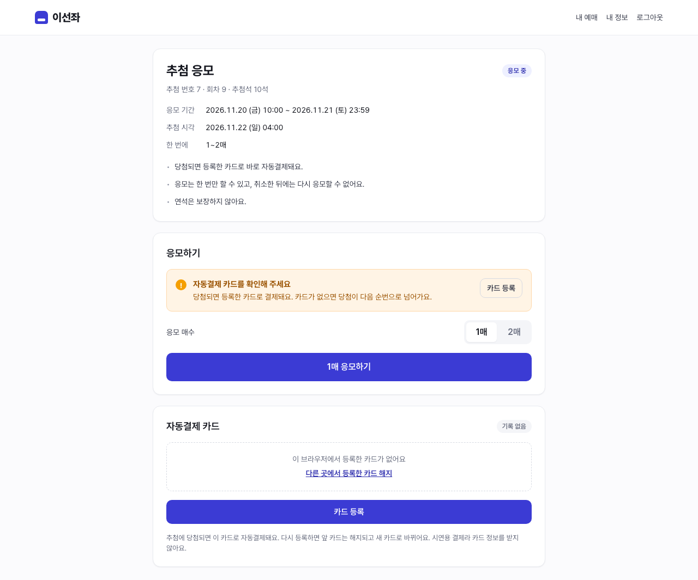
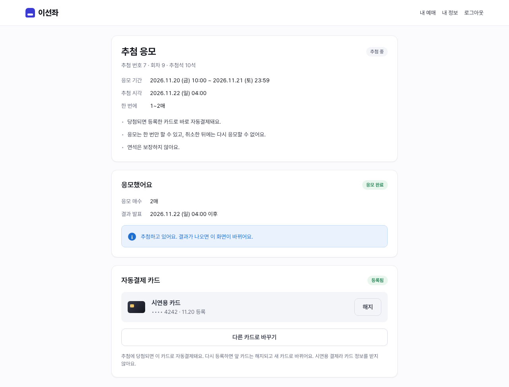
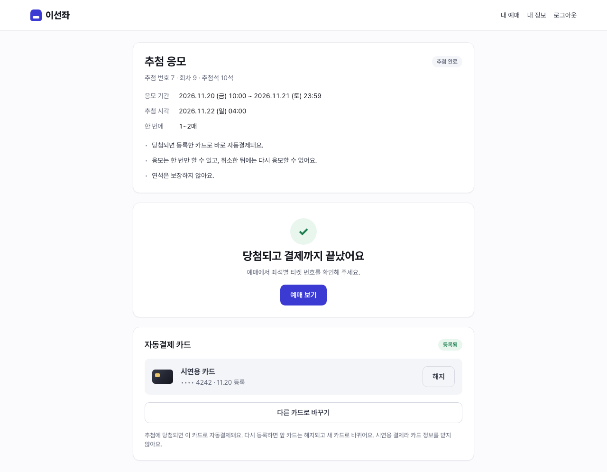
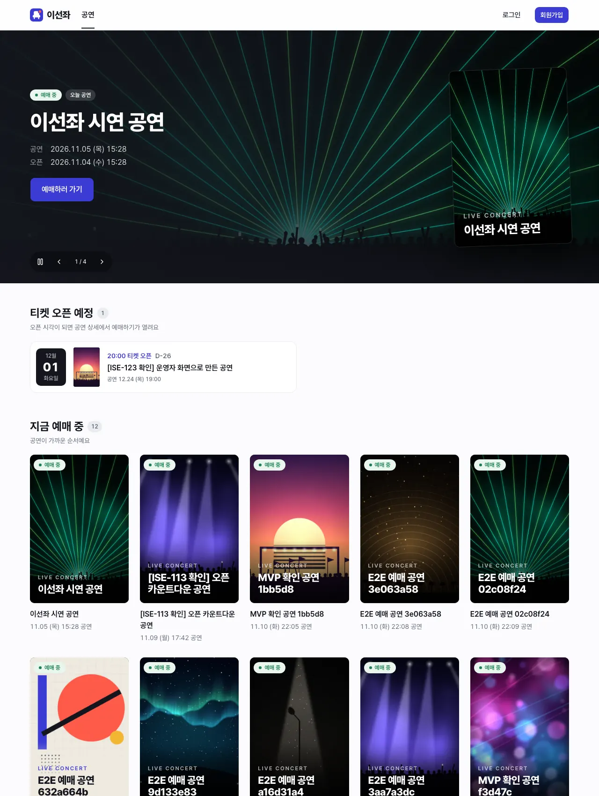
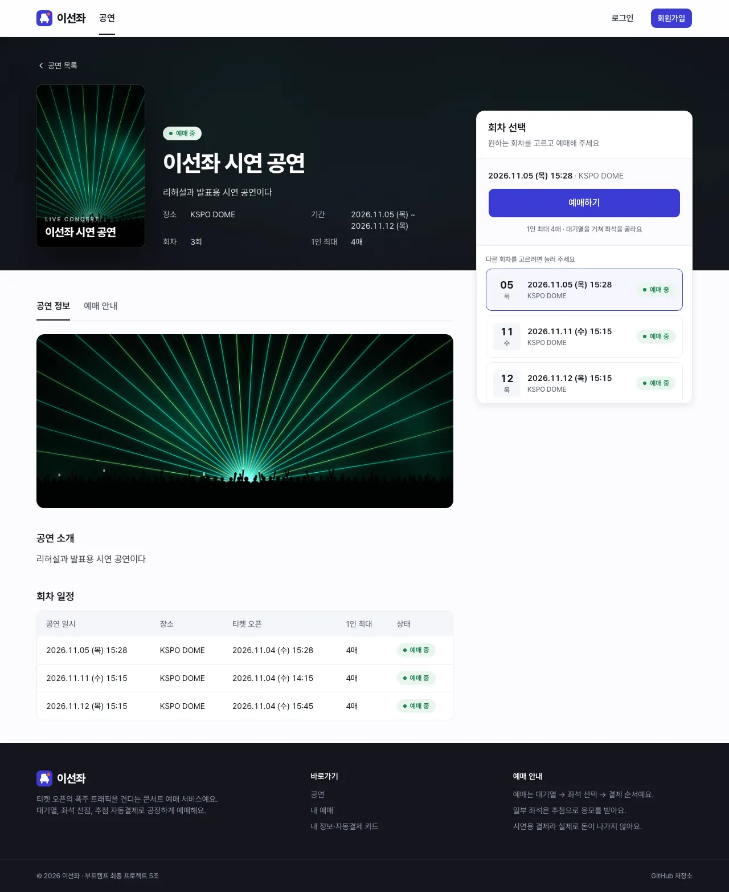
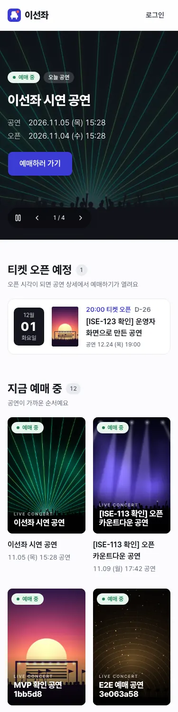
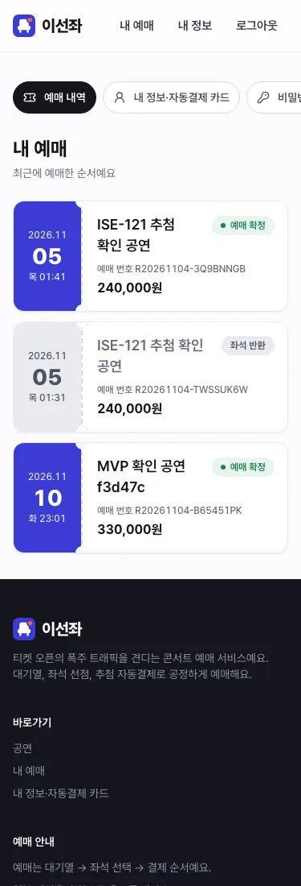
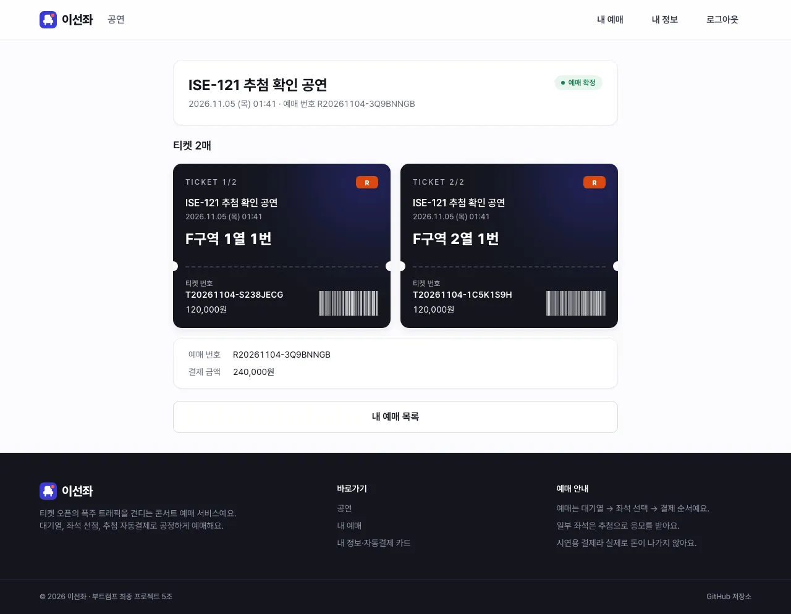
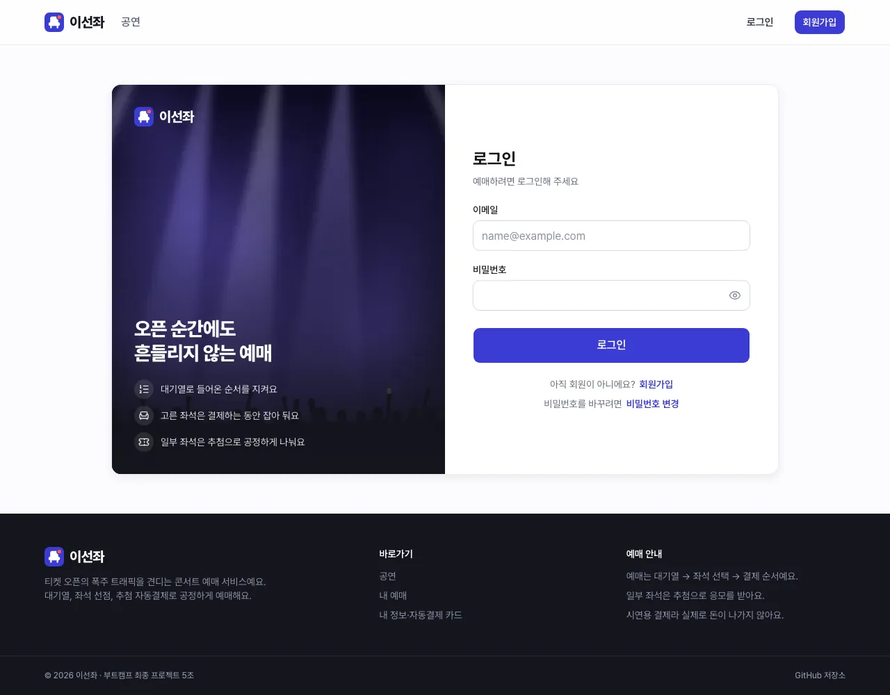
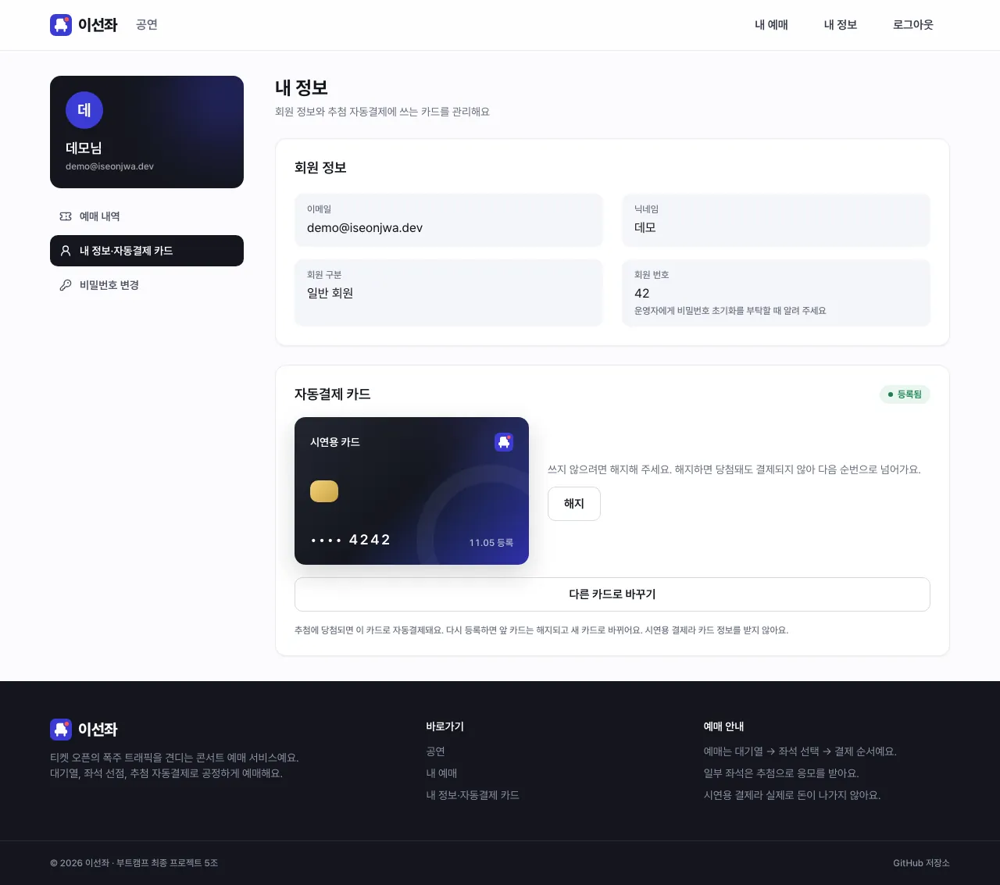

# 디자인 시스템

시연용 웹 화면(ADR 0040)이 함께 쓰는 원칙, 토큰, 좌석 상태, 컴포넌트, 화면 상태, 안내 문구를 둔다. 구현은 ISE-111(토큰과 기본 컴포넌트)에서 한다. 이 문서는 ISE-106의 결과다.

상태: 확정(2026-11-02, 프론트 담당 결정). 샘플 화면 [`samples/seat-selection.html`](samples/seat-selection.html)과 값이 같다. 값을 바꾸면 샘플과 이 문서, `frontend/src/index.css`를 함께 고친다. 구현은 ISE-111에서 끝났고(4절 아래 "구현"), 개발 서버의 `/_design`에서 모든 컴포넌트를 상태별로 본다.

## 1. 원칙

사용자(SA 2-2 페르소나 P1)는 오픈 순간 긴장한 상태로 "되든 안 되든 지금 상태를 정확히 알고 싶다". 화면은 이 요구에서 출발한다.

| 원칙 | 뜻 | 화면에서 |
|---|---|---|
| 지금 상태와 다음 행동이 먼저 보인다 | 어느 단계인지, 남은 시간이 얼마인지, 다음에 무엇을 누르면 되는지가 한눈에 보인다 | 상단 단계 표시, 입장 유효 시간, 버튼 문구가 남은 할 일을 말한다("1석 더 골라 주세요") |
| 실패는 막다른 길이 아니다 | 실패 안내는 원인과 다음 행동으로 끝난다. 결과를 모르면 실패라고 하지 않는다 | 409 이선좌는 좌석만 다시 고르게 한다. 결제 202·504는 "확인 중"이다 |
| 색에만 기대지 않는다 | 상태는 색과 함께 모양·아이콘·글자로도 구분한다 | 선택 좌석은 체크, 추첨석은 빗금, 등급은 구역 이름표의 글자 |
| 숫자는 흔들리지 않는다 | 시간·순번·금액은 고정폭 숫자로 쓰고, 시간은 서버 시각 기준이다 | `font-variant-numeric: tabular-nums`, 카운트다운은 `serverTime`으로 보정 |

### 문구 규칙
- 해요체로 짧게 쓴다. 사용자를 탓하지 않는다("잘못 입력" 대신 "이메일 형식을 확인해 주세요").
- 원인 한 문장, 다음 행동 한 문장 순서로 쓴다.
- HTTP 코드, 토큰, 멱등키 같은 기술 용어를 보이지 않는다. 예상하지 못한 오류에만 문의용 `traceId`를 작게 보인다.
- 버튼은 동사로 끝낸다("선택 완료", "결제하러 가기", "대기열로 돌아가기").

## 2. 토큰

값은 CSS 변수로 두고 Tailwind 테마와 shadcn/ui 변수에 연결한다(ISE-107·111). 대비는 WCAG 2.2 기준으로 계산했다. 본문 글자는 4.5:1, 아이콘·좌석·테두리 같은 비글자 요소는 3:1 이상이다.

### 2-1. 색

중립색 (배경·글자·테두리)

| 토큰 | 값 | 쓰는 곳 | 대비 |
|---|---|---|---|
| `gray-0` | `#FFFFFF` | 카드·모달 바탕 | |
| `gray-25` | `#FBFBFD` | 페이지 바탕 | |
| `gray-50` | `#F4F5F8` | 약한 바탕(선택 목록, 세그먼트) | |
| `gray-100` | `#E9EBF0` | 기본 테두리 | |
| `gray-200` | `#D7DAE2` | 강한 테두리, 비활성 버튼, 선택할 수 없는 좌석 | |
| `gray-400` | `#8D92A3` | 비활성 글자만 | 3.0:1 (본문 금지) |
| `gray-500` | `#676C7E` | 보조 글자 | 5.1:1 |
| `gray-700` | `#373B4A` | 기본 글자 | |
| `gray-900` | `#14161E` | 제목·강조 글자, 선택한 좌석 | 17.5:1 |

브랜드

| 토큰 | 값 | 쓰는 곳 | 대비 |
|---|---|---|---|
| `primary-50` | `#EEF0FF` | 완료 단계 바탕 | |
| `primary-500` | `#5B5BF0` | 선택 좌석 고리 | |
| `primary-600` | `#3B3BD4` | 주 버튼, 현재 단계, 초점 고리 | 흰 글자 7.6:1 |
| `primary-700` | `#2F2FAE` | 주 버튼 눌림·올림 | 흰 글자 9.8:1 |

의미색 (바탕 `-50`, 글자·아이콘 `-600`·`-700`)

| 의미 | 바탕 | 글자 | 쓰는 곳 |
|---|---|---|---|
| 성공 | `#E8F6EE` | `#1E7F4F` (5.0:1) | 예매 중 배지, 좌석 확보 |
| 경고 | `#FFF4E5` | `#9A5200` (5.4:1), 아이콘 `#F59F00` | 이선좌 409, 남은 시간 60초 이하, 결제 가능 시간 |
| 위험 | `#FDECEE` | `#D12B3A` (5.1:1) | 입장 만료, 결제 실패, 예상하지 못한 오류 |
| 정보 | `#EAF2FD` | `#1F6FD1` (4.9:1) | 처리 중·확인 중 |

좌석 (3절)

| 토큰 | 값 | 흰 바탕 대비 |
|---|---|---|
| `seat-vip` | `#C2255C` | 5.7:1 |
| `seat-r` | `#D9480F` | 4.3:1 |
| `seat-s` | `#2B8A3E` | 4.4:1 |
| `seat-a` | `#1971C2` | 5.0:1 |
| `seat-selected` | `gray-900` + 흰 체크 + `primary-500` 고리. 다크 모드에서는 같은 변수가 뒤집혀 흰 좌석 + 검은 체크가 된다(2-5절) | 18.1:1 |
| `seat-unavailable` | `gray-200` | 비활성 요소라 대비 기준 제외 |
| `seat-lottery` | `primary-100`·`primary-50` 빗금 + `#6E6EF0` 테두리 | 테두리 4.1:1 |

R(주황)과 S(초록)는 적록색약에게 비슷하게 보일 수 있다. 등급은 구역 단위로 묶여 있고 구역 이름표에 등급 글자를 함께 쓰므로 색만으로 등급을 구분하지 않는다.

### 2-2. 글꼴

Pretendard(SIL OFL)를 쓴다. 샘플은 CDN, 구현은 npm `pretendard` 패키지의 가변 글꼴을 Vite가 번들해 자체 호스팅한다. 대체 글꼴은 `Apple SD Gothic Neo`, `Noto Sans KR`, `system-ui`다.

구현에서 글자 토큰은 `type-display`~`type-caption` 클래스다(`text-*`가 아니다). 클래스 합치기 함수가 `text-body` 같은 사용자 토큰을 글자 색으로 보고 함께 쓴 색 클래스를 지우기 때문이다. 한 요소에는 `type-*` 하나만 쓰고, `src/lib/utils.ts`의 `cn`으로 합친다.

| 토큰 | 크기/줄 높이 | 굵기 | 쓰는 곳 |
|---|---|---|---|
| `display` | 32/40 | 700 | 결과 화면 큰 제목 |
| `title` | 24/32 | 700 | 페이지 제목, 모달 제목 |
| `heading` | 18/26 | 600 | 카드 제목 |
| `body` | 16/24 | 400 | 본문 |
| `body-sm` | 14/20 | 400 | 보조 설명, 목록 |
| `caption` | 12/16 | 500 | 도움말, 범례 |

굵기 기준(2026-11-09, 홈 시안 B 확정 때 사용자가 "굵은 글씨가 너무 굵다"며 한 단계 낮춤): 그림 위 큰 제목과 워드마크 800, 큰 숫자(카운트다운·순번·금액·날짜)와 섹션 제목 700, 카드 제목·버튼·배지·단계 번호 600, 메뉴 500, 본문 400이다.

- 한국어는 단어 중간에서 줄이 바뀌지 않게 `word-break: keep-all`을 기본으로 둔다.
- 시간·순번·금액·좌석 번호는 `tabular-nums`로 쓴다.

### 2-3. 간격·모서리·그림자·움직임

| 종류 | 토큰 |
|---|---|
| 간격 (4px 단위) | `1`=4 · `2`=8 · `3`=12 · `4`=16 · `5`=20 · `6`=24 · `8`=32 · `10`=40 · `12`=48 |
| 모서리 | `sm`=6 (배지·포스터) · `md`=10 (버튼·입력·알림) · `lg`=14 (모달) · `pill`=999 (칩) · 좌석은 위 5px·아래 3px. `Card` 컴포넌트는 `lg` 토큰이 아니라 18px을 쓴다(ISE-211). 티켓 모양 카드는 22px, 내 예매 티켓은 20px, 완료 티켓은 26px이다 |
| 그림자 | `sm` 카드 · `md` 좌석 올림·떠 있는 패널 · `lg` 모달·토스트 |
| 움직임 | `fast` 120ms (올림·눌림) · `base` 200ms (등장) · `ease-out`. `prefers-reduced-motion`이면 끈다 |

### 2-4. 화면 폭
PC를 먼저 맞춘다(P1은 퇴근 후 PC로 대기한다). 본문 최대 폭 1200px, 960px 아래에서 요약 패널이 아래로 내려가고, 640px 아래에서 여백을 줄인다. 좌석표는 좁은 화면에서 카드 안에서 가로로 스크롤한다. 모바일 전용 좌석 탐색(확대·구역 먼저 고르기)은 범위 밖이다.

폭의 기준은 브라우저 창이 아니라 앱 화면이다. 시연 모드의 요청 로그 패널이 오른쪽을 차지하면 앱 화면이 그만큼 좁아지기 때문이다(ISE-180). 코드에서는 `sm:`·`md:` 대신 `AppLayout` 루트 기준의 `@min-[40rem]:`·`@min-[48rem]:`을 쓴다. 대화상자처럼 화면 전체에 뜨는 것만 창 폭을 쓴다.

### 2-5. 화면 모드(라이트·다크)

2026-11-09 사용자가 홈 시안 B를 라이트·다크 두 벌로 확정하고 모드 방식을 골랐다([판단 기록](../../ai-judgments/junhyun/2026-11-09-home-renewal-draft-b-light-dark.md), ISE-208). 9절 4번 "다크 모드는 하지 않는다"를 바꾼다.

| 무엇 | 규칙 | 이유 |
|---|---|---|
| 모드 정하기 | 처음에는 운영체제 설정(`prefers-color-scheme`)을 따른다. 헤더의 해·달 버튼으로 고르면 그 값을 이 브라우저(`localStorage` `iseonjwa:theme`)에 기억하고, 그 뒤에는 운영체제 설정보다 앞선다. 다른 탭에서 고른 값도 따라간다 | 사용자가 정한 방식(1번). 실제 서비스에서 가장 흔하다 |
| 깜빡임 막기 | `index.html`의 스크립트가 첫 그리기 전에 `<html data-theme>`을 정한다. 규칙과 키는 `src/lib/theme.ts`와 같고, 한쪽을 바꾸면 다른 쪽도 바꾼다 | 앱 코드가 뜬 뒤에 정하면 새로고침마다 라이트로 한 번 그려졌다가 바뀐다 |
| 색 바꾸는 방법 | 화면 코드는 모드를 모른다. `:root[data-theme='dark']`가 같은 이름의 변수 값을 바꾼다. 회색은 순서를 뒤집고(`gray-0`은 카드 면 `#161824`, `gray-25`는 페이지 `#0C0D13`, `gray-900`은 가장 밝은 글자 `#F4F5F8`), 상태 색은 옅은 바탕을 짙게·글자를 밝게 바꾼다. shadcn `dark:`도 같은 속성을 따른다 | 기존 화면 대부분이 고치지 않고 두 모드로 그려진다 |
| 주 버튼 | 라이트는 인디고 바탕 + 흰 글자, 다크는 흰 바탕 + 검은 글자(`--primary`). 인디고(`primary-600`)는 다크에서 `#A9B0FF`로 밝아져 링크·강조 글자·현재 단계에 쓴다 | 시안 B. 다크 바탕에서 어두운 인디고 글자는 2.5:1로 읽히지 않는다 |
| 뒤집히는 칩 | 진한 바탕 칩(무대 표시, 단계 번호)은 바탕 `gray-900`·`gray-800`이나 `primary-600`에 글자 `gray-0`을 쓴다. 두 모드에서 바탕과 글자가 함께 뒤집힌다. 마이페이지 현재 메뉴는 진한 칩이 아니라 옅은 인디고(`primary-50` 바탕, `primary-700` 글자)이고 다크에서 함께 바뀐다(ISE-211) | 글자를 `white`로 고정하면 다크에서 밝아진 바탕 위에 흰 글자가 된다 |
| 늘 어두운 곳 | 인증 화면 그림 칸, 포스터 바탕, 실물 카드(자동결제 카드), 대화상자 막은 모드와 상관없는 `ink-900`·`ink-800`을 쓰고 글자는 `white`로 둔다. 그 위의 인디고는 `brand-600`·`brand-700`(모드와 상관없음)이다. 홈 대표 배너는 11절, 공연 상세 배너와 예매 티켓은 12절 규칙(페이지 바탕색 막·밝은 티켓, 모드를 따름)을 따르고 여기에 속하지 않는다 | 그림과 실물 모양은 모드가 바뀌어도 같아야 한다 |
| 고른 좌석 | 다크에서는 `seat-selected`(`gray-900`)가 밝아져 흰 좌석 + 검은 체크(`gray-0`) + 밝은 인디고 고리가 된다 | 검정은 어두운 바탕에서 보이지 않는다(2026-11-09 사용자 확인) |
| 로고 | 어두운 칸 표시라 두 모드에서 같은 그림이다. 앱 화면이 28rem보다 좁으면 헤더 로고는 표시만 보이고 글자는 화면 낭독기만 읽는다 | 모드 버튼이 들어가며 로그인 상태의 360px 헤더에서 [로그아웃]이 잘렸다 |
| 사이트 아래 정보 | 모드를 따른다(라이트 흰 면, 다크 카드 면). 전에는 늘 검은 띠였다 | 시안 B |
| 주소창 색 | `meta theme-color` 하나를 첫 그리기 전 스크립트와 `applyTheme`이 고른 모드의 페이지 바탕색(`#FBFBFD`·`#0C0D13`)으로 바꾼다 | `media` 두 개로 나누면 운영체제 설정만 따라, 버튼으로 고른 모드와 휴대폰 주소창 색이 달라진다(셀프 리뷰) |
| 초점 고리 | 고리와 요소 사이 띠(`ring-offset`)는 `ring-offset-gray-0`(카드 위)이나 `ring-offset-gray-25`(페이지 위)로 칠한다 | Tailwind 기본 띠 색이 흰색이라 다크에서 모든 버튼 초점에 흰 띠가 생겼다(셀프 리뷰) |
| 링크 글자 | `primary-600`(라이트 인디고, 다크 밝은 인디고). 주 버튼의 `--primary`(다크에서 흰색)와 섞지 않는다 | 다크에서 링크가 흰 글자와 구분되지 않았다 |
| 모르는 등급 배지 | 등급 색 표에 없는 등급은 `brand-600` 바탕에 흰 글자다 | `primary-600`은 다크에서 밝아져 흰 글자가 2.0:1이 됐다(셀프 리뷰) |

확인한 것(ISE-208, 목 서버 `npm run dev:mock` + headless Chrome, 운영체제 설정을 흉내 내 캡처): 1440px 홈·로그인·`/_design`·마이페이지, 360px 홈(로그인 전후)을 두 모드로 봤다. 다크 홈의 오픈 날짜 칸 작은 글자가 바탕에 묻힌 것(`text-white/70`)을 찾아 `gray-0`으로 고쳤다. 셀프 리뷰(Opus)가 다크 글자 대비를 WCAG 식으로 계산해 상태 글자/바탕 7.1~9.7:1, 진한 칩 6.5:1 이상, 보조 글자 6.8:1을 확인했고, 위 표의 주소창 색·초점 고리·링크·등급 배지와 사이트 아래 정보 아래 줄(라이트 대비 3.1:1)을 고쳤다. 첫 그리기 전 스크립트는 `src/lib/themeScript.test.ts`가 그대로 실행해 `theme.ts`와 같은 키·규칙·색인지 확인한다.

## 3. 좌석 상태

좌석 조회 응답은 `available` 하나만 준다(SA 11-5, 누가 선점 중인지 보이지 않는다). 그래서 "선점 중"과 "판매됨"을 나누지 않고 "선택할 수 없음" 하나로 그린다.

| 상태 | 모양 | 동작 | 접근성 |
|---|---|---|---|
| 선택 가능 | 등급 색으로 채운 좌석 | 누르면 선택. 올리면 조금 커진다 | `button`, `aria-pressed="false"`, 이름 "VIP석 A1구역 1열 7번, 165,000원" |
| 선택함 | `gray-900` + 흰 체크 + `primary-500` 고리 | 다시 누르면 해제 | `aria-pressed="true"` |
| 선택할 수 없음 | `gray-200` | 누를 수 없음 | `disabled`, 이름 끝에 "선택할 수 없음" |
| 추첨석 | 빗금 + 1px 테두리 | 누를 수 없음 | `disabled`, "추첨석이라 일반 예매로 고를 수 없음" |
| 방금 선택됨(409 뒤) | 1.6초 동안 위험색으로 깜빡인 뒤 선택할 수 없음 | — | 알림 영역(`role="alert"`)이 함께 알린다 |
| 초점 | `primary-600` 2px 바깥 고리 | 키보드 Tab·화살표 | `:focus-visible` |

- 매수를 먼저 고르고(1–4매, SA 결정 #35) 그 수만큼만 고른다. 다 고른 뒤 다른 좌석을 누르면 토스트로 "먼저 해제해 주세요"를 알린다.
- 409 `SEAT_ALREADY_HELD`는 어느 좌석이 겹쳤는지 알려 주지 않는다(`docs/design/reservation/contracts.md` 4절). 좌석을 다시 조회해 선택할 수 없게 된 좌석만 풀고 나머지는 유지한다. 좌석이 바뀌면 다음 요청은 새 `Idempotency-Key`를 쓴다(같은 키에 다른 좌석이면 `IDEMPOTENCY_KEY_REUSED`).

## 4. 컴포넌트

| 컴포넌트 | 변형·상태 | 쓰는 화면 | 바탕 |
|---|---|---|---|
| 버튼 | 주·보조(외곽선)·위험 / 기본·올림·눌림·비활성·처리 중(스피너) / 크기 기본 44·큰 52. 큰 크기(`lg`)는 알약(`rounded-full`)이라 시안이 없는 화면(로그인·가입·비밀번호 변경·운영자 공연 등록)의 큰 버튼도 같은 모양이다 | 전체 | shadcn `Button` |
| 입력·선택 | 기본·초점·오류(아래 문구)·비활성 | 로그인, 회원가입, 운영자 | shadcn `Input`, `Select` |
| 세그먼트 | 매수 1–4매 | 좌석 | shadcn `ToggleGroup` |
| 카드 | 기본(모서리 18px, 티켓 모양은 22px를 따로 준다) | 전체 | shadcn `Card` |
| 배지 | 예매 중·오픈 예정·매진·추첨 / 등급(VIP·R·S·A) | 공연, 좌석, 내 예매 | shadcn `Badge` |
| 알림 | 정보·성공·경고·위험 / 닫기·행동 버튼. 폭이 28rem보다 좁으면(`@container/alert`) 행동 버튼을 글자 아래 줄로 내린다 | 좌석, 결제, 대기열, 추첨 | shadcn `Alert` |
| 토스트 | 한 줄, 3초 | 전체 | shadcn `Sonner` |
| 모달 | 확인형(좌석 확보 등) | 좌석, 결제 | shadcn `Dialog` |
| 단계 표시 | 완료·현재·예정 | 대기열~완료 | 직접 |
| 시간 칩 | 기본·경고(60초 이하)·위험(0) | 입장 유효 시간, 결제 가능 시간 | 직접 |
| 카운트다운 | 오픈까지 남은 시간, 서버 시각 보정 | 공연 상세 | 직접 |
| 대기 순번 | 순번, 예상 시간, 진행 막대 | 대기열 | 직접 |
| 확인 중 | 스피너 + 제목 + 설명, `role="status"` | 접수형 선점, 결제 202·504 | 직접 |
| 좌석·좌석표 | 3절 상태, 무대, 구역, 범례 | 좌석 | 직접 |
| 빈 상태 | 안내 문구 + 행동 | 선택 목록, 내 예매 | 직접 |
| 스켈레톤 | 목록·카드 자리 | 공연 목록, 내 예매 | shadcn `Skeleton` |

### 구현 (ISE-111)

| 위치 | 내용 |
|---|---|
| `frontend/src/index.css` | 2절 토큰, shadcn 의미 변수 연결, `type-*` 글자 토큰, 좌석 모양 |
| `frontend/src/components/ui/` | 버튼·입력·선택·세그먼트·카드·배지·알림·토스트·모달·스켈레톤(shadcn을 이 문서와 샘플에 맞춤) |
| `frontend/src/components/ticketing/` | 좌석·좌석표·범례, 매수 선택(`QuantitySelector`), 등급·판매 상태 배지, 시간 칩, 카운트다운, 대기 순번, 확인 중, 단계 표시, 빈 상태, 에러 안내 |
| `frontend/src/components/layout/` | 고정 헤더(워드마크, 로그인 상태), 토스트 자리, 에러 화면 |
| `/_design` | 개발 서버 전용 확인 화면. 운영 빌드에는 들어가지 않는다 |

이 문서와 다르게 하거나 구현하며 정한 것:

| 항목 | 정한 것 | 이유 |
|---|---|---|
| 판매 상태 배지 | 알약 모양, "예매 중"만 앞에 점. 등급 배지는 반경 sm | 확정 샘플(`.badge`)이 그렇다. 2-3의 "배지는 sm"은 등급 배지에만 맞춘다 |
| `CLOSED` 회차 | "판매 종료"(매진 모양) | 좌석 조회 없이는 매진인지 모른다 |
| 대기 순번 문구 | "내 순번 n번" | 순번은 `max(0, seq - admitted)`라 바로 다음 차례가 1이다. "내 앞에 n명"이면 1명 어긋난다 |
| 좌석표 키보드 | 구역마다 Tab 정지점 하나, 화살표는 구역 안에서만 | 정지점을 좌석표 전체에 하나만 두면 화살표가 구역을 넘지 못해 첫 구역만 고를 수 있다 |
| 좌석표 잠금 | `locked`면 모든 좌석을 누를 수 없고 흐리게(.45) | 7절 "0이면 좌석표 잠금" |
| 처리 중 버튼 | `aria-disabled`로 누름만 막고 초점은 남긴다 | `disabled`는 초점을 잃게 해 키보드 사용자의 위치가 사라진다 |
| 좌석 크기 | 18px(샘플대로) | 터치 기기에서는 작을 수 있다. 모바일 좌석 탐색은 범위 밖(2-4) |
| 대기 순번 숫자 | 48/56, 굵기 800. "내 순번"과 "번"은 작게 따로 둔다 | 대기열 화면의 주인공 숫자라 글자 토큰의 가장 큰 값(display 32)보다 크게 쓴다(`samples/queue.html`, ISE-114) |
| 단계 표시 자리 | 예매 흐름 화면의 헤더 가운데. 앱 화면이 60rem보다 좁으면 지금 단계 이름만, 48rem보다 좁으면 숨긴다 | 시연 패널을 켠 화면에서도 워드마크·메뉴와 헤더 한 줄에 들어간다(ISE-114) |

후속 과제:
- 등급 배지의 흰 글자(11~12px)가 R(`#D9480F`, 4.3:1)·S(`#2B8A3E`, 4.4:1) 바탕에서 WCAG 1.4.3의 4.5:1에 못 미친다. 샘플과 같은 값이라 색이나 글자 처리를 정할 때 함께 고친다.
- 헤더 가운데의 단계 표시는 ISE-114에서 경로의 handle로 열었다(`docs/design/frontend/README.md` "대기열 화면 규칙"). 입장 유효 시간 칩 자리는 좌석 화면(ISE-115)에서 연다.

## 5. 화면 흐름과 상태

```
로그인 ─▶ 공연 목록 ─▶ 공연 상세(카운트다운) ─▶ 대기열 ─▶ 좌석 선택 ─▶ 결제 ─▶ 결과 ─▶ 내 예매
                                     │              │            │            │
                               오픈 전 비활성    READY면 토큰   409면 좌석만   202·504면
                                                 받아 이동      다시 고름      확인 중
```

| 화면 | 기본 | 불러오는 중 | 비어 있음 | 기다림 | 실패 |
|---|---|---|---|---|---|
| 공연 상세 | 회차·등급 가격, 예매하기 | 스켈레톤 | — | 오픈 전 카운트다운, 버튼 비활성 | 조회 실패 알림 + 다시 시도 |
| 대기열 | 순번·예상 시간·진행 막대 | 진입 중 스피너 | — | 서버가 준 간격으로 조회 | 404 `QUEUE_NOT_JOINED`면 다시 줄 서기, 503이면 자동 재시도 안내 |
| 좌석 선택 | 좌석표, 선택 요약 | 좌석표 스켈레톤 | 남은 좌석 0이면 매진 안내 | 접수형 202 "좌석을 확인하고 있어요" | 409 이선좌(경고), 입장 만료(위험) |
| 결제 | 결제 수단, 금액, 결제 가능 시간 | — | — | 202·504 "결제를 확인하고 있어요" | 거절 사유별 안내, 503 `PG_UNAVAILABLE`, 시간 만료 |
| 결과 | 확정·티켓 번호 / 실패 사유 | 예매 확정 조회 중 | — | 확정 반영 대기(2초 이내 목표) | 실패 사유 + 좌석 반환 안내 |
| 내 예매 | 상태별 목록 | 스켈레톤 | "아직 예매한 공연이 없어요" | 취소·환불 진행 | 조회 실패 알림 |

## 6. 에러 코드별 안내

코드는 SA 11-3을 따른다. 정해진 처리가 없는 코드는 위험 알림 + `traceId`로 보인다.

| 상황 | 코드 | 톤 | 안내(예시) | 다음 행동 |
|---|---|---|---|---|
| 오픈 전 | 409 `SALE_NOT_OPEN` | 정보 | 아직 오픈 전이에요 | 카운트다운 유지 |
| 입장 기록 만료 | 404 `QUEUE_NOT_JOINED` | 경고 | 입장 시간이 지나 줄에서 빠졌어요 | 다시 줄 서기 |
| 입장 토큰 무효 | 403 `ENTRY_TOKEN_INVALID` | 위험 | 입장 시간이 끝났어요 | 저장한 토큰 지우고 대기열로 |
| 이선좌 | 409 `SEAT_ALREADY_HELD` | 경고 | 이미 선택된 좌석입니다. 남은 좌석은 그대로 두었어요 | 좌석 다시 조회, 빠진 만큼만 다시 고르기 |
| 매수 초과 | 409 `PURCHASE_LIMIT_EXCEEDED` | 경고 | 이 회차는 1인 4매까지예요 | 내 예매 보기 |
| 요청 과다 | 429 `RATE_LIMITED` | 경고 | 요청이 많아요. 잠시 뒤 다시 시도해 주세요 | 버튼 잠시 비활성 |
| 일시 장애 | 503 `SERVICE_UNAVAILABLE` | 경고 | 연결이 잠시 불안정해요. 곧 다시 시도할게요 | `Retry-After`에 0~+20% 더해 자동 재시도 |
| 결제사 장애 | 503 `PG_UNAVAILABLE` | 경고 | 결제사 연결이 원활하지 않아요. 좌석은 남은 시간 동안 유지돼요 | 다시 결제 |
| 결제 결과 모름 | 202 `REQUESTED`·`UNKNOWN`, 504 | 정보 | 결제를 확인하고 있어요 | 결제 조회 폴링, 504는 같은 멱등키로 재요청. 실패로 다루지 않는다 |
| 결제 시간 지남 | 403 `PAYMENT_TOKEN_INVALID`, 409 `RESERVATION_NOT_PAYABLE` | 위험 | 결제 가능 시간이 지났어요 | 좌석 다시 고르기(새 멱등키) |
| 로그인 만료 | 401 `TOKEN_EXPIRED`(그 밖의 401 `UNAUTHORIZED`·`TOKEN_REVOKED`도 같게 처리) | — | (보이지 않음) | 재발급 후 재시도. 실패하면 로그인 화면으로, 돌아올 경로 유지 |
| 로그인 실패 | 401 `INVALID_CREDENTIALS` | 입력 오류 | 이메일 또는 비밀번호를 확인해 주세요 | 비밀번호 칸 아래 문구와 "비밀번호를 5번 틀리면 계정이 잠겨요". 초점을 그 칸으로 옮긴다 |
| 계정 잠금 | 423 `ACCOUNT_LOCKED` | 위험 | 로그인을 여러 번 실패해 계정이 잠겼어요. 운영자에게 비밀번호 초기화를 요청해 주세요 | 폼 위 알림. 임시 비밀번호를 받으면 로그인할 때 바꿀 수 있다고 덧붙인다 |
| 임시 비밀번호 | 403 `PASSWORD_CHANGE_REQUIRED` | 경고 | 임시 비밀번호로는 로그인할 수 없어요 | 이메일을 채운 비밀번호 변경 화면으로 보낸다. 바꾸면 바로 로그인해 원래 화면으로 간다 |
| 가입 이메일 중복 | 409 `EMAIL_DUPLICATED` | 입력 오류 | 이미 가입한 이메일이에요. 로그인해 주세요 | 이메일 칸 아래 문구와 그 이메일을 채운 로그인 링크 |
| 예상하지 못한 오류 | 그 밖의 4xx·5xx | 위험 | 문제가 생겼어요. 문의할 때 아래 번호를 알려 주세요 | `traceId` 표시, 다시 시도 |

## 7. 시간 표시

| 시간 | 근거 | 표시 |
|---|---|---|
| 오픈 카운트다운 | 공연 상세 `serverTime`으로 브라우저 시계 차이를 보정. 차이는 응답을 받은 순간 기준이다(`createServerClock(serverTime, dataUpdatedAt)`). 회차 판매 상태도 같은 시계로 다시 정해 0이 되는 순간 [예매하기]가 켜진다(ISE-113) | 공연 상세 |
| 입장 유효 시간 | 입장 토큰 10분(SA 9-4), `entryTokenExpiresAt` | 상단 시간 칩. 60초 이하 경고, 0이면 위험 + 좌석표 잠금 |
| 결제 가능 시간 | 선점 5분이지만 결제 토큰은 10초 먼저 끝난다(SA 7-3). 표시는 `paymentTokenExpiresAt` 기준 4분 50초 | 좌석 확보 모달, 결제 화면 |

남은 시간은 초를 올림으로 보인다. 0.9초 남았을 때 "00:01"이고, "00:00"이 보이는 순간과 만료 처리(입장 만료, 오픈)가 같다.

## 8. 샘플

[`samples/seat-selection.html`](samples/seat-selection.html)은 빌드 없이 브라우저로 여는 좌석 선택 화면이다. 오른쪽 아래 "샘플 전용 조작"으로 선택 완료 결과(201 성공, 409 이선좌, 202 처리 중)와 입장 만료를 바꿔 본다. 주소 끝에 `#demo=selected`·`conflict`·`pending`·`held`·`expired`를 붙이면 그 상태로 바로 열린다. 공연·아티스트·장소 이름은 지어낸 것이다.

확인한 것(2026-11-02, headless Chrome 1440×1080·500×1300): 여섯 상태가 그려지고, 409 뒤 남은 좌석이 유지되며, 좁은 화면에서는 좌석표만 가로로 스크롤된다.

| 좌석 2석 선택 | 409 이선좌 뒤 | 좌석 확보 |
|---|---|---|
|  |  |  |

[`samples/queue.html`](samples/queue.html)은 대기열 화면이다(ISE-114, 2026-11-04 사용자 확인). 조작판으로 줄 서는 중, 대기 중, 연결 불안정(503), 차례가 됨, 줄에서 빠짐(404), 오픈 전(409), 예상하지 못한 오류를 바꿔 본다. 주소 끝에 `#demo=waiting`·`unstable`·`expired` 등을 붙이면 그 상태로 열리고, `&panel=0`이면 조작판을 숨긴다.

| 대기 중 | 연결 불안정(자동 재시도) | 줄에서 빠짐 |
|---|---|---|
|  |  |  |

[`samples/seat-sections.html`](samples/seat-sections.html)은 좌석 선택을 "구역 먼저 고르기"로 바꾼 샘플이다(ISE-115, 2026-11-04 사용자 선택). 로컬 공연장(KSPO DOME)이 25구역 × 600석 = 15,000석이라 위 샘플처럼 전부 그리면 페이지가 1만 px를 넘는다. 구역 배치도(응답 순서대로 5칸, 좁으면 4칸)에서 구역을 고르면 그 구역 좌석만 그리고, 고른 좌석은 구역을 옮겨도 요약과 배치도(구역별 고른 수)에 남는다. 상단 바의 입장 유효 시간은 좁은 화면에서 본문 맨 위로 내려온다. 조작판과 `#demo=` 값은 위 샘플과 같다.

| 두 구역에서 2석 선택 | 409 이선좌 뒤 | 375px |
|---|---|---|
|  |  |  |

[`samples/payment.html`](samples/payment.html)은 결제 화면이다(ISE-116). 결제 수단은 카드 하나다(API가 `method: CARD`만 받고, 시연 결제(Mock PG)라 카드 정보를 받지 않는다). 조작판으로 결제 전, 결제 요청 중, 확인 중(202·504), 승인 뒤 확정 확인, 거절, 결제사 장애(503), 결제 가능 시간 지남, 수동 확인(409), 승인 뒤 만료(환불)를 바꿔 본다. 주소 끝에 `#demo=checking` 등을 붙이면 그 상태로 열리고 `&panel=0`이면 조작판을 숨긴다.

| 결제 전 | 확인 중 | 거절 |
|---|---|---|
|  |  |  |

[`samples/reservations.html`](samples/reservations.html)은 예매 결과·상세와 내 예매 목록이다(ISE-117). 조작판으로 결과(예매 확정), 상세(결제 대기·기한 만료), 내 예매 목록, 빈 목록을 바꿔 본다. 예매 상세 응답에 공연 제목이 없어 결제 화면·내 예매 목록에서 오면 화면 이동 값으로 받고, 주소로 열면 예매 번호를 제목으로 쓴다. 결제 상태는 예매 응답에 없어(결제 ID 없음) 예매 상태로만 보인다.

| 결과(예매 확정) | 상세(결제 대기) | 내 예매 |
|---|---|---|
|  |  |  |

[`samples/lottery.html`](samples/lottery.html)은 추첨 응모 화면이다(ISE-121·122). 조작판으로 응모 전(자동결제 카드 기록 없음), 응모 완료, 추첨 중, 당첨(자동결제 중), 당첨·결제 완료, 예비, 미당첨, 자동결제 실패를 바꿔 본다. 추첨 정보에 공연 제목이 없어 추첨 번호·회차 번호를 보인다. 아래 자동결제 카드는 내 정보에 두는 카드와 같다.

| 응모 전 | 추첨 중 | 당첨·결제 완료 |
|---|---|---|
|  |  |  |

홈·공연 상세(ISE-187)는 실제 데이터와 그림 에셋을 바로 써야 해서 HTML 샘플 없이 React로 만들고 상태별 캡처로 확인했다(9절 5번 보완). 아래는 로컬 compose 백엔드와 프로덕션 nginx 이미지로 찍었다. 그림이 많아 PNG가 1MB를 넘어 캡처는 WebP로 둔다.

| 홈 | 공연 상세 | 홈 375px |
|---|---|---|
|  |  |  |

마이페이지·티켓·로그인(ISE-188)도 같은 방식으로 확인했다. 내 예매·티켓·로그인은 로컬 compose 백엔드와 프로덕션 nginx 이미지, 자동결제 카드는 목 서버로 찍었다. 내 예매는 프로필 카드(이메일)가 보이지 않는 375px로 찍었다.

| 내 예매 375px | 확정 티켓 | 로그인 | 자동결제 카드 |
|---|---|---|---|
|  |  |  |  |

2026-11-09 ISE-210에서 확정 티켓이 한 장짜리 가로 티켓으로 바뀌었다(12절). 캡처 파일은 바꾸기 전 모양이다.

## 10. 서비스형 레이아웃과 그림 에셋 (ISE-187)

2026-11-05 사용자가 핵심 흐름만 보이던 화면을 실제 예매 서비스처럼 바꾸라고 했다. 레이아웃을 다양하게 쓰고 에셋도 실제처럼 하라는 요청이다([판단 기록](../../ai-judgments/junhyun/2026-11-05-frontend-service-like-layout.md)). 토큰, 좌석 상태, 문구 규칙은 그대로 두고 배치와 그림을 더했다. 홈·공연 상세(ISE-187)부터 바꾸고, 마이페이지·티켓·로그인(ISE-188)으로 이었다. 대기열·좌석·결제는 샘플로 맞춘 흐름 화면이라 그대로 두고 새 헤더만 받는다.

| 무엇 | 규칙 | 이유 |
|---|---|---|
| 화면 폭 | 홈·공연 상세는 배너를 화면 끝까지 그린다. 경로 handle `{ layout: 'bleed' }`를 쓴다(`app/pageLayout.ts`). 나머지 화면은 지금처럼 최대 1200px 상자에 둔다 | 대표 배너가 상자 안에 갇히면 서비스 첫 화면처럼 보이지 않는다. 모든 화면을 고치지 않고 필요한 화면만 폭을 스스로 정한다 |
| 헤더 | 로고(좌석 표시 + "이선좌") 옆에 [공연]을 두고, 오른쪽에 계정 메뉴를 둔다. 로그아웃 상태면 [로그인]·[회원가입]을 보인다. 예매 흐름 화면에서는 [공연] 자리를 단계 표시가 쓴다 | 실제 서비스의 기본 길 찾기. 예매 흐름에서는 지금 단계가 먼저다(1절) |
| 사이트 아래 정보 | 서비스 소개, 바로가기, 예매 안내, 저장소 링크를 둔다. 없는 약관·고객센터 링크는 만들지 않는다. 예매 흐름 화면(대기열~완료)에서는 숨긴다 | 실제 서비스처럼 마무리하되 가짜 링크는 두지 않는다 |
| 배치 종류 | 대표 배너(캐러셀), 오픈 예정 티켓(날짜 머리 + 떼는 칸), 예매 중 티켓 카드(정사각 포스터, 2~4열), 띠 배너(추첨 안내), 작은 목록 카드(홈의 현재 배치는 11절), 그림을 선명하게 깐 공연 상세 배너 + 절취선 티켓 모양 예매 패널(넓은 화면에서 배너 아래 오른쪽 열에 붙음, 12절), 탭, 표. ISE-188에서 마이페이지 왼쪽 메뉴(좁으면 가로 알약 메뉴), 날짜 칸·절취선 티켓 목록, 한 장짜리 가로 예매 티켓(12절), 그림 패널 + 폼(인증), 실물 카드 모양(자동결제 카드)을 더했다 | 같은 카드 목록만 되풀이하지 않고 내용 성격에 맞는 배치를 고른다 |
| 포스터 그림 | `tools/concert-art/art.html`이 캔버스로 그린 원본 8종이다(무대 조명, 보케, 노을 페스티벌, 오케스트라, 레이저, 기하 도형, 오로라, 재즈). 포스터 480×720과 배너 1600×667을 WebP로 둔다(16장 합계 약 300KB). 공연 번호로 고르고(`(id-1) % 8`), 그림 위 제목은 화면 글자로 얹는다(꾸밈, `aria-hidden`) | 공연 API에 이미지가 없다. 사진을 내려받으면 저작권·초상권을 따로 확인해야 하고 외부 이미지 서버에 기대게 된다. 직접 그린 그림은 저장소에서 다시 만들 수 있고(`node tools/concert-art/render.mjs <Chrome 포트>`, 같은 입력이면 같은 파일), 글자를 화면이 얹어 어떤 제목에도 맞는다 |
| 그림 톤 | 그림마다 `tone`(dark·light)을 둔다. light 그림은 제목을 어두운 글자와 옅은 막으로 얹는다 | 밝은 그림 위에서는 흰 글자의 대비가 모자란다 |
| 움직임 | 캐러셀은 7초마다 넘긴다. 멈춤 버튼을 맨 앞에 두고, 마우스를 올린 동안만 멈춘다. 키보드 초점이 밖에서 들어오면 멈추고 [자동 넘김 시작]을 누르기 전에는 다시 넘기지 않는다(마우스로 버튼을 누를 때 생기는 초점은 세지 않는다). 동작 줄이기 설정이면 처음부터 멈춘다. 보이지 않는 장은 `inert`다. 포스터 카드는 올라오는 효과를 주고 동작 줄이기면 끈다 | WCAG 2.2.2(5초 넘게 움직이는 것은 멈출 수 있어야 한다)와 WAI-ARIA 캐러셀 패턴 |
| 로고 | 2026-11-09 "조명이 비춘 내 자리"로 바꿨다(ISE-208). 어두운 칸에 위에서 비추는 조명과 빨간 좌석 하나를 둔다. 파비콘과 같은 그림이다. 처음(11-05)에는 인디고 사각에 흰 좌석과 빨간 점이었다 | 홈 시안 B와 함께 사용자가 골랐다(시안 A·C 로고는 고르지 않음). 빨간 좌석이 409 "이미 선택된 좌석입니다"의 그 좌석이다 |
| 그림 위 글자 | 홈 대표 배너(11절)와 공연 상세 배너(12절) 모두 페이지 바탕색 막으로 덮고 모드를 따른다. 막의 세기와 대비 계산은 각 절에 있다 | 그림 위 글자는 어떤 그림이 와도 본문 4.5:1을 넘겨야 한다(셀프 리뷰에서 3.6~3.8:1을 재서 고쳤다) |
| 쌓임 | 캐러셀은 `isolate`로 쌓임 맥락을 가둔다 | 조작판(`z-20`)이 sticky 헤더 위로 올라와 로고를 덮었다(셀프 리뷰) |

배포 환경:
- 그림은 번들에 들어가 `/assets/`에서 해시 이름과 1년 immutable 캐시로 내려간다(nginx `location /assets/`). 외부 이미지·CDN을 쓰지 않아 배포 서버(http 공개 IP)에서도 같은 그림이 보인다. 나중에 CSP를 더해도 `img-src 'self'`로 충분하다.
- 첫 배너 그림만 `fetchpriority="high"`로 먼저 받는다. 목록 포스터와 대표 배너 포스터는 `loading="lazy"`(좁은 화면에서 숨긴 배너 포스터는 받지 않는다)이고, 공연 상세 배너 포스터만 첫 화면이라 `eager`다. 모든 `img`에 `width`·`height`를 둬 받는 동안 자리가 밀리지 않는다.
- 대표 배너는 지금 장과 다음 장의 그림만 받고, 넘기면 그다음 장 그림을 받는다(한 번 받은 그림은 남긴다).
- 측정(이 브랜치로 만든 프로덕션 nginx 이미지, 캐시 끔): 홈은 1280px에서 WebP 9장 174KB, 375px에서 8장 163KB다. 공연 상세는 2장 100KB다. `image/webp` 형식과 캐시 헤더로 내려오고, 컨테이너 메모리는 약 11MiB다(제한 64MiB).

## 11. 홈 시안 B와 샘플 광고 자리 (ISE-209)

2026-11-09 사용자가 홈 시안 B(나이트 스테이지)를 라이트·다크 두 벌로 확정했다([판단 기록](../../ai-judgments/junhyun/2026-11-09-home-renewal-draft-b-light-dark.md)). 시안은 Design 캔버스(비공개)에 있다. 모드 규칙은 2-5절이다.

| 무엇 | 규칙 | 이유 |
|---|---|---|
| 대표 배너 | 그림을 꽉 채우고 페이지 바탕색(`gray-25`)으로 왼쪽을 덮는다. 라이트는 흰 막 + 검은 글자, 다크는 검은 막 + 흰 글자가 된다. 오픈 예정이면 "오픈 일시 티켓 오픈" 칩과 일·시간·분·초 칸, 예매 중이면 "공연 D-n" 칩을 둔다. 넓은 화면(56rem 이상) 오른쪽에 기울인 입장권(포스터·절취선·날짜·바코드)을 둔다. 넘김 규칙은 10절 그대로다 | 시안 B. 남은 시간은 목록 응답에 서버 시각이 없어(ISE-99) 브라우저 시계로 센다. 보여 주기만 하고, [예매하기]가 켜지는 순간은 서버 시각으로 보정하는 공연 상세가 정한다 |
| 티켓 모양 | `.ticket-perf`(가로 절취선), `.ticket-stub`(세로 절취선과 떼는 칸), `.ticket-pass`(그림 위에서 실제로 파낸 홈, 높이는 `--cut`)를 `index.css`에 둔다. 절취선 양 끝 홈은 카드 뒤 바탕색 `--notch-bg`(기본 페이지 바탕)로 칠한다 | 예매 흐름 화면(ISE-210)과 마이페이지(ISE-211)에서도 같은 모양을 쓴다 |
| 티켓 오픈 예정 | 오픈 날짜를 위에 크게 두고, 카드 오른쪽 떼는 칸에 D-n을 둔다 | |
| 지금 예매 중 | 포스터를 정사각형으로 잘라 위에 두고, 절취선 아래에 제목과 일시를 둔다. 카드 가로:세로는 약 3:4, 2~4열이다. `img`는 `h-auto` + `aspect-square`로 비율을 정한다 | 시안 1차는 세로로 너무 길었다. `height` 속성만 두면 CSS 높이로 남아 비율이 무시된다(2026-11-09 시안에서 놓친 것) |
| 목록 응답에 없는 값 | 공연장과 1인 매수는 홈에 두지 않는다. 시안에는 있었다 | 목록 응답은 공연 번호·제목·다음 회차 시각만 준다. 백엔드 구현 그대로 쓴다 |
| 그림 바이트 | 바꾸기 전과 같은 포스터·배너 파일을 쓴다. 자르기와 기울이기만 CSS로 바꿨다. 입장권 포스터와 목록 포스터는 `loading="lazy"`다 | 첫 화면 그림 수와 크기는 그대로다. 개발 서버는 그림 모듈을 모두 미리 불러와 재지 못했고, 프로덕션 이미지 측정은 ISE-212에서 함께 한다 |

### 11-1. 샘플 광고 자리

| 규칙 | 이유 |
|---|---|
| 모든 광고에 '광고'를 표시하고, 샘플이라는 것을 글로 밝힌다 | 광고와 내용을 섞어 보이지 않게 한다. 실제 광고주가 없다 |
| 자리 높이를 미리 잡는다. 띠는 최소 200px, 목록 안 카드는 이웃한 티켓 카드와 같은 칸이다 | 받는 동안 화면이 밀리지 않게 한다 |
| 외부 광고 스크립트를 쓰지 않는다. 그림은 CSS와 인라인 SVG다 | 받는 바이트와 외부 의존이 늘지 않는다(배포 환경 기준) |
| 광고 소재 색은 모드와 상관없이 같다 | 광고주가 만든 소재라는 전제다 |
| 링크를 두지 않는다 | 이어질 실제 광고 화면이 없다 |
| 띠는 '티켓 오픈 예정'과 '지금 예매 중' 사이에 화면 폭 전체로 둔다. 음수 여백(`mx-[calc(50%-50cqw)]`)으로 넓힌다 | `width`로 넓히면 목록 격자의 칸 너비가 같이 넓어져 아래 추첨 안내 띠가 넘쳤다(캡처로 찾음) |
| 목록 안 카드는 예매 중 넷째 공연 뒤에 둔다. 공연이 그보다 적으면 맨 끝에 둔다 | 2·3·4열 모두 첫 줄을 공연으로 채운다(셋째 다음이면 4열 첫 줄 끝이 광고였다) |
| 이름은 "광고: 상품명"이다. 띠는 `aside`(보조 영역)이고, 목록 안 카드는 main 안 목록 항목이라 랜드마크가 아닌 이름 있는 묶음(`role="group"`)이다 | 화면 낭독기가 광고임을 먼저 알리고, 목록 안에 보조 영역이 끼지 않게 한다 |
| 예매 흐름(대기열~결제) 화면에는 광고를 두지 않는다 | 지금 단계에 집중한다(1절) |

### 11-2. 셀프 리뷰에서 정한 것

| 무엇 | 규칙 | 이유 |
|---|---|---|
| 대비 근거 | 순흑·순백 그림을 최악으로 놓고 WCAG 식으로 계산했다. 좁은 화면(막 85%)의 본문 `gray-700`은 라이트 7.6:1, 다크 9.2:1이다. 넓은 화면에서 글자 열 오른쪽 끝(앱 896px, 막 약 69%)은 라이트 4.98:1, 다크 5.07:1이다 | 어떤 그림이 와도 본문 4.5:1을 넘기는지 그림과 상관없이 정하려고 최악의 경우로 계산했다 |
| 카드 모서리 | 티켓 카드는 18px, 입장권·큰 카드는 22px이다. 2-3절의 `lg`=14와 다르게 티켓 모양에만 쓴다 | 절취선 홈과 함께 티켓으로 읽히게 한다 |
| 남은 시간 칸은 낭독하지 않는다 | 칸은 `aria-hidden`이다. 멈춘 캐러셀은 polite 알림 영역이고, Safari(VoiceOver)는 그 안의 `timer`도 매초 읽을 수 있다. 같은 정보는 칩 "오픈 일시 티켓 오픈"이 가진다. 0이 되면 칸 대신 "티켓이 열렸어요. 공연 보기에서 예매해 주세요" 문장으로 바꾼다 | 묶음을 다시 나누는 10초까지 "오픈 예정" 배지가 남아도 모순으로 보이지 않게 한다 |
| 지금 장은 공연 번호로 기억한다 | 순서가 아니라 공연 번호를 기억한다. 보던 공연이 빠지면 같은 자리, 그 자리도 없으면 마지막 장을 보인다 | 오픈한 공연이 예매 중 묶음으로 옮겨 순서가 바뀌어도 보던 장이 다른 공연으로 바뀌지 않게 한다 |
| 입장권 그림자 | 바깥 래퍼(`data-slot="hero-pass"`)의 `drop-shadow`로 그린다 | `mask`가 `box-shadow`를 잘라 파낸 홈 모양을 따라가지 못한다 |
| 배너 자리표시 | 받는 동안 `HERO_HEIGHT`와 `gray-25`로 배너와 같은 높이·색을 잡는다 | 배너가 나타날 때 아래 내용이 밀리지 않는다 |

알려진 문제: 예매 중 배지(`#1e7f4f` / `#e8f6ee`)가 4.48:1이라 axe color-contrast에 걸린다. 이번 변경 전부터 있던 문제이고 후속으로 둔다.

확인한 것(목 서버 + headless Chrome): 1440px·375px 홈을 두 모드로 캡처했다. 프론트 테스트 1188개가 통과했다(`npx vitest run --maxWorkers=4`).

## 12. 예매 흐름 티켓 모양 (ISE-210)

예매 흐름 화면(공연 상세·대기열·좌석·결제·완료)을 11절의 티켓 모양으로 맞췄다. 모드 규칙은 2-5절이다. 시안과 다르게 한 곳은 12-1에 이유와 함께 모았다.

| 무엇 | 규칙 | 이유 |
|---|---|---|
| 공통 | 카드를 가로지르는 절취선은 `TicketPerforation`(`.ticket-perf`를 감쌈)이다. 카드 안쪽 여백이 있으면 음수 여백을 `className`으로 넘긴다. 흐름 화면의 주 버튼은 알약(`rounded-full`)이다. 대상은 예매하기, 선택 완료, 다시 고르기, 결제하기, 결제하러 가기, 대기열 다시 서기·다시 시도·돌아가기, 완료 화면 이동 버튼이다. 티켓 카드 모서리는 22px, 완료 티켓은 26px이다 | 홈과 같은 티켓 모양을 흐름 전체에서 쓴다. 절취선을 화면마다 따로 그리지 않는다 |
| 공연 상세 배너 | 모드를 따른다. 그림을 선명하게 깔고 페이지 바탕색(`gray-25`)으로 덮는다. 넓은 화면(72rem 이상)은 `from-gray-25/95 via-gray-25/90 via-65% to-gray-25/40` 가로 막, 그보다 좁으면 `gray-25/90`로 고르게 덮는다. 글자는 `gray-900`, 소개 `gray-700`, 요약 라벨 `gray-600`이다. 공연 정보 탭의 큰 그림은 뺐다. 배너 높이를 묶는다: 64rem 이상에서 제목은 2줄까지(전체 제목은 `title`), 요약 표는 숨긴다. 48rem 이상에서 창 높이가 620px 이하면 포스터를 112px로 줄이고 소개·요약을 숨긴다 | 예전에는 흐린 그림 + `ink-900` 막 + 흰 글자였다. 홈 배너(11절)와 모드 규칙을 맞춘다. 배너가 같은 그림을 선명하게 보여 탭의 큰 그림은 중복이다. 글자 열 끝은 px로 고정이고 막은 화면 폭의 %라 72rem보다 좁으면 글자 끝이 옅은 구간에 놓였다(900px에서 2.4:1, 셀프 리뷰). 예매 패널이 배너 아래에 있어 배너가 길어지면 [예매하기]가 첫 화면 밖으로 밀렸다(3줄 제목이면 1366×650, 1366×768 125% 배율이면 기본 제목에서도, 셀프 리뷰). 숨긴 요약은 예매 패널과 회차 일정 표가 같은 값을 가진다 |
| 예매 패널 | 티켓 모양이다. 위 칸에 고른 회차, 카운트다운, [예매하기], 안내를 두고, 절취선 아래 칸에 "회차 선택" 제목과 라디오 목록(보이는 라디오 + 일시·공연장 + 판매 상태 배지)을 둔다. 넓은 화면에서는 배너 아래 오른쪽 열에 두고 스크롤하면 위에 붙는다(시안과 같다). 예전 구현처럼 배너 위로 끌어올려 겹치지 않는다. 위 칸에도 화면 낭독기용 제목("고른 회차")을 둔다. 보는 중에 오픈하면 카운트다운 줄 자리에 "티켓 오픈 · 지금 열렸어요"를 남긴다 | 오픈 순간 [예매하기]가 첫 화면 안에 있어야 한다. 겹치면 절취선 양 끝 홈(페이지 바탕색으로 칠함)이 그림 위에서 점으로 보인다. 제목으로 이동할 때 [예매하기]를 건너뛰지 않게 한다. 카운트다운 줄이 사라지면 버튼이 44px 위로 뛰어 0초에 버튼이 있던 자리를 누르면 안내 글자를 눌렀다(셀프 리뷰, 이번 변경 전부터 있던 문제) |
| 대기열 | 기다리는 카드는 티켓 모양이다. 제목 "줄을 서고 있어요", 절취선, 내 순번 \| 예상 대기 두 칸과 진행 막대, 상태 알약, "새로고침하거나 창을 닫았다 다시 열어도 자리는 그대로예요" 안내 순이다. `estimatedWaitSeconds <= 1`이면 순번 대신 "곧 입장해요 / 좌석 선택 화면을 준비하고 있어요"를 보인다. 서버가 예상 대기를 `ceil(순번 / 초당 입장 인원)`으로 내므로 "순번이 초당 입장 인원 이하", 곧 다음 입장 묶음이라는 뜻이다. 순번 숫자는 상자 폭(cqw)을 따르는 크기로 줄바꿈하지 않고, 상자가 26rem보다 좁으면 두 칸을 위아래로 쌓는다 | 혼자 줄을 서도 입장 처리(500ms 스케줄러)와 순번 조회 간격(poll-min 3s + 20% 흔들기) 때문에 3~3.6초 동안 "내 순번 1"이 보였다. 화면 쪽 완화다. 서버 쪽 개선(작은 순번은 바로 입장하거나 짧은 조회 간격)은 별도 contract 이슈로 다룬다. 전역 `overflow-wrap: anywhere` 때문에 좁은 칸에서 "123,45 / 6번"처럼 숫자 중간에서 끊겼다(셀프 리뷰) |
| 좌석 | 구역 카드(매수·안내·무대·구역·등급 가격)와 좌석 카드(고른 구역 좌석표·범례)로 나눴다. "선택한 좌석" 요약은 티켓 모양이다. 위 칸의 좌석 줄은 등급 색 띠, 좌석 이름, "VIP석 · 165,000원", X 해제 버튼이다. 절취선 아래 칸에 합계(28px), [n매 선택 완료], [다시 고르기], 안내를 둔다. 좌석을 잡은 대화상자도 모서리 22px와 알약 버튼이다 | 등급은 글자로도 적어 색만으로 알리지 않는다 |
| 결제 | 결제 수단 칸에 카드 그림을 넣었다. 요약은 티켓 모양이다. 위 칸은 "결제 금액" 제목과 좌석별 "A구역 1열 1번 · VIP석 … 금액" 줄이고, 절취선 아래 칸은 합계(28px), [금액 결제하기], 안내다 | 무엇에 얼마를 내는지 좌석별로 보이게 한다 |
| 완료·상세 | 확정 티켓은 한 장짜리 가로 티켓이다. 왼쪽 포스터, 가운데 ADMIT n·상태 배지·공연 제목·일시·공연장·좌석 줄(좌석, 금액, "등급석 · 티켓 번호")·예매 번호·결제 금액, 오른쪽 떼는 칸(공연 날짜 MM.DD, 요일 시:분, 꾸밈 바코드) 순이다. 좁은 화면(40rem 미만)은 떼는 칸을 아래로 내리고 가로 절취선으로 나눈다. 48rem 미만이면 포스터를 숨긴다. 결과 화면 머리는 카드 없이 가운데 정렬한 "예매가 확정됐어요"와 "예매 번호 …"이고 공연 줄은 티켓이 가진다. 이동 버튼은 [내 예매 목록](주)과 [다른 공연 보기](보조)다. 떼는 칸과 "ADMIT n"은 꾸밈이라 `aria-hidden`이다. 날짜는 일시 줄이, 매수는 제목(티켓 n매)이 같은 내용을 가진다. 바코드는 예매 번호로 그린다. 카드 없는 가운데 머리와 알약 이동 버튼은 끝난 예매(만료·풀림·취소) 결과와 예매 상세에도 같이 쓴다 | 예전에는 좌석마다 어두운(`ink`) 모바일 티켓 카드였고 바코드는 티켓 번호로 그렸다. 완료 직후 사용자가 가장 먼저 찾는 것은 내 예매이고, 다른 공연 보기는 그다음이다 |

### 12-1. 시안과 다르게 한 것

| 무엇 | 시안 | 구현 | 이유 |
|---|---|---|---|
| 예매 패널의 칸 순서 | 회차 목록이 위 | 행동(고른 회차·카운트다운·[예매하기])이 위, 회차 목록이 절취선 아래 | 오픈 순간 [예매하기]가 첫 화면 안에 있어야 한다 |
| 등급별 가격 카드, 추첨 안내 줄 | 공연 상세 패널 안에 있다 | 넣지 않았다 | 상세 응답(ISE-99)에 값이 없다. README의 "회차별 등급 가격" 후속 항목과 같은 이유다 |
| 결제 가능 시간 | 요약 안에 카운트다운 | 헤더의 "결제 가능" 칩 하나만 둔다 | 같은 숫자가 두 곳에서 줄면 무엇을 봐야 할지 헷갈리고, 좌석 화면의 "입장 유효" 칩과 같은 자리다 |
| 완료 티켓 포스터 | 늘 있다 | 화면 이동 값(`ReservationHeading`)에 `concertId`가 있을 때만 붙인다 | 결제 화면이 공연 요약에서 넘길 때만 공연 번호가 있다. 내 예매 목록 응답에는 공연 번호가 없다. 스키마에 `concertId`(선택)를 더했다 |

티켓 카드(예매 패널, 선택 요약, 결제 요약, 대기열 카드, 완료 티켓)는 자르지 않는다(`overflow-visible`). 잘리면 카드 테두리 선이 절취선 홈 위를 곧게 지나간다(셀프 리뷰, 다크에서 뚜렷했다). 완료 티켓의 포스터는 왼쪽 모서리를 따로 둥글린다.

측정(목 서버, headless Chrome, 셀프 리뷰 반영 뒤): 공연 상세 [예매하기] 버튼 아래 끝(예매 중 / 오픈 전, 3줄 제목도 같음)은 아래와 같다. 모두 첫 화면 안이고 가로 넘침이 없었다.

| 창 크기 | 버튼 아래 끝 |
|---|---|
| 1440×780, 1366×650, 1536×730 | 538 / 582px |
| 1280×600(1920×1080 150% 배율), 1093×530(1366×768 125% 배율), 1024×600 | 466 / 510px |
| 900×600 | 486 / 530px(3줄 제목 489 / 533px) |
| 390×664, 360×640 | 438 / 482px |

배너 막 대비(그림을 순흑·순백으로 바꿔 소개 `gray-700` 오른쪽 끝을 잼): 900~1100px 라이트 8.5:1·다크 10.9:1, 1280px 7.2:1·8.6:1, 1440px 7.8:1·9.7:1. 요약 라벨 `gray-600`은 가장 낮은 1280px 라이트에서 5.05:1이다. 순번은 360·390·600·1440px에서 1,234,567번까지 한 줄이었다.

## 13. 마이페이지·추첨·인증·운영자 (ISE-211)

2026-11-09 시안이 있는 마이페이지·추첨 화면과, 시안이 없는 로그인·가입·내 정보·운영자 화면을 새 토큰에 맞췄다.

| 무엇 | 규칙 | 이유 |
|---|---|---|
| 큰 버튼 | `Button` `lg`는 알약(`rounded-full`)이다 | 시안의 큰 행동 버튼이 모두 알약이다. 컴포넌트에서 한 번에 바꿔 시안이 없는 화면도 같은 버튼이 된다 |
| 카드 모서리 | `Card` 기본이 18px이다. 티켓 모양 카드는 22px를 따로 준다. `--radius-lg` 토큰(14px) 자체는 그대로이고 `Card`만 18px을 쓴다 | 홈 티켓 카드(18px)와 맞춘다. 토큰을 바꾸면 모달·입력 등 쓰는 곳이 모두 바뀐다 |
| 알림 | `Alert`는 container(`@container/alert`)다. 폭이 28rem보다 좁으면 행동 버튼을 글자 아래 줄로 내린다(`order-last basis-full pl-7`) | 추첨 화면 오른쪽 열(380px)에서 경고 글자가 한 줄에 몇 글자씩 접혔다 |
| 추첨 배치 | 넓은 화면(60rem 이상)은 두 열이다. 왼쪽은 추첨 안내, 오른쪽(380px, 스크롤하면 위에 붙음)은 응모 카드와 자동결제 카드다 | 응모하는 곳이 스크롤해도 보인다 |
| 추첨 안내 | 상태 배지, h1 "추첨 응모", "추첨 번호 · 회차 · 추첨석" 줄, 추첨 순서 4단계(`<ol aria-label="추첨 순서">`), "추첨 정보" 카드(응모 기간·추첨 시각·추첨 좌석·한 번에), "알아 두세요" 상자 순이다 | 시안 순서 |
| 추첨 순서 | 응모, 추첨, 자동결제(`billingKeyRequired`가 아니면 "결제"), 예매 확정 4단계다. 지금 단계에 `aria-current="step"`을 붙인다. 응모 시작 전·응모 중은 1, 마감 뒤·추첨 중은 2, 추첨 완료는 3, 종료는 4다 | 색만으로 알리지 않고 접근성 이름으로도 알린다 |
| 승계 안내 | "알아 두세요"에 "앞 순위 당첨자의 결제가 되지 않으면 추첨 순위대로 당첨이 넘어와요. 승계는 추첨 30분 뒤에 끝나요."를 늘 둔다 | 예비자 결과 카드와 같은 문장이다. 응모 전에 알아야 한다 |
| 응모 티켓 | 응모 카드는 `footer`가 있으면 절취선(`TicketPerforation`) 아래에 둔다. 응모하기([n매 응모하기]와 `billingKeyRequired`면 "당첨되면 등록한 자동결제 카드로 바로 결제돼요.")와 로그인 안내([로그인하고 응모하기])가 `footer`를 쓴다 | 티켓 모양을 흐름 전체에서 같게 한다 |
| 마이페이지 메뉴 | 현재 메뉴는 `bg-primary-50 text-primary-700`이다(좁은 화면 알약은 `border-primary-600 bg-primary-50`). 메뉴 높이 44px, 모서리 12px이다 | 예전의 뒤집히는 진한 칩(`bg-gray-900 text-gray-0`)은 시안에서 옅은 인디고로 바뀌었다 |
| 내 예매 티켓 | 모서리만 20px로 바꿨다 | 아래 13-1 |
| 시안 없는 화면 | 로그인·가입·비밀번호 변경·내 정보·운영자 화면은 시안이 없어 위 토큰(큰 버튼·카드 모서리·알림)만으로 맞췄다 | 화면을 새로 설계하지 않고 컴포넌트 변경이 닿는 만큼만 바뀐다 |

### 13-1. 시안과 다르게 한 것

| 무엇 | 시안 | 구현 | 이유 |
|---|---|---|---|
| 추첨 공연 배너 | 공연 그림 배너가 있다 | 넣지 않았다 | 추첨 응답에 공연 번호·제목이 없고 회차 번호만 있다. 백엔드 구현 그대로 쓴다 |
| 내 예매 날짜 칸 | 상태와 상관없이 같은 색, 포스터가 있다 | ISE-188 규칙(상태별 날짜 칸 색)을 유지하고 포스터를 붙이지 않았다 | 상태별 색에 테스트가 있고 색만으로 구분하지 않도록 한 규칙이다. 목록 응답에 공연 번호가 없어 포스터를 붙일 수 없다 |
| 마이페이지 프로필 카드 | 없다 | 유지했다 | 이름·이메일을 보여 주는 자리라 지우지 않았다 |

## 9. 확정한 방향

샘플을 보고 초안 그대로 확정했다(2026-11-02, [판단 기록](../../ai-judgments/junhyun/2026-11-02-design-system-sample-accepted.md)).

| # | 항목 | 결정 | 이유 |
|---|---|---|---|
| 1 | 서비스 이름·로고 | 팀 이름 "이선좌"를 워드마크로 쓴다. 2026-11-05에 좌석 표시(빨간 점)를 더했고, 2026-11-09에 "조명이 비춘 내 자리"로 바꿨다(10절) | 409 안내 "이미 선택된 좌석입니다"가 서비스 이름과 같아 발표에서 설계 의도가 바로 보인다 |
| 2 | 주 색 | 인디고 `#3B3BD4` | 흰 글자 대비 7.6:1, 좌석 등급 색 네 가지와 색상이 겹치지 않는다 |
| 3 | 선택한 좌석 색 | 검정 + 체크 + 인디고 고리. 다크 모드는 흰 좌석 + 검은 체크(2026-11-09, 2-5절) | 등급 색과 섞이지 않고 모양(체크)으로도 구분된다 |
| 4 | 다크 모드 | ~~하지 않는다~~ → 2026-11-09 라이트·다크 둘 다 둔다. 운영체제 설정을 따르고 헤더 버튼으로 고른 값을 기억한다(2-5절) | 처음에는 시연 화면 하나에 집중하려고 뺐다. 홈 시안 B를 두 모드로 확정하며 바꿨다 |
| 5 | 시안 방식 | 화면마다 HTML 샘플을 먼저 만들고 React 컴포넌트로 옮긴다 | 빌드 없이 브라우저로 바로 확인하고, 구현 전에 상태별 화면을 맞춘다 |

5번 보완(2026-11-02, ISE-112, [판단 기록](../../ai-judgments/junhyun/daily/2026-11-02.md)): 컴포넌트와 `/_design`, MSW 목이 생긴 뒤에는 기존 컴포넌트만으로 만드는 단순한 화면(로그인·회원가입처럼 입력 칸과 버튼뿐인 화면)은 샘플 없이 React로 만들고, PR 전에 상태별 화면 캡처로 확인한다. 같은 모양을 두 번 만들지 않기 위해서다. 좌석·결제·대기열처럼 새 컴포넌트나 배치가 많은 화면은 샘플을 먼저 만든다.
