# 디자인 시스템

시연용 웹 화면(ADR 0040)이 함께 쓰는 원칙, 토큰, 좌석 상태, 컴포넌트, 화면 상태, 안내 문구를 둔다. 구현은 ISE-111(토큰과 기본 컴포넌트)에서 한다. 이 문서는 ISE-106의 결과다.

상태: 확정(2026-11-02, 프론트 담당 결정). 샘플 화면 [`samples/seat-selection.html`](samples/seat-selection.html)과 값이 같다. 값을 바꾸면 샘플과 이 문서, `frontend/src/index.css`를 함께 고친다. 구현은 ISE-111에서 끝났고(4절 아래 "구현"), 개발 서버의 `/_design`에서 모든 컴포넌트를 상태별로 본다.

## 1. 원칙

사용자(SA 2-2 페르소나 P1)는 오픈 순간 긴장한 상태로 "되든 안 되든 지금 상태를 정확히 알고 싶다". 화면은 이 요구에서 출발한다.

| 원칙 | 뜻 | 화면에서 |
|---|---|---|
| 지금 상태와 다음 행동이 먼저 보인다 | 어느 단계인지, 남은 시간이 얼마인지, 다음에 무엇을 누르면 되는지가 한눈에 보인다 | 상단 단계 표시, 입장 유효 시간, 버튼 문구가 남은 할 일을 말한다("1석 더 골라 주세요") |
| 실패는 막다른 길이 아니다 | 실패 안내는 원인과 다음 행동으로 끝난다. 결과를 모르면 실패라고 하지 않는다 | 409 이선좌는 좌석만 다시 고르게 한다. 결제 202·504는 "확인 중"이다 |
| 색에만 기대지 않는다 | 상태는 색과 함께 모양·아이콘·글자로도 구분한다 | 선택 좌석은 체크, 추첨석은 빗금, 등급은 구역 이름표의 글자 |
| 숫자는 흔들리지 않는다 | 시간·순번·금액은 고정폭 숫자로 쓰고, 시간은 서버 시각 기준이다 | `font-variant-numeric: tabular-nums`, 카운트다운은 `serverTime`으로 보정 |

### 문구 규칙
- 해요체로 짧게 쓴다. 사용자를 탓하지 않는다("잘못 입력" 대신 "이메일 형식을 확인해 주세요").
- 원인 한 문장, 다음 행동 한 문장 순서로 쓴다.
- HTTP 코드, 토큰, 멱등키 같은 기술 용어를 보이지 않는다. 예상하지 못한 오류에만 문의용 `traceId`를 작게 보인다.
- 버튼은 동사로 끝낸다("선택 완료", "결제하러 가기", "대기열로 돌아가기").

## 2. 토큰

값은 CSS 변수로 두고 Tailwind 테마와 shadcn/ui 변수에 연결한다(ISE-107·111). 대비는 WCAG 2.2 기준으로 계산했다. 본문 글자는 4.5:1, 아이콘·좌석·테두리 같은 비글자 요소는 3:1 이상이다.

### 2-1. 색

중립색 (배경·글자·테두리)

| 토큰 | 값 | 쓰는 곳 | 대비 |
|---|---|---|---|
| `gray-0` | `#FFFFFF` | 카드·모달 바탕 | |
| `gray-25` | `#FBFBFD` | 페이지 바탕 | |
| `gray-50` | `#F4F5F8` | 약한 바탕(선택 목록, 세그먼트) | |
| `gray-100` | `#E9EBF0` | 기본 테두리 | |
| `gray-200` | `#D7DAE2` | 강한 테두리, 비활성 버튼, 선택할 수 없는 좌석 | |
| `gray-400` | `#8D92A3` | 비활성 글자만 | 3.0:1 (본문 금지) |
| `gray-500` | `#676C7E` | 보조 글자 | 5.1:1 |
| `gray-700` | `#373B4A` | 기본 글자 | |
| `gray-900` | `#14161E` | 제목·강조 글자, 선택한 좌석 | 17.5:1 |

브랜드

| 토큰 | 값 | 쓰는 곳 | 대비 |
|---|---|---|---|
| `primary-50` | `#EEF0FF` | 완료 단계 바탕 | |
| `primary-500` | `#5B5BF0` | 선택 좌석 고리 | |
| `primary-600` | `#3B3BD4` | 주 버튼, 현재 단계, 초점 고리 | 흰 글자 7.6:1 |
| `primary-700` | `#2F2FAE` | 주 버튼 눌림·올림 | 흰 글자 9.8:1 |

의미색 (바탕 `-50`, 글자·아이콘 `-600`·`-700`)

| 의미 | 바탕 | 글자 | 쓰는 곳 |
|---|---|---|---|
| 성공 | `#E8F6EE` | `#1E7F4F` (5.0:1) | 예매 중 배지, 좌석 확보 |
| 경고 | `#FFF4E5` | `#9A5200` (5.4:1), 아이콘 `#F59F00` | 이선좌 409, 남은 시간 60초 이하, 결제 가능 시간 |
| 위험 | `#FDECEE` | `#D12B3A` (5.1:1) | 입장 만료, 결제 실패, 예상하지 못한 오류 |
| 정보 | `#EAF2FD` | `#1F6FD1` (4.9:1) | 처리 중·확인 중 |

좌석 (3절)

| 토큰 | 값 | 흰 바탕 대비 |
|---|---|---|
| `seat-vip` | `#C2255C` | 5.7:1 |
| `seat-r` | `#D9480F` | 4.3:1 |
| `seat-s` | `#2B8A3E` | 4.4:1 |
| `seat-a` | `#1971C2` | 5.0:1 |
| `seat-selected` | `gray-900` + 흰 체크 + `primary-500` 고리 | 18.1:1 |
| `seat-unavailable` | `gray-200` | 비활성 요소라 대비 기준 제외 |
| `seat-lottery` | `primary-100`·`primary-50` 빗금 + `#6E6EF0` 테두리 | 테두리 4.1:1 |

R(주황)과 S(초록)는 적록색약에게 비슷하게 보일 수 있다. 등급은 구역 단위로 묶여 있고 구역 이름표에 등급 글자를 함께 쓰므로 색만으로 등급을 구분하지 않는다.

### 2-2. 글꼴

Pretendard(SIL OFL)를 쓴다. 샘플은 CDN, 구현은 npm `pretendard` 패키지의 가변 글꼴을 Vite가 번들해 자체 호스팅한다. 대체 글꼴은 `Apple SD Gothic Neo`, `Noto Sans KR`, `system-ui`다.

구현에서 글자 토큰은 `type-display`~`type-caption` 클래스다(`text-*`가 아니다). 클래스 합치기 함수가 `text-body` 같은 사용자 토큰을 글자 색으로 보고 함께 쓴 색 클래스를 지우기 때문이다. 한 요소에는 `type-*` 하나만 쓰고, `src/lib/utils.ts`의 `cn`으로 합친다.

| 토큰 | 크기/줄 높이 | 굵기 | 쓰는 곳 |
|---|---|---|---|
| `display` | 32/40 | 700 | 결과 화면 큰 제목 |
| `title` | 24/32 | 700 | 페이지 제목, 모달 제목 |
| `heading` | 18/26 | 600 | 카드 제목 |
| `body` | 16/24 | 400 | 본문 |
| `body-sm` | 14/20 | 400 | 보조 설명, 목록 |
| `caption` | 12/16 | 500 | 도움말, 범례 |

- 한국어는 단어 중간에서 줄이 바뀌지 않게 `word-break: keep-all`을 기본으로 둔다.
- 시간·순번·금액·좌석 번호는 `tabular-nums`로 쓴다.

### 2-3. 간격·모서리·그림자·움직임

| 종류 | 토큰 |
|---|---|
| 간격 (4px 단위) | `1`=4 · `2`=8 · `3`=12 · `4`=16 · `5`=20 · `6`=24 · `8`=32 · `10`=40 · `12`=48 |
| 모서리 | `sm`=6 (배지·포스터) · `md`=10 (버튼·입력·알림) · `lg`=14 (카드·모달) · `pill`=999 (칩) · 좌석은 위 5px·아래 3px |
| 그림자 | `sm` 카드 · `md` 좌석 올림·떠 있는 패널 · `lg` 모달·토스트 |
| 움직임 | `fast` 120ms (올림·눌림) · `base` 200ms (등장) · `ease-out`. `prefers-reduced-motion`이면 끈다 |

### 2-4. 화면 폭
PC를 먼저 맞춘다(P1은 퇴근 후 PC로 대기한다). 본문 최대 폭 1200px, 960px 아래에서 요약 패널이 아래로 내려가고, 640px 아래에서 여백을 줄인다. 좌석표는 좁은 화면에서 카드 안에서 가로로 스크롤한다. 모바일 전용 좌석 탐색(확대·구역 먼저 고르기)은 범위 밖이다.

폭의 기준은 브라우저 창이 아니라 앱 화면이다. 시연 모드의 요청 로그 패널이 오른쪽을 차지하면 앱 화면이 그만큼 좁아지기 때문이다(ISE-180). 코드에서는 `sm:`·`md:` 대신 `AppLayout` 루트 기준의 `@min-[40rem]:`·`@min-[48rem]:`을 쓴다. 대화상자처럼 화면 전체에 뜨는 것만 창 폭을 쓴다.

## 3. 좌석 상태

좌석 조회 응답은 `available` 하나만 준다(SA 11-5, 누가 선점 중인지 보이지 않는다). 그래서 "선점 중"과 "판매됨"을 나누지 않고 "선택할 수 없음" 하나로 그린다.

| 상태 | 모양 | 동작 | 접근성 |
|---|---|---|---|
| 선택 가능 | 등급 색으로 채운 좌석 | 누르면 선택. 올리면 조금 커진다 | `button`, `aria-pressed="false"`, 이름 "VIP석 A1구역 1열 7번, 165,000원" |
| 선택함 | `gray-900` + 흰 체크 + `primary-500` 고리 | 다시 누르면 해제 | `aria-pressed="true"` |
| 선택할 수 없음 | `gray-200` | 누를 수 없음 | `disabled`, 이름 끝에 "선택할 수 없음" |
| 추첨석 | 빗금 + 1px 테두리 | 누를 수 없음 | `disabled`, "추첨석이라 일반 예매로 고를 수 없음" |
| 방금 선택됨(409 뒤) | 1.6초 동안 위험색으로 깜빡인 뒤 선택할 수 없음 | — | 알림 영역(`role="alert"`)이 함께 알린다 |
| 초점 | `primary-600` 2px 바깥 고리 | 키보드 Tab·화살표 | `:focus-visible` |

- 매수를 먼저 고르고(1–4매, SA 결정 #35) 그 수만큼만 고른다. 다 고른 뒤 다른 좌석을 누르면 토스트로 "먼저 해제해 주세요"를 알린다.
- 409 `SEAT_ALREADY_HELD`는 어느 좌석이 겹쳤는지 알려 주지 않는다(`docs/design/reservation/contracts.md` 4절). 좌석을 다시 조회해 선택할 수 없게 된 좌석만 풀고 나머지는 유지한다. 좌석이 바뀌면 다음 요청은 새 `Idempotency-Key`를 쓴다(같은 키에 다른 좌석이면 `IDEMPOTENCY_KEY_REUSED`).

## 4. 컴포넌트

| 컴포넌트 | 변형·상태 | 쓰는 화면 | 바탕 |
|---|---|---|---|
| 버튼 | 주·보조(외곽선)·위험 / 기본·올림·눌림·비활성·처리 중(스피너) / 크기 기본 44·큰 52 | 전체 | shadcn `Button` |
| 입력·선택 | 기본·초점·오류(아래 문구)·비활성 | 로그인, 회원가입, 운영자 | shadcn `Input`, `Select` |
| 세그먼트 | 매수 1–4매 | 좌석 | shadcn `ToggleGroup` |
| 카드 | 기본 | 전체 | shadcn `Card` |
| 배지 | 예매 중·오픈 예정·매진·추첨 / 등급(VIP·R·S·A) | 공연, 좌석, 내 예매 | shadcn `Badge` |
| 알림 | 정보·성공·경고·위험 / 닫기·행동 버튼 | 좌석, 결제, 대기열 | shadcn `Alert` |
| 토스트 | 한 줄, 3초 | 전체 | shadcn `Sonner` |
| 모달 | 확인형(좌석 확보 등) | 좌석, 결제 | shadcn `Dialog` |
| 단계 표시 | 완료·현재·예정 | 대기열~완료 | 직접 |
| 시간 칩 | 기본·경고(60초 이하)·위험(0) | 입장 유효 시간, 결제 가능 시간 | 직접 |
| 카운트다운 | 오픈까지 남은 시간, 서버 시각 보정 | 공연 상세 | 직접 |
| 대기 순번 | 순번, 예상 시간, 진행 막대 | 대기열 | 직접 |
| 확인 중 | 스피너 + 제목 + 설명, `role="status"` | 접수형 선점, 결제 202·504 | 직접 |
| 좌석·좌석표 | 3절 상태, 무대, 구역, 범례 | 좌석 | 직접 |
| 빈 상태 | 안내 문구 + 행동 | 선택 목록, 내 예매 | 직접 |
| 스켈레톤 | 목록·카드 자리 | 공연 목록, 내 예매 | shadcn `Skeleton` |

### 구현 (ISE-111)

| 위치 | 내용 |
|---|---|
| `frontend/src/index.css` | 2절 토큰, shadcn 의미 변수 연결, `type-*` 글자 토큰, 좌석 모양 |
| `frontend/src/components/ui/` | 버튼·입력·선택·세그먼트·카드·배지·알림·토스트·모달·스켈레톤(shadcn을 이 문서와 샘플에 맞춤) |
| `frontend/src/components/ticketing/` | 좌석·좌석표·범례, 매수 선택(`QuantitySelector`), 등급·판매 상태 배지, 시간 칩, 카운트다운, 대기 순번, 확인 중, 단계 표시, 빈 상태, 에러 안내 |
| `frontend/src/components/layout/` | 고정 헤더(워드마크, 로그인 상태), 토스트 자리, 에러 화면 |
| `/_design` | 개발 서버 전용 확인 화면. 운영 빌드에는 들어가지 않는다 |

이 문서와 다르게 하거나 구현하며 정한 것:

| 항목 | 정한 것 | 이유 |
|---|---|---|
| 판매 상태 배지 | 알약 모양, "예매 중"만 앞에 점. 등급 배지는 반경 sm | 확정 샘플(`.badge`)이 그렇다. 2-3의 "배지는 sm"은 등급 배지에만 맞춘다 |
| `CLOSED` 회차 | "판매 종료"(매진 모양) | 좌석 조회 없이는 매진인지 모른다 |
| 대기 순번 문구 | "내 순번 n번" | 순번은 `max(0, seq - admitted)`라 바로 다음 차례가 1이다. "내 앞에 n명"이면 1명 어긋난다 |
| 좌석표 키보드 | 구역마다 Tab 정지점 하나, 화살표는 구역 안에서만 | 정지점을 좌석표 전체에 하나만 두면 화살표가 구역을 넘지 못해 첫 구역만 고를 수 있다 |
| 좌석표 잠금 | `locked`면 모든 좌석을 누를 수 없고 흐리게(.45) | 7절 "0이면 좌석표 잠금" |
| 처리 중 버튼 | `aria-disabled`로 누름만 막고 초점은 남긴다 | `disabled`는 초점을 잃게 해 키보드 사용자의 위치가 사라진다 |
| 좌석 크기 | 18px(샘플대로) | 터치 기기에서는 작을 수 있다. 모바일 좌석 탐색은 범위 밖(2-4) |
| 대기 순번 숫자 | 48/56, 굵기 800. "내 순번"과 "번"은 작게 따로 둔다 | 대기열 화면의 주인공 숫자라 글자 토큰의 가장 큰 값(display 32)보다 크게 쓴다(`samples/queue.html`, ISE-114) |
| 단계 표시 자리 | 예매 흐름 화면의 헤더 가운데. 앱 화면이 60rem보다 좁으면 지금 단계 이름만, 48rem보다 좁으면 숨긴다 | 시연 패널을 켠 화면에서도 워드마크·메뉴와 헤더 한 줄에 들어간다(ISE-114) |

후속 과제:
- 등급 배지의 흰 글자(11~12px)가 R(`#D9480F`, 4.3:1)·S(`#2B8A3E`, 4.4:1) 바탕에서 WCAG 1.4.3의 4.5:1에 못 미친다. 샘플과 같은 값이라 색이나 글자 처리를 정할 때 함께 고친다.
- 헤더 가운데의 단계 표시는 ISE-114에서 경로의 handle로 열었다(`docs/design/frontend/README.md` "대기열 화면 규칙"). 입장 유효 시간 칩 자리는 좌석 화면(ISE-115)에서 연다.

## 5. 화면 흐름과 상태

```
로그인 ─▶ 공연 목록 ─▶ 공연 상세(카운트다운) ─▶ 대기열 ─▶ 좌석 선택 ─▶ 결제 ─▶ 결과 ─▶ 내 예매
                                     │              │            │            │
                               오픈 전 비활성    READY면 토큰   409면 좌석만   202·504면
                                                 받아 이동      다시 고름      확인 중
```

| 화면 | 기본 | 불러오는 중 | 비어 있음 | 기다림 | 실패 |
|---|---|---|---|---|---|
| 공연 상세 | 회차·등급 가격, 예매하기 | 스켈레톤 | — | 오픈 전 카운트다운, 버튼 비활성 | 조회 실패 알림 + 다시 시도 |
| 대기열 | 순번·예상 시간·진행 막대 | 진입 중 스피너 | — | 서버가 준 간격으로 조회 | 404 `QUEUE_NOT_JOINED`면 다시 줄 서기, 503이면 자동 재시도 안내 |
| 좌석 선택 | 좌석표, 선택 요약 | 좌석표 스켈레톤 | 남은 좌석 0이면 매진 안내 | 접수형 202 "좌석을 확인하고 있어요" | 409 이선좌(경고), 입장 만료(위험) |
| 결제 | 결제 수단, 금액, 결제 가능 시간 | — | — | 202·504 "결제를 확인하고 있어요" | 거절 사유별 안내, 503 `PG_UNAVAILABLE`, 시간 만료 |
| 결과 | 확정·티켓 번호 / 실패 사유 | 예매 확정 조회 중 | — | 확정 반영 대기(2초 이내 목표) | 실패 사유 + 좌석 반환 안내 |
| 내 예매 | 상태별 목록 | 스켈레톤 | "아직 예매한 공연이 없어요" | 취소·환불 진행 | 조회 실패 알림 |

## 6. 에러 코드별 안내

코드는 SA 11-3을 따른다. 정해진 처리가 없는 코드는 위험 알림 + `traceId`로 보인다.

| 상황 | 코드 | 톤 | 안내(예시) | 다음 행동 |
|---|---|---|---|---|
| 오픈 전 | 409 `SALE_NOT_OPEN` | 정보 | 아직 오픈 전이에요 | 카운트다운 유지 |
| 입장 기록 만료 | 404 `QUEUE_NOT_JOINED` | 경고 | 입장 시간이 지나 줄에서 빠졌어요 | 다시 줄 서기 |
| 입장 토큰 무효 | 403 `ENTRY_TOKEN_INVALID` | 위험 | 입장 시간이 끝났어요 | 저장한 토큰 지우고 대기열로 |
| 이선좌 | 409 `SEAT_ALREADY_HELD` | 경고 | 이미 선택된 좌석입니다. 남은 좌석은 그대로 두었어요 | 좌석 다시 조회, 빠진 만큼만 다시 고르기 |
| 매수 초과 | 409 `PURCHASE_LIMIT_EXCEEDED` | 경고 | 이 회차는 1인 4매까지예요 | 내 예매 보기 |
| 요청 과다 | 429 `RATE_LIMITED` | 경고 | 요청이 많아요. 잠시 뒤 다시 시도해 주세요 | 버튼 잠시 비활성 |
| 일시 장애 | 503 `SERVICE_UNAVAILABLE` | 경고 | 연결이 잠시 불안정해요. 곧 다시 시도할게요 | `Retry-After`에 0~+20% 더해 자동 재시도 |
| 결제사 장애 | 503 `PG_UNAVAILABLE` | 경고 | 결제사 연결이 원활하지 않아요. 좌석은 남은 시간 동안 유지돼요 | 다시 결제 |
| 결제 결과 모름 | 202 `REQUESTED`·`UNKNOWN`, 504 | 정보 | 결제를 확인하고 있어요 | 결제 조회 폴링, 504는 같은 멱등키로 재요청. 실패로 다루지 않는다 |
| 결제 시간 지남 | 403 `PAYMENT_TOKEN_INVALID`, 409 `RESERVATION_NOT_PAYABLE` | 위험 | 결제 가능 시간이 지났어요 | 좌석 다시 고르기(새 멱등키) |
| 로그인 만료 | 401 `TOKEN_EXPIRED`(그 밖의 401 `UNAUTHORIZED`·`TOKEN_REVOKED`도 같게 처리) | — | (보이지 않음) | 재발급 후 재시도. 실패하면 로그인 화면으로, 돌아올 경로 유지 |
| 로그인 실패 | 401 `INVALID_CREDENTIALS` | 입력 오류 | 이메일 또는 비밀번호를 확인해 주세요 | 비밀번호 칸 아래 문구와 "비밀번호를 5번 틀리면 계정이 잠겨요". 초점을 그 칸으로 옮긴다 |
| 계정 잠금 | 423 `ACCOUNT_LOCKED` | 위험 | 로그인을 여러 번 실패해 계정이 잠겼어요. 운영자에게 비밀번호 초기화를 요청해 주세요 | 폼 위 알림. 임시 비밀번호를 받으면 로그인할 때 바꿀 수 있다고 덧붙인다 |
| 임시 비밀번호 | 403 `PASSWORD_CHANGE_REQUIRED` | 경고 | 임시 비밀번호로는 로그인할 수 없어요 | 이메일을 채운 비밀번호 변경 화면으로 보낸다. 바꾸면 바로 로그인해 원래 화면으로 간다 |
| 가입 이메일 중복 | 409 `EMAIL_DUPLICATED` | 입력 오류 | 이미 가입한 이메일이에요. 로그인해 주세요 | 이메일 칸 아래 문구와 그 이메일을 채운 로그인 링크 |
| 예상하지 못한 오류 | 그 밖의 4xx·5xx | 위험 | 문제가 생겼어요. 문의할 때 아래 번호를 알려 주세요 | `traceId` 표시, 다시 시도 |

## 7. 시간 표시

| 시간 | 근거 | 표시 |
|---|---|---|
| 오픈 카운트다운 | 공연 상세 `serverTime`으로 브라우저 시계 차이를 보정. 차이는 응답을 받은 순간 기준이다(`createServerClock(serverTime, dataUpdatedAt)`). 회차 판매 상태도 같은 시계로 다시 정해 0이 되는 순간 [예매하기]가 켜진다(ISE-113) | 공연 상세 |
| 입장 유효 시간 | 입장 토큰 10분(SA 9-4), `entryTokenExpiresAt` | 상단 시간 칩. 60초 이하 경고, 0이면 위험 + 좌석표 잠금 |
| 결제 가능 시간 | 선점 5분이지만 결제 토큰은 10초 먼저 끝난다(SA 7-3). 표시는 `paymentTokenExpiresAt` 기준 4분 50초 | 좌석 확보 모달, 결제 화면 |

남은 시간은 초를 올림으로 보인다. 0.9초 남았을 때 "00:01"이고, "00:00"이 보이는 순간과 만료 처리(입장 만료, 오픈)가 같다.

## 8. 샘플

[`samples/seat-selection.html`](samples/seat-selection.html)은 빌드 없이 브라우저로 여는 좌석 선택 화면이다. 오른쪽 아래 "샘플 전용 조작"으로 선택 완료 결과(201 성공, 409 이선좌, 202 처리 중)와 입장 만료를 바꿔 본다. 주소 끝에 `#demo=selected`·`conflict`·`pending`·`held`·`expired`를 붙이면 그 상태로 바로 열린다. 공연·아티스트·장소 이름은 지어낸 것이다.

확인한 것(2026-11-02, headless Chrome 1440×1080·500×1300): 여섯 상태가 그려지고, 409 뒤 남은 좌석이 유지되며, 좁은 화면에서는 좌석표만 가로로 스크롤된다.

| 좌석 2석 선택 | 409 이선좌 뒤 | 좌석 확보 |
|---|---|---|
| 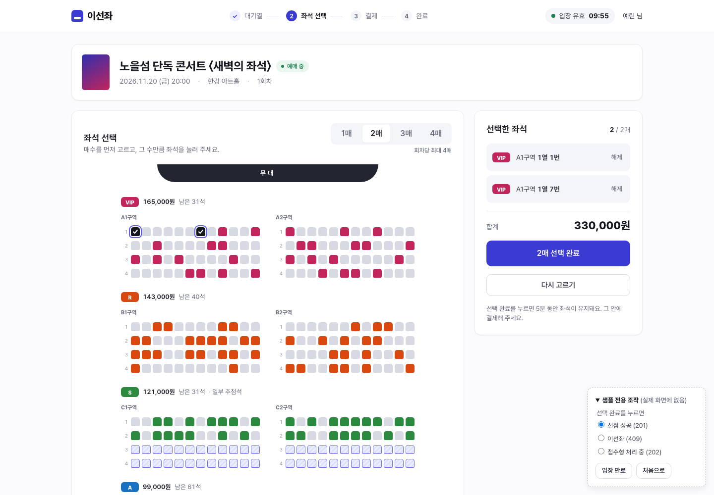 | 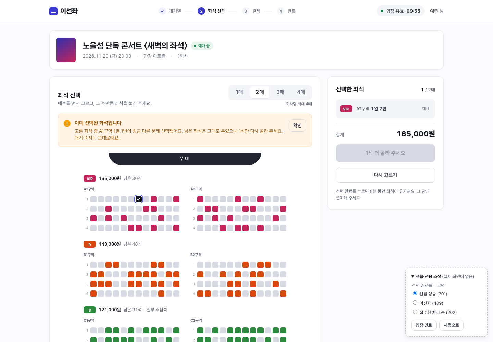 | 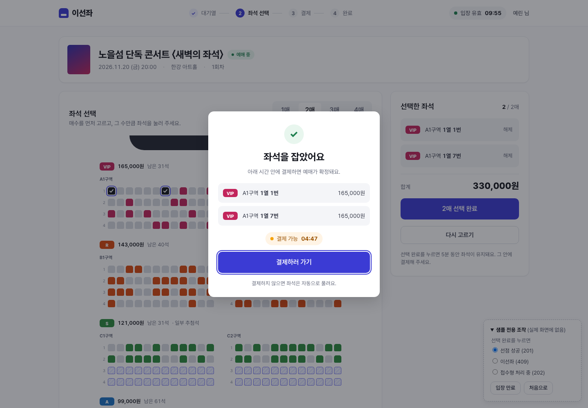 |

[`samples/queue.html`](samples/queue.html)은 대기열 화면이다(ISE-114, 2026-11-04 사용자 확인). 조작판으로 줄 서는 중, 대기 중, 연결 불안정(503), 차례가 됨, 줄에서 빠짐(404), 오픈 전(409), 예상하지 못한 오류를 바꿔 본다. 주소 끝에 `#demo=waiting`·`unstable`·`expired` 등을 붙이면 그 상태로 열리고, `&panel=0`이면 조작판을 숨긴다.

| 대기 중 | 연결 불안정(자동 재시도) | 줄에서 빠짐 |
|---|---|---|
| 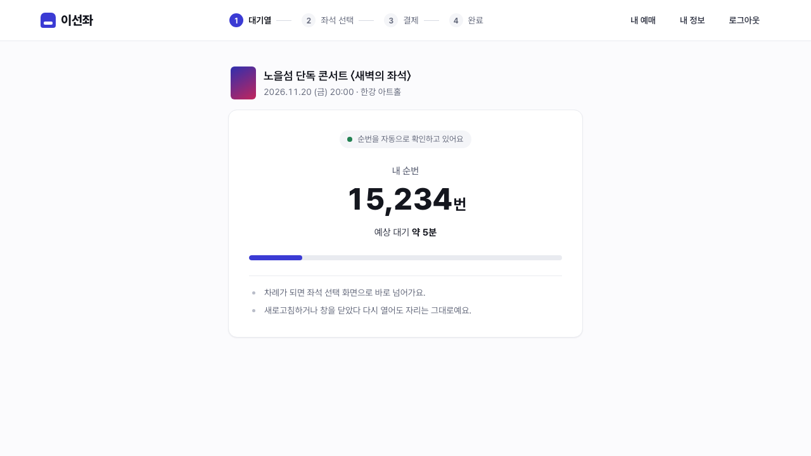 | 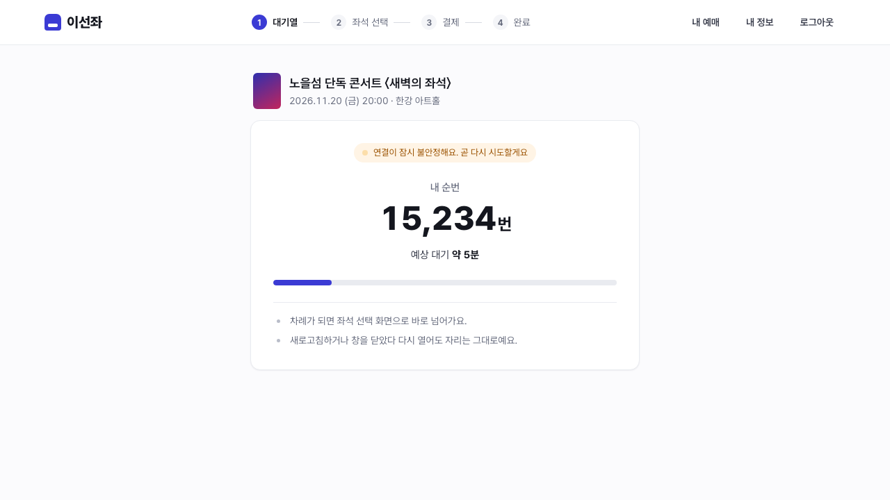 | 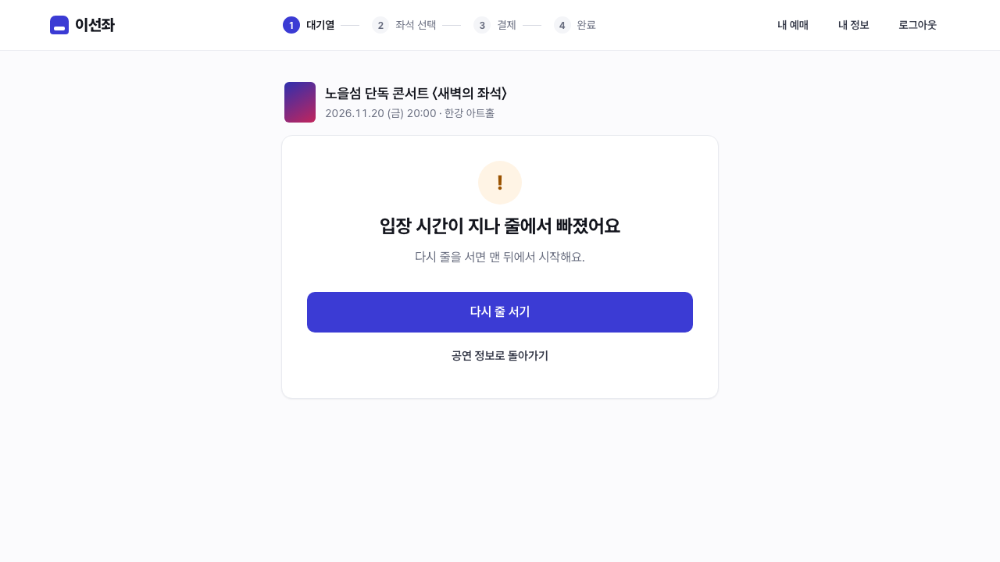 |

[`samples/seat-sections.html`](samples/seat-sections.html)은 좌석 선택을 "구역 먼저 고르기"로 바꾼 샘플이다(ISE-115, 2026-11-04 사용자 선택). 로컬 공연장(KSPO DOME)이 25구역 × 600석 = 15,000석이라 위 샘플처럼 전부 그리면 페이지가 1만 px를 넘는다. 구역 배치도(응답 순서대로 5칸, 좁으면 4칸)에서 구역을 고르면 그 구역 좌석만 그리고, 고른 좌석은 구역을 옮겨도 요약과 배치도(구역별 고른 수)에 남는다. 상단 바의 입장 유효 시간은 좁은 화면에서 본문 맨 위로 내려온다. 조작판과 `#demo=` 값은 위 샘플과 같다.

| 두 구역에서 2석 선택 | 409 이선좌 뒤 | 375px |
|---|---|---|
| 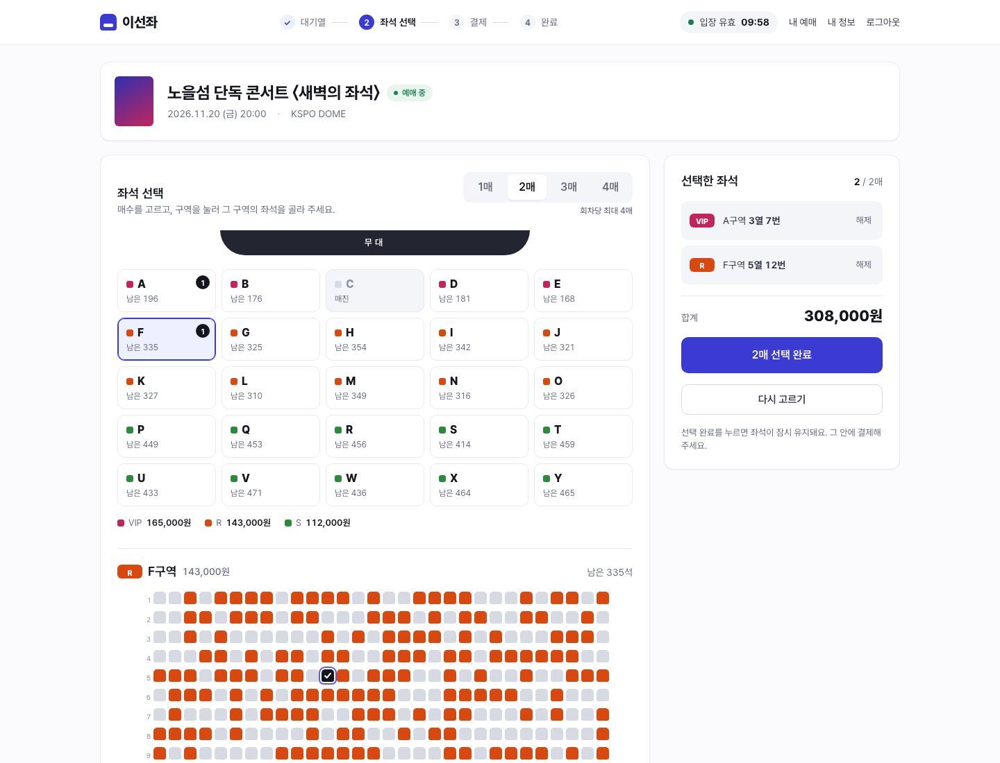 | 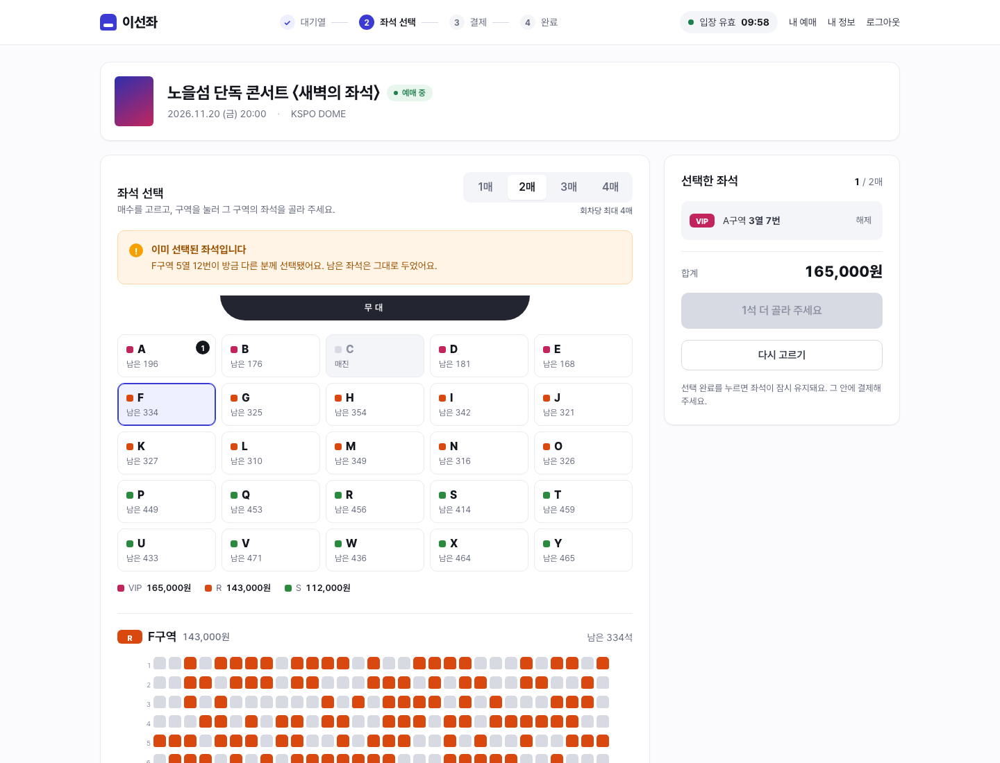 | 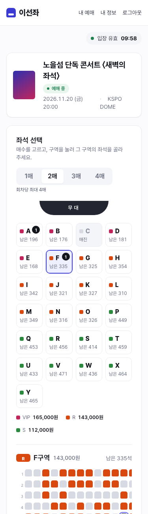 |

[`samples/payment.html`](samples/payment.html)은 결제 화면이다(ISE-116). 결제 수단은 카드 하나다(API가 `method: CARD`만 받고, 시연 결제(Mock PG)라 카드 정보를 받지 않는다). 조작판으로 결제 전, 결제 요청 중, 확인 중(202·504), 승인 뒤 확정 확인, 거절, 결제사 장애(503), 결제 가능 시간 지남, 수동 확인(409), 승인 뒤 만료(환불)를 바꿔 본다. 주소 끝에 `#demo=checking` 등을 붙이면 그 상태로 열리고 `&panel=0`이면 조작판을 숨긴다.

| 결제 전 | 확인 중 | 거절 |
|---|---|---|
| 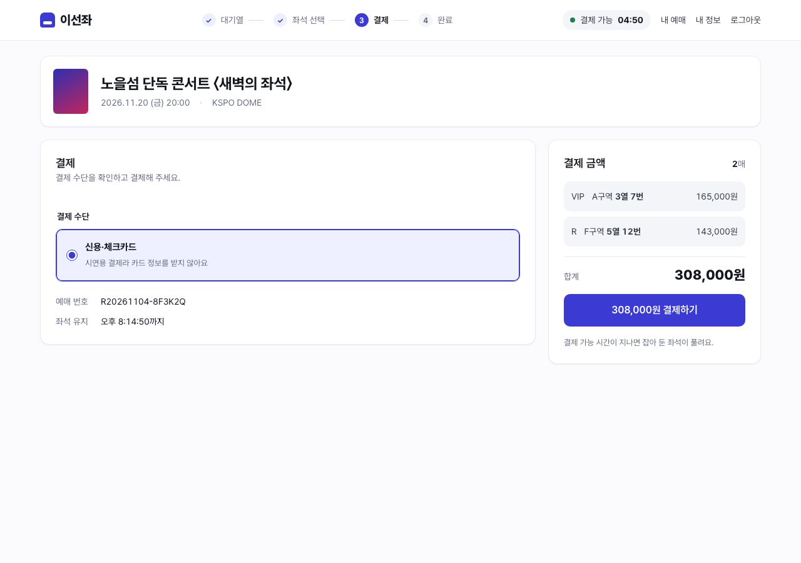 | 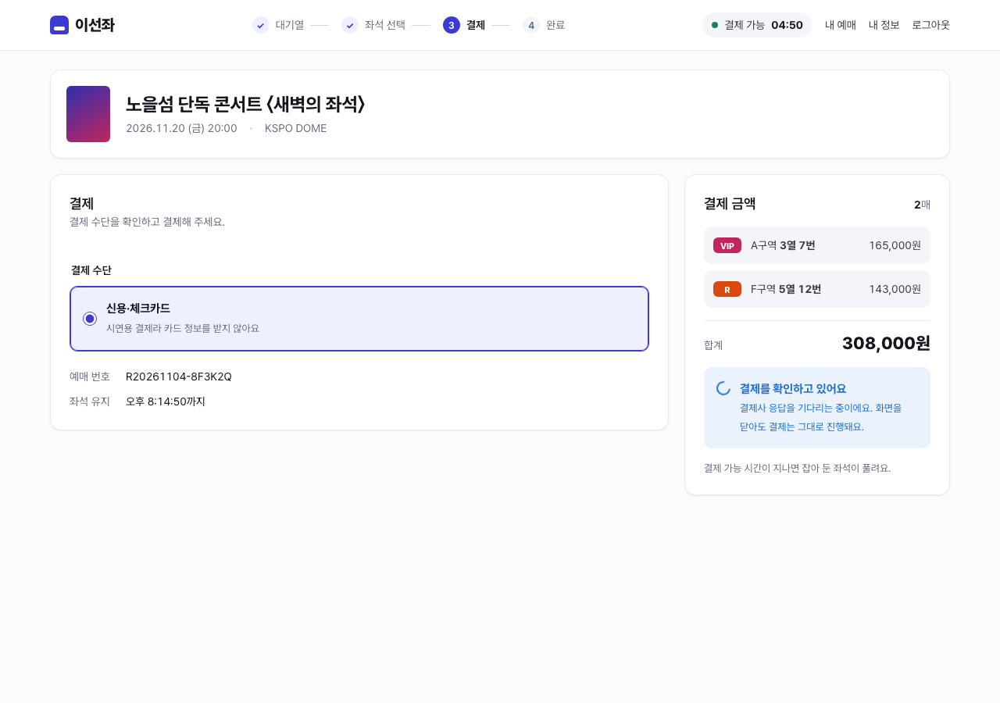 | 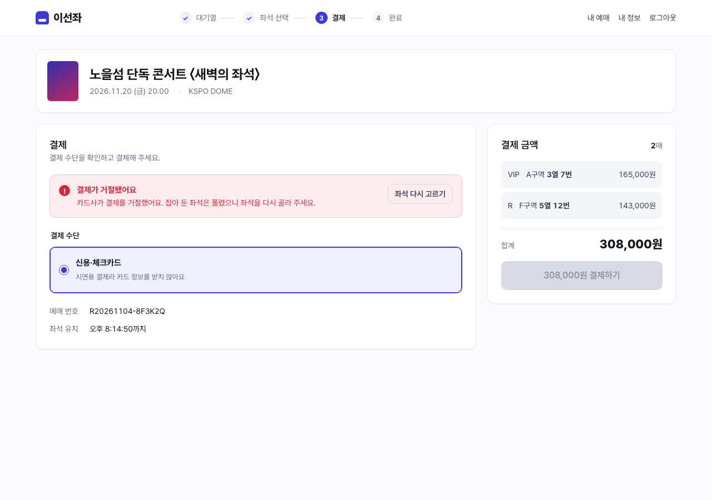 |

[`samples/reservations.html`](samples/reservations.html)은 예매 결과·상세와 내 예매 목록이다(ISE-117). 조작판으로 결과(예매 확정), 상세(결제 대기·기한 만료), 내 예매 목록, 빈 목록을 바꿔 본다. 예매 상세 응답에 공연 제목이 없어 결제 화면·내 예매 목록에서 오면 화면 이동 값으로 받고, 주소로 열면 예매 번호를 제목으로 쓴다. 결제 상태는 예매 응답에 없어(결제 ID 없음) 예매 상태로만 보인다.

| 결과(예매 확정) | 상세(결제 대기) | 내 예매 |
|---|---|---|
| 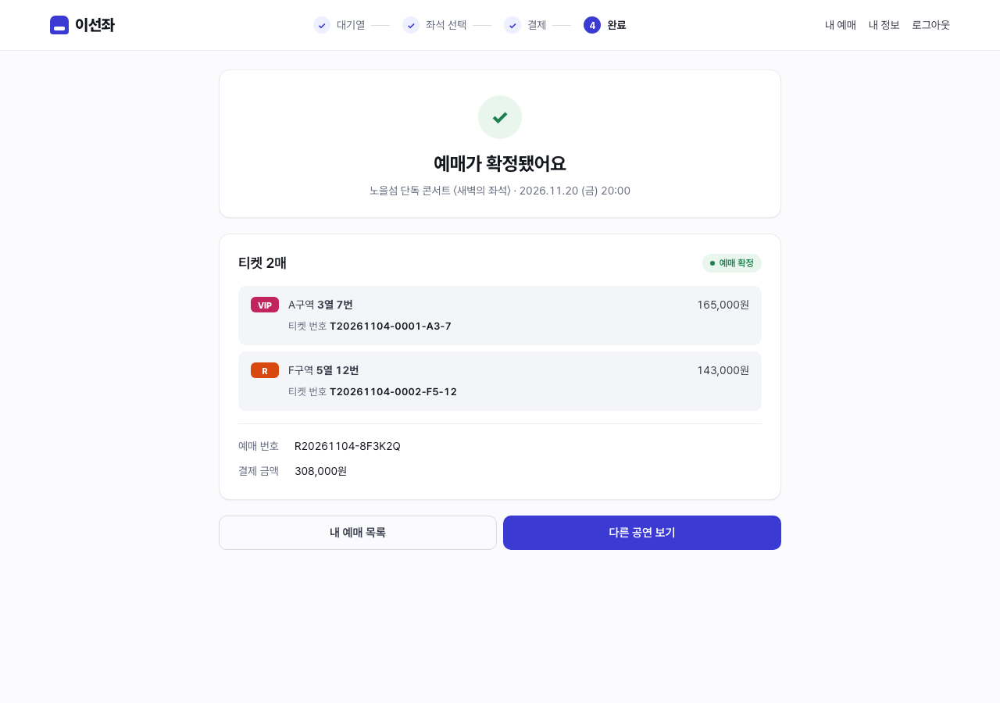 | 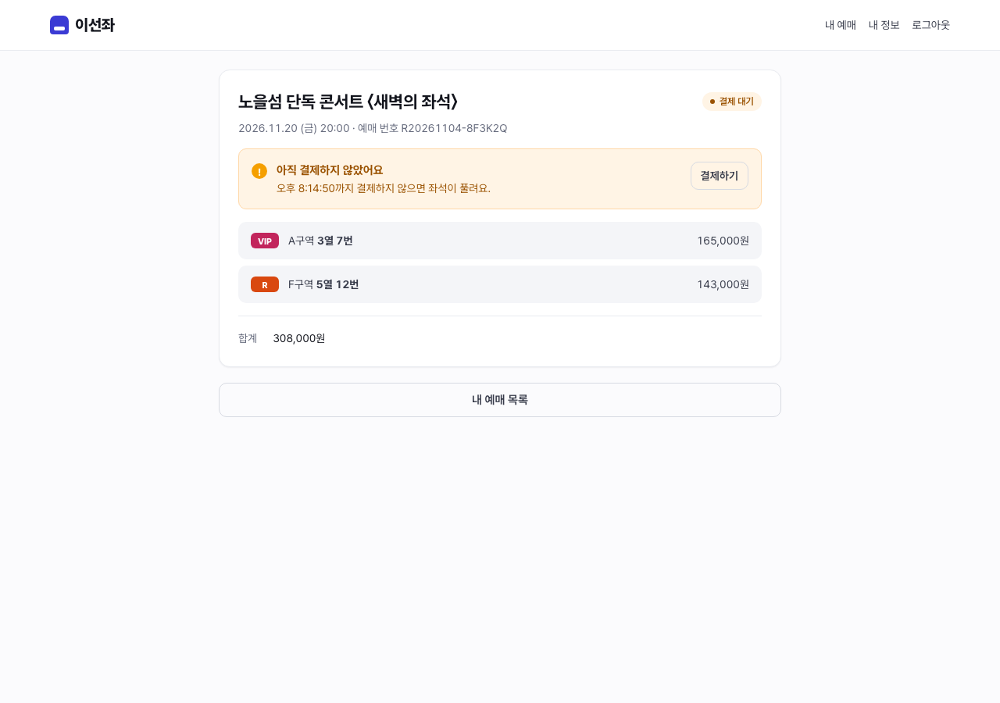 | 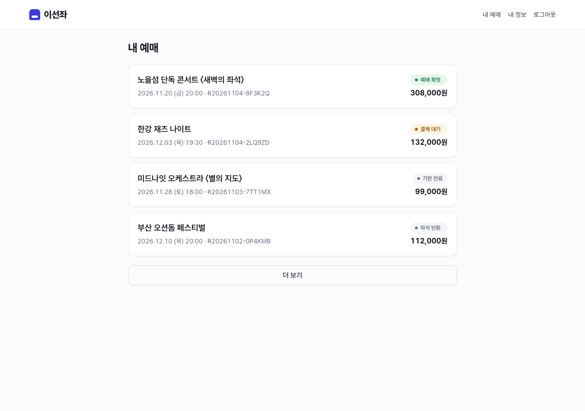 |

## 9. 확정한 방향

샘플을 보고 초안 그대로 확정했다(2026-11-02, [판단 기록](../../ai-judgments/junhyun/2026-11-02-design-system-sample-accepted.md)).

| # | 항목 | 결정 | 이유 |
|---|---|---|---|
| 1 | 서비스 이름·로고 | 팀 이름 "이선좌"를 워드마크로 쓴다 | 409 안내 "이미 선택된 좌석입니다"가 서비스 이름과 같아 발표에서 설계 의도가 바로 보인다 |
| 2 | 주 색 | 인디고 `#3B3BD4` | 흰 글자 대비 7.6:1, 좌석 등급 색 네 가지와 색상이 겹치지 않는다 |
| 3 | 선택한 좌석 색 | 검정 + 체크 + 인디고 고리 | 등급 색과 섞이지 않고 모양(체크)으로도 구분된다 |
| 4 | 다크 모드 | 하지 않는다 | 시연 화면 하나에 집중한다 |
| 5 | 시안 방식 | 화면마다 HTML 샘플을 먼저 만들고 React 컴포넌트로 옮긴다 | 빌드 없이 브라우저로 바로 확인하고, 구현 전에 상태별 화면을 맞춘다 |

5번 보완(2026-11-02, ISE-112, [판단 기록](../../ai-judgments/junhyun/daily/2026-11-02.md)): 컴포넌트와 `/_design`, MSW 목이 생긴 뒤에는 기존 컴포넌트만으로 만드는 단순한 화면(로그인·회원가입처럼 입력 칸과 버튼뿐인 화면)은 샘플 없이 React로 만들고, PR 전에 상태별 화면 캡처로 확인한다. 같은 모양을 두 번 만들지 않기 위해서다. 좌석·결제·대기열처럼 새 컴포넌트나 배치가 많은 화면은 샘플을 먼저 만든다.
