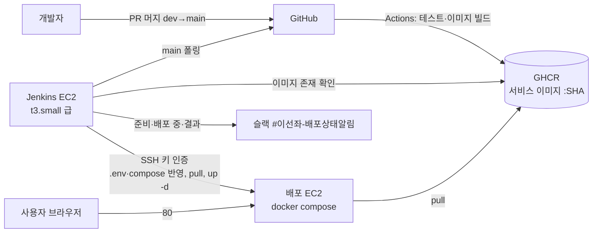

# 배포 설계

결론: main에 머지되면 GitHub Actions가 이미지를 만들어 GHCR에 올리고, 분리된 Jenkins EC2가 이를 감지해 배포 EC2에 SSH로 `docker compose up -d`를 실행한다. 결정은 2026-11-03에 사용자가 했고, 기록은 ADR 0044다([README](README.md)).

## 1. 대상과 구조

배포 대상은 SA 9-1대로 EC2 한 대의 docker compose다. 단일 EC2의 한계(인스턴스 장애 시 전체 중단)는 SA 9-3에 적힌 그대로다. AWS 계정은 2026-11-04 안준현이 만들었다. AWS의 새 가입 방식이라 리전이 아시아 태평양(시드니) `ap-southeast-2`로 고정되고, 사람의 콘솔 접근은 IAM 사용자가 아니라 AWS Settings 팀원 초대로 준다([학습 노트](../../learning/junhyun/qna/2026-11-04-aws-account-initial-setup.md), [판단 기록](../../ai-judgments/junhyun/2026-11-04-aws-region-and-team-access.md)). 이 문서의 "같은 리전"은 시드니다.



역할을 나누는 이유는 GitHub Actions가 CI와 이미지 빌드·푸시를, Jenkins가 배포만 맡도록 하기 위해서다(2026-11-03 사용자 결정).

## 2. 파이프라인

dev → main 머지가 릴리스다. 단계는 다음과 같다.

1. main에 머지된다.
2. Actions가 커밋 SHA 태그로 서비스 이미지를 빌드하고 GHCR에 푸시한다. `.github/workflows/images.yml`이 맡는다(아래 "이미지 워크플로"). 테스트는 지금처럼 `build.yml`이 한다.
3. Jenkins가 main의 새 커밋을 감지한다. 웹훅을 받으려고 Jenkins를 공개하지 않도록 폴링을 기본으로 한다. 웹훅으로 바꾸려면 GitHub 웹훅 IP 대역만 보안그룹에서 허용한다.
4. Jenkins가 그 SHA 이미지가 GHCR에 모두 있는지 확인한다. 없으면 30초마다 다시 확인하고 20분이 지나면 중단한다(ISE-175).
5. 배포 EC2에 SSH로 접속해 `.env`와 compose 파일을 반영하고 `docker compose pull`, `up -d`를 실행한다.
6. 헬스를 기다린다(Gateway 경유와 각 컨테이너의 readiness).
7. 스모크 테스트를 돈다.
8. 슬랙 #이선좌-배포상태알림에 단계마다 알린다: 배포 준비, 배포 중, 결과 순이다(ISE-175).
9. 헬스나 스모크가 실패하면 직전 성공 태그로 되돌린다.

스모크 테스트의 기본은 가볍게 한다: Gateway 경유 헬스, 가입·로그인, 공연 목록. `BookingFlowSystemTest`는 회차마다 좌석 15,000석을 만들어 DB를 키우므로 Jenkins 파라미터로 고를 때만 돈다([testing.md](../../guides/testing.md) 전체 스택 검사).

수동 재배포는 Jenkins에서 태그를 골라 다시 실행한다.

### 이미지 워크플로 (ISE-173)

파일은 `.github/workflows/images.yml`(언제·어떻게)과 `docker-bake.hcl`(무엇을)이다. 두 파일에 단계마다 주석을 달았다. 바탕 개념(워크플로·잡·스텝, `GITHUB_TOKEN`, 레지스트리와 태그, BuildKit 캐시)은 [학습 노트](../../learning/junhyun/qna/2026-11-04-github-actions-ghcr-image-workflow.md)에 있다.

**언제 도나**

| 계기 | 하는 일 | 이유 |
|---|---|---|
| main push(dev → main 릴리스 머지) | 이미지 8개를 빌드해 GHCR에 올린다 | Jenkins가 main 커밋마다 그 SHA의 이미지를 배포하고 되돌린다. 그래서 paths 필터 없이 매번 8개를 모두 만든다 |
| PR(Dockerfile, `.dockerignore`, `docker-bake.hcl`, `frontend/Dockerfile`, `frontend/nginx/**`, 프론트 의존성 파일(`package.json`, `package-lock.json`, `.npmrc`, `.nvmrc`), 이 워크플로가 바뀐 경우) | 빌드만 하고 올리지 않는다 | 이미지 정의가 깨진 것을 main에 가기 전에 본다. 필수 검사가 아니다(paths 필터 워크플로라 필수로 두면 해당 없는 PR의 머지가 막힌다) |
| 수동 실행(Actions → images → Run workflow) | main에서 돌리면 그 시점 main SHA로 다시 올린다. 다른 브랜치는 빌드만 한다 | 실패한 릴리스 이미지를 다시 만들 때 |

**무엇을 만드나**

- `ghcr.io/iseonjwa/<서비스>:<40자 커밋 SHA>` 8개: `config-server`, `eureka`, `gateway`, `user-service`, `reservation-service`, `payment-service`, `mock-pg`, `frontend`.
- 태그는 커밋 SHA 하나만 붙인다. `latest` 같은 움직이는 태그를 두지 않아, 서버에 무엇이 떠 있는지를 언제나 커밋 하나로 말할 수 있다.
- `linux/amd64`로 만든다. 배포 EC2가 x86이다.
- 라벨 `org.opencontainers.image.source`로 GHCR 패키지를 이 저장소에 연결하고, `org.opencontainers.image.revision`에 SHA를 남긴다.

**단계**

| 단계 | 하는 일 | 이유 |
|---|---|---|
| 권한 | 잡에만 `packages: write`를 준다 | 워크플로마다 GitHub이 만드는 `GITHUB_TOKEN`으로 GHCR에 올린다. 개인 토큰을 비밀값으로 두지 않는다 |
| buildx 준비 | BuildKit 빌더를 띄운다 | 여러 이미지를 한 번에(bake), 다른 CPU용(amd64)으로 만든다 |
| 의존성 캐시 | `actions/cache`로 Gradle·npm 다운로드 폴더를 복원하고, `buildkit-cache-dance`가 그 폴더를 Dockerfile의 캐시 마운트(`/root/.gradle`, `/root/.npm`)에 넣었다가 빌드 뒤 꺼내 저장한다 | Dockerfile의 캐시 마운트는 빌드 머신 안에만 남는데, GitHub 실행기는 매번 새 머신이다. 넣지 않으면 매번 의존성을 처음부터 받는다 |
| 로그인 | main일 때만 GHCR에 로그인한다 | PR은 올리지 않는다 |
| bake | `docker-bake.hcl`의 8개를 한 번에 빌드한다 | 앱 7개의 builder 단계(`gradlew bootJar`)가 `APP_MODULE`과 무관해서 BuildKit이 한 번만 돌린다. 앱마다 워크플로 매트릭스로 나누면 같은 Gradle 빌드를 7번 한다. 2026-11-04 로컬에서 앱 두 개를 함께 빌드해 Gradle 단계가 한 번만 도는 것을 확인했다 |
| 요약 | 올린(또는 빌드만 한) 이미지 이름을 실행 요약에 적는다 | Jenkins나 사람이 배포할 태그를 바로 찾는다 |

- 동시 실행: PR은 같은 PR의 이전 실행을 취소한다. main은 커밋마다 그룹을 따로 둔다. GitHub은 한 그룹에 대기 실행을 하나만 남기고 먼저 기다리던 실행을 취소하므로, main을 그룹 하나로 두면 빌드 중에 머지가 연달아 올 때 가운데 커밋의 이미지가 빠진다.
- 의존성 캐시 폴더(`build-cache`)와 cache-dance 작업 폴더(`scratch`)는 저장소 루트에 생긴다. 루트 `.dockerignore`에서 빼 두었다. 빼지 않으면 캐시를 맞힌 실행마다 수백 MB가 빌드 컨텍스트로 들어간다.
- 출처 증명(provenance) 첨부는 껐다. 켜면 GHCR 화면에 `unknown/unknown` 플랫폼 항목이 더 붙는다. 이미지 하나에 플랫폼 하나로 단순하게 둔다.
- `docker buildx bake`는 항상 `-f docker-bake.hcl`로 실행한다. 파일을 고르지 않으면 bake가 `compose.yml`도 읽어 같은 이름의 compose 서비스를 타깃에 합친다.

**보관 정책**

- 프로젝트 기간(M4 11/16까지)에는 지우지 않는다. 되돌림에 쓸 직전 태그가 남아 있어야 하고, 릴리스는 하루 몇 번이다.
- 공개 패키지는 저장·전송 요금이 없다. 비공개로 두면 요금제의 저장 한도를 확인해야 한다. 공개 여부는 아래 "첫 실행 뒤 할 일"에서 정한다.
- 정리가 필요해지면 패키지마다 최근 태그 몇 개만 남기고 지운다. 배포 EC2에 떠 있는 태그와 그 직전 태그는 지우지 않는다.

**첫 실행 뒤 할 일** (이 워크플로가 들어간 dev가 main으로 처음 릴리스된 뒤)

1. 조직의 Packages에 8개가 생겼고 태그가 그 커밋 SHA인지 본다.
2. 공개 여부를 정한다(ISE-174). 저장소가 공개이고 이미지에는 비밀값이 없다(비밀값은 서버 `.env`가 실행할 때 넣는다). 공개로 바꾸면 배포 EC2와 Jenkins가 토큰 없이 받는다. 바꾸는 곳은 패키지 설정의 Change visibility이고 조직 관리자 권한이 필요하다. 비공개로 두면 `read:packages` 토큰을 Jenkins Credentials에 둔다(4절).
3. `docker pull ghcr.io/iseonjwa/gateway:<SHA>`로 받아지는지 확인한다.

**로컬에서 재현**

```bash
docker buildx bake -f docker-bake.hcl --print                    # 타깃·태그·인자 확인
TAG=local docker buildx bake -f docker-bake.hcl gateway \
  --set '*.platform=linux/arm64' --load                          # 맥에서 하나만 빌드
```

### 이미지와 compose

- 서비스 이미지는 `ghcr.io/iseonjwa/<서비스>:<커밋 SHA>` 형태를 쓴다(위 "이미지 워크플로").
- 지금 `compose.yml`은 `build:`로 로컬에서 빌드한다. 배포 서버는 `compose.yml` 위에 `compose.deploy.yml`을 덮어 GHCR의 커밋 이미지를 받는다(아래 "배포 compose와 스크립트").
- 인프라 이미지(PostgreSQL, Redis, Kafka 등)는 지금처럼 digest로 고정한다.
- 현재 Dockerfile은 `APP_MODULE` 인자 하나로 모듈을 골라 `bootJar`를 만든다. 서비스 7개는 매트릭스가 아니라 bake 한 번으로 빌드한다(위 "이미지 워크플로").
- 프론트 SPA는 nginx 컨테이너가 서빙하고 `/api`를 Gateway로 중계한다([ADR 0040](../../decisions/0040-frontend-react-spa-in-monorepo.md), ISE-109). 배포 compose에 포함한다. `frontend/Dockerfile`(node 빌드 → nginx)과 compose의 `frontend` 서비스는 ISE-109에서 만들었다(로컬 `127.0.0.1:8000:80`, `mem_limit` 64m).

### 외부 노출 (SA 9-2)

공개 진입점은 프론트 nginx의 80이다. 8080(Gateway 직접)은 전체에 열지 않고, 부하 측정 때 발생기 보안그룹에만 연다(부하 도구는 nginx를 거치지 않고 Gateway를 부른다, [ADR 0040](../../decisions/0040-frontend-react-spa-in-monorepo.md) 4절). 관리 UI(Grafana, Kafka-UI, Prometheus, Zipkin)는 `127.0.0.1`에 바인딩해 SSH 터널로만 연다. 내부 서비스는 `ports` 없이 `expose`만 쓴다.

## 3. 보안그룹 규칙

SA 9-2의 표에 Jenkins EC2와 부하 발생기 EC2 행을 더했다.

| 대상 | 포트 | 인바운드 허용 | 비고 |
|---|---|---|---|
| 배포 EC2 | 22 | 팀원 IP, Jenkins EC2 보안그룹 | 키 인증만. Jenkins EC2는 SSH만 허용 |
| 배포 EC2 | 80 | 전체(0.0.0.0/0) | 화면과 `/api/` 중계(프론트 nginx). 유일한 공개 진입점 |
| 배포 EC2 | 8080 | 허용 없음. 부하 측정 중에만 발생기 보안그룹 | Gateway 직접 접근. 부하 도구용 |
| 배포 EC2 | 3000 | 팀원 IP `/32` | Grafana만. 익명 Viewer(보기만)이고 시연 모드 링크가 이 주소로 온다 |
| 배포 EC2 | 8085, 9090, 9093, 9411, 8761 | 허용 없음 | SSH 터널로만 |
| 배포 EC2 | 8081~8083, 8090, 8888, DB, Redis, Kafka | 허용 없음 | compose 내부 네트워크 전용 |
| Jenkins EC2 | 22 | 팀원 IP | Jenkins UI(8080)는 열지 않고 SSH 터널로만 접근 |
| Jenkins EC2 | 웹훅 포트 | 허용 없음 `[가정]` | 폴링이 기본이다. 웹훅으로 바꿀 때만 GitHub 웹훅 IP 대역을 허용 |
| 발생기 EC2 (측정 때만) | 22 | 팀원 IP | 측정이 끝나면 인스턴스를 지운다([load-test.md](load-test.md)) |

배포 EC2의 8080 인바운드는 평소 닫아 두고, 부하 측정 때만 발생기 보안그룹 하나에 연다. SA 9-2의 "측정 기기 IP 허용"을 같은 VPC 방식으로 구체화한 것이다.

## 4. 비밀값

- 서버 `.env`는 서버에서 만든다. 키 목록은 `initLocalEnv`와 같고 저장소에 올리지 않는다. 지금 `.env.example`의 키는 `DB_USER`(compose에 기본값 있음), `JWT_ACCESS_SECRET`, `JWT_REFRESH_SECRET`, `ENTRY_TOKEN_SECRET`, `PAYMENT_TOKEN_SECRET`, `BILLING_KEY_SECRET`, `DB_PASSWORD`, `ADMIN_EMAIL`, `ADMIN_PASSWORD`, `GRAFANA_ADMIN_PASSWORD`다. 알림용 슬랙 웹훅 `SLACK_WEBHOOK_MONITORING`(선택)과 환경 이름 `STACK_ENV`가 더해진다. 서버의 `STACK_ENV`는 `local`이 아닌 값(예: `deploy`)으로 둬 슬랙에서 로컬 알림과 가린다([observability.md](observability.md) 3절).
- Jenkins 자격 증명은 Jenkins Credentials에만 둔다: GHCR 읽기 토큰, 배포 EC2 SSH 키, 슬랙 웹훅(`#이선좌-배포상태알림`용).
- 배포 단계의 "`.env` 반영"은 서버에 이미 만든 `.env`를 유지한다는 뜻이다. Jenkins가 비밀값 원문을 저장소에서 가져오지 않는다.
- 서버 `.env`는 `script/deploy/init-env.sh`가 만든다(ISE-174). 키와 값 형식은 `initLocalEnv`와 같고, `STACK_ENV=deploy`가 들어간다. 이미 있으면 덮어쓰지 않고 빠진 키만 더한다. 그래서 키 목록이 바뀌는 릴리스는 배포 전에 서버에서 이 스크립트를 한 번 더 돌린다(새 키를 스크립트에 함께 더한다).

## 5. 배포·되돌림 절차 개요

배포는 2절의 5~7단계다. 되돌림은 직전 성공 커밋으로 `pull`·`up -d`를 다시 실행하는 것이다. 되돌림 뒤에도 같은 헬스 확인을 한다.

### 배포 compose와 스크립트 (ISE-174)

배포 절차를 서버의 스크립트 하나로 만들고 Jenkins(ISE-175)는 SSH로 그 스크립트를 부르기만 한다. Jenkins가 없어도 사람이 같은 스크립트로 배포·되돌림을 할 수 있다(리허설 대비).

| 파일 | 하는 일 |
|---|---|
| `compose.deploy.yml` | `compose.yml` 위에 덮는다. 앱 8개를 `ghcr.io/iseonjwa/<서비스>:${IMAGE_TAG}`로 받고 `build`를 지운다(`!reset`). SA 9-3 상한·힙, 관측 추가분 상한, `restart: unless-stopped`, 로그 파일 크기 제한(20MB×5), 앱 프로필 `prod`(Mock PG만 `loadtest`, 장애 주입 API용, ISE-71), 트레이스 샘플링 1.0, `STACK_ENV=deploy`, Kafka-UI 읽기 전용(ISE-72). 공개는 frontend `80:80`, gateway는 `8080:8080`(보안 그룹이 외부를 막는다) |
| `script/deploy/deploy.sh <SHA>` | 저장소를 그 커밋으로 checkout(compose·config-repo·관측 설정을 이미지와 맞춘다) → `pull` → `up -d --remove-orphans --wait`(헬스까지 최대 7분) → 스모크. 실패하면 `.deploy/current`의 직전 성공 커밋으로 되돌린다. 종료 코드 0 성공, 1 실패(되돌림 성공), 2 사용법, 3 되돌림도 실패 |
| `script/deploy/smoke.sh [주소]` | nginx 80을 거쳐 화면 200, 깊은 경로 200, 공연 목록 200, 내 정보 401. 항목마다 기대한 상태가 나올 때까지 `SMOKE_WAIT_SECONDS`(기본 120초) 동안 5초 간격으로 다시 확인한다(Eureka 발견 지연, TS-34). 데이터를 만들지 않는다 |
| `script/deploy/init-env.sh` | 서버 `.env`를 처음 만들고 빠진 키를 더한다(4절). 시연 샘플 계정 키(`SAMPLE_USER_EMAIL`·`SAMPLE_USER_PASSWORD`·`SAMPLE_USER_NICKNAME`)도 만든다 |
| `script/deploy/seed-demo.sh [주소]` | 시연 공연 `이선좌 시연 공연`과 회차 둘(좌석 15,000석씩), 샘플 사용자를 관리자·가입 API로 넣는다. 다시 돌려도 안전하다(공연이 있으면 건너뛰고, 샘플 사용자가 있으면 가입을 건너뛴다) |
| `script/deploy/seed-lottery-entrants.sh` | 추첨 시연 응모자를 공개 API로 적재한다. `prepare`는 가입·로그인·카드 등록, `enter <추첨 id>`는 응모다. 다시 돌려도 안전하고, loopback이 아닌 주소는 `LOTTERY_SEED_ALLOW_REMOTE=yes`가 있어야 보낸다(ISE-199) |
| `script/deploy/install-docker.sh` | Ubuntu에 Docker 공식 apt 저장소로 Docker와 compose 플러그인을 설치한다 |
| `script/deploy/slack-payload.sh` | Jenkins가 보낼 배포 결과 슬랙 메시지(JSON)를 만든다. 서버가 아니라 Jenkins 작업 공간에서 돈다(아래 Jenkins 4번) |

- 앱 프로필은 `prod`다. `local` 전용 컨트롤러(`LocalIdentityController` 등)가 배포 서버에 뜨지 않게 하려는 것이다. `application-prod.yml`의 샘플링은 `${TRACING_SAMPLE_RATE:0.1}`로 바꾸고 배포 compose가 1.0을 넣는다(시연에서 traceId로 트레이스를 본다). 부하 측정 때는 0.01(`loadtest`)로 바꿀지 측정 이슈에서 정한다.
- 상한 합계는 약 12.1GB(앱 4.8GB, 데이터 4.5GB, 관측 2.8GB)다. 16GB급의 약 77%로 SA 9-3의 75% 기준을 조금 넘는다. 실제 사용량은 배포 뒤 `docker stats`로 잰다(ISE-176).
- 2026-11-04 로컬에서 `IMAGE_TAG=<임의 SHA> docker compose -f compose.yml -f compose.deploy.yml config`로 합쳐진 설정(이미지, 빌드 없음, 상한, 포트, 프로필)을 확인했다. 스크립트는 `bash -n`과 shellcheck(경고 없음)를 통과했고, `smoke.sh`를 로컬 nginx(8000)에 돌려 네 항목이 모두 통과했다. 실제 배포는 첫 main 릴리스로 GHCR 이미지가 생긴 뒤 확인한다.
- `seed-demo.sh`(ISE-177)는 2026-11-04 로컬 nginx(8000)에서 확인했다. 처음에는 공연 1개·회차 2개(좌석 15,000석씩)를 만들었고 상태는 `ON_SALE`과 `BEFORE_OPEN`이었다. 두 번째 실행은 공연 만들기를 건너뛰었고, 샘플 사용자 로그인은 200이었다. 샘플 가입(201)은 임시 `.env`의 새 이메일로, 잘못된 관리자 비밀번호는 401과 `code`·`message` 출력 뒤 종료 1로 확인했다. 스크립트는 `bash -n`과 shellcheck(경고 없음)를 통과했다. 오픈 시각 사전 검사(형식·없는 날짜·8일 뒤보다 늦음은 모두 종료 2, 생성 없음)와 `open` 하위 명령(10분 뒤 회차 추가)도 같은 날 확인했다.
- `seed-lottery-entrants.sh`(ISE-199)는 2026-11-05 로컬 nginx(8000)에서 확인했다. `prepare`는 120명 73초였고 계정 120개, 활성 빌링키 108개다. 다시 실행하면 27초에 새 가입·카드 등록 없이 끝났다. `enter`는 120건 75초였고 `ENTERED`가 1매 90건, 2매 30건이다. 다시 실행해도 건수가 같았다. 응모 기간 전은 409로 멈추고 0건이다. 틀린 비밀번호는 첫 계정의 401에서 멈춘다. 추첨(30석, 예비 15) 90초 뒤 `PAID` 22건(30석), `FAILED`·`BILLING_KEY_MISSING` 2건, `dead_letters` 0건이었다. 스크립트는 `bash -n`을 통과했고, shellcheck는 이 PC에 없어 실행하지 못했다. 배포 서버 실행은 미확인이다.

### 서버 준비 순서 (배포 EC2, 처음 한 번)

1. EC2: Ubuntu 24.04 LTS(x86), 16GB급, gp3 40GB, 키 페어 `iseonjwa-deploy`, 보안 그룹 `iseonjwa-deploy-sg`(80 전체, 22 팀원 IP·Jenkins 보안 그룹, 8080은 열지 않음). 주소가 바뀌지 않게 Elastic IP를 붙인다.
2. 접속: `ssh -i ~/.ssh/iseonjwa-deploy.pem ubuntu@<주소>`
3. `git clone https://github.com/iseonjwa/high-quality-ticketing-system.git ~/iseonjwa && cd ~/iseonjwa`
4. `bash script/deploy/install-docker.sh` 뒤 다시 접속한다.
5. `script/deploy/init-env.sh`. 슬랙 알림을 받으려면 `.env`의 `SLACK_WEBHOOK_MONITORING`을 서버에서 직접 채운다.
6. 첫 배포: `script/deploy/deploy.sh <main의 40자 커밋 SHA>`(그 커밋의 이미지가 GHCR에 있어야 한다).
   - 시연 데이터: `script/deploy/seed-demo.sh`(ISE-177). 회차 둘을 만든다. "지금 예매"는 오픈 시각이 이미 지난 회차(공연 7일 뒤)이고, "오픈 시연"은 `OPEN_AT`(ISO-8601 UTC)으로 정한 시각에 열리는 회차(공연 8일 뒤)다. `OPEN_AT`이 없으면 지금부터 30분 뒤다. 예: `OPEN_AT=2026-11-06T05:00:00Z script/deploy/seed-demo.sh`. 회차를 고치는 API가 없으므로 오픈 시각은 바꿀 수 없다. 대신 리허설·시연 직전에 `script/deploy/seed-demo.sh open <OPEN_AT> [주소]`로 시연 공연에 "오픈 시연" 회차를 하나 더 만든다(좌석 포함, 공연 시작은 OPEN_AT 다음 날). 예: `script/deploy/seed-demo.sh open $(date -u -d '+10 minutes' +%Y-%m-%dT%H:%M:%SZ)`. 끝에 새 회차 id와 오픈 시각이 나온다.
   - `OPEN_AT`은 API를 부르기 전에 형식과 "공연 시작(8일 뒤)보다 앞선다"를 검사하고, 틀리면 아무것도 만들지 않고 종료 코드 2로 끝난다. 공연만 있고 회차가 0개면(이전 실행이 중간에 실패) 기본 실행이 회차·좌석을 이어서 만든다.
   - 공연장 id는 조회 API가 없어 예약 DB 컨테이너에서 이름이 `KSPO DOME`인 공연장을 찾는다(없으면 `VENUE_ID`로 넘긴다). 오픈 시각 검증은 회차 등록이 `openAt`이 `startsAt`보다 앞서는지만 본다(`Schedule.create`). 지난 오픈 시각도 받는다. 샘플 사용자 비밀번호는 서버에서 `grep SAMPLE_USER_PASSWORD .env`로 본다.
7. Grafana는 `http://52.63.10.174:3000`으로 바로 연다(등록된 IP만, 로그인 없이 보기). 나머지 관리 UI는 SSH 터널로 본다: `ssh -i ~/.ssh/iseonjwa-deploy.pem -L 9090:127.0.0.1:9090 -L 9411:127.0.0.1:9411 ubuntu@<주소>` 뒤 `http://localhost:9090`.
8. 팀원 SSH: 받은 공개 키를 `~/.ssh/authorized_keys`에 한 줄씩 더하고, 보안 그룹 22 규칙에 팀원 IP를 더한다.

- DB 스키마(Flyway) 변경이 있는 릴리스는 이미지만 되돌려서는 풀리지 않을 수 있다. 되돌림 가능한 마이그레이션 규칙은 정하지 않았다(미정).
- 되돌림 자체가 실패하면 슬랙에 알리고 사람이 접속한다. 자동 재시도 횟수는 미정이다.

### Jenkins (ISE-175)

Jenkins EC2에서 도는 Jenkins와 배포 파이프라인이다. 설정은 화면에서 하지 않고 코드(JCasC)로만 한다.

| 파일 | 하는 일 |
|---|---|
| `infra/jenkins/Dockerfile` | `jenkins/jenkins:2.580.2-lts-jdk21`을 digest로 고정하고 `jq`를 더한다. 플러그인을 이미지에 넣는다 |
| `infra/jenkins/plugins.txt` | 플러그인 7개(configuration-as-code, job-dsl, workflow-aggregator, git, ssh-agent, credentials-binding, timestamper)와 의존성을 2026-11-04 버전으로 모두 고정했다 |
| `infra/jenkins/casc.yaml` | 설치 마법사 없이 설정한다. 로컬 사용자 `admin` 하나(가입·익명 읽기 없음), 실행기 1개, 자격 증명 `deploy-ssh`(사용자 `ubuntu`)·`slack-webhook-deploy`, 잡 `deploy-main` |
| `infra/jenkins/compose.yml` | Jenkins EC2용. `127.0.0.1:8080`, `jenkins_home` 볼륨, `mem_limit` 1200m, `-Xmx768m`, `restart: unless-stopped`, 로그 20MB×5 |
| `Jenkinsfile` | 파이프라인(아래) |

**잡 흐름**: 폴링(`POLL_SCHEDULE`, 서버 기본 `H/2 * * * *`) → 커밋 정하기 → GHCR 이미지 8개 기다리기 → 배포 서버에 SSH로 `deploy.sh` → 슬랙. 슬랙은 세 번 알린다: 커밋을 정한 직후 `started`(배포 준비), 이미지 8개를 확인하고 SSH 배포를 시작하기 직전 `deploying`(배포 중), 끝나면 결과.

1. 커밋 정하기: 매개변수 `TAG`가 비면 checkout한 main의 HEAD SHA, 있으면 그 40자 SHA(16진이 아니면 실패)를 쓴다. 커밋 제목도 함께 읽는다.
2. 이미지 기다리기: 8개(config-server, eureka, gateway, user-service, reservation-service, payment-service, mock-pg, frontend)에 그 SHA 태그가 모두 생길 때까지 30초마다 확인하고 최대 20분 기다린다. 익명 토큰(`https://ghcr.io/token?scope=repository:iseonjwa/<이름>:pull`)으로 매니페스트에 HEAD 요청을 보내 200을 본다. 이 방식은 패키지가 공개일 때만 동작한다(아래 "GHCR 패키지 공개"). 아직 올라오지 않은 이미지는 토큰 요청이 403(`DENIED`)으로 끝나는데, 이것도 "없음"으로 센다.
3. 배포: `sshagent(['deploy-ssh'])` 안에서 `ssh ubuntu@${DEPLOY_HOST} "cd ~/iseonjwa && git fetch -q origin && git checkout -q --detach <SHA> && script/deploy/deploy.sh <SHA>"`를 실행한다. 종료 코드 0은 성공, 1은 실패(되돌림 성공), 3은 되돌림도 실패, 그 밖(예: SSH 접속 실패 255)은 오류다.
4. 슬랙: 단계 알림 둘과 결과를 `#이선좌-배포상태알림`에 보낸다(Jenkinsfile의 `notifySlack`). 이미지를 못 찾아 중단되면 배포 중 알림은 가지 않고 배포 준비 다음에 바로 결과가 간다. 메시지는 `script/deploy/slack-payload.sh`가 만들고 모양은 Alertmanager 알림(`infra/alertmanager/templates/slack.tmpl`)과 맞췄다(2026-11-04, 처음의 한 줄 메시지는 커밋·직전 버전을 찾기 어려워 바꿨다).
   - 단계 알림: 남색 띠에 `[배포 준비] 새 커밋을 찾았습니다. 이미지 8개를 기다립니다`와 `[배포 중] 이미지 8개를 확인했습니다. 배포 서버에 반영합니다`다. 직전 버전은 `deploy.sh`가 알려 주므로 이 시점에는 모른다. 그래서 커밋 제목과 필드 둘(커밋, 계기), 꼬리말만 담고 직전 버전·걸린 시간·바뀐 내용·바로 가기는 뺀다.
   - 결과 알림의 왼쪽 색 띠와 제목 한 줄: 성공 초록 `[배포 성공] 배포 서버에 새 버전을 올렸습니다`, 되돌림 주황 `[배포 실패] 새 버전이 확인을 통과하지 못해 직전 버전(def5678)으로 되돌렸습니다`, 되돌림도 실패 빨강 `[배포 실패] 배포와 되돌림이 모두 실패했습니다. 서버 확인이 필요합니다`, 이미지 대기 초과 회색 `[배포 중단] …`, 사람이 멈췄거나 40분 제한 회색 `[배포 멈춤] …`, 그 밖 빨강 `[배포 오류] …`. 제목은 GitHub 커밋 페이지로 이어진다.
   - 본문: 굵은 커밋 제목, 그리고 짧은 필드 커밋(링크)·직전 버전(링크, 처음 배포면 "없음")·계기(`main 새 커밋`, `수동 재배포(TAG)`, `수동 실행(main 최신)`)·걸린 시간·바뀐 내용(직전 버전과 새 버전의 GitHub 비교 링크)·바로 가기(`PUBLIC_URL`이 있을 때 서비스 링크). 꼬리말은 `이선좌 Jenkins #<빌드 번호> · 배포 서버`다.
   - 직전 버전은 `deploy.sh`가 남기는 `== 배포 시작: <SHA> (직전 성공: <SHA>|없음)` 줄에서 뽑는다. 휴대폰 푸시 알림에는 제목, 짧은 SHA, 커밋 제목이 한 줄로 보인다.
   - 웹훅 주소는 `withCredentials` 환경 변수로만 다루고 로그에 찍지 않는다. 메시지를 만들지 못하면(체크아웃 실패 등) 한 줄짜리로 보낸다. 전송이 실패해도 빌드 결과는 바뀌지 않는다.
   - 모양 확인(`RESULT`는 `started`, `deploying`도 된다): `RESULT=success SHA=<40자> COMMIT_TITLE=제목 PREVIOUS_SHA=<40자> TRIGGER='main 새 커밋' DURATION_SEC=95 BUILD_NUMBER=1 script/deploy/slack-payload.sh | jq .`

옵션은 동시 실행 금지, 타임스탬프, 전체 40분 제한이다. 되돌리기·재배포는 Jenkins에서 `TAG`에 이전 커밋 SHA를 넣고 실행한다. `BookingFlowSystemTest`를 고르는 매개변수는 이번에 넣지 않았다(후속).

**자격 증명과 비밀 파일**: 저장소에 올리지 않는다. Jenkins EC2의 `/opt/jenkins/jenkins.env`(`JENKINS_ADMIN_PASSWORD`, `SLACK_WEBHOOK_DEPLOY`, `DEPLOY_HOST`, `POLL_SCHEDULE`, 선택 `PUBLIC_URL`=슬랙 바로 가기 주소, 서버는 `http://52.63.10.174`)와 `/opt/jenkins/deploy_ssh_key`(배포 EC2에 접속하는 개인 키)를 0600으로 둔다. 컨테이너 사용자(uid 1000, EC2의 `ubuntu`와 같다)가 읽는다. 키 파일은 컨테이너의 `/run/secrets/deploy_ssh_key`에 읽기 전용으로 붙고 casc.yaml이 `${readFile:...}`로 읽는다. 파이프라인 단계는 컨테이너 환경 변수를 그대로 보므로 이 파일의 값이 빌드 로그에 찍히지 않게 주의한다(`env`·`printenv`를 쓰지 않는다).

**`DEPLOY_HOST`는 배포 EC2의 사설 IP다.** 배포 서버 보안 그룹은 "Jenkins 보안 그룹에서 오는 22"만 허용하는데, 이 규칙은 VPC 안 사설 IP로 온 연결에만 맞는다. 공인 IP(Elastic IP)로 붙으면 출발지가 Jenkins 보안 그룹이 아닌 공인 주소로 보여 막힌다. 두 EC2는 같은 VPC에 둔다.

**UI는 SSH 터널로만 연다**: `ssh -i <키> -L 8081:127.0.0.1:8080 ubuntu@<Jenkins IP>` 뒤 `http://localhost:8081`(`admin`과 `jenkins.env`의 비밀번호).

**Jenkins EC2 준비 순서**
1. EC2: Ubuntu 24.04, t3.small 급, 같은 VPC, 보안 그룹은 22를 팀원 IP에만 연다(3절).
2. `git clone https://github.com/iseonjwa/high-quality-ticketing-system.git ~/iseonjwa && cd ~/iseonjwa`, `bash script/deploy/install-docker.sh` 뒤 다시 접속한다.
3. `sudo mkdir -p /opt/jenkins && sudo chown ubuntu: /opt/jenkins`, `/opt/jenkins/jenkins.env`를 만들고 `chmod 600`. `ssh-keygen -t ed25519 -N '' -f /opt/jenkins/deploy_ssh_key`로 키를 만들고 `chmod 600`.
4. 배포 EC2의 `~/.ssh/authorized_keys`에 `/opt/jenkins/deploy_ssh_key.pub` 한 줄을 더한다.
5. `docker compose -f infra/jenkins/compose.yml up -d --build`.

**GHCR 패키지 공개**: 이미지 대기 확인은 익명 토큰을 쓰므로 패키지 8개를 공개로 바꿔야 한다(위 "첫 실행 뒤 할 일"). 비공개로 두면 확인이 항상 403이라 20분 뒤 "[배포 중단]"이 된다.

**로컬 확인(2026-11-04, 맥 Docker)**: 가짜 값(무작위 관리자 비밀번호, 막힌 슬랙 주소, `ssh-keygen`으로 만든 가짜 키)으로 따로 띄웠다(프로젝트 `iseonjwa-jenkins-test`, 포트 28080).
- 이미지 빌드와 기동 성공. 설치 마법사 없이 로그인 페이지가 200. 익명 `/api/json`은 403, 틀린 비밀번호는 401.
- `admin`으로 잡 `deploy-main` 하나, 자격 증명 `deploy-ssh`(SSH 개인 키)와 `slack-webhook-deploy`(Secret text) 둘, 실행기 1개. `POLL_SCHEDULE`이 비면 트리거가 없고 `H/2 * * * *`이면 SCM 폴링이 생긴다.
- Jenkinsfile 문법 검사(`/pipeline-model-converter/validate`)가 "successfully validated". 안의 셸 조각 셋은 shellcheck(경고 없음)를 통과했다.
- `deploy-main`을 실행하니 GitHub에서 main을 받았으나 main에 `Jenkinsfile`이 아직 없어 실패했다(이 PR이 main에 들어가야 한다).
- 파이프라인 시험: Jenkinsfile을 인라인 잡으로 옮겨 단계마다 확인했다. 20분 대기를 12초로 줄이면 "[배포 중단]" 경로로 가고 슬랙 전송 실패는 빌드를 바꾸지 않았다. 이미지 확인을 건너뛰면 SSH 단계까지 가서 ssh-agent가 키를 읽고 `127.0.0.1:22`에 접속을 시도했다(연결 거부, 오류 경로). `ssh`를 종료 코드 0·1·3으로 흉내 내면 슬랙 메시지가 각각 성공, "직전 버전(aaaaaaa)으로 되돌렸습니다", "되돌림도 실패했습니다"로 나왔다.
- 실제 GHCR 이미지 확인, 실제 배포 EC2 SSH, 실제 슬랙 전송은 하지 않았다(이미지는 아직 올라오지 않았다).

**단계 알림 확인(2026-11-05, 맥 Docker)**: 같은 방식으로 띄우고(포트 28080) 슬랙 대신 맥의 작은 HTTP 수신기(28099)가 POST 본문을 받게 했다. 이 브랜치의 `Jenkinsfile`을 인라인 시험 잡에 넣고 `slack-payload.sh`를 작업 공간에 뒀다. 저장소 `Jenkinsfile`의 문법 검사는 "successfully validated"였다.
- `TAG`를 실제 커밋 SHA로 줘 GHCR의 공개 이미지 8개 확인을 통과시키면 `DEPLOY_HOST=127.0.0.1`의 SSH가 실패(종료 코드 255)하고, 수신기에 `[배포 준비]` → `[배포 중]` → `[배포 오류]` 3건이 순서대로 왔다.
- `TAG`를 존재하지 않는 SHA(0이 40개)로 주고 대기를 12초로 줄이면 `[배포 준비]` → `[배포 중단]` 2건만 왔다(배포 중 알림 없음).
- 실제 슬랙 전송과 실제 배포 서버(SSH 성공 경로)는 확인하지 않았다. 시험 컨테이너·볼륨·수신기는 지웠다.

### 첫 배포 기록 (2026-11-04)

- 서버: 배포 `m7i-flex.xlarge`(Ubuntu 24.04, 4 vCPU, 15.7GiB, 디스크 40GB, 탄력적 IP `52.63.10.174`, 사설 IP `172.31.4.93`), Jenkins `t3.small`(사설 IP `172.31.38.150`). 공개 주소는 `http://52.63.10.174/`다.
  - 2026-11-05: 부하 측정에 대비해 배포 서버를 같은 크기의 일반 인스턴스 `m7i.xlarge`로 바꿨다.
    - 이유: flex는 vCPU당 40% 기준 성능에 "대부분의 시간" 최대 성능이라, 지속 부하에서 CPU 성능이 보장되지 않는다.
    - 요금: 시드니 시간당 0.2394달러에서 0.252달러가 됐다.
    - 방법: 중지 → 유형 변경 → 시작. 탄력적 IP, 사설 IP, EBS 데이터는 그대로다.
    - 근거: [판단 기록](../../ai-judgments/junhyun/2026-11-05-deploy-ec2-m7i-standard-for-load-test.md)
- 막혔던 것: 두 보안 그룹에 아웃바운드 규칙이 없어 서버에서 GitHub·GHCR·Docker 저장소로 나가지 못했다(DNS와 들어오는 SSH는 됨). 아웃바운드 "모든 트래픽 0.0.0.0/0"을 더해 풀었다. 보안 그룹을 만들 때 아웃바운드 기본 규칙이 있는지 확인한다.
- 릴리스: dev → main을 merge commit으로 반영(#315, `e27d54e`). `images` 워크플로가 이미지 8개를 올렸고, 사용자가 패키지 8개를 공개로 바꾼 뒤 익명으로 받아지는 것(200)을 확인했다.
- 배포 서버 준비: `install-docker.sh`(Docker 29.9, Compose 5.7), `init-env.sh`(키 15개, 0600), 슬랙 알림 웹훅은 로컬 `.env`에서 출력 없이 옮겼다.
- 첫 `deploy.sh e27d54e…`: 컨테이너 20개가 모두 떴고(`--wait` 통과) `prod` 프로필 기동과 요청 로그(traceId 포함)를 확인했다. 그런데 스모크의 공연 목록이 503으로 실패했다. reservation-service가 뜬 뒤 약 35초 동안 Gateway가 Eureka에서 서비스를 찾지 못했다(`No servers available for service: reservation-service`). 직전 성공 커밋이 없어 되돌리지 않았고, 다시 돌린 스모크가 통과해 `.deploy/current`에 기록했다. 이 지연을 기다리도록 `smoke.sh`를 항목마다 최대 120초 다시 확인하게 고쳤다(`SMOKE_WAIT_SECONDS`).
- 외부에서 `http://52.63.10.174/` 화면 200, `/api/v1/concerts` 200, `:8080`은 막힘(보안 그룹)을 확인했다.
- 시드: `seed-demo.sh`(Ubuntu, GNU date)로 공연 1, 회차 1(판매 중)·2(오픈 시연), 각 15,000석, 샘플 사용자를 만들었다.
- Jenkins: Jenkins 서버에서 만든 배포 전용 키(`/opt/jenkins/deploy_ssh_key`, ed25519)를 배포 서버 `authorized_keys`에 더하고, Jenkins 서버에서 배포 서버 사설 IP로 SSH가 되는 것(보안 그룹 참조 규칙)을 확인했다. `/opt/jenkins/jenkins.env`(관리자 비밀번호 무작위, 배포 웹훅은 로컬 `.env`에서 출력 없이)로 띄우자 폴링이 첫 빌드를 시작했다. 빌드 #1은 커밋 확인 → 이미지 8개 확인 → SSH 배포 → 스모크 4개 통과로 23초 만에 SUCCESS였다.
- 유휴 메모리(배포 직후, `docker stats`): 사용 약 4.7GB / 15.7GB. 큰 것부터 reservation 505MiB(상한 1,152m의 44%), kafka 429MiB, payment 404MiB, user 384MiB(60%), gateway 347MiB, grafana 278MiB(384m의 72%), eureka 273MiB. 부하 중 측정은 ISE-176·181에서 한다. Loki에 앱 7개 라벨이 모두 들어왔다.

## 6. 인스턴스 크기 결정 방법 (SA U10)

결정(2026-11-04, 사용자): 16GB급. 금요일(11/6) 리허설에 맞추려고 측정을 기다리지 않고 SA 9-3 합계(관측 추가분 포함 약 12GB)로 정했다. Free plan은 8GB급까지라 Paid plan으로 바꿨다. 측정(ISE-176)은 배포 서버의 실제 사용량으로 대신하고, 아래 근거는 결정 전 기록이다.

크기는 로컬에서 측정한 뒤 16GB급과 8GB급 중 고른다. 근거는 두 가지다.

- 로컬 유휴 측정(2026-11-03, 최신 dev): 스택 합계 약 4.1GB. 지금 로컬 compose의 컨테이너 상한은 SA 9-3 표보다 작다. 예를 들어 reservation-service는 512m 상한 중 508MiB를 쓰는데 SA 표는 1,152m다.
- 배포용 상한은 SA 9-3을 기준으로 두고, [부하 측정](load-test.md) 뒤에 정한다. SA 9-3은 합계가 11,392m이고 75% 이하 규칙으로 16GB급이 최소라고 했다. Loki·Alloy·Alertmanager 추가분은 [observability.md](observability.md) 4절에서 더한다.

8GB급을 고르면 SA 9-3의 대안(zipkin·kafka-ui·prometheus 제외 또는 상한 축소)을 따로 정해야 한다. 이 대안을 쓸 경우 관측 요구와 충돌하는 부분이 생긴다(예: 알림 전송에 Prometheus가 필요).

## 7. 남은 결정

| 항목 | 상태 |
|---|---|
| AWS 계정 | 정함(2026-11-04): 안준현 계정, 새 가입 방식, 리전 시드니 `ap-southeast-2` |
| 배포 EC2 크기 | 정함(2026-11-04, 사용자): 16GB급, AWS Paid plan. 측정은 배포 뒤 실제 사용량으로(ISE-176). 유형은 2026-11-05에 `m7i-flex.xlarge`에서 `m7i.xlarge`로 바꿨다(부하 측정 때문) |
| Jenkins EC2 크기 | t3.small 2GB급 `[가정]` |
| 앱 JVM GC | 정함(2026-11-05, 사용자): 리허설(11/6)까지는 지금처럼 JVM 자동 선택(Serial)을 둔다. 컨테이너 상한이 모두 약 1,792MB보다 작아 Serial이 골라진다. 다음 주 부하 측정 전에 contract 이슈로 알리고, 앱 7개 `JAVA_TOOL_OPTIONS`에 `-XX:+UseG1GC`를 명시한다. 근거는 ISE-79 측정과 [판단 기록](../../ai-judgments/junhyun/2026-11-05-deploy-g1-after-rehearsal.md) |
| Jenkins 구성·파이프라인 | 정함(ISE-175): JCasC 이미지 + `Jenkinsfile`(폴링 → 이미지 대기 20분 → SSH 배포 → 슬랙). 서버 설치는 EC2 준비 뒤 |
| 슬랙 채널 이름 | 확정: 배포 결과 `#이선좌-배포상태알림`, 알림 `#이선좌-성능-모니터링`(2026-11-04 생성) |
| GHCR 소유자·이미지 이름 규칙 | 정함(ISE-173): `ghcr.io/iseonjwa/<서비스>:<40자 커밋 SHA>` |
| GHCR 패키지 공개 여부(배포 서버가 토큰 없이 받을지) | 미정. 첫 main 실행 뒤 ISE-174에서 정함 |
| 배포용 compose 파일 이름·위치 | 정함(ISE-174): 저장소 루트 `compose.deploy.yml`, 서버의 `~/iseonjwa` 클론에서 `script/deploy/deploy.sh`로 실행 |
| 프론트 nginx 공개 포트와 8080의 관계 | 정함(ISE-109): 80 공개, 8080은 발생기 보안그룹만 |
| 서버 `.env` 키 갱신 절차 | 정함(ISE-174): `script/deploy/init-env.sh`가 빠진 키만 더한다. 키가 바뀌는 릴리스는 배포 전에 서버에서 한 번 돌린다 |
| DB·캐시·브로커를 매니지드 서비스(RDS 등)로 분리 | 검토 예정: 11/7~11/12 서버 중지 기간([ADR 0047](../../decisions/0047-single-ec2-first-managed-split-review.md)). 그전까지는 단일 EC2 |
| 관리 화면 접근 | 정함(2026-11-05, 사용자): Grafana만 3000을 팀원 IP로 열고 익명 보기, 나머지는 SSH 터널 |
| HTTPS | 리허설 뒤 Let's Encrypt IP 인증서(무료, 약 6일 자동 갱신, certbot)로 붙인다. 지금은 HTTP만 연다 |
| 서버 운영 일정 | 정함(ADR 0047): 11/6까지 켜 둠, 11/7~11/12 중지, 11/13~11/19 다시 켬, 그 뒤 삭제 |
| DB 마이그레이션이 있는 릴리스의 되돌림 규칙 | 미정 |
| 배포 DB 시드(시연용 관리자·샘플 계정, 공연 데이터) | 정함(ISE-177): `seed-demo.sh`. 관리자는 `.env`의 `ADMIN_EMAIL`로 기동 때 만들어진다 |

## SA와 다른 점/더한 점 (SA 변경 요청 대상)

- SA 9-1 구조도와 구성 요소 표에 Jenkins EC2와 GHCR이 더해진다. 부하 도구 열은 "다른 기기"에서 "측정 때만 띄우는 같은 VPC의 임시 EC2"로 바뀐다.
- SA 9-2 보안그룹 표에 Jenkins EC2와 발생기 EC2 행이 더해지고, 부하 측정 중 8080 허용이 "측정 기기 IP"에서 "발생기 보안그룹"이 된다.
- SA 9-2의 공개 진입점이 8080에서 프론트 nginx 80으로 바뀐다. 8080은 전체에 열지 않는다.
- SA 9-3 메모리 표는 Jenkins EC2를 포함하지 않는다(별도 인스턴스). 배포 EC2 합계에는 관측 추가분이 더해진다.
