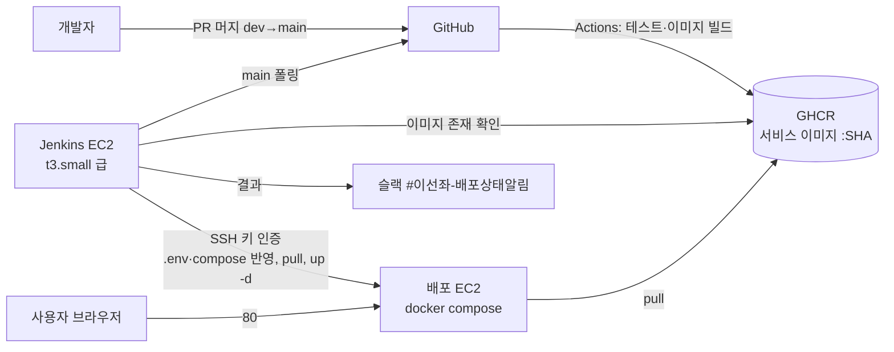

# 배포 설계

결론: main에 머지되면 GitHub Actions가 이미지를 만들어 GHCR에 올리고, 분리된 Jenkins EC2가 이를 감지해 배포 EC2에 SSH로 `docker compose up -d`를 실행한다. 결정은 2026-11-03에 사용자가 했고, 기록은 ADR 0044다([README](README.md)).

## 1. 대상과 구조

배포 대상은 SA 9-1대로 EC2 한 대의 docker compose다. 단일 EC2의 한계(인스턴스 장애 시 전체 중단)는 SA 9-3에 적힌 그대로다. AWS 계정은 미정이고 팀과 정한다(만드는 단계에서 결정).

역할을 나누는 이유는 GitHub Actions가 CI와 이미지 빌드·푸시를, Jenkins가 배포만 맡도록 하기 위해서다(2026-11-03 사용자 결정).

## 2. 파이프라인

dev → main 머지가 릴리스다. 단계는 다음과 같다.

1. main에 머지된다.
2. Actions가 커밋 SHA 태그로 서비스 이미지를 빌드하고 GHCR에 푸시한다. 지금 `.github/workflows/build.yml`은 테스트만 하며 이미지 빌드·푸시 단계는 없다(구현 이슈에서 더한다).
3. Jenkins가 main의 새 커밋을 감지한다. 웹훅을 받으려고 Jenkins를 공개하지 않도록 폴링을 기본으로 한다. 웹훅으로 바꾸려면 GitHub 웹훅 IP 대역만 보안그룹에서 허용한다.
4. Jenkins가 그 SHA 이미지가 GHCR에 모두 있는지 확인한다. 없으면 기다리거나 실패로 끝낸다(대기 시간은 미정).
5. 배포 EC2에 SSH로 접속해 `.env`와 compose 파일을 반영하고 `docker compose pull`, `up -d`를 실행한다.
6. 헬스를 기다린다(Gateway 경유와 각 컨테이너의 readiness).
7. 스모크 테스트를 돈다.
8. 결과를 슬랙 #이선좌-배포상태알림에 보낸다.
9. 헬스나 스모크가 실패하면 직전 성공 태그로 되돌린다.

스모크 테스트의 기본은 가볍게 한다: Gateway 경유 헬스, 가입·로그인, 공연 목록. `BookingFlowSystemTest`는 회차마다 좌석 15,000석을 만들어 DB를 키우므로 Jenkins 파라미터로 고를 때만 돈다([testing.md](../../guides/testing.md) 전체 스택 검사).

수동 재배포는 Jenkins에서 태그를 골라 다시 실행한다.

### 이미지와 compose

- 서비스 이미지는 `ghcr.io/<소유자>/<서비스>:<커밋 SHA>` 형태를 쓴다. 소유자와 이름 규칙은 미정이다.
- 지금 `compose.yml`은 `build:`로 로컬에서 빌드한다. 배포용은 `image: ghcr.io/...:<sha>`를 참조하는 별도 compose 파일을 둔다. 이름과 위치는 구현 이슈에서 정한다.
- 인프라 이미지(PostgreSQL, Redis, Kafka 등)는 지금처럼 digest로 고정한다.
- 현재 Dockerfile은 `APP_MODULE` 인자 하나로 모듈을 골라 `bootJar`를 만든다. 서비스 7개를 매트릭스로 빌드할 수 있다(방식은 구현 이슈).
- 프론트 SPA는 nginx 컨테이너가 서빙하고 `/api`를 Gateway로 중계한다([ADR 0040](../../decisions/0040-frontend-react-spa-in-monorepo.md), ISE-109). 배포 compose에 포함한다. `frontend/Dockerfile`(node 빌드 → nginx)과 compose의 `frontend` 서비스는 ISE-109에서 만들었다(로컬 `127.0.0.1:8000:80`, `mem_limit` 64m).

### 외부 노출 (SA 9-2)

공개 진입점은 프론트 nginx의 80이다. 8080(Gateway 직접)은 전체에 열지 않고, 부하 측정 때 발생기 보안그룹에만 연다(부하 도구는 nginx를 거치지 않고 Gateway를 부른다, [ADR 0040](../../decisions/0040-frontend-react-spa-in-monorepo.md) 4절). 관리 UI(Grafana, Kafka-UI, Prometheus, Zipkin)는 `127.0.0.1`에 바인딩해 SSH 터널로만 연다. 내부 서비스는 `ports` 없이 `expose`만 쓴다.

## 3. 보안그룹 규칙

SA 9-2의 표에 Jenkins EC2와 부하 발생기 EC2 행을 더했다.

| 대상 | 포트 | 인바운드 허용 | 비고 |
|---|---|---|---|
| 배포 EC2 | 22 | 팀원 IP, Jenkins EC2 보안그룹 | 키 인증만. Jenkins EC2는 SSH만 허용 |
| 배포 EC2 | 80 | 전체(0.0.0.0/0) | 화면과 `/api/` 중계(프론트 nginx). 유일한 공개 진입점 |
| 배포 EC2 | 8080 | 허용 없음. 부하 측정 중에만 발생기 보안그룹 | Gateway 직접 접근. 부하 도구용 |
| 배포 EC2 | 3000, 8085, 9090, 9411, 8761 | 허용 없음 | SSH 터널로만 |
| 배포 EC2 | 8081~8083, 8090, 8888, DB, Redis, Kafka | 허용 없음 | compose 내부 네트워크 전용 |
| Jenkins EC2 | 22 | 팀원 IP | Jenkins UI(8080)는 열지 않고 SSH 터널로만 접근 |
| Jenkins EC2 | 웹훅 포트 | 허용 없음 `[가정]` | 폴링이 기본이다. 웹훅으로 바꿀 때만 GitHub 웹훅 IP 대역을 허용 |
| 발생기 EC2 (측정 때만) | 22 | 팀원 IP | 측정이 끝나면 인스턴스를 지운다([load-test.md](load-test.md)) |

배포 EC2의 8080 인바운드는 평소 닫아 두고, 부하 측정 때만 발생기 보안그룹 하나에 연다. SA 9-2의 "측정 기기 IP 허용"을 같은 VPC 방식으로 구체화한 것이다.

## 4. 비밀값

- 서버 `.env`는 서버에서 만든다. 키 목록은 `initLocalEnv`와 같고 저장소에 올리지 않는다. 지금 `.env.example`의 키는 `DB_USER`(compose에 기본값 있음), `JWT_ACCESS_SECRET`, `JWT_REFRESH_SECRET`, `ENTRY_TOKEN_SECRET`, `PAYMENT_TOKEN_SECRET`, `BILLING_KEY_SECRET`, `DB_PASSWORD`, `ADMIN_EMAIL`, `ADMIN_PASSWORD`, `GRAFANA_ADMIN_PASSWORD`다. 알림용 슬랙 웹훅 `SLACK_WEBHOOK_MONITORING`(선택)과 환경 이름 `STACK_ENV`가 더해진다. 서버의 `STACK_ENV`는 `local`이 아닌 값(예: `deploy`)으로 둬 슬랙에서 로컬 알림과 가린다([observability.md](observability.md) 3절).
- Jenkins 자격 증명은 Jenkins Credentials에만 둔다: GHCR 읽기 토큰, 배포 EC2 SSH 키, 슬랙 웹훅(`#이선좌-배포상태알림`용).
- 배포 단계의 "`.env` 반영"은 서버에 이미 만든 `.env`를 유지한다는 뜻이다. Jenkins가 비밀값 원문을 저장소에서 가져오지 않는다. 키 목록이 바뀔 때 서버 `.env`를 누가 어떻게 갱신하는지는 미정이다.

## 5. 배포·되돌림 절차 개요

배포는 2절의 5~7단계다. 되돌림은 직전 성공 태그를 Jenkins가 기록해 두었다가 그 태그로 `pull`·`up -d`를 다시 실행하는 것이다. 되돌림 뒤에도 같은 헬스 확인을 한다.

- DB 스키마(Flyway) 변경이 있는 릴리스는 이미지만 되돌려서는 풀리지 않을 수 있다. 되돌림 가능한 마이그레이션 규칙은 정하지 않았다(미정).
- 되돌림 자체가 실패하면 슬랙에 알리고 사람이 접속한다. 자동 재시도 횟수는 미정이다.

## 6. 인스턴스 크기 결정 방법 (SA U10)

크기는 로컬에서 측정한 뒤 16GB급과 8GB급 중 고른다. 근거는 두 가지다.

- 로컬 유휴 측정(2026-11-03, 최신 dev): 스택 합계 약 4.1GB. 지금 로컬 compose의 컨테이너 상한은 SA 9-3 표보다 작다. 예를 들어 reservation-service는 512m 상한 중 508MiB를 쓰는데 SA 표는 1,152m다.
- 배포용 상한은 SA 9-3을 기준으로 두고, [부하 측정](load-test.md) 뒤에 정한다. SA 9-3은 합계가 11,392m이고 75% 이하 규칙으로 16GB급이 최소라고 했다. Loki·Alloy·Alertmanager 추가분은 [observability.md](observability.md) 4절에서 더한다.

8GB급을 고르면 SA 9-3의 대안(zipkin·kafka-ui·prometheus 제외 또는 상한 축소)을 따로 정해야 한다. 이 대안을 쓸 경우 관측 요구와 충돌하는 부분이 생긴다(예: 알림 전송에 Prometheus가 필요).

## 7. 남은 결정

| 항목 | 상태 |
|---|---|
| AWS 계정 | 미정. 팀과 정한다(만드는 단계) |
| 배포 EC2 크기 | 미정. 측정 뒤 16GB급/8GB급 선택(U10) |
| Jenkins EC2 크기 | t3.small 2GB급 `[가정]` |
| 슬랙 채널 이름 | 확정: 배포 결과 `#이선좌-배포상태알림`, 알림 `#이선좌-성능-모니터링`(2026-11-04 생성) |
| GHCR 소유자·이미지 이름 규칙 | 미정. 구현 이슈에서 정함 |
| 배포용 compose 파일 이름·위치 | 미정. 구현 이슈에서 정함 |
| 프론트 nginx 공개 포트와 8080의 관계 | 정함(ISE-109): 80 공개, 8080은 발생기 보안그룹만 |
| 서버 `.env` 키 갱신 절차 | 미정 |
| DB 마이그레이션이 있는 릴리스의 되돌림 규칙 | 미정 |
| 배포 DB 시드(시연용 관리자·샘플 계정, 공연 데이터) | 별도 이슈 |

## SA와 다른 점/더한 점 (SA 변경 요청 대상)

- SA 9-1 구조도와 구성 요소 표에 Jenkins EC2와 GHCR이 더해진다. 부하 도구 열은 "다른 기기"에서 "측정 때만 띄우는 같은 VPC의 임시 EC2"로 바뀐다.
- SA 9-2 보안그룹 표에 Jenkins EC2와 발생기 EC2 행이 더해지고, 부하 측정 중 8080 허용이 "측정 기기 IP"에서 "발생기 보안그룹"이 된다.
- SA 9-2의 공개 진입점이 8080에서 프론트 nginx 80으로 바뀐다. 8080은 전체에 열지 않는다.
- SA 9-3 메모리 표는 Jenkins EC2를 포함하지 않는다(별도 인스턴스). 배포 EC2 합계에는 관측 추가분이 더해진다.
