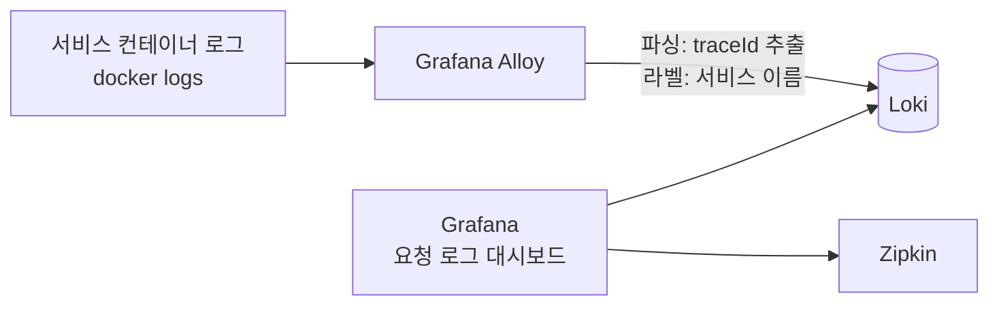

# 로그·알림 관측 설계

결론: 앱 코드와 로그 형식은 바꾸지 않고, Grafana Alloy가 컨테이너 로그를 모아 Loki에 저장하며 기존 Grafana에서 `traceId`로 서비스별 로그를 본다. Prometheus 알림은 Alertmanager를 더해 슬랙으로 보낸다. 결정은 2026-11-03에 사용자가 했고 기록은 ADR 0045다([README](README.md)). 지표·결제 알림 규칙 자체는 [payment/observability.md](../payment/observability.md)에 있다.

## 1. 로그: Alloy → Loki → Grafana



- Alloy는 Docker 소켓으로 컨테이너 로그를 읽어 Loki에 보낸다. Docker 소켓을 읽기 전용으로 마운트하는 방식이 기본이고, 구현 이슈에서 확정한다.
- 앱 코드와 로그 형식은 바꾸지 않는다. Alloy가 로그 줄의 추적 부분을 파싱해 `traceId`를 뽑는다.
- 라벨은 서비스 이름 정도로 적게 둔다(카디널리티). `traceId`는 라벨이 아니라 로그 줄에서 필터로 찾는다.
- 보관 기간은 7일 `[가정]`이다.

### 실제 로그 형식 (2026-11-03 compose 로그로 확인)

`docker logs`로 확인한 줄의 구성은 다음과 같다(읽기만 했고 컨테이너는 조작하지 않았다).

```
2026-11-03T13:06:11.676Z  INFO 6 --- [payment-service] [   outbox-relay] [6ae9dc431d13b84dd5bf14165900c54f-d5bf14165900c54f] o.a.kafka.common.utils.AppInfoParser     : Kafka startTimeMs: 1793711171676
시각(UTC ISO)   레벨 PID    [앱 이름]         [스레드]          [traceId(32자 16진) - spanId(16자 16진)]            로거                                          : 메시지
```

- 추적 정보가 없는 줄(예약 작업, 유레카 갱신 등)은 같은 자리가 공백으로 채워진다: `[                                                 ]`. 이런 줄은 `traceId`가 없다.
- 요청에서 나온 줄은 `[traceId-spanId]`가 채워진다. 예: `[6ae9dc34db4706b9a471203fe302c09b-8da6e5eb02636454]`(reservation-service의 HTTP 스레드 `0.0-8082-exec-3`).
- 스레드 이름 칸은 앞에 공백이 들어갈 수 있다(`[ housekeeping-1]`). 파싱 정규식은 이 점을 고려한다.
- 응답 본문의 `traceId`는 32자 16진 한 덩어리이고, 로그 줄에서는 뒤에 `-spanId`가 붙는다. 대시보드의 `traceId` 변수와 로그 줄의 앞 32자를 맞춘다.
- 여러 줄 로그(예외 스택 트레이스)가 줄 단위로 나뉘면 `traceId`가 첫 줄에만 있다. Alloy에서 여러 줄 병합을 할지는 미정이다.

### 로그가 비어 보일 수 있는 곳

로컬 gateway와 user-service 로그에서, 응답 본문으로 받은 `traceId`(`6ae9e8882f0b15dd07a668325571be3e`, 틀린 비밀번호 로그인 한 건)를 `--since 2m`로 찾았을 때 두 컨테이너 모두 해당 줄이 없었다. 요청마다 접근 로그를 남기는 코드가 없거나 로그 레벨 때문일 수 있고, 원인은 미확인이다. 그러면 "요청 로그" 대시보드에서 이 traceId로 거른 결과가 비어 시연이 약해진다. 앱 로그 형식은 바꾸지 않는 것이 결정이므로, 시연 전에 시연 흐름(대기열, 선점, 결제)에서 서비스별로 traceId가 남는 줄이 있는지 확인하고, 부족하면 로그를 더하는 별도 이슈로 다룬다.

## 2. Grafana "요청 로그" 대시보드

- `traceId` 텍스트 변수 하나를 둔다.
- 서비스별 패널(Gateway, user, reservation, payment)이 그 traceId가 들어간 로그를 시간순으로 보여 준다.
- 같은 traceId의 Zipkin 트레이스로 가는 링크를 둔다.
- 데이터 소스 프로비저닝은 `infra/grafana/provisioning/datasources/`에 Loki를 더하고, 대시보드는 `infra/grafana/dashboards/`에 JSON으로 둔다(기존 `payment.json`과 같은 방식). 파일 이름은 구현 이슈에서 정한다.

## 3. 알림: Alertmanager → 슬랙

현재 Prometheus는 알림 규칙만 평가하고 전송 경로가 없다(`payment-alerts.yml`. 전송은 범위 밖으로 둔 상태). 여기에 Alertmanager를 더한다.

| 항목 | 내용 |
|---|---|
| 전송 대상 | 팀 슬랙 워크스페이스의 새 채널(예: #alerts) |
| 배포 결과 | Jenkins가 #deploy로 보낸다([deployment.md](deployment.md)). 채널 이름은 `[가정]`이고 팀이 만든다 |
| 웹훅 주소 | 비밀값. `.env`와 Jenkins Credentials에만 둔다. 저장소에 올리지 않는다 |
| 해결 알림 | 보낸다(`send_resolved`) |
| 묶기 | 서비스(`service` 라벨)와 심각도(`severity`)별로 묶는다 `[가정]` |
| 반복 간격 | `[가정]` 값은 구현 이슈에서 정한다 |
| 규칙 | 기존 결제 알림 규칙의 `service`, `urgency`, `severity` 라벨을 그대로 쓴다 |

결제 서비스가 내려가면 건수 알림이 풀리는 한계(서비스 다운 알림은 범위 밖)는 그대로 둔다. 서비스 다운과 Alertmanager 자체가 죽는 경우의 알림은 미정이다.

## 4. 메모리 추가분

SA 9-3 표에 아래 행을 더한다. 값은 모두 `[가정]`이고 [부하 측정](load-test.md)에서 `docker stats`로 확인해 바꾼다.

| 구성 | 컨테이너 상한 `[가정]` |
|---|---|
| loki | 512m |
| alloy | 256m |
| alertmanager | 128m |
| 추가 합계 | 896m |

SA 9-3 합계 11,392m에 더하면 약 12,288m(12.0GB)다. 75% 규칙이면 필요 메모리는 약 16.0GB로 16GB급이 정확히 한계에 닿는다. 이 값이 크기 결정에 영향을 주므로 측정 결과로 다시 본다. 로컬 compose의 현재 상한은 SA 표보다 작으므로 위 합계와 로컬 합계를 직접 비교하지 않는다.

## 5. 시연 방식

M3(사용자 결정): 나란히 띄우기. 발표자 노트북에서 SSH 터널로 Grafana를 열고, 프론트 화면과 나란히 둔다. 프론트가 요청마다 traceId를 보여 주면 Grafana 대시보드가 그 traceId로 서비스별 로그를 거른다.

- 프론트가 traceId를 읽는 곳은 응답 본문의 `traceId` 필드다. 성공은 `{status, message, data, traceId}`, 실패는 `{status, code, message, errors, traceId}`이고 모든 응답 본문에 있다. 2026-11-03에 로컬 Gateway로 보낸 실패 응답(401)에서 `traceId`가 본문에 있는 것을 확인했다. 같은 응답의 헤더에는 `traceId` 헤더가 없었다(확인한 헤더: `Content-Type`, `transfer-encoding`, `Date`). 그래서 본문 필드를 쓴다.
- 요청 중 서비스가 응답을 만들지 못하는 경우(예: 게이트웨이 시간 초과)의 본문에도 `traceId`가 있는지는 미확인이다.

M4 후보: 프론트 안 로그 패널. 관리자 전용 API가 traceId로 Loki를 조회해 프론트가 보여 주는 방식이다. 지금은 설계하지 않는다.

### 프론트가 할 일

프론트 세션이 이 문서를 읽고 한다.
1. 요청별 `traceId`를 화면에 표시한다(응답 본문의 `traceId`, 시연 모드).
2. Grafana "요청 로그" 대시보드로 가는 링크를 둔다(시연 모드). 링크에 traceId 변수를 실을 수 있으면 싣는다. 주소는 발표자 노트북의 터널 주소(`localhost:3000`)다.

## 6. 남은 결정

| 항목 | 상태 |
|---|---|
| 로그 보관 기간 | 7일 `[가정]` |
| 알림 묶기·반복 간격 | `[가정]`, 구현 이슈에서 정함 |
| 슬랙 채널 이름 | #alerts `[가정]`, 팀이 만든다 |
| Loki·Alloy·Alertmanager 메모리 상한 | `[가정]`, 측정 뒤 확정 |
| 예외 스택 트레이스 여러 줄 병합 | 미정 |
| 요청 단위 로그 부족 문제 | 원인 미확인, 시연 전 확인 |
| 서비스 다운·Alertmanager 장애 알림 | 미정 |
| 프론트 안 로그 패널(M4) | 후보 |

## SA와 다른 점/더한 점 (SA 변경 요청 대상)

- SA 9-1 구조도와 구성 요소 표에 Loki, Alloy, Alertmanager가 더해진다.
- SA 9-3 메모리 표에 위 4절 세 행이 더해진다.
- SA 3-1의 관측성 항목(Grafana, Zipkin)에 로그 조회(Loki)와 알림 전송(슬랙)이 더해진다.
