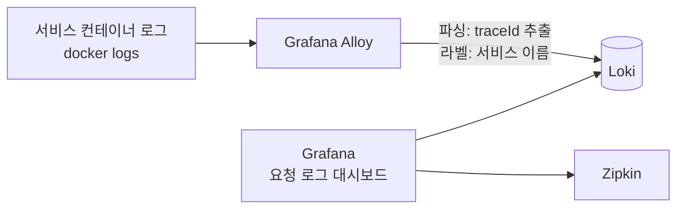

# 로그·알림 관측 설계

결론: Grafana Alloy가 컨테이너 로그를 모아 Loki에 저장하고, 기존 Grafana에서 `traceId`로 서비스별 로그를 본다. 로그 형식은 그대로 두고, 요청마다 한 줄을 남기는 공통 요청 로그 필터를 Gateway와 서비스에 더한다(정상 요청은 지금 로그를 한 줄도 남기지 않기 때문이다, 1절). Prometheus 알림은 Alertmanager를 더해 슬랙으로 보낸다. 결정은 2026-11-03에 사용자가 했고 기록은 ADR 0045다([README](README.md)). 지표·결제 알림 규칙 자체는 [payment/observability.md](../payment/observability.md)에 있다.

## 1. 로그: Alloy → Loki → Grafana



- Alloy는 Docker 소켓으로 컨테이너 로그를 읽어 Loki에 보낸다. Docker 소켓을 읽기 전용으로 마운트하는 방식이 기본이고, 구현 이슈에서 확정한다.
- 로그 형식(패턴)은 바꾸지 않는다. Alloy가 로그 줄의 추적 부분을 파싱해 `traceId`를 뽑는다.
- 라벨은 서비스 이름 정도로 적게 둔다(카디널리티). `traceId`는 라벨이 아니라 로그 줄에서 필터로 찾는다.
- 보관 기간은 7일이다(Loki compactor).

### 실제 로그 형식 (2026-11-03 compose 로그로 확인)

`docker logs`로 확인한 줄의 구성은 다음과 같다(읽기만 했고 컨테이너는 조작하지 않았다).

```
2026-11-03T13:06:11.676Z  INFO 6 --- [payment-service] [   outbox-relay] [6ae9dc431d13b84dd5bf14165900c54f-d5bf14165900c54f] o.a.kafka.common.utils.AppInfoParser     : Kafka startTimeMs: 1793711171676
시각(UTC ISO)   레벨 PID    [앱 이름]         [스레드]          [traceId(32자 16진) - spanId(16자 16진)]            로거                                          : 메시지
```

- 추적 정보가 없는 줄(예약 작업, 유레카 갱신 등)은 같은 자리가 공백으로 채워진다: `[                                                 ]`. 이런 줄은 `traceId`가 없다.
- 요청에서 나온 줄은 `[traceId-spanId]`가 채워진다. 예: `[6ae9dc34db4706b9a471203fe302c09b-8da6e5eb02636454]`(reservation-service의 HTTP 스레드 `0.0-8082-exec-3`).
- 스레드 이름 칸은 앞에 공백이 들어갈 수 있다(`[ housekeeping-1]`). 파싱 정규식은 이 점을 고려한다.
- 응답 본문의 `traceId`는 32자 16진 한 덩어리이고, 로그 줄에서는 뒤에 `-spanId`가 붙는다. 대시보드의 `traceId` 변수와 로그 줄의 앞 32자를 맞춘다.
- 여러 줄 로그(예외 스택 트레이스)가 줄 단위로 나뉘면 `traceId`가 첫 줄에만 있다. Alloy에서 여러 줄 병합을 할지는 미정이다.

### 정상 요청은 로그를 남기지 않는다 → 공통 요청 로그 필터

- 확인(2026-11-03, 최신 dev compose): 예매 한 흐름(가입, 대기열, 선점, 결제, 확정)을 Gateway로 돌린 3분 동안 gateway·user·reservation·payment 서비스 로그에는 요청에서 나온 줄이 없었다. 남은 줄은 Eureka 갱신과 대사 작업 같은 배경 작업뿐이었다. 서비스는 오류·업무 사건만 로그로 남기고, 요청마다 남기는 접근 로그가 없다. 이대로면 "요청 로그" 대시보드가 비어 보인다.
- 결정(사용자, 2026-11-03): 요청마다 한 줄을 남기는 공통 요청 로그 필터를 둔다. 서비스 사이 구간과 시간은 Zipkin 트레이스 링크로 보강한다.
  - 대상: Gateway(WebFlux 전역 필터)와 서블릿 서비스(common의 필터, user·reservation·payment·mock-pg)
  - 한 줄의 내용: 메서드, 경로 템플릿(실제 ID 대신 `/api/v1/payments/{paymentId}`처럼, 없으면 경로), 상태 코드, 처리 시간(ms). `traceId`는 기존 로그 패턴이 붙인다
  - 넣지 않는 것: 요청·응답 본문, 헤더(인증 토큰·입장 토큰·결제 토큰), 쿼리 문자열의 값
  - 헬스·지표 경로(`/actuator/**`)는 남기지 않는다. 로그 레벨은 INFO이고 설정으로 끌 수 있게 한다(부하 측정 때 로그 양 조절)
  - 모든 서비스에 걸리는 공통 변경이라 `contract` 이슈로 팀에 알리고 결제 담당이 구현한다
- Kafka로 이어지는 처리(결제 → 예매 확정)는 요청이 아니라 소비자에서 일어나므로 이 필터에 잡히지 않는다. 소비자 처리 로그와 트레이스 전파는 구현 이슈에서 확인한다.

### 구현 (ISE-182, 요청 로그 필터)

- 위치: 서블릿 서비스(user·reservation·payment)는 `common`의 `RequestLogFilter`(`OncePerRequestFilter`)이고 `CommonWebConfiguration`이 `FilterRegistrationBean`으로 등록한다. Gateway는 `gateway/.../observability/RequestLogWebFilter`(`WebFilter` + `Ordered`)다. mock-pg는 `common`을 쓰지 않아 이번에 넣지 않았다. 외부 PG를 흉내 내는 서비스이고 호출은 Zipkin 트레이스로 보인다.
- 한 줄 형식: `요청 {메서드} {경로} {상태} {시간}ms`. 로그 레벨은 INFO이고 `traceId`는 기존 로그 패턴이 붙인다. 예: `요청 POST /api/v1/payments 200 521ms`.
- 경로: 서블릿 서비스는 컨트롤러 경로 템플릿(`HandlerMapping.BEST_MATCHING_PATTERN_ATTRIBUTE`, 예 `/api/v1/payments/{paymentId}`)을 쓰고 매칭이 없으면 요청 경로를 쓴다. Gateway는 경로 템플릿이 없어 쿼리를 뺀 원래 경로를 쓴다(예 `/api/v1/payments/23`).
- 남기지 않는 것: 요청·응답 본문, 헤더, 쿼리 문자열, `/actuator`로 시작하는 경로.
- 설정: `iseonjwa.request-log.enabled`(기본 true, `config-repo/application.yml`). false면 필터를 등록하지 않는다. 부하 측정 때 로그 양을 줄이는 데 쓴다.
- 필터 순서: 트레이싱 관측 필터 안쪽에서 돌아 traceId가 MDC에 있을 때 줄을 쓰고, 요청을 거절하는 필터보다 바깥에서 돌아 401·403·404도 한 줄이 남는다. 서블릿은 관측 필터가 `HIGHEST_PRECEDENCE + 1`이라 이 필터를 `HIGHEST_PRECEDENCE + 2`로 등록한다(`GatewayIdentityFilter`는 기본 순서). Gateway는 WebFlux 관측 필터가 `@Order(0)`이라 이 필터는 order 1이다(`Ordered.HIGHEST_PRECEDENCE + 2`로 두면 관측 필터 바깥이 되어 traceId가 비므로 맞추지 않았다). Gateway 인증·입장 토큰 필터는 `GlobalFilter`라 이 필터보다 안쪽이다.
- 상태: 체인이 예외를 던지면 서블릿은 500으로 남기고 예외를 다시 던진다. Gateway는 `ErrorResponse` 예외(라우트 없음 404 등)는 그 상태로, 그 밖의 예외는 500으로 남기고 다시 던진다. 클라이언트가 끊으면 상태 자리에 `CANCELLED`가 남는다.
- 확인 결과(2026-11-04, 로컬 compose):
  - 테스트는 common 100, gateway 76, user 35, reservation 294, payment 764건이 모두 통과했다.
  - Gateway 줄에도 traceId가 채워졌다. `spring.reactor.context-propagation: auto`로 `doFinally`에서 쓴 줄에서 MDC가 살아 있었다. 인증 없는 `/api/v1/users/me`는 `요청 GET /api/v1/users/me 401 29ms`, 없는 경로는 `요청 GET /api/v1/nowhere 404 3ms`로 남았다.
  - 같은 요청의 Gateway 줄과 서비스 줄에 같은 traceId가 붙었다. 빈 본문 로그인은 Gateway와 user-service에서 `요청 POST /api/v1/auth/login 400`, 공연 조회는 reservation-service에서 `요청 GET /api/v1/concerts/{concertId} 200`으로 남았다.
  - `BookingFlowSystemTest`(예매 한 흐름)가 통과했다. 이어서 Loki에서 최근 10분의 `{service="payment-service"} |= "요청 "` 줄 둘의 traceId로 `{service=~"gateway|reservation-service|payment-service"}`를 조회하니 각각 Gateway 줄과 payment-service 줄이 함께 나왔다(`POST /api/v1/payments` Gateway 638ms·payment 521ms). 이 traceId에는 reservation-service 요청 줄이 없었다. 결제 승인 뒤 예매 확정은 Kafka 소비자에서 일어나 요청 로그에 잡히지 않는 것이 설계 그대로다.
  - 최근 10분에 Gateway·reservation·payment·user 요청 줄이 같은 traceId로 묶인 경우는 Gateway와 서비스 하나씩의 쌍이었고, 세 서비스를 모두 지나는 traceId는 없었다.
- 완료 기준을 읽는 법: 요청 하나의 traceId에는 Gateway 줄과 그 요청을 받은 서비스 줄이 함께 나온다. 예매 한 흐름은 요청 여러 개(대기열, 선점, 결제, 조회)라 traceId도 여러 개다. 결제 승인 뒤 예매 확정은 Kafka 소비자에서 일어나 요청 로그에 잡히지 않는다. 그래서 ISE-182의 완료 기준("한 traceId로 Gateway·예매·결제 요청 줄")은 "요청마다 Gateway와 서비스 줄이 같은 traceId로 보인다"로 확인했다. 소비자 처리의 로그·트레이스 전파는 6절의 남은 항목이다.

### 구현 (ISE-178, 수집)

- 파일: `infra/loki/loki.yml`, `infra/alloy/config.alloy`, Grafana 데이터 소스 `infra/grafana/provisioning/datasources/loki.yml`·`zipkin.yml`, compose의 `loki`(`grafana/loki:3.7.9`, 512m)·`alloy`(`grafana/alloy:v1.21.3`, 256m) 서비스. 이미지는 인덱스 digest로 고정했다. 호스트 포트는 열지 않고 Grafana가 `http://loki:3100`으로 읽는다.
- 모으는 컨테이너: compose 프로젝트 `iseonjwa`의 앱 8개(config-server, eureka, gateway, user-service, reservation-service, payment-service, mock-pg, assistant-service)만이다. DB·Kafka·관측 도구 로그는 모으지 않는다. 로그 양과 메모리를 [부하 측정](load-test.md)(ISE-176)에서 예측할 수 있게 하려는 것이다.
- 라벨(색인)은 `service`(compose 서비스 이름), `level`(INFO·WARN·ERROR), `env`(`STACK_ENV`, 없으면 `local`) 셋이다. `traceId`는 라벨이 아니라 구조화 메타데이터로 붙이고 로그 줄에도 그대로 남는다. 추적 정보가 없는 줄은 `traceId`가 없고 줄은 버리지 않는다. Loki가 `service`에서 `service_name`과 `detected_level` 라벨을 자동으로 더 붙인다.
- 여러 줄 병합(정함): 새 로그는 `^\d{4}-\d{2}-\d{2}T`로 시작한다고 보고 이어지는 줄(예외 스택 트레이스)을 앞 항목에 붙인다(`stage.multiline`, 최대 대기 3s). 첫 줄의 `traceId`가 스택 트레이스까지 한 항목에 담긴다.
- 보관 7일: Loki compactor 보존(`retention_enabled: true`, `retention_period: 168h`, `delete_request_store: filesystem`). compactor는 기동 뒤 10분 기다렸다가 시작한다.
- Docker 소켓: Alloy가 `/var/run/docker.sock`을 `:ro`로 읽는다. `:ro`여도 소켓으로 Docker API를 모두 부를 수 있어 호스트 root와 같은 권한이다. 공식 이미지라 받아들인다. 로그 파일(`/var/lib/docker/containers`)을 직접 읽는 방식은 맥 Docker Desktop에서 쓸 수 없어 소켓을 쓴다.
- Loki 이미지에는 wget·curl·셸이 없어 healthcheck를 두지 않았다. 준비 여부는 `/ready`로 확인한다. 기동 직후에는 "Ingester not ready: waiting for 15s"가 나온다.
- Grafana Loki 데이터 소스에는 derived field를 두어 로그 줄의 `[traceId-spanId]`에서 traceId를 뽑아 Zipkin으로 연결한다. provisioning 파일의 `$`는 `$$`로 써야 하고, Grafana API로 읽으면 `${__value.raw}`로 풀려 있는 것을 확인했다.
- 배포 서버의 compose도 프로젝트 이름이 `iseonjwa`여야 한다(`compose.yml`의 `name`). Alloy가 이 프로젝트 라벨로 컨테이너를 고르므로, 이름이 다르면 오류 없이 로그가 0건이 된다. 배포 첫 확인(ISE-174)에 Loki `label/service/values`로 앱 7개가 보이는지를 넣는다.
- Alloy는 5초마다 컨테이너 목록을 다시 찾는다(기본 1분). 뜬 지 1분 안에 죽는 컨테이너의 로그도 남기려는 것이다.
- Loki 받기 한도를 기본값(초당 4MB, 스트림당 3MB)보다 넉넉히 두었다(초당 16MB, 스트림당 8MB). 공통 요청 로그가 들어온 뒤 부하 측정에서 gateway 한 스트림에 줄이 몰려도 거절되지 않게 하려는 것이다. 측정 때 `loki_discarded_samples_total`이 늘지 않는지 본다.
- Alloy는 새로 뜰 때 컨테이너의 지난 로그부터 읽는다(확인 때 6시간 전 줄도 들어왔다). 저장된 위치는 `alloy` 볼륨에 남는다.
- 확인 결과(2026-11-04, 로컬 compose):
  - Loki `/ready`는 `ready`, `label/service/values`에 앱 7개가 모두 보였다. 라벨은 `env`, `level`, `service`, `service_name`이다. Alloy 로그에 오류·경고는 없었다.
  - `{service="payment-service"}` 줄에 `level=INFO`, `env=local`이 붙었다. 레벨 값은 ERROR·INFO·WARN이다.
  - traceId 구조화 메타데이터가 붙은 줄은 최근 12시간에 reservation-service 7줄, eureka 4줄이었다.
  - 스택 트레이스가 있는 항목 7개가 줄 단위로 나뉘지 않고 한 항목으로 묶였다(예: reservation-service의 `QueryTimeoutException` 항목에 첫 줄의 traceId가 메타데이터로 붙음).
  - Gateway로 실패 요청(빈 본문 로그인, 인증 없는 `/api/v1/users/me`) 6개를 보내 얻은 traceId를 `|= "<traceId>"`로 10분 범위에서 찾았을 때 줄은 0개였다. 정상·실패 요청은 지금 로그를 남기지 않는다. 공통 요청 로그 필터(ISE-182)가 들어오면 달라진다.
  - Grafana `/api/health`는 ok였고 데이터 소스에 `loki`·`zipkin`·`prometheus`가 있었다. Loki 데이터 소스 상태 확인은 연결 성공이었다.

## 2. Grafana "요청 로그" 대시보드

- `traceId` 텍스트 변수 하나를 둔다.
- 서비스별 패널(Gateway, user, reservation, payment)이 그 traceId가 들어간 로그를 시간순으로 보여 준다.
- 같은 traceId의 Zipkin 트레이스로 가는 링크를 둔다.
- 데이터 소스 프로비저닝은 `infra/grafana/provisioning/datasources/`에 Loki를 더하고, 대시보드는 `infra/grafana/dashboards/`에 JSON으로 둔다(기존 `payment.json`과 같은 방식). 파일 이름은 구현 이슈에서 정한다.

### 구현 (ISE-178, 대시보드)

파일은 `infra/grafana/dashboards/request-logs.json`이고 UID는 `iseonjwa-request-logs`, 제목은 "요청 로그"다. 프론트 시연 모드가 여는 주소(5절)에 맞췄다. 위에서 아래로 "흐름 → 로그 → 서비스별 → 오류" 순서로 둔다.

| 위치 | 패널 | 쿼리 | 왜 |
|---|---|---|---|
| 맨 위 | 트레이스(Zipkin) | Zipkin 데이터 소스, `$traceId` | 서비스 사이 호출 순서와 걸린 시간을 먼저 본다. 로그만으로는 구간 시간이 안 보인다 |
| 그 아래 | 이 요청의 로그(모든 서비스, 시간순) | `{service=~"gateway\|user-service\|reservation-service\|payment-service\|mock-pg"} \|= "$traceId"` | 완료 기준인 "한 화면에 시간순"을 패널 하나로 만족한다. 줄 옆 라벨이 서비스다 |
| 서비스별 행 | Gateway·user·reservation·payment 로그 4개 | `{service="<서비스>"} \|= "$traceId"` | 설계 2절의 서비스별 패널. 한 서비스만 따로 볼 때 쓴다 |
| 접힌 행 | 앱 7개의 WARN·ERROR | `{service=~"<앱 7개>", level=~"WARN\|ERROR"}` | 시연 중 실패 원인을 traceId 없이 찾을 때 연다 |

- traceId 필터는 구조화 메타데이터가 아니라 줄 필터(`|=`)를 쓴다. traceId가 줄에 그대로 있어서 결과가 같고, 메타데이터가 붙지 않은 줄(파싱 실패)도 놓치지 않는다.
- traceId를 비우면 줄 필터가 모든 줄과 맞아 최근 로그가 나온다. 시연 전에 로그가 들어오는지 볼 때 쓴다.
- 로그 줄을 펼치면 Loki 데이터 소스의 derived field가 traceId로 Zipkin 트레이스를 여는 링크를 보여 준다.
- 기본 시간 범위는 최근 15분이고 자동 새로 고침은 끈다. 프론트가 여는 주소에는 요청 시각 앞뒤 15분이 들어 있다.
- 확인(2026-11-04, 로컬): Grafana가 대시보드를 읽었다(`/api/dashboards/uid/iseonjwa-request-logs`). Loki에 있던 traceId(reservation-service 예약 작업의 ERROR 줄)로 "이 요청의 로그" 쿼리를 Grafana를 거쳐 돌려 그 줄 하나가 나왔다. 트레이스 패널과 같은 쿼리(Zipkin, `queryType: traceID`)를 Grafana로 보내 Gateway 트레이스의 스팬 표를 받았다. Zipkin 컨테이너는 확인 때만 켰다(로컬에서 꺼져 있었다). 실제 예매 한 흐름의 서비스별 로그는 공통 요청 로그 필터(ISE-182) 뒤에 확인한다.

## 3. 알림: Alertmanager → 슬랙

현재 Prometheus는 알림 규칙만 평가하고 전송 경로가 없다(`payment-alerts.yml`. 전송은 범위 밖으로 둔 상태). 여기에 Alertmanager를 더한다.

| 항목 | 내용 |
|---|---|
| 전송 대상 | 슬랙 워크스페이스 디스이스스파르타의 `#이선좌-성능-모니터링`(2026-11-04 생성) |
| 배포 결과 | Jenkins가 `#이선좌-배포상태알림`으로 보낸다([deployment.md](deployment.md), ISE-175) |
| 웹훅 주소 | 비밀값. 저장소에 올리지 않는다. 알림용은 `.env`의 `SLACK_WEBHOOK_MONITORING`이고 compose `configs`가 파일로 만들어 Alertmanager의 `api_url_file`로 읽는다. 배포 결과용은 Jenkins Credentials에 둔다. 봇 토큰·앱 토큰은 쓰지 않고 Incoming Webhook만 쓴다 |
| 해결 알림 | 보낸다(`send_resolved: true`) |
| 묶기 | `env`, `service`, `severity` 라벨별로 한 메시지에 묶는다(`group_by`). `group_wait` 30s, `group_interval` 5m. 즉시 확인 알림은 하위 경로를 타서 같은 심각도의 지연 감시 알림과 다른 메시지로 온다. 그래서 제목에 긴급도를 붙여 가린다 |
| 반복 간격 | 기본 4h, `urgency="immediate"` 알림은 1h(`repeat_interval`) |
| 억제 | 같은 `env`·`service`·`alertname`에서 critical이 울리면 warning은 보내지 않는다 |
| `env` 라벨 | Prometheus `external_labels.env`를 `.env`의 `STACK_ENV`로 채운다(기본 `local`). 슬랙 제목에 환경이 붙어 로컬 알림과 배포 서버 알림을 가린다 |
| 규칙 | 기존 결제 알림 규칙의 `service`, `urgency`, `severity` 라벨을 그대로 쓴다 |

결제 서비스가 내려가면 건수 알림이 풀리는 한계(서비스 다운 알림은 범위 밖)는 그대로 둔다. 서비스 다운과 Alertmanager 자체가 죽는 경우의 알림은 미정이다.

### 구현 (ISE-179)

- 설정 파일은 `infra/alertmanager/alertmanager.yml`이다. 메시지 모양은 `infra/alertmanager/templates/slack.tmpl`에 있다. compose에는 `alertmanager` 서비스(prom/alertmanager 0.34.2 digest 고정, `mem_limit` 128m, `127.0.0.1:9093`, 볼륨 `alertmanager`, `--web.external-url=http://localhost:9093`)를 더했고, Prometheus는 `alerting.alertmanagers`에 `alertmanager:9093`을 둔다.
- 메시지 모양:
  - 제목 예: `[발생] 결제 심각(즉시 확인) 2건 · 로컬`, 해결은 `[해결] 결제 경고(지연 감시) 1건 모두 해결 · 로컬`. 라벨 값은 한국어로 바꾼다(env: local→로컬, deploy→배포 서버 / service: payment→결제 / severity: critical→심각, warning→경고 / urgency: immediate→즉시 확인, threshold→지연 감시).
  - 왼쪽 색 띠: 해결 초록 `#1E7F4F`, 심각 빨강 `#D12B3A`, 경고 주황 `#F59F00`(프론트 토큰 success-600·danger-600·warning-500).
  - 필드: 환경, 긴급도, 발생 중 N건, 해결 N건, 바로 가기(결제 대시보드·Prometheus 알림·Alertmanager 링크). 주소는 `env` 라벨로 고른다(`slack.tmpl`의 `iseonjwa.links`, 2026-11-12 ISE-256). 배포 서버(`deploy`)의 결제 대시보드는 Grafana 공인 주소 `http://52.63.10.174:3000`(등록된 IP만)이고, Prometheus·Alertmanager는 서버 밖에 열지 않아 "SSH 터널을 켜면"을 붙인 `localhost` 링크다. 그 밖의 환경은 모두 `localhost`다. 처음에는 모두 `localhost`라 배포 서버 알림의 대시보드 링크가 열리지 않았다.
  - 본문: 발생 알림마다 summary를 굵게 쓰고, 다음 줄에 알림 이름, 같은 이름을 가르는 라벨(rule, topic, operation, pool, task 등), 시작 시각(KST), 대응 문서(runbook 주석을 GitHub dev 브랜치 문서 링크로)를 둔다. 해결된 알림은 이름, 라벨, 시작~끝 시각, 지속 시간을 쓴다. 한 메시지에 발생과 해결이 섞이면 "이번에 해결된 알림" 아래에 모은다.
  - fallback(휴대폰 푸시·미리보기 한 줄)은 제목과 첫 알림의 summary다. 꼬리말에는 다시 알리는 간격(즉시 확인 1시간, 그 밖 4시간)을 쓴다.
- 웹훅 주소를 파일로 넘기는 이유: Alertmanager 설정 파일은 환경 변수를 풀지 않는다. compose `secrets`의 `environment` 방식은 변수가 없으면 compose 전체가 실패해 웹훅이 없는 팀원 스택이 뜨지 않는다(2026-11-04 Compose v5.6.0으로 확인). `configs`의 `content`가 빈 값이면 파일 대신 디렉터리가 생긴다(같은 날 확인). 그래서 최상위 `configs.slack-monitoring-url`의 `content`에 `${SLACK_WEBHOOK_MONITORING:-http://127.0.0.1:9/slack-webhook-not-set}`를 두어, 값이 없으면 보내지 않는 자리표시 주소를 넣는다. 이때 Alertmanager는 그대로 뜨고 알림을 보낼 때 실패만 로그에 남는다.
- `STACK_ENV`: compose가 prometheus에 `STACK_ENV: ${STACK_ENV:-local}`을 넘기고, `infra/prometheus.yml`과 `infra/prometheus-local.yml`의 `global.external_labels.env`가 `${STACK_ENV}`로 받는다. Prometheus 3.15.1은 `external_labels`의 `${VAR}`를 기능 플래그 없이 풀어 준다(2026-11-04 확인). 배포 서버는 `.env`에 `STACK_ENV`를 `deploy` 같은 다른 값으로 둔다.
- 로컬 주의: 웹훅을 `.env`에 넣은 사람의 로컬 스택 알림도 팀 채널로 간다(제목에 `local`이 붙는다). 확인할 때만 넣고 평소에는 비워 둔다. 웹훅이나 `STACK_ENV`를 바꾸면 `docker compose up -d --force-recreate alertmanager prometheus`로 다시 만들어야 한다(compose `configs` 내용이 바뀌어도 그냥 `up -d`는 컨테이너를 다시 만들지 않는다. 2026-11-04 리뷰에서 확인). 설정·템플릿만 바꿨으면 `curl -X POST localhost:9093/-/reload`로 반영한다.
- 검사: `script/check-prometheus-rules.sh`가 promtool 규칙 검사·테스트, Prometheus 설정 두 개의 `promtool check config`, `amtool check-config`, 경로 검사, 템플릿 렌더 검사를 한다. 경로 검사는 `--tree` 출력으로 즉시 확인 알림만 1시간 반복 하위 경로를 타는지 확인한다. 수신자가 하나라 수신자 이름만으로는 틀린 설정을 못 잡기 때문이다. CI `prometheus-rules` 워크플로의 paths에 `infra/alertmanager/**`와 이 스크립트를 더했다.
- 확인 방법: Alertmanager UI(http://localhost:9093)에서 수신자와 알림 상태를 보고, `curl -s localhost:9090/api/v1/alertmanagers`로 Prometheus가 Alertmanager를 찾았는지 본다. 미리보기는 `docker exec iseonjwa-alertmanager-1 amtool --alertmanager.url=http://localhost:9093 alert add alertname=... env=preview ...`로 가짜 알림을 넣어 볼 수 있다(제목에 "미리보기"가 붙는다). 팀 채널에 올라가니 필요할 때만 쓴다.
- 확인 결과(2026-11-04, 로컬 compose): (1) 이미 울리던 환불 확인 알림 2건이 슬랙으로 갔다. (2) 결제 DB를 12초 멈춰 `PaymentDbConnectionTimeout`을 울리자 발생 메시지와 약 10분 뒤 해결 메시지가 갔다. (3) 새 모양의 미리보기 알림(발생, 발생·해결 섞임, 해결)이 갔다. 전송 실패는 0건이었다(`alertmanager_notifications_failed_total`).
- 알림 문구(2026-11-04 사용자 요청): 결제 규칙의 `summary`를 합니다체로 바꾸고 해야 할 일을 끝에 붙였다(예: "결제 DB 연결 Timeout이 났습니다(pool=…). 이 시간의 결제 요청이 503으로 실패했을 수 있어 확인이 필요합니다"). 규칙 단위 테스트의 기대 문구도 함께 바꿨다.

### 건별 알림 (ISE-183)

사용자는 "몇 번 유저가 언제 결제한 건인지"까지 알림에 담기를 원했다(2026-11-04). 지표 알림은 건수·최고령·횟수만 있어 결제 건 정보가 없고, DB 연결 시간 초과는 결제 한 건에 묶이지 않는다. 세 안(Loki 로그 알림, 결제 서비스가 슬랙에 직접 전송, 말투만 바꾸고 상세는 링크) 중 Loki 로그 알림을 골랐고, 2026-11-09에 아래 여섯 가지를 추천안대로 정했다.

| 결정(2026-11-09) | 내용 |
|---|---|
| 결제 시각 | `paidAt` = `payments.created_at`을 Asia/Seoul로 바꾼 ISO-8601(오프셋 포함, 초 단위). 시간대를 코드에 고정해 시스템 시간대에 기대지 않는다 |
| 기존 지표 알림 | 그대로 둔다. 건별 알림은 그 위에 더한다 |
| 금액 불일치 | 따로 알리지 않고 NMC 알림의 사유(`PG_AMOUNT_MISMATCH`·`REFUND_AMOUNT_MISMATCH`)로 합친다. 진단 로그 줄(`event=PG_AMOUNT_MISMATCH` 등)은 남긴다 |
| 해결 메시지 | 건별 알림은 보내지 않는다 |
| 대사 상한 | 한 회차에 규칙 하나가 남기는 새 OPEN 건별 줄은 10건까지이고, 넘으면 요약 한 줄(`event=RECONCILIATION_MISMATCH_OPEN_SUMMARY`)만 더 남긴다 |
| 환불 문구 | "N번 유저가 YYMMDD HH:MM에 결제한 건의 환불입니다"(원 결제 시각) |

**로그 줄**(ERROR, 필드 순서 고정, 값이 없으면 `-`). 결제 서비스의 `PaymentAlertLog`가 만든다.

```
event=<E> paymentId=<n> userId=<n> reservationId=<n> paidAt=2026-11-09T14:03:12+09:00 <추가 k=v>
```

| 사건 | 남기는 곳 | 추가 필드 |
|---|---|---|
| `PAYMENT_NEEDS_MANUAL_CHECK` | `PaymentTransitionService.markAmountMismatch`·`markUnresolved`(전이가 1행일 때만) | `reason=PG_AMOUNT_MISMATCH` 또는 `PG_UNRESOLVED` |
| `REFUND_NEEDS_MANUAL_CHECK` | `RefundWorkerService.markNeedsManualCheck`(전이가 1행일 때만) | `refundId=<n> reason=<사유>`(`REFUND_AMOUNT_MISMATCH`, `REFUND_REJECTED`, `REFUND_UNRESOLVED`, `STATE_CONFLICT`) |
| `RECONCILIATION_MISMATCH_OPEN` | `ReconciliationRecorder`(이전에 OPEN이 아니던 불일치만) | `rule=RC-n`. 결제 키가 없으면 결제 필드는 `-`이고 `reservationId`만 남는다 |
| `DEAD_LETTER_OPEN` | `DeadLetterService`(OPEN으로 끝난 건) | `eventKey=<...>` 뒤에 자유 문장 `reason=...`. 봉투나 결제를 읽지 못하면 결제 필드는 `-` |

- 줄은 호출한 트랜잭션 안에서 결제를 읽어 두고 커밋 뒤(`afterCommit`)에 찍는다. 롤백된 전이는 줄이 없고, 트랜잭션이 없으면 바로 찍는다. 개인정보는 내부 ID와 시각뿐이다(이메일·이름·카드 정보 금지, 공개 채널).
- reservation-service에도 `DEAD_LETTER_OPEN` 로그가 있어 Loki 규칙이 `service="payment-service"` 라벨로 좁힌다. 예약 서비스 로그는 건드리지 않았다.
- **Loki ruler**(`infra/loki/loki.yml`): `ruler.storage.local.directory: /etc/loki/rules`, `rule_path: /loki/rules-temp`, `alertmanager_url: http://alertmanager:9093`, `enable_api: true`, `evaluation_interval: 1m`, 링 `inmemory`. 키 이름은 Loki 3.7.9 `-verify-config`와 `-print-config-stderr`로 확인했다. `common.storage.filesystem.rules_directory`(`/loki/rules`)는 ruler 저장소 종류가 `filesystem`일 때의 값이라 `local` 저장소를 쓰는 지금은 쓰이지 않는다. 인증이 꺼진 Loki의 테넌트는 `fake`라 compose가 `./infra/loki/rules`를 `/etc/loki/rules/fake`에 읽기 전용으로 마운트한다(`compose.deploy.yml`은 loki의 볼륨을 건드리지 않는다).
- **규칙**(`infra/loki/rules/payment-events.yml`): 사건마다 하나(`PaymentNeedsManualCheckEvent`, `RefundNeedsManualCheckEvent`, `ReconciliationMismatchOpenEvent`, `DeadLetterOpenEvent`). 최근 10분의 ERROR 줄을 정규식으로 읽어 라벨(`env`, `event`, `paymentId`, `userId`, `reservationId`, `paidAt`, 사건별 `reason`·`refundId`·`rule`·`eventKey`)로 뽑고 `service=payment`, `urgency=immediate`, `severity=critical`을 붙인다. `for`는 없다. 문구의 `YYMMDD HH:MM`은 annotation 템플릿의 `reReplaceAll`로 `paidAt`에서 만든다. Loki 3.7.9 ruler가 이 함수를 지원함을 검사 스크립트로 확인해서 `paidAtKst` 같은 보조 필드는 두지 않았다. regexp 뒤의 `| event="…"` 필터는 형식이 다른 줄을 걸러 낸다. regexp는 맞지 않는 줄을 오류 없이 라벨 없이 통과시키는데, 이 필터가 없으면 라벨이 없는 알림이 생겨 건별 경로를 타지 못했다(검사 스크립트의 미끼 줄이 잡았다).
- **Alertmanager**: `event=~".+"` 하위 경로를 `urgency="immediate"` 경로보다 위에 둔다. 수신자는 `slack-monitoring-event`(같은 `slack_configs`를 YAML 앵커로 공유하고 `send_resolved: false`만 다르다). `group_by`는 `[alertname, env, paymentId, reservationId, refundId, rule, eventKey]`라 결제 한 건마다 메시지 하나이고, `group_wait` 10s, `repeat_interval` 24h다. 같은 줄은 10분 동안 매 평가마다 같은 라벨로 올라오지만 한 번만 보낸다. 슬랙 템플릿은 본문 라벨 줄에서 `event`·`userId`·`paidAt`·`reason`을 뺀다(요약 문장에 이미 있다). 꼬리말은 `event` 라벨이 있으면 "건별 알림 · 같은 사건은 한 번만 보냅니다"다. `event`가 없는 기존 알림(추첨 포함)은 경로·수신자·문구가 바뀌지 않는다.
- **문구 예**: "결제가 운영자 확인 상태가 됐습니다(사유 PG_UNRESOLVED). 45번 유저가 261109 14:03에 결제한 건입니다. 확인이 필요합니다". 대사에서 결제 키가 없으면 "결제 없이 예매 7002번에서 찾은 건입니다", DLQ에서 결제를 읽지 못하면 "결제를 읽지 못해 어느 유저의 건인지 알 수 없습니다".
- **검사**: `script/check-loki-rules.sh`(같은 Loki 이미지로 `-verify-config`, 평가 주기를 5초로 줄인 임시 Loki에 `/loki/api/v1/push`로 정상 줄 4건과 미끼 줄 3건을 넣고 ruler API를 jq로 확인), `script/check-prometheus-rules.sh`(event 알림이 건별 수신자로 가는지, event 없는 즉시 알림은 기존 수신자인지, 건별 수신자의 `send_resolved: false`, 건별 알림 꼬리말·라벨 줄 렌더). CI는 `loki-rules` 워크플로가 `infra/loki/**`가 바뀔 때 돈다.
- **한계**: 결제 한 건에 묶이지 않는 알림(DB 연결 시간 초과, 작업 정체 등)은 지표 알림으로 둔다. 줄을 읽는 구간이 10분이라 Loki와 Alertmanager를 함께 다시 만들면(`--force-recreate`) 10분 안의 같은 줄이 새 알림으로 한 번 더 올 수 있다. 대사 요약 줄은 알림이 아니라 로그로만 남는다.

## 4. 메모리 추가분

SA 9-3 표에 아래 행을 더한다. 값은 모두 `[가정]`이고 [부하 측정](load-test.md)에서 `docker stats`로 확인해 바꾼다.

| 구성 | 컨테이너 상한 `[가정]` |
|---|---|
| loki | 512m |
| alloy | 256m |
| alertmanager | 128m |
| 추가 합계 | 896m |

SA 9-3 합계 11,392m에 더하면 약 12,288m(12.0GB)다. 75% 규칙이면 필요 메모리는 약 16.0GB로 16GB급이 정확히 한계에 닿는다. 이 값이 크기 결정에 영향을 주므로 측정 결과로 다시 본다. 로컬 compose의 현재 상한은 SA 표보다 작으므로 위 합계와 로컬 합계를 직접 비교하지 않는다.

건별 알림 규칙(ISE-183)을 평가하는 Loki ruler는 같은 loki 프로세스에서 1분마다 쿼리 4개(최근 10분 ERROR 줄 검색)를 돈다. 상한(512m)은 그대로 `[가정]`으로 두고, 부하 측정 때 `docker stats`에서 ruler 평가 전후의 loki 메모리·CPU를 같이 본다.

측정(2026-11-04, 로컬 compose 유휴, `docker stats`): loki 약 83MiB, alloy 약 53MiB. 부하가 없는 값이라 상한(512m·256m)은 그대로 `[가정]`이다.

## 5. 시연 방식

M3(사용자 결정): 나란히 띄우기. Grafana를 열고(로컬은 compose의 `localhost:3000`, 배포 서버는 `http://52.63.10.174:3000`으로 바로), 프론트 화면과 나란히 둔다. 프론트가 요청마다 traceId를 보여 주면 Grafana 대시보드가 그 traceId로 서비스별 로그를 거른다.

- 프론트가 traceId를 읽는 곳은 응답 본문의 `traceId` 필드다. 성공은 `{status, message, data, traceId}`, 실패는 `{status, code, message, errors, traceId}`이고 모든 응답 본문에 있다. 2026-11-03에 로컬 Gateway로 보낸 실패 응답(401)에서 `traceId`가 본문에 있는 것을 확인했다. 같은 응답의 헤더에는 `traceId` 헤더가 없었다(확인한 헤더: `Content-Type`, `transfer-encoding`, `Date`). 그래서 본문 필드를 쓴다.
- 요청 중 서비스가 응답을 만들지 못하는 경우(예: 게이트웨이 시간 초과)의 본문에도 `traceId`가 있는지는 미확인이다.

M4 후보: 프론트 안 로그 패널. 관리자 전용 API가 traceId로 Loki를 조회해 프론트가 보여 주는 방식이다. 지금은 설계하지 않는다.

### 프론트가 할 일 (ISE-180에서 구현)

프론트 시연 모드(주소에 `?demo=on`)가 화면 오른쪽 요청 로그 패널에 요청마다 메서드·경로·상태·traceId를 보이고, traceId를 누르면 아래 주소로 Grafana를 연다. 켜는 방식, 패널, 기록 범위는 [프론트 설계](../frontend/README.md) "시연 모드 규칙"에 있다.

```
<Grafana 주소>/d/iseonjwa-request-logs?orgId=1&var-traceId=<traceId>&from=<요청 시각-15분>&to=<요청 시각+15분>
```

`<Grafana 주소>`는 화면을 연 호스트의 3000번이다(로컬 `http://localhost:3000`, 배포 `http://52.63.10.174:3000`, 2026-11-05 사용자 결정). 배포 서버는 3000을 보안 그룹에서 팀원 IP에만 열고 익명 보기(Viewer)를 켠다. 로컬 compose는 그대로다.

ISE-178의 "요청 로그" 대시보드가 이 주소에 맞춘다.
- UID는 `iseonjwa-request-logs`다(기존 `iseonjwa-payment`, `iseonjwa-bootstrap`과 같은 규칙).
- 텍스트 변수 이름은 `traceId`다. 값은 응답 본문의 32자 16진수이고 로그 줄 `[traceId-spanId]`의 앞 32자와 같다.
- 시간 범위는 주소의 `from`·`to`(epoch ms)를 따른다. 앞뒤 15분은 브라우저·서버 시계 차이와 요청 뒤 Kafka 소비자 로그까지 넣으려는 값이다.
- 기준 주소가 호스트의 3000번이 아니면 프론트 빌드의 `VITE_GRAFANA_URL`로 바꾼다.

## 6. 남은 결정

| 항목 | 상태 |
|---|---|
| 로그 보관 기간 | 7일(compactor 보존, ISE-178) |
| 알림 묶기·반복 간격 | 확정(ISE-179): 묶기 `env`·`service`·`severity`, 반복 4h(`immediate`는 1h) |
| 슬랙 채널 이름 | 확정: `#이선좌-성능-모니터링`(알림), `#이선좌-배포상태알림`(배포 결과). 2026-11-04 생성 |
| Loki·Alloy·Alertmanager 메모리 상한 | `[가정]`, 측정 뒤 확정 |
| 예외 스택 트레이스 여러 줄 병합 | 정함(ISE-178): ISO 시각으로 시작하지 않는 줄을 앞 항목에 붙인다 |
| 요청 단위 로그 부족 문제 | 공통 요청 로그 필터로 해결(사용자 결정, contract 이슈) |
| Kafka 소비자 처리의 로그·트레이스 전파 | 구현 이슈에서 확인 |
| 서비스 다운·Alertmanager 장애 알림 | 미정 |
| 건별 결제 알림(유저·결제 시각) | 구현함(ISE-183): Loki 규칙 → Alertmanager → 슬랙. 세부 결정은 3절. 실제 슬랙·실제 NMC 결제로 끝까지 보는 확인은 사용자가 한다 |
| 프론트 안 로그 패널(M4) | 후보 |

## SA와 다른 점/더한 점 (SA 변경 요청 대상)

- SA 9-1 구조도와 구성 요소 표에 Loki, Alloy, Alertmanager가 더해진다.
- SA 9-3 메모리 표에 위 4절 세 행이 더해진다.
- SA 3-1의 관측성 항목(Grafana, Zipkin)에 로그 조회(Loki)와 알림 전송(슬랙)이 더해진다.
