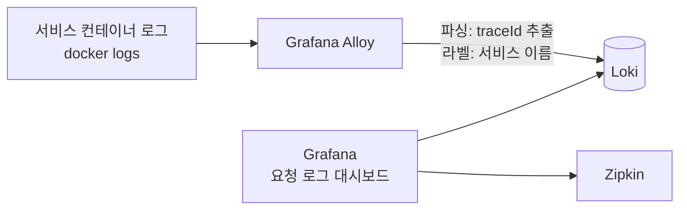

# 로그·알림 관측 설계

결론: Grafana Alloy가 컨테이너 로그를 모아 Loki에 저장하고, 기존 Grafana에서 `traceId`로 서비스별 로그를 본다. 로그 형식은 그대로 두고, 요청마다 한 줄을 남기는 공통 요청 로그 필터를 Gateway와 서비스에 더한다(정상 요청은 지금 로그를 한 줄도 남기지 않기 때문이다, 1절). Prometheus 알림은 Alertmanager를 더해 슬랙으로 보낸다. 결정은 2026-11-03에 사용자가 했고 기록은 ADR 0045다([README](README.md)). 지표·결제 알림 규칙 자체는 [payment/observability.md](../payment/observability.md)에 있다.

## 1. 로그: Alloy → Loki → Grafana



- Alloy는 Docker 소켓으로 컨테이너 로그를 읽어 Loki에 보낸다. Docker 소켓을 읽기 전용으로 마운트하는 방식이 기본이고, 구현 이슈에서 확정한다.
- 로그 형식(패턴)은 바꾸지 않는다. Alloy가 로그 줄의 추적 부분을 파싱해 `traceId`를 뽑는다.
- 라벨은 서비스 이름 정도로 적게 둔다(카디널리티). `traceId`는 라벨이 아니라 로그 줄에서 필터로 찾는다.
- 보관 기간은 7일 `[가정]`이다.

### 실제 로그 형식 (2026-11-03 compose 로그로 확인)

`docker logs`로 확인한 줄의 구성은 다음과 같다(읽기만 했고 컨테이너는 조작하지 않았다).

```
2026-11-03T13:06:11.676Z  INFO 6 --- [payment-service] [   outbox-relay] [6ae9dc431d13b84dd5bf14165900c54f-d5bf14165900c54f] o.a.kafka.common.utils.AppInfoParser     : Kafka startTimeMs: 1793711171676
시각(UTC ISO)   레벨 PID    [앱 이름]         [스레드]          [traceId(32자 16진) - spanId(16자 16진)]            로거                                          : 메시지
```

- 추적 정보가 없는 줄(예약 작업, 유레카 갱신 등)은 같은 자리가 공백으로 채워진다: `[                                                 ]`. 이런 줄은 `traceId`가 없다.
- 요청에서 나온 줄은 `[traceId-spanId]`가 채워진다. 예: `[6ae9dc34db4706b9a471203fe302c09b-8da6e5eb02636454]`(reservation-service의 HTTP 스레드 `0.0-8082-exec-3`).
- 스레드 이름 칸은 앞에 공백이 들어갈 수 있다(`[ housekeeping-1]`). 파싱 정규식은 이 점을 고려한다.
- 응답 본문의 `traceId`는 32자 16진 한 덩어리이고, 로그 줄에서는 뒤에 `-spanId`가 붙는다. 대시보드의 `traceId` 변수와 로그 줄의 앞 32자를 맞춘다.
- 여러 줄 로그(예외 스택 트레이스)가 줄 단위로 나뉘면 `traceId`가 첫 줄에만 있다. Alloy에서 여러 줄 병합을 할지는 미정이다.

### 정상 요청은 로그를 남기지 않는다 → 공통 요청 로그 필터

- 확인(2026-11-03, 최신 dev compose): 예매 한 흐름(가입, 대기열, 선점, 결제, 확정)을 Gateway로 돌린 3분 동안 gateway·user·reservation·payment 서비스 로그에는 요청에서 나온 줄이 없었다. 남은 줄은 Eureka 갱신과 대사 작업 같은 배경 작업뿐이었다. 서비스는 오류·업무 사건만 로그로 남기고, 요청마다 남기는 접근 로그가 없다. 이대로면 "요청 로그" 대시보드가 비어 보인다.
- 결정(사용자, 2026-11-03): 요청마다 한 줄을 남기는 공통 요청 로그 필터를 둔다. 서비스 사이 구간과 시간은 Zipkin 트레이스 링크로 보강한다.
  - 대상: Gateway(WebFlux 전역 필터)와 서블릿 서비스(common의 필터, user·reservation·payment·mock-pg)
  - 한 줄의 내용: 메서드, 경로 템플릿(실제 ID 대신 `/api/v1/payments/{paymentId}`처럼, 없으면 경로), 상태 코드, 처리 시간(ms). `traceId`는 기존 로그 패턴이 붙인다
  - 넣지 않는 것: 요청·응답 본문, 헤더(인증 토큰·입장 토큰·결제 토큰), 쿼리 문자열의 값
  - 헬스·지표 경로(`/actuator/**`)는 남기지 않는다. 로그 레벨은 INFO이고 설정으로 끌 수 있게 한다(부하 측정 때 로그 양 조절)
  - 모든 서비스에 걸리는 공통 변경이라 `contract` 이슈로 팀에 알리고 결제 담당이 구현한다
- Kafka로 이어지는 처리(결제 → 예매 확정)는 요청이 아니라 소비자에서 일어나므로 이 필터에 잡히지 않는다. 소비자 처리 로그와 트레이스 전파는 구현 이슈에서 확인한다.

## 2. Grafana "요청 로그" 대시보드

- `traceId` 텍스트 변수 하나를 둔다.
- 서비스별 패널(Gateway, user, reservation, payment)이 그 traceId가 들어간 로그를 시간순으로 보여 준다.
- 같은 traceId의 Zipkin 트레이스로 가는 링크를 둔다.
- 데이터 소스 프로비저닝은 `infra/grafana/provisioning/datasources/`에 Loki를 더하고, 대시보드는 `infra/grafana/dashboards/`에 JSON으로 둔다(기존 `payment.json`과 같은 방식). 파일 이름은 구현 이슈에서 정한다.

## 3. 알림: Alertmanager → 슬랙

현재 Prometheus는 알림 규칙만 평가하고 전송 경로가 없다(`payment-alerts.yml`. 전송은 범위 밖으로 둔 상태). 여기에 Alertmanager를 더한다.

| 항목 | 내용 |
|---|---|
| 전송 대상 | 슬랙 워크스페이스 디스이스스파르타의 `#이선좌-성능-모니터링`(2026-11-04 생성) |
| 배포 결과 | Jenkins가 `#이선좌-배포상태알림`으로 보낸다([deployment.md](deployment.md), ISE-175) |
| 웹훅 주소 | 비밀값. 저장소에 올리지 않는다. 알림용은 `.env`의 `SLACK_WEBHOOK_MONITORING`이고 compose `configs`가 파일로 만들어 Alertmanager의 `api_url_file`로 읽는다. 배포 결과용은 Jenkins Credentials에 둔다. 봇 토큰·앱 토큰은 쓰지 않고 Incoming Webhook만 쓴다 |
| 해결 알림 | 보낸다(`send_resolved: true`) |
| 묶기 | `env`, `service`, `severity` 라벨별로 한 메시지에 묶는다(`group_by`). `group_wait` 30s, `group_interval` 5m. 즉시 확인 알림은 하위 경로를 타서 같은 심각도의 지연 감시 알림과 다른 메시지로 온다. 그래서 제목에 긴급도를 붙여 가린다 |
| 반복 간격 | 기본 4h, `urgency="immediate"` 알림은 1h(`repeat_interval`) |
| 억제 | 같은 `env`·`service`·`alertname`에서 critical이 울리면 warning은 보내지 않는다 |
| `env` 라벨 | Prometheus `external_labels.env`를 `.env`의 `STACK_ENV`로 채운다(기본 `local`). 슬랙 제목에 환경이 붙어 로컬 알림과 배포 서버 알림을 가린다 |
| 규칙 | 기존 결제 알림 규칙의 `service`, `urgency`, `severity` 라벨을 그대로 쓴다 |

결제 서비스가 내려가면 건수 알림이 풀리는 한계(서비스 다운 알림은 범위 밖)는 그대로 둔다. 서비스 다운과 Alertmanager 자체가 죽는 경우의 알림은 미정이다.

### 구현 (ISE-179)

- 설정 파일은 `infra/alertmanager/alertmanager.yml`이다. 메시지 모양은 `infra/alertmanager/templates/slack.tmpl`에 있다. compose에는 `alertmanager` 서비스(prom/alertmanager 0.34.2 digest 고정, `mem_limit` 128m, `127.0.0.1:9093`, 볼륨 `alertmanager`, `--web.external-url=http://localhost:9093`)를 더했고, Prometheus는 `alerting.alertmanagers`에 `alertmanager:9093`을 둔다.
- 메시지 모양:
  - 제목 예: `[발생] 결제 심각(즉시 확인) 2건 · 로컬`, 해결은 `[해결] 결제 경고(지연 감시) 1건 모두 해결 · 로컬`. 라벨 값은 한국어로 바꾼다(env: local→로컬, deploy→배포 서버 / service: payment→결제 / severity: critical→심각, warning→경고 / urgency: immediate→즉시 확인, threshold→지연 감시).
  - 왼쪽 색 띠: 해결 초록 `#1E7F4F`, 심각 빨강 `#D12B3A`, 경고 주황 `#F59F00`(프론트 토큰 success-600·danger-600·warning-500).
  - 필드: 환경, 긴급도, 발생 중 N건, 해결 N건, 바로 가기(결제 대시보드·Prometheus 알림·Alertmanager 링크). 주소는 localhost라 로컬이나 SSH 터널에서 열린다.
  - 본문: 발생 알림마다 summary를 굵게 쓰고, 다음 줄에 알림 이름, 같은 이름을 가르는 라벨(rule, topic, operation, pool, job 등), 시작 시각(KST), 대응 문서(runbook 주석을 GitHub dev 브랜치 문서 링크로)를 둔다. 해결된 알림은 이름, 라벨, 시작~끝 시각, 지속 시간을 쓴다. 한 메시지에 발생과 해결이 섞이면 "이번에 해결된 알림" 아래에 모은다.
  - fallback(휴대폰 푸시·미리보기 한 줄)은 제목과 첫 알림의 summary다. 꼬리말에는 다시 알리는 간격(즉시 확인 1시간, 그 밖 4시간)을 쓴다.
- 웹훅 주소를 파일로 넘기는 이유: Alertmanager 설정 파일은 환경 변수를 풀지 않는다. compose `secrets`의 `environment` 방식은 변수가 없으면 compose 전체가 실패해 웹훅이 없는 팀원 스택이 뜨지 않는다(2026-11-04 Compose v5.6.0으로 확인). `configs`의 `content`가 빈 값이면 파일 대신 디렉터리가 생긴다(같은 날 확인). 그래서 최상위 `configs.slack-monitoring-url`의 `content`에 `${SLACK_WEBHOOK_MONITORING:-http://127.0.0.1:9/slack-webhook-not-set}`를 두어, 값이 없으면 보내지 않는 자리표시 주소를 넣는다. 이때 Alertmanager는 그대로 뜨고 알림을 보낼 때 실패만 로그에 남는다.
- `STACK_ENV`: compose가 prometheus에 `STACK_ENV: ${STACK_ENV:-local}`을 넘기고, `infra/prometheus.yml`과 `infra/prometheus-local.yml`의 `global.external_labels.env`가 `${STACK_ENV}`로 받는다. Prometheus 3.15.1은 `external_labels`의 `${VAR}`를 기능 플래그 없이 풀어 준다(2026-11-04 확인). 배포 서버는 `.env`에 `STACK_ENV`를 `deploy` 같은 다른 값으로 둔다.
- 로컬 주의: 웹훅을 `.env`에 넣은 사람의 로컬 스택 알림도 팀 채널로 간다(제목에 `local`이 붙는다). 확인할 때만 넣고 평소에는 비워 둔다. 웹훅이나 `STACK_ENV`를 바꾸면 `docker compose up -d --force-recreate alertmanager prometheus`로 다시 만들어야 한다(compose `configs` 내용이 바뀌어도 그냥 `up -d`는 컨테이너를 다시 만들지 않는다. 2026-11-04 리뷰에서 확인). 설정·템플릿만 바꿨으면 `curl -X POST localhost:9093/-/reload`로 반영한다.
- 검사: `script/check-prometheus-rules.sh`가 promtool 규칙 검사·테스트, Prometheus 설정 두 개의 `promtool check config`, `amtool check-config`, 경로 검사, 템플릿 렌더 검사를 한다. 경로 검사는 `--tree` 출력으로 즉시 확인 알림만 1시간 반복 하위 경로를 타는지 확인한다. 수신자가 하나라 수신자 이름만으로는 틀린 설정을 못 잡기 때문이다. CI `prometheus-rules` 워크플로의 paths에 `infra/alertmanager/**`와 이 스크립트를 더했다.
- 확인 방법: Alertmanager UI(http://localhost:9093)에서 수신자와 알림 상태를 보고, `curl -s localhost:9090/api/v1/alertmanagers`로 Prometheus가 Alertmanager를 찾았는지 본다. 미리보기는 `docker exec iseonjwa-alertmanager-1 amtool --alertmanager.url=http://localhost:9093 alert add alertname=... env=preview ...`로 가짜 알림을 넣어 볼 수 있다(제목에 "미리보기"가 붙는다). 팀 채널에 올라가니 필요할 때만 쓴다.
- 확인 결과(2026-11-04, 로컬 compose): (1) 이미 울리던 환불 확인 알림 2건이 슬랙으로 갔다. (2) 결제 DB를 12초 멈춰 `PaymentDbConnectionTimeout`을 울리자 발생 메시지와 약 10분 뒤 해결 메시지가 갔다. (3) 새 모양의 미리보기 알림(발생, 발생·해결 섞임, 해결)이 갔다. 전송 실패는 0건이었다(`alertmanager_notifications_failed_total`).
- 알림 문구(2026-11-04 사용자 요청): 결제 규칙의 `summary`를 합니다체로 바꾸고 해야 할 일을 끝에 붙였다(예: "결제 DB 연결 Timeout이 났습니다(pool=…). 이 시간의 결제 요청이 503으로 실패했을 수 있어 확인이 필요합니다"). 규칙 단위 테스트의 기대 문구도 함께 바꿨다.

### 건별 알림(후속, ISE-183)

사용자는 "몇 번 유저가 언제 결제한 건인지"까지 알림에 담기를 원했다(2026-11-04). 지표 알림은 건수·최고령·횟수만 있어 결제 건 정보가 없고, DB 연결 시간 초과는 결제 한 건에 묶이지 않는다. 세 안(Loki 로그 알림, 결제 서비스가 슬랙에 직접 전송, 말투만 바꾸고 상세는 링크) 중 Loki 로그 알림을 골랐다.

- 결제 서비스가 건별 사건(NEEDS_MANUAL_CHECK 전환, 금액 불일치, 대사 불일치 OPEN, DLQ OPEN)을 `event=… paymentId=… userId=… occurredAt=…` 한 줄로 남긴다.
- Loki 규칙이 이 줄로 알림을 만들어 같은 Alertmanager로 보낸다. 경로가 하나라 묶기·반복·해결 알림과 메시지 모양을 그대로 쓴다.
- 슬랙에는 내부 ID만 싣는다(이메일·이름 금지). 채널이 큰 워크스페이스의 공개 채널이기 때문이다.
- Loki·Alloy(ISE-178) 뒤에 한다. 결제 한 건에 묶이지 않는 알림(DB 시간 초과, 작업 정체 등)은 지표 알림으로 둔다.

## 4. 메모리 추가분

SA 9-3 표에 아래 행을 더한다. 값은 모두 `[가정]`이고 [부하 측정](load-test.md)에서 `docker stats`로 확인해 바꾼다.

| 구성 | 컨테이너 상한 `[가정]` |
|---|---|
| loki | 512m |
| alloy | 256m |
| alertmanager | 128m |
| 추가 합계 | 896m |

SA 9-3 합계 11,392m에 더하면 약 12,288m(12.0GB)다. 75% 규칙이면 필요 메모리는 약 16.0GB로 16GB급이 정확히 한계에 닿는다. 이 값이 크기 결정에 영향을 주므로 측정 결과로 다시 본다. 로컬 compose의 현재 상한은 SA 표보다 작으므로 위 합계와 로컬 합계를 직접 비교하지 않는다.

## 5. 시연 방식

M3(사용자 결정): 나란히 띄우기. 발표자 노트북에서 SSH 터널로 Grafana를 열고, 프론트 화면과 나란히 둔다. 프론트가 요청마다 traceId를 보여 주면 Grafana 대시보드가 그 traceId로 서비스별 로그를 거른다.

- 프론트가 traceId를 읽는 곳은 응답 본문의 `traceId` 필드다. 성공은 `{status, message, data, traceId}`, 실패는 `{status, code, message, errors, traceId}`이고 모든 응답 본문에 있다. 2026-11-03에 로컬 Gateway로 보낸 실패 응답(401)에서 `traceId`가 본문에 있는 것을 확인했다. 같은 응답의 헤더에는 `traceId` 헤더가 없었다(확인한 헤더: `Content-Type`, `transfer-encoding`, `Date`). 그래서 본문 필드를 쓴다.
- 요청 중 서비스가 응답을 만들지 못하는 경우(예: 게이트웨이 시간 초과)의 본문에도 `traceId`가 있는지는 미확인이다.

M4 후보: 프론트 안 로그 패널. 관리자 전용 API가 traceId로 Loki를 조회해 프론트가 보여 주는 방식이다. 지금은 설계하지 않는다.

### 프론트가 할 일 (ISE-180에서 구현)

프론트 시연 모드(주소에 `?demo=on`)가 화면 오른쪽 요청 로그 패널에 요청마다 메서드·경로·상태·traceId를 보이고, traceId를 누르면 아래 주소로 Grafana를 연다. 켜는 방식, 패널, 기록 범위는 [프론트 설계](../frontend/README.md) "시연 모드 규칙"에 있다.

```
http://localhost:3000/d/iseonjwa-request-logs?orgId=1&var-traceId=<traceId>&from=<요청 시각-15분>&to=<요청 시각+15분>
```

ISE-178의 "요청 로그" 대시보드가 이 주소에 맞춘다.
- UID는 `iseonjwa-request-logs`다(기존 `iseonjwa-payment`, `iseonjwa-bootstrap`과 같은 규칙).
- 텍스트 변수 이름은 `traceId`다. 값은 응답 본문의 32자 16진수이고 로그 줄 `[traceId-spanId]`의 앞 32자와 같다.
- 시간 범위는 주소의 `from`·`to`(epoch ms)를 따른다. 앞뒤 15분은 브라우저·서버 시계 차이와 요청 뒤 Kafka 소비자 로그까지 넣으려는 값이다.
- 기준 주소가 다르면 프론트 빌드의 `VITE_GRAFANA_URL`로 바꾼다.

## 6. 남은 결정

| 항목 | 상태 |
|---|---|
| 로그 보관 기간 | 7일 `[가정]` |
| 알림 묶기·반복 간격 | 확정(ISE-179): 묶기 `env`·`service`·`severity`, 반복 4h(`immediate`는 1h) |
| 슬랙 채널 이름 | 확정: `#이선좌-성능-모니터링`(알림), `#이선좌-배포상태알림`(배포 결과). 2026-11-04 생성 |
| Loki·Alloy·Alertmanager 메모리 상한 | `[가정]`, 측정 뒤 확정 |
| 예외 스택 트레이스 여러 줄 병합 | 미정 |
| 요청 단위 로그 부족 문제 | 공통 요청 로그 필터로 해결(사용자 결정, contract 이슈) |
| Kafka 소비자 처리의 로그·트레이스 전파 | 구현 이슈에서 확인 |
| 서비스 다운·Alertmanager 장애 알림 | 미정 |
| 건별 결제 알림(유저·결제 시각) | Loki 로그 알림으로 정함(사용자, 2026-11-04), ISE-183 |
| 프론트 안 로그 패널(M4) | 후보 |

## SA와 다른 점/더한 점 (SA 변경 요청 대상)

- SA 9-1 구조도와 구성 요소 표에 Loki, Alloy, Alertmanager가 더해진다.
- SA 9-3 메모리 표에 위 4절 세 행이 더해진다.
- SA 3-1의 관측성 항목(Grafana, Zipkin)에 로그 조회(Loki)와 알림 전송(슬랙)이 더해진다.
