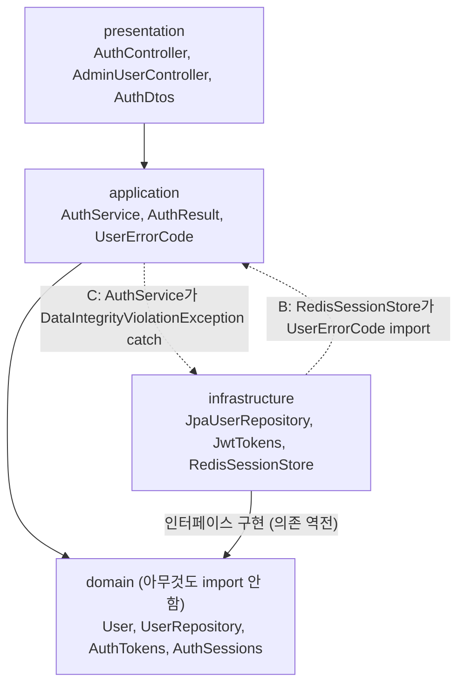

# 우리 4계층 분리는 DDD인가, 계층형 아키텍처와 DDD는 무엇이 다른가

## 질문
우선 현 서비스 계층 분리에 대해서 지식이 필요해. 이게 지금 DDD 계층 분리인건가?

ISE-47(user-service 계층 정리)을 시작하기 전에 물었다. 4계층 각각의 책임은 [4계층 노트](2026-10-27-four-layer-architecture.md)에 있다.

## 짧은 답
- **아니다. 우리가 하는 것은 계층형 아키텍처(Layered Architecture)에 의존 역전(DIP)을 더한 것이다.** DDD(Domain-Driven Design, 도메인 주도 설계)를 적용한 것은 아니다.
- 다만 4계층 이름(표현·응용·도메인·인프라)은 에릭 에반스의 DDD 책(2003)이 제안한 계층 구조에서 왔다. 그래서 "DDD 계층"이라고 부르는 사람도 있어 헷갈린다.
- 계층형 아키텍처는 **코드를 어디에 두고 어느 방향으로 의존하는지**를 정하는 구조 규칙이다. DDD는 **업무 영역(도메인)을 어떻게 나누고 모델링할지**를 정하는 설계 방법론이고, 계층 구조는 그중 일부일 뿐이다.
- 발제도 둘을 나눈다. SA 14장 제출 기준에서 "계층형 아키텍처(4계층) 검증은 모든 팀 필수, DDD는 선택"이다.

## 자세히

### 0. 구조도 (user-service 기준)

- 실선은 허용된 의존 방향이다. 모든 화살표가 domain으로 모인다.
- infrastructure는 맨 아래에 있지만 화살표는 위(domain)를 향한다. domain이 정한 인터페이스(`UserRepository`, `AuthTokens`, `AuthSessions`)를 구현하기 때문이다. 이것이 의존 역전이다.
- 점선은 ISE-47에서 고칠 위반이다. C는 엄밀히 infrastructure 패키지가 아니라 Spring Data 예외(영속성 기술)에 의존하는 것이지만, 기술을 아는 쪽이 infrastructure여야 한다는 뜻에서 같은 방향으로 그렸다.

### 0-1. 계층별로 하는 일 (user-service 실제 코드)

일반 설명은 [4계층 노트](2026-10-27-four-layer-architecture.md) 2절에 있다. 여기서는 실제 코드에 대응시킨다.

| 계층 | 하는 일 | 실제 코드 |
|---|---|---|
| presentation | HTTP 요청을 받아 형식을 검증(`@Valid`)하고, 서비스를 부르고, 공통 응답(`SuccessResponse`)으로 감싼다 | `AuthController.login`은 이메일·비밀번호를 꺼내 `auth.login`에 넘기고 결과를 감싸기만 한다 |
| application | 유스케이스의 순서와 트랜잭션 경계를 정한다. 저장소·토큰·세션을 인터페이스로만 부른다 | `AuthService.login`: 인증 → 행 잠금 → 비밀번호 변경 여부·잠금 확인 → 실패 횟수 초기화 → 토큰 발급 → 세션 저장 |
| domain | 상태와 규칙, 그리고 바깥 기술에 요구하는 인터페이스를 가진다 | `User`(`isLocked()`), 인터페이스 `UserRepository`·`AuthTokens`·`AuthSessions` |
| infrastructure | domain 인터페이스를 실제 기술로 구현한다 | `JpaUserRepository`(PostgreSQL), `JwtTokens`(JWT 서명), `RedisSessionStore`(리프레시 토큰·로그아웃 목록) |
| global | 서비스 설정과 빈 조립 | `UserConfiguration`(공통 JPA·Web 설정 import, 빈 등록) |

로그인 한 번의 흐름: `AuthController` → `AuthService.login` → `UserRepository`·`AuthTokens`·`AuthSessions`(인터페이스) ← `JpaUserRepository`·`JwtTokens`·`RedisSessionStore`(구현). `AuthService`는 JWT 라이브러리도 Redis 명령도 모른다. 토큰을 JWT에서 다른 형식으로 바꿔도 `JwtTokens`만 바뀐다.

지금 빈 곳: 잠금·임시 비밀번호 판단(`validateUnlocked`, `validateTokenIssueAllowed`)이 domain이 아닌 application에 있다. ISE-47 A가 이것을 `User`로 옮긴다.

### 0-2. 3계층이었다면 토큰 교체를 어떻게 했어야 하나

3계층(Controller·Service·Repository)에는 "기술을 감싸는 인터페이스를 누가 소유하나"라는 규칙이 없다. 그래서 흔히 두 모양이 나온다.

| 모양 | 생김새 | JWT를 다른 형식으로 바꿀 때 |
|---|---|---|
| 직접 호출 | `AuthService`가 `Jwts.builder()`, `redisTemplate.opsForValue()`를 직접 부른다 | `AuthService`의 로그인·재발급·로그아웃을 모두 고친다. 서비스 테스트도 JWT·Redis를 띄워야 한다 |
| 유틸·컴포넌트 분리 | `JwtProvider`, `RedisUtil` 같은 구체 클래스를 만들고 `AuthService`가 주입받는다 | `JwtProvider` 안만 고치면 되는 경우가 많다. 다만 메서드 시그니처에 JWT 개념(`Claims`, 토큰 문자열 파싱 결과)이 새어 나오면 서비스도 함께 고친다 |

- 두 번째 모양도 "교체를 한 클래스에 가두기"는 상당 부분 된다. 3계층이 교체를 못 하는 게 아니다.
- 차이는 **방향**이다. 3계층에서는 서비스가 구체 클래스 `JwtProvider`를 의존하고, 그 클래스가 무엇을 내놓을지는 기술 쪽이 정한다. 4계층 + DIP에서는 domain이 `AuthTokens`(`issue`, `decodeAccess`, `refreshTtl`)라는 **필요한 기능**을 먼저 정하고 `JwtTokens`가 거기에 맞춘다. 그래서 `AuthTokens.Identity`처럼 기술과 무관한 타입만 서비스로 올라온다.
- 테스트 이점: 서비스 단위 테스트에서 `AuthTokens`를 가짜 구현으로 바꿔 끼울 수 있다. 구체 클래스도 Mockito로 대신할 수 있지만, 인터페이스가 있으면 "무엇을 요구하는지"가 계약으로 드러난다.
- 대가: 인터페이스 파일이 하나 더 생긴다. 구현이 하나뿐인 인터페이스라 과하다는 비판도 있다. 우리는 Mock PG → 실제 PG처럼 구현이 실제로 바뀌는 곳이 있어 이 대가를 감수했다(#22, ADR 0023).

### 0-3. "domain은 아무것도 의존하지 않는다"는 무슨 뜻인가

- **같은 서비스의 다른 계층(presentation·application·infrastructure)과 바깥 기술(Spring Web, Redis, Kafka, JWT 라이브러리)을 import하지 않는다**는 뜻이다. Java 표준 라이브러리(`java.time`, `java.util`)까지 쓰지 말라는 뜻은 아니다.
- 실제 확인(2026-10-28, `grep "^import" domain/*.java`): `java.time`, `java.util.Optional`, `jakarta.persistence.*`, `com.iseonjwa.common.persistence.BaseEntity`뿐이다.
- 예외 두 가지는 팀이 합의한 타협이다. JPA 애너테이션(#22, 도메인 모델과 JPA 엔티티를 따로 두지 않음)과 공통 모듈의 `BaseEntity`(생성·수정 시각).
- 왜 지키나: 규칙이 기술 변경에 휘말리지 않는다. Redis를 빼도, 토큰 형식을 바꿔도 `User`의 잠금 규칙은 그대로다. 또 domain은 스프링 없이 `new User(...)`로 단위 테스트할 수 있다.
- ISE-47 b1과의 관계: `UserErrorCode`를 domain으로 옮기면 domain이 공통 모듈의 `ErrorCode` 인터페이스를 import하게 된다. 바깥 기술이 아니라 팀 공통 계약이라 `BaseEntity`와 같은 종류의 허용으로 본다. SA 11-2(공통 형식은 `common-response`, 코드 값은 서비스별)와도 맞는다.

### 1. 둘은 층위가 다르다

| | 계층형 아키텍처 (+ DIP) | DDD |
|---|---|---|
| 무엇인가 | 코드 배치와 의존 방향 규칙 | 도메인을 이해하고 모델링하는 설계 방법론 |
| 묻는 것 | "이 코드는 어느 계층에 있어야 하나, 누가 누구를 import하나" | "업무 경계가 어디인가, 같은 단어가 팀마다 같은 뜻인가, 규칙은 어느 객체가 지키나" |
| 산출물 | 패키지 구조, 의존 규칙 | 전략 설계: 바운디드 컨텍스트, 유비쿼터스 언어, 컨텍스트 맵 / 전술 설계: 애그리거트, 엔티티, 값 객체, 도메인 서비스, 도메인 이벤트, 리포지토리 |
| 계층과의 관계 | 그 자체가 목적 | 도메인 모델을 기술 코드에서 떼어 놓으려고 계층 구조를 **수단으로** 쓴다 |

DDD를 하면 보통 계층 구조도 따라오지만, 계층 구조를 썼다고 DDD가 되지는 않는다.

### 2. 에반스의 원형과 우리 구조의 차이
- 에반스 책의 계층형 아키텍처는 위에서 아래로만 의존한다: 사용자 인터페이스 → 응용 → 도메인 → 인프라. 인프라가 맨 아래에 있어 도메인이 인프라를 쓸 수 있는 그림이다.
- 우리는 여기에 **의존 역전**을 더했다. 저장소 인터페이스를 domain에 두고 infrastructure가 구현한다. 그래서 domain은 아무것도 import하지 않는다(SA 13장 표 "domain: 아무것도 의존하지 않음"). 이후 DDD 문헌(반 버논의 『도메인 주도 설계 구현』 등)이 계층에 DIP를 적용하는 방식을 다루는데, 우리 구조는 그쪽에 가깝다.

### 3. 우리 프로젝트에 DDD 요소가 얼마나 있나

| DDD 요소 | 우리 상태 |
|---|---|
| 엔티티 | 있다(`User`, `Reservation` 등). 단, JPA 엔티티를 그대로 도메인 모델로 쓴다(#22의 타협) |
| 리포지토리 인터페이스를 도메인에 | 있다(`UserRepository`). 의존 역전 |
| 값 객체 | 거의 없다. 이메일·금액이 `String`·숫자 그대로다 |
| 애그리거트 경계 | 명시적으로 정하지 않았다. 대신 다른 모듈의 엔티티는 ID로만 참조한다(4계층 노트 7절) |
| 도메인 이벤트 | 서비스 간 이벤트(`payment.result`)는 있지만 계약 중심이고, 도메인 모델에서 나오는 이벤트로 설계한 것은 아니다 |
| 바운디드 컨텍스트 | 서비스 3개·모듈 경계(#9, #10)가 비슷한 역할을 한다. 다만 유비쿼터스 언어나 컨텍스트 맵을 만드는 DDD 절차로 도출한 것은 아니다 |

정리하면 "DDD의 일부 습관을 빌린 계층형 아키텍처"다.

### 4. ISE-47은 어느 쪽 작업인가

| ISE-47 항목 | 성격 |
|---|---|
| B. 인프라가 응용의 `UserErrorCode`를 import | **계층 규칙 위반**. 의존 방향 문제라 DDD와 상관없이 고친다 |
| C. 응용이 Spring DB 예외를 직접 잡음 | **계층 규칙 위반**. 응용이 기술(영속성)을 알면 안 된다 |
| A. 토큰 발급 가능 여부·이메일 정규화를 `User`로 | 계층 위반은 아니다. **빈약한 도메인 모델(Anemic Domain Model)** 을 조금 풍부하게 만드는 작업이다. "규칙은 그 데이터를 가진 객체가 지킨다"는 DDD 전술 설계의 방향과 같다 |

"빈약한 도메인 모델"은 마틴 파울러가 이름 붙인 상태다. 엔티티가 getter만 갖고 규칙은 모두 서비스에 있는 모양으로, 지금 `User`(`isLocked()` 하나에 나머지는 getter)가 여기에 해당한다. 규칙을 서비스가 순서대로 처리하는 방식을 트랜잭션 스크립트라고 한다. 규모가 작을 때는 트랜잭션 스크립트가 오히려 단순하다. 그래서 A는 "모두 옮긴다"가 아니라 상태에 붙은 규칙(잠금, 임시 비밀번호, 이메일 정규화)만 옮기는 부분 수용이었다.

### 5. 왜 DDD를 전부 하지 않았나 (선택지 비교)

| 선택지 | 얻는 것 | 대가 |
|---|---|---|
| 3계층 (Controller·Service·Repository) | 가장 빠르고 익숙하다 | 규칙과 기술 호출이 Service에 섞인다 |
| **4계층 + DIP (선택, #22)** | domain이 기술을 모르고, 규칙을 엔티티로 옮길 자리가 생긴다 | 인터페이스와 변환 코드가 늘어난다 |
| DDD 전면 적용 | 복잡한 도메인(예매 상태, 결제 정합성)의 규칙이 가장 잘 모인다 | 유비쿼터스 언어·애그리거트 설계·값 객체 매핑 학습 비용이 5주 일정에 크다. 발제도 선택 항목이다 |

감수한 점: 애그리거트 경계를 정하지 않아서, 무엇을 한 트랜잭션에서 함께 바꿔도 되는지를 DDD 규칙이 아니라 SA의 시퀀스와 조건부 UPDATE로 지킨다.

## 이 프로젝트에서는
- 근거: 결정 기록 #22(4계층), SA 13장(패키지 구조와 의존 표), SA 14장(계층형 필수, DDD 선택)
- 위반 사례와 판단: `docs/sa-review/06-layered-architecture-check.md`, `docs/ai-judgments/kangmin/2026-10-27-layered-architecture-check7.md`
- 적용 작업: Linear ISE-47

## 면접 포인트
- "DDD 해 봤나요?": 계층형 아키텍처에 DIP를 적용했고, DDD 전술 설계 중 엔티티·도메인 리포지토리를 썼다. 애그리거트나 값 객체까지 체계적으로 쓰지는 않았다고 구분해서 답한다. 과장하면 애그리거트 경계 질문에서 바로 드러난다.
- "빈약한 도메인 모델은 나쁜가요?": 무조건 나쁘지는 않다. 규칙이 적으면 트랜잭션 스크립트가 단순하다. 같은 상태 판단이 여러 유스케이스에서 반복될 때(`User`의 잠금 확인이 로그인·재발급·비밀번호 변경에 모두 등장) 엔티티로 옮길 이유가 생긴다.
- "계층 규칙은 어떻게 지키나요?": 지금은 리뷰와 AI 검증(`#7`)으로 확인한다. ArchUnit 같은 테스트로 강제하는 방법은 확인할 질문으로 남아 있다.

## 참고
- 에릭 에반스, 『도메인 주도 설계』 4장 도메인 격리(계층형 아키텍처)
- 마틴 파울러, "AnemicDomainModel"(bliki)
- 이 노트의 DDD 문헌 내용은 기억에 기반한 설명이다. 원문 쪽수는 확인하지 못했다.
