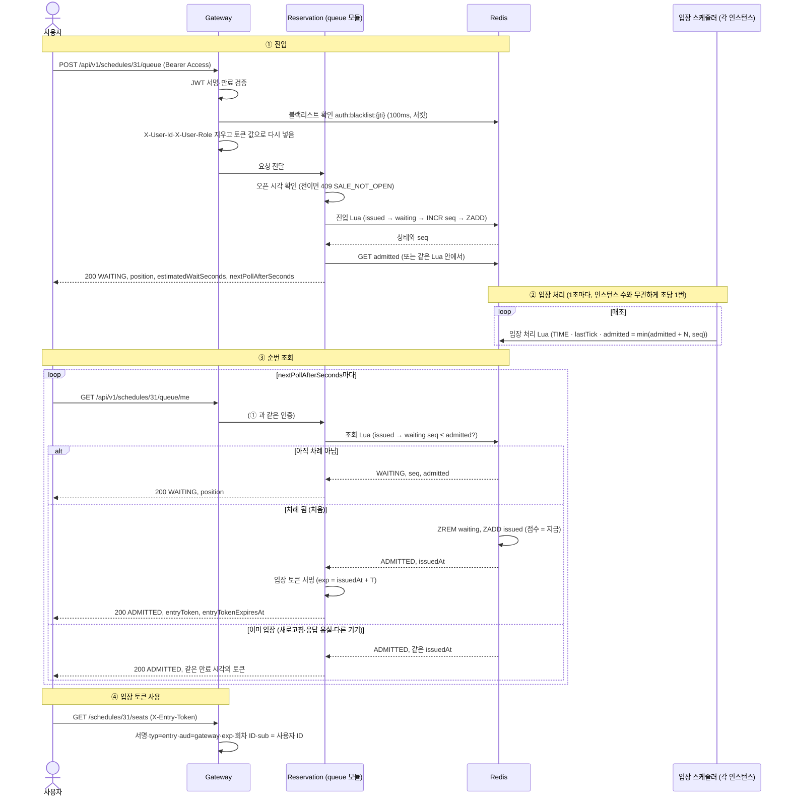

# 대기열 진입부터 입장 토큰 발급까지 요청·Redis·상태 전이를 단계별로 보면

## 질문
사용자 → POST `/schedules/{id}/queue` → Gateway → 대기열 진입(Lua: seq 발급 → Redis ZSET) → Reservation부터 ADMITTED + 입장 토큰을 받는 과정까지의 시퀀스를 상태 전이 등 모든 로직을 포함해 상세히 설명해 달라.

관련: [진입(POST)과 조회(GET)의 역할 노트](2026-10-28-queue-entry-vs-status-responsibility.md)

## 짧은 답
- 근거는 SA 12-8, 7-3, 9-4, 9-5, 11-5와 ADR 0015(제안)다. **대기열 코드는 아직 없다**(10/28 dev 기준 queue 모듈은 패키지 뼈대와 Redis 연결 테스트뿐). 아래는 설계 기준이다.
- 순서 정정: Lua는 Gateway가 아니라 **Reservation이 Redis에 보내 실행**한다. Gateway는 인증만 하고 Reservation으로 넘긴다.
- 흐름은 네 단계다. ① 진입(POST, 번호표 발급) ② 입장 처리(스케줄러, 1초마다 `admitted` +N) ③ 순번 조회(GET 반복, `seq <= admitted`면 입장 토큰) ④ 입장 토큰 사용과 만료.
- 사용자 한 명의 상태: **없음 → 대기(WAITING) → 입장(ADMITTED) → 만료 → 없음**.

## 자세히

### 0. Redis 키 (회차마다 따로, 12-8)

| 키 | 타입 | 뜻 |
|---|---|---|
| `queue:{scheduleId}:seq` | 문자열 카운터 | 지금까지 나눠 준 마지막 번호표 |
| `queue:{scheduleId}:waiting` | ZSET (멤버 userId, 점수 seq) | 줄 서 있는 사람. 계정당 1자리 |
| `queue:{scheduleId}:admitted` | 문자열 카운터 | "이 번호까지 들어와도 된다"는 선 |
| 🆕 `queue:{scheduleId}:lastTick` | 문자열 | `admitted`를 마지막으로 올린 초 (ADR 0015) |
| 🆕 `queue:{scheduleId}:issued` | ZSET (멤버 userId, 점수 발급 시각) | 입장 토큰을 받은 사람 (ADR 0015) |

은행 번호표로 비유하면 `seq`는 번호표 기계, `waiting`은 대기석, `admitted`는 전광판의 "○번까지 오세요", `issued`는 창구에 들어간 사람 명단이다.

### 1. 전체 시퀀스



### 2. ① 진입: POST `/queue`

**Gateway (구현됨)**
1. `Authorization: Bearer` 없으면 401. JWT 서명·만료 검증.
2. 블랙리스트 Redis 확인: 100ms 타임아웃 + 서킷 브레이커. Redis가 안 되면 closed(503 + `Retry-After`, ADR 0005).
3. 클라이언트가 보낸 `X-User-Id`·`X-User-Role`을 지우고 토큰 값으로 다시 넣는다(위조 차단).
4. 대기열 경로는 입장 토큰이 필요 없다(입장 토큰은 좌석 조회·선점만).

**Reservation (설계)**
1. 오픈 시각 확인: 서버 시각이 `schedules.open_at` 전이면 409 `SALE_NOT_OPEN`(E4). 검사 위치(Gateway냐 서비스냐)는 SA에 두 군데로 적혀 있어 확정이 필요하다(9-2 "Gateway 오픈 전 시각 검사", 6-5 "판매 오픈 판정").
2. 대기열 Redis 호출도 100ms 타임아웃 + 서킷. OPEN이면 closed(503, 9-5).
3. 진입 Lua 하나로 처리한다. 하나의 Lua는 Redis에서 다른 명령이 끼어들지 않고 한 번에 실행되므로 연타·동시 요청에도 결과가 하나다.

```
진입 Lua (KEYS: issued, waiting, seq / ARGV: userId, now, T)
1. issuedAt = ZSCORE issued userId
   있고 now - issuedAt < T  → "ADMITTED", issuedAt 반환 (새 seq 만들지 않음)
   있고 T 지남             → ZREM issued userId (만료 정리, 아래 계속)
2. seq = ZSCORE waiting userId
   있으면                   → "WAITING", seq 반환 (같은 번호표 유지, 연타 방어)
3. seq = INCR seq
   ZADD waiting seq userId  → "WAITING", seq 반환
```

4. 응답: `position = max(0, seq - admitted)`, `estimatedWaitSeconds`(position ÷ N 등), `nextPollAfterSeconds`(기본 3초, 순번이 멀수록 길게, 최대 10초, 9-4).
- 1번에서 토큰까지 줄지(ADR 0015) 상태만 알릴지는 [역할 노트](2026-10-28-queue-entry-vs-status-responsibility.md)의 선택지다.
- `position`은 이탈자 번호를 포함해 실제보다 클 수 있다(11-5). 이탈자 슬롯만큼 실제 입장 속도가 N보다 낮아진다(12-8).

### 3. ② 입장 처리: 스케줄러

```
입장 처리 Lua (KEYS: lastTick, admitted, seq / ARGV: N)
1. nowSec = Redis TIME의 초
2. lastTick == nowSec → 건너뜀 (다른 인스턴스가 이번 초를 이미 처리)
3. SET lastTick nowSec
4. admitted = min(admitted + N, seq)
```

- 왜 `lastTick`: 인스턴스 3개가 각자 1초마다 돌면 초당 +3N이 된다. 초 단위 표시로 한 번만 올린다(ADR 0015 1·2번).
- 왜 `min(…, seq)`: 오픈 전 줄이 빈 동안에도 매초 +N이면 `admitted`가 커져, 오픈 순간 몰린 사람이 한꺼번에 들어온다. 발급된 번호표보다 앞서가지 못하게 한다(3번).
- Redis `TIME`을 쓰는 이유: 인스턴스마다 시계가 다르면 같은 초를 다르게 본다. 시계 기준을 Redis 하나로 맞춘다.

### 4. ③ 순번 조회: GET `/queue/me`

```
조회 Lua (KEYS: issued, waiting, admitted / ARGV: userId, now, T)
1. issuedAt = ZSCORE issued userId
   있고 now - issuedAt < T  → "ADMITTED", issuedAt   (재발급 아님, 같은 만료)
   있고 T 지남             → ZREM issued userId, "EXPIRED"(→ 404 처리 후 다시 진입)
2. seq = ZSCORE waiting userId
   없으면                   → "NOT_JOINED"            → 404 QUEUE_NOT_JOINED
3. seq <= GET admitted
   아니면                   → "WAITING", seq, admitted
   맞으면                   → ZREM waiting userId
                               ZADD issued now userId
                               "ADMITTED", now
```

- 입장 판정 `seq <= admitted`(#27): 이탈자가 빠져 ZRANK가 앞당겨져도 `admitted`는 번호 기준이라 판정이 어긋나지 않는다.
- 토큰 서명은 Lua 밖, 앱이 한다. Redis는 "누가 언제 입장했는가"만 안다.
  - claim: `typ=entry`, `aud=gateway`, `sub`(userId), 회차 ID, `exp` = issuedAt + T(10분 `[가정]`), `jti`
  - 키: `ENTRY_TOKEN_SECRET`(HMAC-SHA256, 결제 토큰과 분리)
- 같은 발급 시각으로 다시 서명하므로 **만료가 늘어나지 않는다**. 재조회로 토큰 유효 시간을 무한히 늘리던 문제(ADR 0015 3번)가 막히고, 응답이 유실돼도 차례를 잃지 않는다.
- `jti`는 다시 서명할 때마다 달라질 수 있다. 폐기 목록이 없어(7-3) 만료가 같으면 문제 되지 않는다.

### 5. ④ 사용과 만료
- 좌석 조회·선점에 `X-Entry-Token`을 붙인다. Gateway가 서명·`typ`·`aud`·`exp`·회차 ID + 🆕 `sub` = JWT 사용자 ID를 확인한다. 다르면 403 `ENTRY_TOKEN_INVALID`(남의 토큰 넘겨받기 차단).
- Redis 서킷이 OPEN이어도 입장 토큰은 서명과 `exp`만으로 검증해 통과한다(9-5).
- T가 지나면 토큰이 만료되고, `issued` 기록은 정리된다. 다시 진입하면 새 seq로 맨 뒤에 선다.

### 6. 사용자 한 명의 상태 전이 (회차 단위)

```
            POST 진입               seq <= admitted (GET)        T 경과
 [없음] ──────────────▶ [WAITING] ─────────────────────▶ [ADMITTED] ───────▶ [없음]
   ▲   (seq 발급, ZADD waiting)    (ZREM waiting, ZADD issued)    (issued 정리)   │
   │                                                                              │
   └──────────────────────── 다시 POST하면 새 seq로 맨 뒤 ◀──────────────────────────┘

 WAITING ── DELETE /queue/me (이후 단계, 대기 취소) ──▶ [없음]  (ZREM waiting)
```

| 상태 | Redis에 있는 곳 | 같은 요청을 다시 보내면 |
|---|---|---|
| 없음 | 어디에도 없음 | POST → 새 seq / GET → 404 |
| WAITING | `waiting` (점수 seq) | POST → 같은 seq / GET → 순번 또는 입장 |
| ADMITTED | `issued` (점수 발급 시각) | POST → 새 seq 없음 / GET → 같은 만료의 토큰 |

### 7. 경계 상황 정리

| 상황 | 결과 | 막는 장치 |
|---|---|---|
| POST 연타 | 같은 seq | 진입 Lua 2번(`waiting` 확인) |
| 입장 후 POST 다시 | 새 seq 없음 | 진입 Lua 1번(`issued` 확인) |
| 토큰 응답 유실·새로고침·다른 기기 | 같은 만료의 토큰 다시 받음 | `issued` 발급 시각 재사용 |
| 매크로가 GET 반복 | 토큰 유효 시간이 늘지 않음 | 같은 발급 시각 |
| 인스턴스 여러 개 | 입장 속도 초당 N 이하 | `lastTick` |
| 오픈 전 빈 줄 | 오픈 순간 몰림 입장 없음 | `min(admitted + N, seq)` |
| 남의 입장 토큰 사용 | 403 | Gateway `sub` 확인 |
| Redis 느림·장애 | 대기열 503, 입장 토큰 검증은 계속 | 100ms 타임아웃 + 서킷 (9-5) |

## 이 프로젝트에서는
- 근거: SA 12-8(키·판정·🆕 입장 처리), 7-3(토큰 규칙), 9-4(숫자), 9-5(Redis 정책), 11-5(응답 예시), ADR 0015(제안, 대기열 담당)
- 구현 상태(10/28): Gateway 인증·블랙리스트·헤더 교체는 구현됨(`GatewayAuthenticationFilter`). 대기열 Lua·스케줄러·입장 토큰·입장 토큰 필터는 아직 없음

## 확인할 질문
- 오픈 시각 검사를 Gateway와 Reservation 중 어디서 할지(SA에 두 곳으로 적힘)
- `issued` 점수(발급 시각)를 Redis `TIME`으로 정할지 앱 시계로 정할지. 입장 처리가 Redis `TIME`을 쓰므로 맞추는 편이 안전해 보인다
- T가 지난 `issued` 기록을 Lua 안에서 그때그때 지울지, 스케줄러가 `ZREMRANGEBYSCORE`로 한꺼번에 지울지
- 입장자가 토큰 만료 전에 예매를 끝내면 `issued`에서 바로 뺄지(빼면 같은 사람이 곧바로 다시 줄을 설 수 있음)
