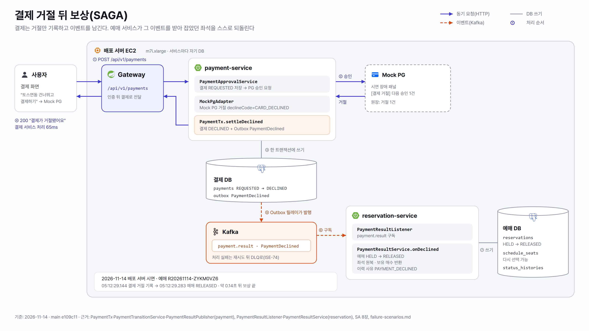

# 결제 거절 뒤 보상(SAGA) 한 장 요약

## 문제

- 예매와 결제는 서비스마다 DB가 따로라 한 트랜잭션으로 묶을 수 없다. 좌석을 잡은(예매 `HELD`) 뒤 결제가 거절되면, 예매 쪽이 잡아 둔 좌석과 1인 매수 몫을 스스로 되돌려야 한다.
- 방식은 SAGA 코레오그래피다(SA 14장 #3). 결제 서비스는 결과를 이벤트로만 남기고, 예매 서비스가 그 이벤트를 받아 보상한다. 서로를 직접 부르지 않는다.

## 흐름

| 순서 | 어디서 | 무엇을 |
|---|---|---|
| ① | 사용자 → Gateway → 결제 | `POST /api/v1/payments` |
| ② | 결제 → Mock PG | 승인 요청. 시연 장애 패널의 [결제 거절]로 `CARD_DECLINED` |
| ③ | 결제 서비스 | `PaymentTx.settleDeclined`가 결제를 `REQUESTED → DECLINED`로 바꾸고, 같은 트랜잭션에 Outbox `PaymentDeclined`를 쓴다(`PaymentTransitionService`, `PaymentResultPublisher`) |
| ④ | 결제 → 사용자 | 200, 화면 "결제가 거절됐어요" |
| ⑤ | Outbox 릴레이 → Kafka | 토픽 `payment.result`로 발행 |
| ⑥ | 예매 서비스 | `PaymentResultListener`가 구독 |
| ⑦ | 예매 서비스 | `PaymentResultService.onDeclined`: 예매 `HELD → RELEASED`, 좌석 원복, 보유 매수 반환, 이력 사유 `PAYMENT_DECLINED`. 처리에 실패하면 재시도 뒤 DLQ로 간다(ISE-74) |

## 캡처 (2026-11-14 배포 서버, main `e109c11`, 예매 R20261114-ZYKM0VZ6)

측정 모드가 꺼진 상태에서 팀에 알린 뒤 시연 장애 패널([`demo-scenarios.md`](../../guides/demo-scenarios.md))로 [결제 거절] 1건을 걸었다. 배포 서버 결제는 토스 테스트 모드라, 결제 화면의 "토스연동 건너뛰고 결제하기"로 Mock PG를 거쳤다.

| 캡처 | 보여 주는 것 |
|---|---|
| [① 사용자 화면](2026-11-14-saga-captures/1-declined-screen.png) | "결제가 거절됐어요. 잡아 둔 좌석은 풀렸으니 좌석을 다시 골라 주세요" |
| [② 요청 로그 패널](2026-11-14-saga-captures/2-request-log-traceid.png) | `POST /api/v1/payments` 200, traceId `6af7edbd141071fb1f946eded6705e3a` |
| [③ Grafana 요청 로그](2026-11-14-saga-captures/3-grafana-payment-log.png) | 결제 서비스 `MockPgAdapter: Mock PG 거절 declineCode=CARD_DECLINED`(05:12:29.144Z), 요청 200 65ms |
| [④ 좌석 배치도](2026-11-14-saga-captures/4-seat-map-released.png) | 잡았던 X구역 3열 9번이 다시 선택 가능(X구역 남은 600/600) |
| [⑤ 예매 상태 이력](2026-11-14-saga-captures/5-reservation-status-history.png) | `HELD`(SEAT_HELD, 05:10:29.153Z) → `RELEASED`(PAYMENT_DECLINED, 05:12:29.283Z) |

- 결제 거절 기록(05:12:29.144) 뒤 약 0.14초에 예매가 해제됐다.
- ③에는 예매 쪽 로그가 없다. 보상은 결제 요청이 끝난 뒤 Kafka 이벤트로 따로 일어나 결제 요청의 트레이스에 담기지 않고, 예매 서비스는 정상 보상을 로그로 남기지 않는다(ADR 0052). 그래서 예매 쪽 증거는 ⑤ 예매 DB 이력으로 보였다.

## 정본

- [SA](../../core/SA%20MASTER.md) 8장(일반 예매 시퀀스, 상태 머신), 14장 #3(코레오그래피)
- [`docs/design/payment/failure-scenarios.md`](../../design/payment/failure-scenarios.md)
- 이벤트 계약: [`docs/design/payment/contracts.md`](../../design/payment/contracts.md), ADR 0027
