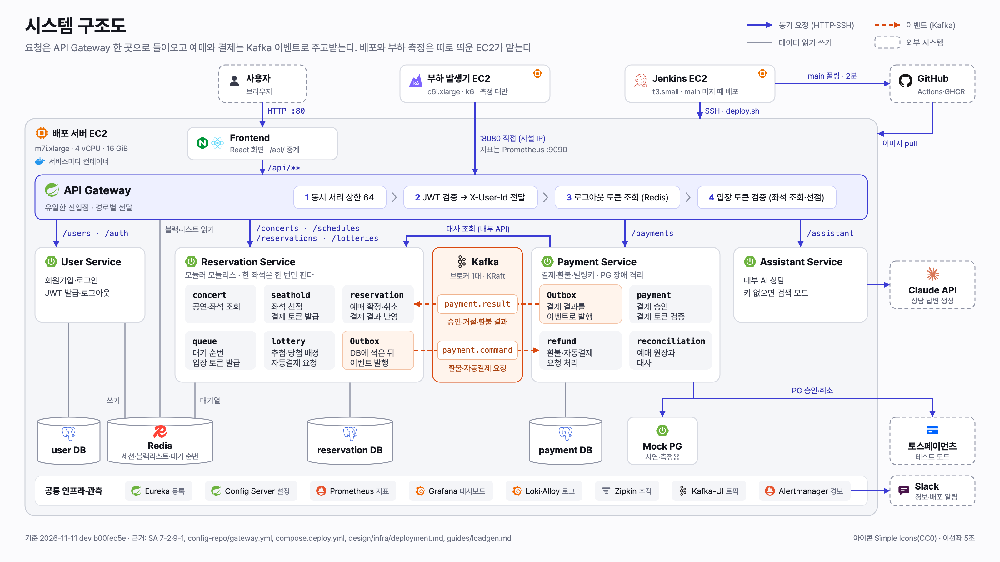
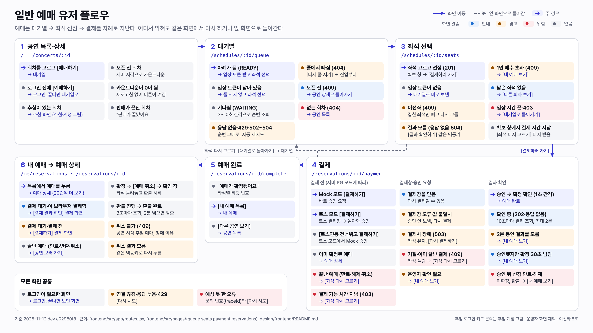
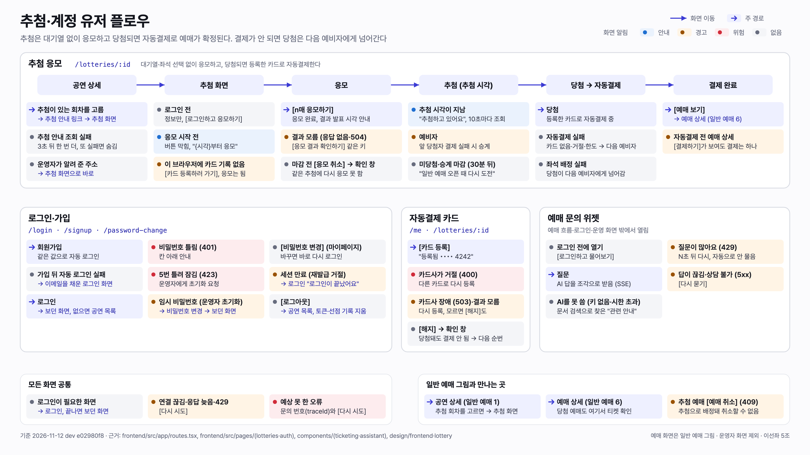
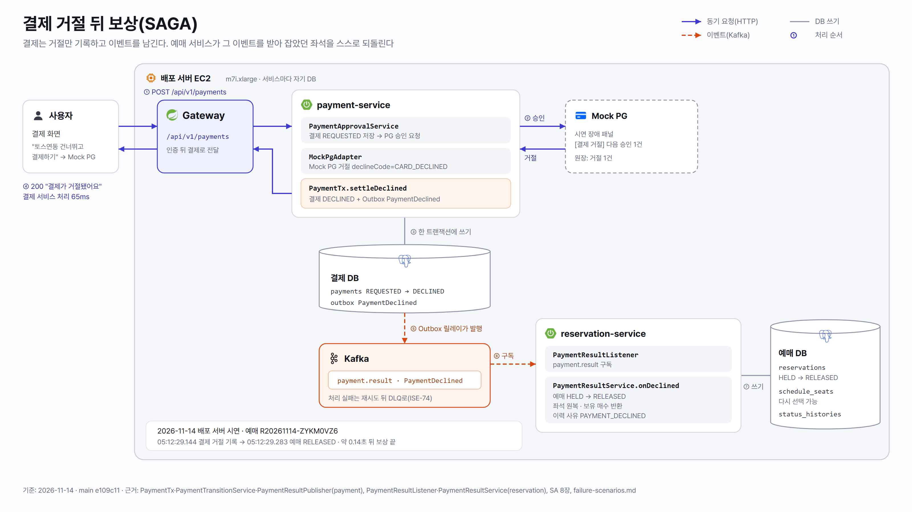

# 아키텍처

시스템 구조도, 서비스 경계, 주요 흐름(일반 예매, 추첨 자동결제, 예매↔결제 SAGA), 상태 머신 그림을 둔다. 배포 서버 위의 배치는 [`deployment/`](../deployment/README.md)에 둔다.

정본:
- 서비스 경계와 시스템 구조도: [SA](../../core/SA%20MASTER.md) 7-1·7-2
- 일반 예매 시퀀스, 상태 머신, 전이 표: SA 8장
- 서비스별 상세: [결제](../../design/payment/README.md), [예매·좌석 선점](../../design/reservation/contracts.md), [대기열](../../design/queue/contracts.md), [추첨](../../design/lottery/README.md)

| 날짜 | 파일 | 내용 |
|---|---|---|
| 2026-11-11 | [2026-11-11-system-architecture.png](2026-11-11-system-architecture.png), [원본 SVG](2026-11-11-system-architecture.svg) | 시스템 구조도. 배포 서버 EC2 경계 안에 nginx → Gateway(필터 순서 1~4) → 서비스 4개와 경로, Reservation·Payment의 패키지, Kafka 토픽 두 개(`payment.command`·`payment.result`)와 양쪽 Outbox, 서비스별 DB와 Redis 공유 방식, Mock PG, 공통 인프라 띠를 둔다. 경계 밖에는 사용자, 부하 발생기 EC2(k6 → Gateway :8080), Jenkins EC2(SSH 배포), GitHub(Actions·GHCR), 토스·Claude API·Slack을 둔다. 상자마다 스택 아이콘(Simple Icons)이 있다. dev `b00fec5e` 코드·설정과 `deployment.md`·`loadgen.md`로 확인했다. [다이어그램 스타일](../brand/diagram-style.md)의 기준 그림이다 |
| 2026-11-12 | [2026-11-12-user-flow-booking.png](2026-11-12-user-flow-booking.png), [원본 SVG](2026-11-12-user-flow-booking.svg) | 일반 예매 유저 플로우. 화면 6개를 위 줄 1~3(공연 목록·상세 → 대기열 → 좌석 선택), 아래 줄 4~6(결제 → 예매 완료 → 내 예매·상세)으로 꺾어 두고, 화면마다 갈래(이선좌 409, 입장 시간 끝, 선점 결과 모름, 토스 결제창 닫음·실패, 거절, 결제사 장애, 승인 뒤 만료 환불, 예매 취소·환불 등)를 화면이 보이는 알림 색과 가는 곳으로 적었다. 결제를 다시 해야 할 때와 입장 시간이 끝났을 때 대기열로 돌아가는 길은 점선이다. 왼쪽 아래에 모든 화면 공통 갈래를 둔다 |
| 2026-11-12 | [2026-11-12-user-flow-lottery-account.png](2026-11-12-user-flow-lottery-account.png), [원본 SVG](2026-11-12-user-flow-lottery-account.svg) | 추첨·계정 유저 플로우. 추첨 응모(공연 상세 → 추첨 화면 → 응모 → 추첨 → 당첨·자동결제 → 결제 완료, 예비자 승계·미당첨·자동결제 실패), 로그인·가입(잠금, 임시 비밀번호, 세션 만료, 로그아웃), 자동결제 카드, 예매 문의 위젯의 갈래와 일반 예매 그림과 만나는 곳을 둔다. 두 장 모두 운영자 화면은 넣지 않았고, dev `e02980f8`의 `frontend/src` 화면 코드와 [프론트 설계](../../design/frontend/README.md)·[추첨 설계](../../design/lottery/README.md)로 확인했다. 표기는 [다이어그램 스타일](../brand/diagram-style.md) 9절이다 |
| 2026-11-14 | [2026-11-14-saga-payment-declined.png](2026-11-14-saga-payment-declined.png), [원본 SVG](2026-11-14-saga-payment-declined.svg), [한 장 요약](2026-11-14-saga-payment-declined.md) | 결제 거절 뒤 보상(SAGA). 사용자 → Gateway → 결제 서비스 → Mock PG 거절, 결제 DECLINED와 Outbox `PaymentDeclined`(한 트랜잭션), Kafka `payment.result`, 예매 서비스 `onDeclined`(HELD → RELEASED, 좌석·보유 매수 반환)를 순서 ①~⑦로 둔다. 2026-11-14 배포 서버 시연 캡처 5장([`2026-11-14-saga-captures/`](2026-11-14-saga-captures/))과 거절 뒤 약 0.14초 보상 시각을 함께 둔다. main `e109c11` 코드로 확인했다(ISE-267) |

## 미리보기

### 시스템 구조도 (2026-11-11)

### 일반 예매 유저 플로우 (2026-11-12)

### 추첨·계정 유저 플로우 (2026-11-12)

### 결제 거절 뒤 보상(SAGA) (2026-11-14)

