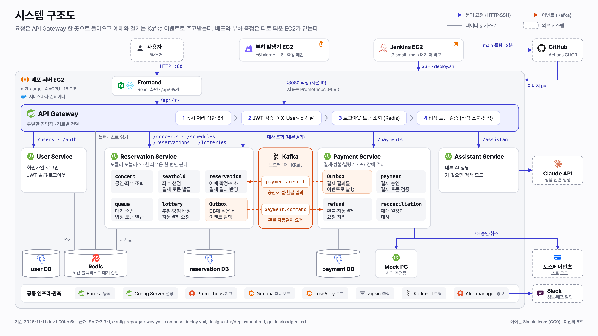

# 다이어그램 스타일

발표용 다이어그램을 같은 모양으로 그리기 위한 규칙이다. 기준 그림은 [시스템 구조도](../architecture/2026-11-11-system-architecture.svg)다. 새 그림은 이 SVG를 복사해 `<style>`과 `<defs>`를 그대로 둔 채 내용만 바꿔 그린다. 색과 글자 크기는 프론트 [디자인 시스템](../../design/frontend/design-system.md) 토큰에서 가져왔고, 그림에만 쓰는 값은 표에 "그림 전용"으로 표시했다.

## 1. 캔버스

- `viewBox="0 0 1600 900"`(16:9)로 그린다. 슬라이드 한 장을 그대로 채운다.
- 좌우 여백은 40이다. 제목 기준선은 y 52, 출처 줄 기준선은 y 866이다.
- 바탕은 `#FBFBFD`(`gray-25`)다. 슬라이드용이라 라이트 모드로 고정한다.
- 위에서 아래로 흐른다. 맨 위는 배포 서버 밖(사용자, 부하 발생기 EC2, Jenkins EC2, GitHub)이고, 그 아래 배포 서버 EC2 경계 안에 진입(nginx, Gateway) → 서비스 → 데이터 → 공통 인프라 띠가 쌓인다.
- 오른쪽 끝 한 열(x 1424~1560)은 배포 서버 밖의 외부 서비스(GitHub, Claude API, 토스, Slack) 자리다. 부르는 상자와 같은 높이에 두어 선이 가로로 경계를 넘게 한다.

## 2. 머리말과 출처 줄

- 제목은 그림 이름이다. 예: "시스템 구조도".
- 부제는 이 그림이 보여 주는 주장 한 문장이다. "~를 나타낸다"가 아니라 "요청은 Gateway 한 곳으로 들어온다"처럼 쓴다.
- 범례는 오른쪽 위에 두고, 그 그림에 실제로 쓴 표기만 넣는다.
- 출처 줄에는 기준 날짜, 커밋, 근거 문서를 적는다. 나중에 정본이 바뀌었는지 이 줄로 판단한다.

## 3. 색

색은 통신 방식만 나타낸다. 상자를 서비스마다 다른 색으로 칠하지 않는다.

| 의미 | 선 | 글자 | 상자 |
|---|---|---|---|
| 동기 요청 (HTTP·SSH) | `#3B3BD4`(`primary-600`) 실선 2, 화살표 | `#2F2FAE`(`primary-700`) | 요청이 지나는 매개(Gateway): 바탕 `#EEF0FF`(`primary-50`), 테두리 `#3B3BD4` |
| 이벤트 (Kafka) | `#D9480F`(`seat-r`) 점선 2(`7 4`), 화살표 | `#A8400E`(그림 전용) | 이벤트 매개(Kafka): 바탕 `#FFF4EC`(그림 전용), 테두리 `#D9480F`. Outbox 칸: 같은 바탕, 테두리 `#F3C3A6` |
| 데이터 읽기·쓰기 | `#8D92A3`(`gray-400`) 실선 1.75, 화살표 없음 | `#676C7E`(`gray-500`) | 저장소: 바탕 흰색, 테두리 `#8D92A3`, 원통 |

| 그 밖의 요소 | 값 |
|---|---|
| 서버(EC2) 경계 | 바탕 `#F5F6F9`, 테두리 `#C9CDD6` 1.5(둘 다 그림 전용), 모서리 16 |
| 일반 상자 | 바탕 흰색, 테두리 `#D7DAE2`(`gray-200`) 1.5 |
| 외부 시스템 | 바탕 흰색, 테두리 `#8D92A3` 점선 `6 4` |
| 상자 안 작은 칸 | 바탕 `#F4F5F8`, 테두리 없음 |
| 공통 인프라 띠 | 바탕 흰색, 테두리 `#E1E4EA`(그림 전용). 칩은 바탕 `#F4F5F8` |
| 글자 | 제목 `#14161E`(`gray-900`), 본문 `#373B4A`(`gray-700`), 보조 `#676C7E`(`gray-500`) |

대비는 계산해 확인했다. 글자는 모두 4.5:1 이상이다(`#A8400E` 흰 바탕 6.2:1, `#FFF4EC` 위 5.7:1, `#676C7E` `#F4F5F8` 위 4.8:1). 선은 그래픽 기준 3:1 이상이다(`#8D92A3` 3.0:1, `#D9480F` 4.0:1).

## 4. 모양

- 서비스·앱은 둥근 사각형(모서리 12)으로 그린다. 안쪽 칸은 8, 작은 칩은 6이다.
- 저장소(DB, Redis)는 원통이다. 외부 시스템은 점선 사각형이다.
- 상자 안 칸에는 실제 패키지·모듈 이름을 고정폭 글꼴로 쓰고, 아래에 한두 줄 설명을 단다. 그림의 이름으로 코드를 찾을 수 있게 하기 위해서다.
- 순서가 있는 단계는 번호와 꺾쇠(`›`)로 잇는다. 예: Gateway 필터 1~4.
- 모든 앱에 걸리는 것(Eureka, Config, 관측)은 선을 긋지 않고 맨 아래 띠에 칩으로 둔다. 선을 그으면 모든 상자와 이어져 그림을 덮는다.
- 한 서버(EC2) 안의 컨테이너는 서버 경계로 묶는다. 경계 왼쪽 위에 서버 이름과 유형·사양을 적는다. 경계를 넘는 선이 서버 밖으로 나가거나 들어오는 호출이다. Jenkins처럼 서버 하나에 한 가지 일만 하는 EC2는 경계 대신 일반 상자로 그리고 오른쪽 위에 EC2 기호(16px)를 단다.
- 그림자와 그라데이션은 쓰지 않는다.

## 4-1. 아이콘

- 스택 아이콘은 [Simple Icons](https://simpleicons.org/) 16.36.0(CC0)의 경로와 브랜드 색을 쓴다. `<defs>`에 `<symbol id="i-<slug>" viewBox="0 0 24 24">`로 넣고 `<use href="#i-<slug>">`로 놓는다. 지금 들어 있는 것: springboot, spring, apachekafka, redis, postgresql, nginx, react, prometheus, grafana, docker, github, jenkins, k6, claude.
- Simple Icons에 로고가 없는 것은 로고를 흉내 내지 않고 뜻만 나타내는 기호를 직접 그렸다: `g-ec2`(AWS EC2, 칩), `g-chat`(Slack, 말풍선), `g-card`(토스, 카드), `g-trace`(Zipkin, 추적 막대), `g-user`(사용자).
- 크기는 상자 이름 앞 20~22, 칩 안 16, 저장소 원통은 위쪽 가운데 22다. 아이콘이 있으면 저장소의 "PostgreSQL" 같은 기술 이름 글자는 뺀다.
- 아이콘 색은 브랜드 색 그대로다. 선 색 규칙(통신 방식)과는 별개이고, 아이콘에 새 의미를 붙이지 않는다.
- 새 아이콘은 `https://cdn.jsdelivr.net/npm/simple-icons@16.36.0/icons/<slug>.svg`를 빈 폴더에 받아 `path` 하나짜리인지 확인한 뒤 symbol로 옮긴다. 브랜드 색은 같은 버전의 `data/simple-icons.json`에 있다.

## 5. 글자

글꼴은 Pretendard(디자인 시스템과 같다)이고, 경로·토픽·패키지 이름은 고정폭(SF Mono, 없으면 Menlo)이다. 슬라이드에서 읽히도록 12px 아래로 내리지 않는다.

| 클래스 | 크기·굵기 | 쓰는 곳 |
|---|---|---|
| `t-title` | 30 / 700 | 그림 제목 |
| `t-sub` | 16 / 400 | 부제(주장 한 문장) |
| `t-node-lg` | 18 / 700 | 띠처럼 넓은 상자의 이름(Gateway) |
| `t-node` | 16 / 700 | 서비스 이름 |
| `t-node-sm` | 15 / 700 | 저장소·외부 시스템·서버 이름 |
| `t-body` | 13.5 / 400 | 상자 안 설명 |
| `t-meta` | 13 / 400 | 보조 설명, 범례 |
| `t-meta-sm` | 12 / 400 | 작은 상자의 설명, 서버 사양, 출처 줄 |
| `t-mono`, `t-mod` | 12.5 / 400, 13 / 600 | 경로·토픽, 패키지 이름 |
| `l` + `l-sync`·`l-event`·`l-data` | 12.5 / 400 | 선 옆 글자. 선과 같은 색 계열 |

## 6. 선

- 직각으로 꺾는다. 대각선은 쓰지 않는다.
- 선 옆에 무엇이 오가는지 쓴다(경로, 토픽, "읽기"·"쓰기" 같은 동사). 서비스가 자기 DB로 가는 선처럼 뻔한 선은 글자를 생략한다.
- 선끼리 교차하지 않게 배치를 바꾼다. 교차가 필요해 보이면 상자 위치부터 다시 본다.
- 그리는 순서는 데이터 선 → 상자 → 이벤트 선 → 토픽 칩이다. 상자가 데이터 선 끝을 덮고, 토픽 칩이 이벤트 선 가운데를 덮어 선이 토픽을 지나가는 것처럼 보인다.

## 7. 다른 그림에서 다시 쓰기

- 같은 구성 요소는 모든 그림에서 같은 자리에 둔다. 발표를 듣는 사람이 슬라이드가 바뀌어도 위치로 따라올 수 있다.
- 한 구간을 설명하는 그림(예: 대기열 입장, 결제 SAGA)은 시스템 구조도를 복사해 주제가 아닌 상자와 선을 흐린다. 테두리·선은 `#E9EBF0`(`gray-100`), 글자는 `#8D92A3`으로 바꾸고 주제만 원래 색을 남긴다.
- 새 의미의 색이나 모양이 필요하면 그림보다 이 문서를 먼저 고친다.

## 8. 만들고 내보내기

1. 기준 SVG를 주제 폴더에 `YYYY-MM-DD-<내용>.svg`로 복사한다.
2. 그릴 사실은 코드·설정·설계 문서에서 확인한다. 그림에만 있는 사실을 만들지 않는다.
3. `script/render-diagram.sh <그림.svg>`로 같은 이름의 PNG(3200×1800)를 만든다. Chrome이 필요하다.
4. PNG를 열어 글자 넘침, 겹침, 선 교차를 확인한다.
5. 그 폴더 README 표에 한 줄을 더한다. 정본이 바뀌면 SVG를 고치고 다시 내보낸 뒤 표의 날짜를 고친다.

## 9. 유저 플로우 그림

기준 그림은 [일반 예매 유저 플로우](../architecture/2026-11-12-user-flow-booking.svg)와 [추첨·계정 유저 플로우](../architecture/2026-11-12-user-flow-lottery-account.svg)다. 화면마다 갈래를 모두 적는 그림이라 서버 사이의 통신을 그리는 시스템 구조도와 표기가 다르다. 3절의 색 규칙(선 색은 통신 방식) 대신 아래 규칙을 쓴다. 캔버스, 머리말, 직각 선은 1·2·6절 그대로다.

- 나누기: 한 장에 갈래 칸이 40개를 넘으면 흐름 단위로 나눈다. 처음 한 장에 71칸을 넣었을 때 글자를 12px로 줄여야 했고 발표 화면에서 읽기 어려웠다. 두 장으로 나눠 글자를 14·13px로 키웠다. 나눈 그림끼리는 "~ 그림과 만나는 곳" 띠로 잇는다.
- 화면 카드: 일반 상자(3절)에 순서 번호(`t-num` 18/700, `#3B3BD4`)와 화면 이름(`t-node-lg` 18/700), 그 아래 경로(`t-route` 고정폭 13, `#2F2FAE`)를 쓴다. 경로는 `frontend/src/app/paths.ts`와 같게 쓴다.
- 화면이 여섯 개면 위 줄은 왼쪽에서 오른쪽(1~3), 아래 줄은 오른쪽에서 왼쪽(4~6)으로 꺾는다. 3에서 4로 가는 선이 짧게 아래로 내려가고, 앞 화면으로 돌아가는 점선이 두 줄 사이 틈 하나로 모인다.
- 갈래 칸: 카드 안에 230 너비 열로 쌓는다. 높이 48, 간격 6, 모서리 6이다. 첫 줄은 조건(`t-cond` 14/600), 둘째 줄은 결과(`t-res` 13)다. 다른 화면으로 가면 둘째 줄을 "→"로 시작하고 `t-go`(`#2F2FAE`)로 쓴다. 버튼 이름은 화면 글자 그대로 `[ ]`에 넣는다.
- 칸 색은 그 경우에 화면이 보이는 알림 색(`Alert`의 `variant`)이다. 코드에서 확인한 값만 쓰고, 경우마다 색이 달라지는 공통 오류는 "모든 화면 공통" 칸에 따로 둔다.

| 칸 | 바탕 | 표시 | 쓰는 곳 |
|---|---|---|---|
| 주 경로 | `#EEF0FF`(`primary-50`) | 화살표 `#3B3BD4` | 다음 화면으로 가는 길 |
| 안내 | `#EAF2FD`(`info-50`) | 점 `#1F6FD1`(`info-600`) | `variant="info"` |
| 경고 | `#FFF4E5`(`warning-50`) | 점 `#9A5200`(`warning-700`) | `variant="warning"` |
| 위험 | `#FDECEE`(`danger-50`) | 점 `#D12B3A`(`danger-600`) | `variant="danger"`, 칸 아래 오류 |
| 없음 | `#F4F5F8` | 점 `#676C7E`(`gray-500`) | 알림 없이 화면 상태로만 보이는 경우 |

- 경고 점은 `warning-500`(`#F59F00`) 대신 `warning-700`을 쓴다. 500은 경고 바탕 위 대비가 2.0:1이라 그래픽 기준 3:1에 못 미친다. 점은 모두 자기 바탕 위 4.4:1 이상이고, 칸 안 글자는 8.6:1 이상이다.
- 선: 화면 이동은 동기 요청 선(실선 `#3B3BD4`, 화살표)을 그대로 쓴다. 앞 화면으로 돌아가는 길은 회색 `#676C7E` 점선 2(`6 4`)에 화살표다(바탕 위 5.1:1). 여러 화면이 같은 곳으로 돌아가면 한 줄로 모으고, 합류하는 선에는 화살표를 달지 않는다.
- 모든 화면에 걸리는 갈래(로그인 필요, 연결 끊김, 예상 못 한 오류)는 "모든 화면 공통" 띠 하나에 모은다. 4절에서 공통 인프라를 띠로 모으는 것과 같은 이유다. 이 띠는 나눈 그림마다 같은 자리(왼쪽 아래)에 둔다.
- 화면 안에서 단계가 이어지는 흐름(추첨)은 주 경로 칸 바탕의 작은 상자(`t-fnode` 15/700)를 화살표로 잇고, 단계마다 그 아래에 갈래 칸을 쌓는다. 한 화면 안의 갈래를 단계로 나눌 때는 `t-sec`(13/600) 소제목을 단다.
