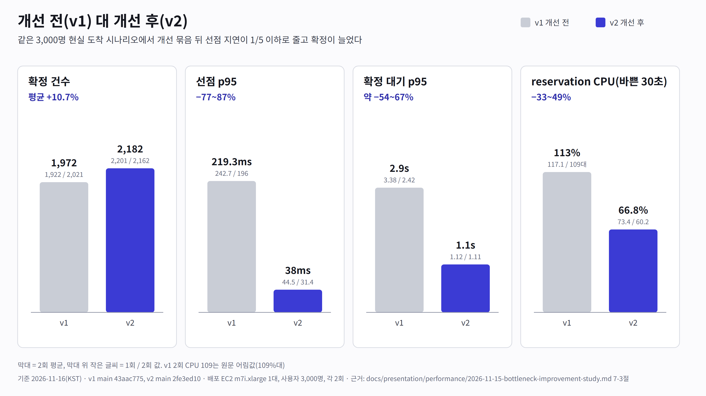

# 최종 발표회 브로셔 초안 (5조 이선좌)

- 틀: Notion 「단기심화 10기 최종 발표회 브로셔」의 팀 페이지 템플릿(항목 10개). 5조 칸은 아직 "서비스 명을 입력해주세요."로 비어 있다.
- 기준: 2026-11-16, 숫자는 저장소 문서에 적힌 값만 옮겼고 칸마다 출처를 달았다. 출처 표기는 Notion에 옮길 때 지운다.
- 상태: 초안, 독립 검수 1차(25건)·2차(19건) 반영. 11/16 오후 8기·10기 분석과 서비스별 하위 페이지로 본문 개편, 개편 뒤 독립 검수(25건)·재검수(18건) 반영. 6절 "검토"의 확인 항목을 정리한 뒤 Notion에 옮긴다.

## 1. 문체

| 정한 것 | 이유 |
|---|---|
| 각 절 첫 문장만 합니다체 한두 문장, 나머지는 개조식(명사형·"~함") | 읽는 사람이 외부 심사위원이다. 템플릿 예시도 개조식에 숫자를 앞에 둔다 |
| 숫자는 `전 → 후 (변화)` 꼴, 조건(사용자 수·부하·반복 횟수)을 같은 줄에 | 템플릿이 "좋은 성과를 냈습니다"를 나쁜 예로 든다. 조건이 없으면 숫자를 믿기 어렵다 |
| 결정은 "선택지 → 고른 이유 → 감수한 점" | 템플릿의 "기술적 의사결정"과 발표 심사가 WHY를 본다 |
| 실패와 되돌린 결정도 쓴다 | 의사결정 과정을 보이라는 템플릿 요구(트러블슈팅)에 맞고, 다른 조와 갈리는 지점이다 |
| 저장소 문서 규칙(평서체)과 다르다 | 브로셔는 Notion 외부 공개용이라 합니다체로 둔다. 저장소에는 이 초안만 남긴다 |

## 2. 개요 (템플릿 항목 순)

| # | 템플릿 항목 | 담을 것 | 에셋 |
|---|---|---|---|
| 0 | 속성 칸 | 한 줄 소개, GitHub, Front·Backend URL, 팀 명·번호, 발표자료 링크 | — |
| 1 | 한 줄 소개 + 메인 이미지 | 서비스 정의 한 문장 | 메인 이미지(선택 필요, 6절) |
| 2 | 소개 | 판매 대행사 전제, 풀려는 문제 4개 | — |
| 3 | 목표 | 정합성 목표(중복 0)와 측정 목표(전후 비교·포화점) | — |
| 4 | 인프라 설계도 | MSA 흐름 + CI/CD | 시스템 구조도(있음) |
| 5 | 주요 기능 | 대기열, 좌석 선점, 예매↔결제 SAGA, 추첨 자동결제, AI 상담 | 사용자 흐름도 2장, SAGA 그림(있음) |
| 6 | 적용 기술 | 기술 + 고른 근거 | — |
| 7 | 기술적 의사결정 | 결정 5개 | — |
| 8 | 트러블슈팅 | 부하테스트 2건(Gateway 과부하, 3,000명 섞인 흐름) + 추첨 1건 | v1 대 v2 그림(새로 만듦), 측정 그림(있음) |
| 9 | CONTRIBUTORS | 5명 역할·기여·GitHub | — |
| 10 | AI 활용 성과 및 회고 | 정량 표, 대표 사례, 회고 | — |

## 3. 에셋

| 쓰는 곳 | 파일 | 상태 |
|---|---|---|
| 인프라 설계도 | `docs/presentation/architecture/2026-11-11-system-architecture.png` | 있음. 11/11 기준이라 자동 배정(ADR 0059)·HTTPS는 없다 |
| 주요 기능 | `architecture/2026-11-12-user-flow-booking.png`, `2026-11-12-user-flow-lottery-account.png` | 있음 |
| SAGA 보상 | `architecture/2026-11-14-saga-payment-declined.png`, 캡처 `2026-11-14-saga-captures/` | 있음 |
| 트러블슈팅 A | `brochure/2026-11-16-gateway-before-after.png`(원본 `.svg`) | **이번에 만듦**. 값은 `performance/2026-11-14-gateway-overload-one-page.md` 전·후 표. `performance/2026-11-13-safety-net-limit-summary.png`는 섞인 흐름(O1)에서 상한 64가 확정을 줄인 그림이라 A의 전후 캡처로 쓰지 않는다 |
| 트러블슈팅 B | `brochure/2026-11-16-v1-vs-v2.png`(원본 `.svg`) | **이번에 만듦**. 값은 `performance/2026-11-15-bottleneck-improvement-study.md` 7-3절 |
| 트러블슈팅 B 보조 | `performance/img/2026-11-15/hikari-pending-122-123.png`, `host-cpu-122-123.png` | 있음 |
| 트러블슈팅 C | `brochure/2026-11-16-autopay-before-after.png`(원본 `.svg`) | **이번에 만듦**. 값은 `design/lottery/numbers-and-measurement.md` 3-3·3-5·3-6절 |
| 트러블슈팅 C 보조 | `performance/img/2026-11-15/l2b-billing-vs-approve.png` | 있음. 개선 후 Grafana 화면(일반 결제 초당 30 유지, 거절 0) |
| 그림 생성 | `brochure/2026-11-16-before-after-charts.py` | A·C 그림을 다시 만드는 스크립트 |
| 메인 이미지 | 후보: 시스템 구조도, 브랜드 티켓 그림 `brand/2026-11-12-charm-ticket-sample.png`, 서비스 화면 캡처 | 고를 것 |

## 4. 본문과 하위 페이지

본문은 붙여 넣기 파일 하나에만 둔다(두 곳을 고치면 어긋나서). 숫자를 고칠 때는 아래 출처를 먼저 보고 본문과 하위 페이지를 함께 고친다.

| 파일 | 내용 |
|---|---|
| [`2026-11-16-brochure-notion.md`](2026-11-16-brochure-notion.md) | Notion에 붙여 넣는 본문(템플릿 10개 항목 순서) |
| [`stories/1-gateway.md`](stories/1-gateway.md) ~ [`stories/5-lottery.md`](stories/5-lottery.md) | 서비스별 이야기 하위 페이지 5개. 고민 → 발전 과정 표 → 감수한 것 → 알려진 문제와 개선 방향 → 넘지 못한 한계 → 예상 질문. 각 페이지 끝에 출처 |
| `stories/thumb-*.png`, `stories/make_thumbnails.py`, `stories/thumbnails.json` | 하위 페이지 갤러리 썸네일과 생성 스크립트·문구 |

본문 절별 출처

| 본문 절 | 출처 |
|---|---|
| 소개·목표 | SA MASTER 166~197·291~308행, `design/lottery/numbers-and-measurement.md` 3-3·3-5·3-6절, `performance/2026-11-14-gateway-overload-one-page.md`, `performance/2026-11-15-bottleneck-improvement-study.md` 7-3절, `architecture/2026-11-14-saga-payment-declined.md` |
| 인프라·주요 기능·적용 기술 | ADR 0018·0031·0041·0044·0046·0047·0049·0050·0051·0053·0056·0057·0059, `compose.yml`, `design/lottery/f1-fault-injection.md` |
| 기술적 의사결정 | ADR 0049·0050·0051·0053 "바꿀 조건", SA 14장 #3, `ai-verification/2026-11-13-gateway-overload-ai-rejection.md` |
| 트러블슈팅 측정 환경·서비스별 표 | 하위 페이지 5개의 출처와 같다 |
| AI 활용 | `docs/ai-judgments/README.md` 공통 표, SA 14장, `ai-verification/2026-11-13-*.md`, `performance/2026-11-15-troubleshooting-journal.md` 80~148행 |
| 적용 소스(8기·10기 분석) | [`2026-11-16-8th-brochure-review.md`](2026-11-16-8th-brochure-review.md) 4절, [`2026-11-16-10th-brochure-review.md`](2026-11-16-10th-brochure-review.md) 5절 |

## 5. 이 초안에서 고른 것

| 고른 것 | 다른 선택지 | 이유 |
|---|---|---|
| Gateway 상한 64의 전 값은 6차 같은 날 비교(1,304/s·571ms) | 5차 값(1,469/s·435ms, +15.5%) | 같은 날·같은 조건 비교라 덜 흔들린다. 발표 자료와 숫자를 맞춰야 한다 |
| 트러블슈팅은 A·B·C 3개 | 좌석 동시성(TS-65~68)까지 4개 | 템플릿이 부하테스트를 요구한다. 좌석 동시성은 AI 사례 표에 넣었다 |
| 결정 5개 | ADR 8개 | 다른 서비스 담당 결정(ES256, seathold 분리)은 적용 기술 칸에 한 줄로 |

## 6. 검토 (옮기기 전에 확인할 것)

| # | 확인할 것 | 누가 |
|---|---|---|
| 1 | 서비스명 풀이 "이미 선택된 좌석", 한 줄 소개 "빠른 손 아니어도 추첨으로, 선착순도 같은 좌석은 딱 한 명" | 팀 |
| 2 | 메인 이미지는 커버 배너를 그대로 씀(11/16 A안). 자동배정 프론트가 들어오면 실제 화면 3장(대기열 → 자동배정 → 당첨)으로 바꿀지 검토 | 팀 |
| 3 | CONTRIBUTORS 각자 기여 문장 | 각자 |
| 4 | Java 21 선택 이유(ADR 0001 미기재) | 준현님 |
| 5 | Grafana 공개 주소(`/grafana/`)를 넣을지(Front URL은 11/16 응답 확인) | 준현님 |
| 6 | 시스템 구조도가 11/11 기준. 자동 배정·HTTPS 반영해 다시 그릴지 | 팀 |
| 7 | 동기형 대 접수형 선점 비교 수치(PR `#662`)가 나오면 트러블슈팅이나 주요 기능에 추가 | 권우님 |
| 8 | AI 판단 기록 건수는 옮기는 날 dev 머지 뒤 다시 센다 | 강민 |
| 9 | 문서끼리 어긋난 숫자(상한 64 전 값, 2,500/s 최종값 2,122 vs 약 2,250)는 발표 슬라이드와 맞춘다 | 강민 |
| 10 | 트러블슈팅 전후 그림은 측정 수치로 그린 막대다. Grafana 화면 캡처로 바꿀지(템플릿 "캡처본") | 팀 |
| 11 | 결정 ③(SAGA 방식)의 "다시 볼 조건"이 원문에 없다 | 결제 담당 |
| 12 | 서비스별 이야기 하위 페이지마다 담당자 표기, CONTRIBUTORS의 "뒤집은 판단 1개" | 각자 |
| 13 | 자동배정 화면(배너·본문)은 프론트 적용 세션이 끝나면 실제 화면과 문구를 맞춘다 | 강민 |
