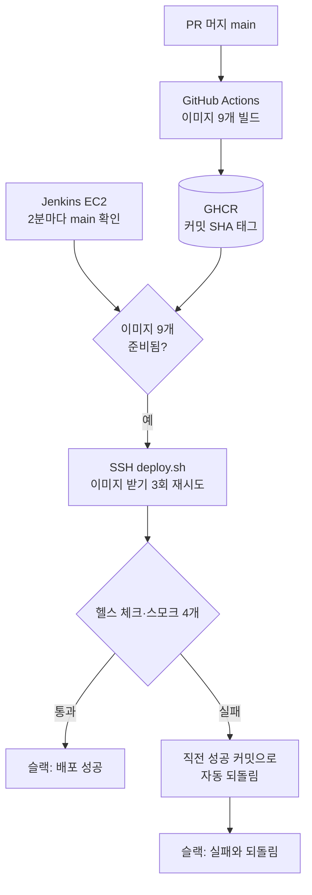
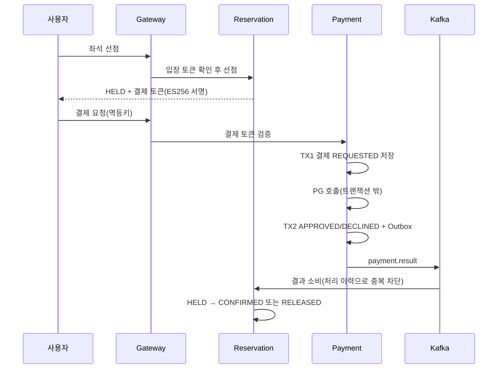
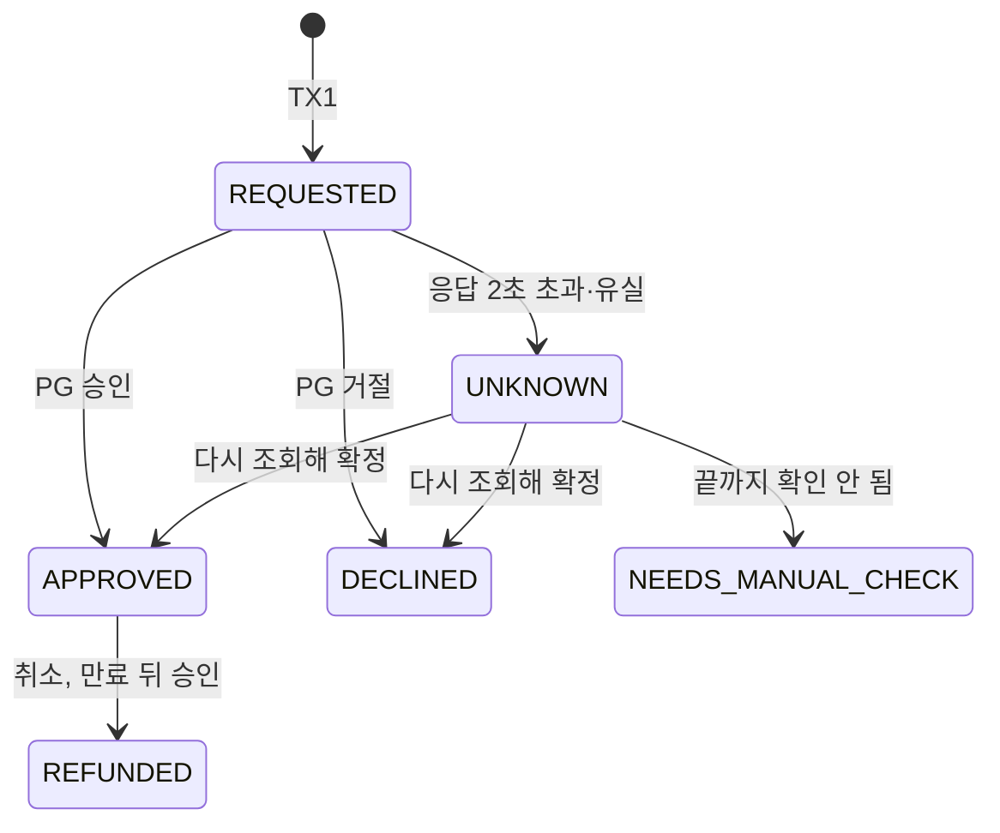
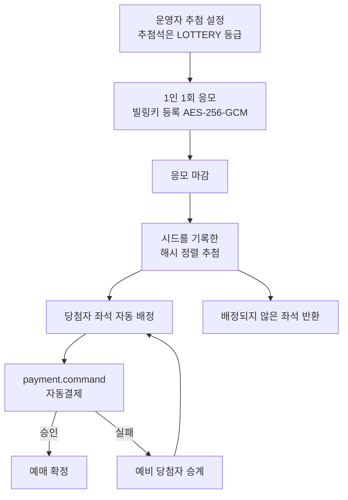
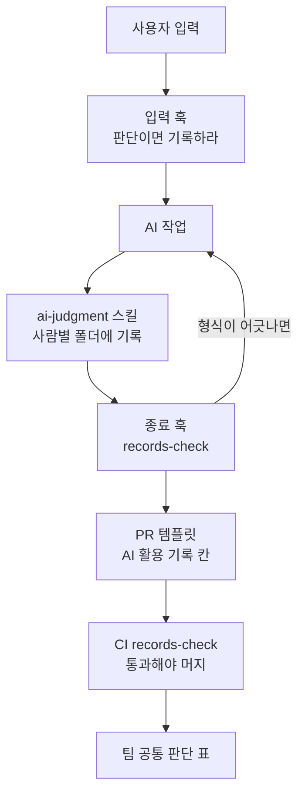

[[toc]]

### 이선좌 : 몰려도 정확한 티켓팅

이선좌는 기획사에게 위탁받아 콘서트 티켓을 판매하는 대행 서비스입니다. "이선좌"는 티켓팅을 하다 보면 자주 보게 되는 "이미 선택된 좌석입니다"의 줄임말입니다. 저희는 티켓 오픈 정각에 수많은 사람이 같은 좌석을 누르는 순간에도 서버가 흔들리지 않도록 만들고, 손이 빠르지 않더라도 예매의 기회를 만들어 보고자 했습니다.

:::callout 🔗 gray_background **바로 열어 보기**
- 서비스: [https://52.63.10.174](https://52.63.10.174) (배포 서버, HTTPS)
- API 문서: [https://52.63.10.174/api/docs](https://52.63.10.174/api/docs) (Swagger UI)
- 실시간 지표: [https://52.63.10.174/grafana/](https://52.63.10.174/grafana/) (로그인 없이 볼 수 있는 대시보드 6개)
- 저장소: [github.com/iseonjwa/high-quality-ticketing-system](https://github.com/iseonjwa/high-quality-ticketing-system) (공개)
- 기간과 인원: 2026.10.26 ~ 11.19(약 4주), 5명 · 서비스 3개 + API Gateway + AI 상담
:::

:::cols
:::col 0.25
:::callout 🎯 blue_background **중복 판매 0건**
모든 배포 측정에서 확정 예매 수 = 결제 승인 수 = 판매된 좌석 수
:::
:::
:::col 0.25
:::callout 🚪 blue_background **굿풋 +30%, p95 −85%**
초당 2,000건에서 Gateway 동시 처리 상한 64 적용(같은 배포에서 비교)
:::
:::
:::col 0.25
:::callout 🎟️ blue_background **자동결제 10분 안 100%**
추첨 당첨 약 2,000건(개선 전 92.4~93.4%)
:::
:::
:::col 0.25
:::callout 🤖 blue_background **AI 판단 기록 806건**
개별 기록 241건 중 94건(39%)은 AI 제안을 거부
:::
:::
:::

:::cols
:::col 0.25
:::callout 🧪 gray_background **테스트 2,020개**
Java @Test 1,968개와 매개변수 테스트 52개, 프론트엔드 약 1,230개
:::
:::
:::col 0.25
:::callout 📚 gray_background **ADR 63건 · 트러블슈팅 74건**
되돌리기 어려운 결정과 막혔던 문제를 모두 저장소에 기록했습니다
:::
:::
:::col 0.25
:::callout 🔀 gray_background **머지된 PR 384개 · 커밋 919개**
Linear 이슈 297개, 서비스 간 계약 이슈 49개
:::
:::
:::col 0.25
:::callout 🔔 gray_background **알림 규칙 37개**
promtool 테스트 64건으로 알림이 제때 울리는지까지 검사합니다
:::
:::
:::

{widths: 160,380,420}
| 문제 | 해결 방법 | 결과 |
|---|---|---|
| 오픈 정각의 접속 폭주 | 대기열(Redis Lua 번호표)로 초당 일정 인원만 입장시키고, Gateway 맨 앞에서 동시 처리 수를 제한 | 순번 조회 굿풋 1,304 → 1,696/s, p95 571 → 87ms(초당 2,000건, 같은 배포에서 각 1회 비교). 최종 8차 측정은 굿풋 1,937~1,954/s, p95 43~44ms(4회) |
| 같은 좌석을 두고 동시 경쟁 | 좌석 ID 순서대로 조건부 UPDATE를 걸어 고른 좌석을 한 번에 선점하고, DB 부분 유니크 인덱스와 고정된 잠금 순서로 보호 | 모든 측정에서 중복 판매 0건. 개선을 묶어 적용한 뒤 선점 p95 77~87% 감소, 확정 예매 10.7% 증가(사용자 3,000명, 버전별 2회) |
| 결제와 예매가 어긋나는 문제 | Kafka와 Outbox, 처리 이력, 멱등키로 이벤트를 주고받고, PG 결과를 모르면 UNKNOWN으로 두고 다시 조회하며, 거절되면 보상 | 결제 서버를 강제로 종료해도 PG 원장 승인 34건 = DB 승인 34건, 중복 0건. 결제가 거절되면 약 0.14초 만에 좌석 반환 |
| 손 빠른 사람과 매크로만 유리한 구조 | 좌석 일부를 추첨으로 배분하고, 당첨되면 등록한 카드로 자동결제(회차당 4매 제한) | 당첨 약 2,000건의 10분 안 자동결제 완료율 92.4~93.4% → 100%, 처리 속도 초당 3.2 → 9.4건 |

> 성능 수치는 모두 배포 서버(EC2 m7i.xlarge, 4 vCPU 1대)와, 같은 VPC에 둔 별도 부하 발생기(k6)로 측정했습니다. 로컬 PC에서 잰 값은 "로컬"이라고 따로 표시했고, 측정한 날이 다른 결과끼리는 %로 비교하지 않았습니다.

---

## 서비스/프로젝트 소개

티켓이 열리는 순간에는 모두가 같은 1초에 같은 좌석을 누릅니다. 요청이 한꺼번에 몰리고, 여러 사람이 같은 좌석을 두고 경쟁하며, 그 좌석에는 돈이 걸려 있습니다. 이선좌는 이 세 가지 상황에서 "빠르게"보다 "틀리지 않게"를 먼저 지키도록 설계했습니다.

{widths: 160,800}
| 예매 방식 | 사용자 경험 |
|---|---|
| **선착순 예매** | 대기열에서 내 순번과 예상 대기 시간을 보며 기다리다가 입장하면, 구역과 매수를 고르고 좌석을 선택합니다. 선택을 마치면 5분 안에 결제합니다. 여러 사람이 같은 좌석을 동시에 누르면 한 사람만 성공하고, 나머지 사람에게는 "이미 선택된 좌석입니다"가 표시됩니다 |
| **추첨 예매** | 응모 기간에 신청하면서 자동결제 카드를 등록해 둡니다. 추첨이 끝나면 당첨자에게 좌석이 자동으로 배정되고 등록한 카드로 결제됩니다. 결제에 실패하면 예비 당첨자가 그 자리를 이어받습니다. 오픈 시각에 맞춰 접속하기 어려운 사람에게도 기회가 돌아갑니다 |
| **AI 예매 상담** | 화면 오른쪽 아래 상담 창에서 취소·환불·추첨 규정을 물어보면, 규정 문서에서 찾은 내용을 근거와 함께 답합니다 |

:::cols
:::col 0.5

:::
:::col 0.5

:::
:::

:::cols
:::col 0.5

:::
:::col 0.5

:::
:::

:::cols
:::col 0.5

:::
:::col 0.5

:::
:::

:::cols
:::col 0.5

:::
:::col 0.5

:::
:::

:::th3 화면 더 보기: 결제 거절, 예매 상세, 추첨 결과, AI 상담, 모바일, 발권 기념 부적
:::cols
:::col 0.5

:::
:::col 0.5

:::
:::
:::cols
:::col 0.5

:::
:::col 0.5

:::
:::
:::cols
:::col 0.5

:::
:::col 0.5

:::
:::
:::cols
:::col 0.5

:::
:::col 0.5

:::
:::
발표 참관객이 직접 발권까지 해 보면, 예매 상세에 있는 QR을 휴대폰으로 찍어 "발권 기념 부적"을 받을 수 있습니다. 부적에는 수호펫(1,200가지 조합), 닉네임, 응원 문장, 공연·좌석 정보, 도장이 들어가며, 16장 중 1장은 반짝이는 레어 부적입니다. 새 API를 만들지 않고 QR 주소에 정보를 담아 프론트엔드만으로 구현했습니다.
:::cols
:::col 0.5

:::
:::col 0.5

:::
:::
:::

:::th3 사용자 흐름도: 선착순 예매, 추첨·계정

:::

---

## 서비스/프로젝트 목표

목표 처리량을 숫자 하나로 정하기보다, "틀리지 않는 것"을 먼저 기준으로 세우고 한계는 측정으로 찾았습니다. EC2 한 대에서 "초당 200건" 같은 고정 목표는 장비 사양에 따라 제한되어, 같은 환경에서 개선 전후를 비교하고 어느 지점이 먼저 포화되는지 찾는 것을 목표로 삼았습니다(SA 3장, 결정 #47). 미해결된 목표도 함께 적었습니다.

{widths: 190,240,420,90}
| 목표 | 기준 | 결과 | 판정 |
|---|---|---|---|
| 같은 좌석 동시 요청 | 한 건만 성공하고 중복 판매 0건 | 모든 배포 측정에서 중복 0건, 확정 예매 수 = 결제 승인 수 = 판매된 좌석 수. 로컬 동시성 시험에서도 100명 × 3라운드 모두 한 명만 성공 | {green\|달성} |
| 돈과 예매의 일치 | 장애가 나도 PG 원장과 DB가 일치 | 결제 서버를 강제로 종료한 직후 원장 승인 34건 = DB 34건, 장애 세 가지가 겹친 뒤에도 38건 = 38건, 중복 0건 | {green\|달성} |
| 과부하에서 버티기 | 초당 2,000건에서 재시작 없이 응답 | 메모리 초과 재시작 3회 → 0회. 최종 p95 43~44ms, 성공률 97%(4회) | {green\|달성} |
| 추첨 자동결제 | 추첨 후 10분 안에 95% 완료 | 100%(11/13 2회, 11/15 2회) | {green\|달성} |
| 응모 마감 직전 몰림 | 초당 100건에서 p95 300ms 이하 | p95 5.0ms, 초당 800건까지 503 0건(미리 데운 서버 기준) | {green\|달성} |
| 추첨 중 일반 선점 영향 | 선점 p95 증가 20% 이하 | 90% 증가(11.06 → 21.0ms, 1회). 늘어난 시간은 약 10ms | {red\|**미달**} |
| 오픈 순간의 대기열 진입 | 처리하지 못한 요청 0건 | 상한에 걸린 요청의 약 87~88%가 오픈 순간의 대기열 진입 요청 | {red\|**미해결**} |
| Synthetic Data(발제 필수) | LLM으로 현실적인 사용자를 만들어 균일 부하와 비교 | 페르소나 8개, 3,000명을 생성해 배포 서버에서 균일 부하와 비교(LLM 예측 4개 중 3개 적중) | {green\|달성} |
| AI 설계 검증 로그(발제 필수) | 3건 이상, 그중 거부 1건 이상 | 11건, 거부 4건·부분 거부 2건 | {green\|달성} |
| RAG 상담(도전 과제) | 문서 → 질문 → 출처가 붙은 답변 | 규정 문서 7개, 출처를 인용한 답변, 장애 시 검색 모드. 골든 질문 10개로 검색 정확도 테스트 | {green\|MVP 달성} |

- 오류 기준: 409(이미 선택된 좌석)는 정상적인 거절로 보고, 5xx와 응답 시간 초과만 오류로 셌습니다.
- 굿풋: 200ms 안에 200으로 응답한 요청 수(초당)입니다. 느리게 성공한 요청까지 성공으로 세지 않으려고 처리량 대신 사용했습니다.

---

## 인프라 설계도

- **요청 경로**: 사용자 → nginx(HTTPS, Let's Encrypt) → API Gateway 순서로 들어옵니다. Gateway는 ① 동시 처리 상한 64 → ② JWT 검증 → ③ 로그아웃된 토큰 확인(Redis) → ④ 입장 토큰 검증을 거친 뒤 각 서비스로 전달합니다. 외부에서 내부 API(`/internal/**`)를 호출하면 404를 돌려줍니다.
- **서비스**: User, Reservation(공연·대기열·선점·예매·추첨 모듈로 구성한 모듈러 모놀리스), Payment, Assistant(AI 상담), Mock PG입니다. DB는 서비스마다 분리했습니다(PostgreSQL 17 × 3).
- **이벤트**: Kafka 토픽 `payment.result`(결제 결과), `payment.command`(환불·자동결제 명령), `seat-hold.request`(접수형 선점)와 각 토픽의 DLQ를 둡니다. 모든 이벤트는 Outbox를 거쳐 발행합니다.
- **CI/CD**: main에 머지하면 GitHub Actions가 이미지 9개를 커밋 번호로 빌드해 GHCR에 올립니다. 별도 Jenkins 서버가 2분마다 main을 확인해 SSH로 `deploy.sh`를 실행하고, 헬스 체크와 스모크 테스트 4개를 통과하면 슬랙으로 알립니다. 실패하면 직전에 성공한 커밋으로 자동으로 되돌립니다.
- **관측**: Prometheus·Grafana(대시보드 6개), Loki·Alloy(로그), Zipkin(추적), Alertmanager → 슬랙으로 구성했습니다.

:::th3 서비스를 3개로 나눈 이유(처음 안은 5개)
처음에는 User, Queue, Reservation, Lottery, Payment 다섯 개로 나누려 했습니다. AI 설계 검증과 팀 검토를 거쳐 세 개로 줄였습니다(SA 7-1, 설계 검증 로그 #1).

| 후보 | 판단 | 이유 |
|---|---|---|
| Queue 분리 | 분리하지 않음(AI는 분리를 권함) | 대기열은 자체 데이터가 없고, 대기열이 멈추면 예매도 함께 멈추기 때문에 분리해도 장애가 격리되지 않습니다 |
| Lottery 분리 | 예매 서비스 안의 모듈로 합침 | 추첨석을 `LOTTERY` 등급으로 따로 두면 실시간 선점과 같은 좌석을 두고 경쟁하지 않아, 같은 DB 안에서도 충돌이 생기지 않습니다 |
| Payment 분리 | 별도 서비스로 유지 | 결제 데이터는 소유 주체가 다르고, PG 장애가 다른 기능으로 번지지 않게 막아야 합니다 |

모듈을 서비스로 분리하는 조건은 측정 지표로 정해 두었습니다. 예를 들어 순번 조회 때문에 좌석 선점 p95가 늘어나면 대기열을 분리합니다. 발제 가이드의 "서비스는 2~3개로 시작하세요"와 같은 결론에, 저희 나름의 근거를 갖고 도달했습니다.
:::

:::th3 배포 흐름과 자동 되돌림

- 자동 되돌림이 실제로 한 번 동작했습니다. 11/11 Jenkins 17번 배포에서 GHCR이 이미지 레이어 하나에 응답하지 않아 이미지를 받는 단계가 실패했고, `deploy.sh`가 직전 성공 커밋으로 되돌려 실패 20초 뒤 스모크 테스트 4개를 통과했습니다. 이후 일시적인 지연에 대비해 이미지 받기를 10초 간격으로 3번까지 다시 시도하도록 바꿨습니다(TS-55).
- 11/16에 HTTPS를 적용했습니다. 도메인 없이 IP 주소용 인증서(Let's Encrypt, 유효기간 6일)를 쓰기 때문에 만료 감시와 갱신 훅을 함께 준비했습니다. 서버 주소는 서버 `.env`의 `PUBLIC_URL` 한 곳에서만 관리합니다.
- 배포 서버에서는 한 번에 한 명만 측정합니다. 측정 모드를 켤 때는 측정 전용 서명 키와 추적 샘플링 0.01을 적용하고, 측정자 이름을 반드시 남기게 했습니다.
:::

:::th3 관측과 알림: 알림도 테스트합니다
| 항목 | 내용 |
|---|---|
| 대시보드 6개 | 개발 기반, 대기열, 좌석 선점, 결제, 추첨, 요청 로그. 심사위원도 [공개 Grafana](https://52.63.10.174/grafana/)에서 바로 볼 수 있습니다 |
| 알림 규칙 37개 | Prometheus 32건(결제 22건, 추첨 6건, Gateway 4건)과 Loki 5건입니다. 결제 알림에는 어느 사용자의 어떤 결제인지까지 담아 슬랙으로 보냅니다 |
| 규칙 테스트 | promtool 테스트 64건으로 규칙이 제때 울리는지 CI에서 검사합니다. Loki 규칙은 알림이 떠야 하는 로그 5줄과, 비슷하지만 떠서는 안 되는 로그 4줄로 검사합니다 |
| 추적 | 요청마다 traceId를 남기고, 예매 상태 이력(DB)과 함께 보며 보상 흐름을 따라갑니다 |

:::

:::th3 Slack 알림: 배포 결과, 장애 경보, 측정 모드
배포와 운영에서 일어나는 일은 사람이 서버에 들어가 확인하지 않아도 Slack으로 먼저 알 수 있게 했습니다. 채널은 용도별로 나눴습니다.

| 채널 | 보내는 곳 | 알리는 내용 |
|---|---|---|
| 이선좌-배포상태알림 | Jenkins(`deploy.sh`) | 배포 준비(새 커밋 발견) → 배포 중(이미지 9개 확인) → 배포 성공·실패. 성공 알림에는 커밋, 직전 버전, 걸린 시간, 바뀐 내용 비교 링크, 서비스 바로 가기를 담고, 실패하면 어느 버전으로 되돌렸는지 알립니다 |
| 이선좌-성능-모니터링 | Alertmanager, 결제 서비스 | 알림 규칙 37개의 발생·해소. 결제 알림에는 어느 사용자의 어떤 결제인지까지 담습니다 |
| 이선좌-부하측정 | `measure-mode.sh` | 측정 모드를 켜고 끌 때마다 측정자와 시각을 알려, 측정 중에는 main 머지를 멈추게 합니다 |

:::cols
:::col 0.34

:::
:::col 0.33

:::
:::col 0.33

:::
:::
:::

:::th3 컨테이너 21개(EC2 한 대)
| 묶음 | 컨테이너 |
|---|---|
| 앱 9개 | gateway, eureka, config-server, user, reservation, payment, assistant, mock-pg, frontend(nginx) |
| 데이터 6개 | PostgreSQL × 3(user·reservation·payment), Redis, Kafka(KRaft), Kafka-UI(배포 서버에서는 읽기 전용) |
| 관측 6개 | Prometheus, Grafana, Loki, Alloy, Zipkin, Alertmanager |

- 배포 서버는 `m7i.xlarge`(4 vCPU, 15.7GiB)이고, 컨테이너 메모리 상한의 합은 약 12.5GB입니다. Jenkins는 `t3.small`로 따로 두었고, 부하 발생기(`c6i.xlarge`)는 측정할 때만 켭니다.
:::

---

## 주요 기능

:::th3 ① 대기열과 입장 토큰

- 대기열 자리는 계정당 하나입니다. Redis Lua로 번호표(`seq`)를 발급해, 같은 밀리초에 들어온 요청끼리도 순서가 겹치지 않습니다. 순번 조회는 읽기 전용이라 조회만으로 상태가 바뀌지 않습니다.
- 초당 50명씩 입장시키고, 입장한 사람은 10분 동안 유효한 입장 토큰을 받습니다. **입장 토큰은 좌석 선점에 성공하는 순간 사용 처리**되어, 다시 쓰면 403을 돌려줍니다. "선점 → 만료 → 다시 선점"을 반복하며 좌석을 붙잡아 두는 것을 막기 위해서입니다(ADR 0053).
- Redis에 장애가 나면 요청을 통과시키지 않고 막습니다(fail-closed).

| 측정(배포 서버) | 결과 |
|---|---|
| 3,000명 동시 진입 | 모든 실행에서 번호표 수, 대기 인원, 성공 응답 수가 일치 |
| 대기자 3,000명의 순번 조회 | p95 2.79ms |
| 3,000명 입장 | 토큰 발급 오류 0건, 초당 50명 입장 유지율 96.7% |
:::

:::th3 ② 좌석 선점: 한 좌석은 한 사람에게만

- 매수 한도를 확인한 뒤, 좌석 ID 오름차순으로 조건부 UPDATE(`WHERE status = 'AVAILABLE'`)를 걸어 고른 좌석을 **한 번에 모두 선점하거나, 하나라도 실패하면 모두 선점하지 않습니다**. 판매 여부는 최종적으로 DB의 부분 유니크 인덱스와 조건부 갱신으로 판정하고, Redis는 대기열·캐시·로그아웃 목록에만 사용합니다.
- 잠금 순서를 예매 → 좌석 → 매수로 고정해 교착 상태를 막고, 잠금 대기 시간을 최대 50ms로 줄여 막힌 요청이 커넥션을 오래 붙잡지 않게 했습니다(ADR 0061). 이미 팔린 좌석이 섞인 요청은 잠금을 걸기 전에 쿼리 한 번으로 먼저 걸러 냅니다(ADR 0062).
- 선점한 좌석은 5분이 지나면 만료 스케줄러가 반환합니다. 서버가 여러 대여도 `SKIP LOCKED`로 나눠 처리해 같은 좌석을 두 번 반환하지 않습니다.
- 바뀌지 않는 좌석 배치는 서비스 메모리에 캐시하고, 좌석 상태는 1초 동안만 캐시합니다(ADR 0054).
- 접수형 선점(Kafka로 요청을 받고 결과를 조회하는 방식)과 자동 배정 API(구역과 매수만 보내면 서버가 `SKIP LOCKED`로 빈 좌석을 골라 줌)도 구현했으며, 배포 서버는 동기형으로 운영합니다.

| 로컬 동시성 시험(고치기 전 → 후) | 결과 |
|---|---|
| 같은 좌석에 100명 동시 요청 × 3라운드 | 라운드마다 한 명만 성공(개선 전부터 보장) |
| 같은 사용자가 탭 4개로 매수 한도를 넘김 | 30/30 라운드 → 0 |
| 같은 요청을 3번 연타하면 자기 요청에 409 | 60건 → 0 |
| 선점 만료를 서버 두 대가 함께 처리 | 100건 → 0 |
| k6 연타(초당 50명, 120초)에서 자기 요청에 409 | 2,416명 → 0명 |
:::

:::th3 ③ 예매↔결제 SAGA(코레오그래피)

- 결제가 거절되면 결제 서비스는 거절 기록과 이벤트를 한 트랜잭션으로 저장하고, 예매 서비스가 이 이벤트를 받아 좌석과 매수를 원래대로 돌려놓습니다. 11/14 배포 서버 시연에서는 거절이 기록된 뒤 약 0.14초 만에 예매가 해제되었습니다.
- 결제는 예매 서비스가 서명한 결제 토큰이 있어야만 시작할 수 있습니다. 서명 키(개인키)는 예매 서비스에만 있어 결제 서비스도 토큰을 위조할 수 없습니다(ADR 0055).
:::

:::th3 ④ 결제 신뢰성: 결과를 모를 때도 돈이 맞게

| 장치 | 하는 일 |
|---|---|
| 결과 모름(UNKNOWN) | PG 응답 시간 초과를 실패로 처리하지 않고 "결과 모름"으로 둔 뒤, 간격을 늘려 가며 다시 조회합니다. 끝까지 확인되지 않으면 운영자 확인으로 넘깁니다 |
| 재시도가 기존 결제를 이어받지 않음 | 저장 응답이 유실된 결제는 재시도 요청이 PG를 다시 호출하지 않고 종결합니다. 이전 요청이 PG를 호출하지 않았다고 판단할 근거가 없어, 다시 호출하면 이중 승인이 날 수 있기 때문입니다(ADR 0048) |
| Outbox · 처리 이력 · DLQ | 상태 변경과 이벤트를 한 트랜잭션으로 저장하고, 브로커가 수신을 확인(acks=all)할 때까지 다시 보냅니다. 소비자는 처리한 이벤트를 기록해 중복을 걸러 내고, 처리에 실패한 메시지는 DLQ에서 환불 건으로 복구합니다 |
| 멱등키 · DB 제약 | `Idempotency-Key`(처리 중이면 202), 예매 한 건당 결제 한 건이라는 DB 제약, 그리고 모든 상태 변경을 "이전 상태가 맞을 때만" 바꾸는 조건부 갱신으로 처리합니다 |
| PG 허가 그룹 | PG 동시 호출 허가를 승인 30, 복구 2, 자동결제 3으로 나누고 서킷 브레이커를 둡니다. 허가를 얻지 못하면 기다리지 않고 바로 503을 돌려주어 PG 장애가 다른 기능으로 번지지 않게 합니다 |
| 대사 RC-1~RC-8 | 5분마다 결제와 예매 데이터를 8가지 규칙으로 대조합니다(승인됐는데 확정되지 않은 예매, 등록되지 않은 환불, 금액 불일치 등). 불일치를 자동으로 고치지 않고 기록과 알림만 남깁니다(ADR 0029) |
| 운영 명령 | 조회·확정·환불 재시도·Outbox 재전송은 SQL을 직접 실행하지 않고 정해진 명령으로만 처리하며, 실행 전에 계획 해시를 확인합니다(ADR 0028) |
| 토스페이먼츠 | PG 연동을 포트로 분리해 Mock PG와 토스 어댑터가 같은 계약 테스트를 통과합니다. 일반 결제는 결제할 때마다 PG를 고를 수 있고, 토스 결제창(테스트 모드)으로도 결제할 수 있습니다 |
:::

:::th3 ⑤ 취소와 환불

- 확정된 예매를 취소하면 예매 상태가 `CANCELED`로 바뀌고, `payment.command`로 환불 명령이 전달됩니다. 결제 서비스가 PG 환불을 마치면 결과 이벤트로 예매 서비스에 알립니다.
- 예매가 만료된 뒤에 늦게 승인된 결제는 자동 환불 대상으로 등록되고, 대사 규칙이 등록 누락을 감시합니다.
:::

:::th3 ⑥ 추첨과 자동결제: 손이 빠르지 않아도

- 추첨석은 `LOTTERY` 등급으로 따로 두어 실시간 선점과 같은 좌석을 두고 경쟁하지 않습니다(ADR 0037). 추첨 시드(32바이트)를 기록해 두어 같은 결과를 다시 계산해 검증할 수 있습니다(ADR 0041).
- 자동결제용 빌링키는 AES-256-GCM으로 암호화하고, 암호화 키는 환경 변수로만 주입합니다(ADR 0042).
- 결제에 실패하면 실패 사유에 따라 예비 당첨자에게 넘길지를 정합니다(ADR 0038).

| 측정(배포 서버, 응모 30,000명·추첨석 3,000석·당첨 약 2,000명) | 결과 |
|---|---|
| 응모 마감 직전 초당 100건 | p95 5.0ms, 초당 800건까지 503 0건 |
| 추첨 후 10분 안 자동결제 완료율 | 92.4~93.4%(3회) → 100%(2회) |
| 자동결제와 겹친 일반 결제의 503 비율 | 9.5% → 0 |
:::

:::th3 ⑦ AI 예매 상담(RAG)

- 규정 문서 7개를 절 단위(20개)로 나누고, 한글 두 글자 단위 키워드와 IDF 가중치로 관련 있는 절 4개를 찾습니다. 찾은 절을 Claude(Haiku 5.5)에 문서로 넘기고 출처 인용(citations)을 켜서, 답변마다 근거가 된 절을 함께 보여 줍니다. 답변은 SSE로 스트리밍합니다.
- 예매·결제와 장애가 섞이지 않도록 별도 서비스로 분리했습니다. API 키가 없거나 응답 시간 초과·429·5xx가 나면 검색 결과만 보여 주는 검색 모드로 전환됩니다. 상담 서비스가 멈춰도 예매와 결제는 그대로 동작합니다.
- 실제 API 키로 확인한 결과(11/9), 첫 응답 조각까지 0.8~1.4초, 전체 답변까지 1.3~2.1초가 걸렸습니다. 문서에 없는 내용을 물으면 출처가 비어 있어 "답할 수 없는 질문"을 구분할 수 있습니다. 골든 질문 10개로 기대한 절이 검색 결과 상위 2개 안에 드는지 테스트합니다.
- 벡터 DB를 쓰지 않은 이유는 기술적 의사결정 ⑨에 적었습니다.
:::

:::th3 ⑧ 운영자 화면과 시연용 장애 주입
- 운영자는 공연·회차·좌석 생성, 추첨 설정, 비밀번호 초기화를 화면에서 처리합니다.
- 시연 장애 패널(`/admin/demo/faults`)에서는 버튼 하나로 Mock PG에 결제 거절, PG 응답 지연(4초), 승인 응답 유실, PG 서버 오류를 일으킬 수 있습니다. 발표에서 SAGA 보상과 UNKNOWN 재조회를 실제로 보여 주기 위해 만들었습니다. 시연이 끝난 뒤 장애가 남지 않도록 현재 걸린 장애를 3초마다 갱신해 보여 주고, [모두 해제] 버튼을 두었습니다.
:::cols
:::col 0.5

:::
:::col 0.5

:::
:::
:::

---

## 적용 기술

{widths: 240,520,240}
| 기술 | 선택 근거 | 결과 |
|---|---|---|
| Java 21, Spring Boot 4.1.2, Spring Cloud 2025.1.4 | SA 초안과 AI 구현 계획에는 Java 25가 있었지만 Java 21로 정했습니다(ADR 0001). Boot와 Cloud는 BOM으로 버전을 고정해 앱 9개가 같은 기반을 씁니다 | Java 테스트 2,020개 |
| Spring Cloud Gateway + Resilience4j | 인증과 입장 판정을 한 곳에서 처리합니다. Redis 장애(차단기)와 Gateway 자체 과부하(bulkhead)를 구분해 집계합니다 | Redis가 정상일 때 차단기 오작동 0건(거절 16,024건은 집계에서 제외) |
| PostgreSQL 17 + JPA · Flyway | 판매 기록의 최종 기준을 DB 제약(부분 유니크, 조건부 UPDATE)에 두었습니다. DB는 서비스마다 분리했습니다 | 중복 판매 0건 |
| Redis 8 | 대기열 번호표(Lua), 로그아웃된 토큰 목록, 세션에 씁니다. 장애가 나면 요청을 통과시키지 않고 막습니다 | 3,000명 진입 순서 정확 |
| Kafka 4.1.1(KRaft) + Outbox · 처리 이력 · DLQ | 서비스 경계를 넘는 결제 결과를 유실이나 중복 없이 전달합니다. 메시지 키로 같은 예매의 이벤트 순서를 보장합니다 | 장애 주입 중에도 PG 원장 = DB, 중복 0건 |
| 결제 토큰 ES256 · 빌링키 AES-256-GCM | 서명 키를 예매 서비스에만 두어 토큰 위조를 막고, 카드 정보(빌링키)는 암호화하며 키는 환경 변수로만 주입합니다 | |
| Prometheus · Grafana · Loki · Alloy · Zipkin · Alertmanager | 지표·로그·추적을 같은 시간축에서 보며 병목을 찾습니다. ELK 대신 Alloy → Loki를 써서 메모리 약 2GB를 아꼈습니다(ADR 0045) | 알림 규칙 37개, 테스트 64건 |
| k6 1.0.0 | 시나리오를 코드로 남기고, 같은 VPC의 별도 EC2에서 반복해 측정합니다(ADR 0046) | 시나리오 19개 |
| GitHub Actions + GHCR + Jenkins | 배포 버전을 커밋 SHA 이미지로 고정하고, 빌드를 운영 서버와 분리했습니다(ADR 0044) | 자동 되돌림 실제 동작 1회 |
| React 19 + Vite + TanStack Query + MSW | 화면이 많아져 정적 HTML에서 SPA로 전환했고, MSW 목 데이터로 백엔드 없이 화면 개발과 E2E 테스트를 합니다(ADR 0040) | 프론트엔드 테스트 약 1,230개 |
| Claude API(`anthropic-java`) | 벡터 DB 없이 출처를 인용해 상담에 답변합니다(ADR 0049) | 질문당 약 $0.0005(추정) |
| springdoc + Swagger UI | 서비스 API 문서를 Gateway의 `/api/docs` 한 곳에 모았습니다(ADR 0063) | [API 문서](https://52.63.10.174/api/docs) |
| Linear + GitHub | 이슈·브랜치·PR을 연결하고, 서비스 간 접점이 바뀌면 `contract` 이슈로 상대 담당에게 알립니다 | 이슈 297개, 계약 이슈 49개 |

:::th3 도입하지 않은 것과 그 이유
| 무엇 | 도입하지 않은 이유 | 대신 한 것 | 근거 |
|---|---|---|---|
| SAGA 조정자(오케스트레이션) | 일반 예매에 참여하는 서비스가 예매·결제 둘뿐이라 결과 이벤트를 구독하는 방식으로 충분함 | 코레오그래피 + 서명된 결제 토큰 + 상태 이력 | SA 14장 #3 |
| 대기열·추첨을 별도 서비스로 분리 | 자체 데이터가 없고, 멈추면 예매도 멈춰 분리해도 장애가 격리되지 않음 | 예매 서비스 안의 모듈로 두고, 분리 조건을 측정 지표로 정함 | SA 7-1 |
| 좌석 배치 캐시를 Redis에 | p95가 Redis 38.3ms, 로컬 7.0ms였고 요청 한 건당 CPU도 약 4.5배. 공용 Redis가 느려지면 다른 기능까지 영향을 받음 | 서비스 메모리 캐시 + 좌석 상태 1초 캐시 | ADR 0054 |
| Gateway 요청률 제한, 폴링 간격 30초 | 고정값은 장비 사양에 따라 달라지고 Redis 부하도 늘어남. 폴링 30초는 부하를 사용자 불편으로 떠넘기는 방식 | 맨 앞 동시 처리 상한 64 | ADR 0050·0052 |
| 동기형 선점에 SKIP LOCKED | 측정해 보니 성공 건수가 83건에서 56건으로 줄어, "손해는 드물다"는 전제가 틀림 | 잠금 대기 최대 50ms | ADR 0061, TS-73 |
| RAG에 벡터 DB | 문서 분량이 수천 토큰이라 효과가 작고, 임베딩 키·메모리(+512MB)·구현 기간 4~6일이 더 필요함 | 키워드 검색 + Claude 출처 인용, 장애 시 검색 모드 | ADR 0049 |
| ELK 로그 | 메모리가 약 2GB 더 들고, 화면이 Grafana와 나뉨 | Alloy → Loki → Grafana | ADR 0045 |
| 쿠버네티스·ECS, 처음부터 매니지드 DB·Kafka | 기간과 인원에 비해 운영 부담이 크고, 리허설 전에 배포를 마치기 위해 | EC2 한 대에서 compose로 시작하고 분리 조건을 검토 | ADR 0047 |
| 대사 결과 자동 수정 | 원인을 모르는 채 데이터를 고치면 더 위험함 | 기록과 알림만 남기고, 운영 명령으로 사람이 확정 | ADR 0029 |
| CodeRabbit 자동 리뷰 | 호출 한도가 있어 PR이 몰리면 리뷰가 빠질 수 있음 | 저장소에 둔 리뷰 프롬프트와 스크립트(Claude·codex) | 판단 기록 11/13 |
:::

---

## 기술적 의사결정

결정마다 배경 → 선택지 → 선택과 이유 → 감수한 점 → 결과 → 다시 검토할 조건 순서로 정리했고, AI가 낸 제안과 저희가 내린 판단도 함께 적었습니다. 모든 결정의 원문은 저장소 `docs/decisions/`(ADR 63건)에 있습니다.

:::th3 ① 서비스는 3개로: 대기열과 추첨은 예매 서비스 안의 모듈로
- **배경**: 기능 단위로 나누면 서비스가 5개였고, AI의 첫 검토도 Queue 분리를 권했습니다.
- **선택지**: 5개로 분리 / Queue만 분리 / 3개(User·Reservation·Payment) + 모듈러 모놀리스
- **선택과 이유**: 3개로 정했습니다. 대기열은 자체 데이터가 없고 멈추면 예매도 멈추므로, 분리해도 장애 격리 효과가 없습니다. 추첨석은 등급으로 나누면 같은 DB 안에서도 충돌하지 않습니다.
- **감수한 점**: 예매 서비스의 규모가 커집니다. 대신 선점 모듈이 다른 모듈을 한 방향으로만 호출하도록 경계를 정했습니다(ADR 0034).
- **AI 제안과 판단**: Queue 분리 권고는 **거부**, Lottery 병합은 수용했습니다(설계 검증 로그 #1).
- **다시 검토할 조건**: 순번 조회 때문에 좌석 선점 p95가 눈에 띄게 늘어나면 대기열을 서비스로 분리합니다.
:::

:::th3 ② 판매 여부는 DB 조건부 갱신과 부분 유니크 인덱스로 판정
- **배경**: 한 좌석이 두 사람에게 팔리는 일만큼은 어떤 부하에서도 막아야 했습니다.
- **선택지**: 비관적 락(`SELECT FOR UPDATE`) / Redis 분산 락 / 조건부 UPDATE + 부분 유니크 인덱스
- **선택과 이유**: 조건부 UPDATE를 골랐습니다. "AVAILABLE일 때만 HELD로 바꾼다"는 쿼리 하나로 판정과 기록을 함께 처리하고, 부분 유니크 인덱스가 마지막 방어선이 됩니다. Redis가 느려지거나 데이터를 잃어도 판매 기록은 DB를 기준으로 하므로 어긋나지 않습니다.
- **감수한 점**: 인기 좌석에는 잠금 대기가 몰립니다. 잠금 순서를 고정하고 대기 시간을 최대 50ms로 줄여, 실패할 요청은 빨리 응답하게 했습니다.
- **결과**: 모든 측정에서 중복 판매 0건. 로컬에서 잠금 장애를 초당 300건으로 재현했을 때, 대기 시간 500ms에서는 실패율 77.2%·p95 8.6초였고 50ms에서는 실패율 0%·p95 103ms였습니다(n=4).
- **대안 준비**: Kafka로 요청을 받고 결과를 조회하는 접수형 선점도 구현해 두었고, 기동 설정만 바꾸면 전환할 수 있습니다(ADR 0057).
:::

:::th3 ③ Gateway 과부하: 차단기와 bulkhead를 나누고, 넘치는 요청은 맨 앞에서 거절
- **배경**: 초당 2,000건에서 Redis는 정상인데 인증 차단기가 열려 거의 모든 요청이 503이었습니다(성공 428건, 503 19,573건). bulkhead에서 거절한 요청이 "Redis 실패"로 집계되는 구조였습니다.
- **선택지**: 맨 앞 동시 처리 상한(AI 추천) / 기존 차단기를 더 민감하게 조정 / 입구에서 요청률 제한
- **선택과 이유**: 먼저 차단기가 Redis 장애만 집계하도록 분리했습니다(ADR 0050). AI의 추천은 바로 받지 않고, 차단기가 포화 전에 열리는지부터 실험했습니다. 차단기가 열리지 않아(느린 호출 최대 24%, 기준 80%) 동시 처리 상한을 도입했고, 리틀의 법칙(동시에 처리 중인 요청 수 = 처리량 × 처리 시간)으로 계산한 60~67을 근거로 64로 정했습니다.
- **감수한 점**: 과부하가 차단기 지표에 드러나지 않아 거절 비율 경보 2개를 따로 두었습니다. 여러 종류의 요청이 섞이면 정상 요청도 상한에 걸릴 수 있습니다.
- **결과**: 같은 배포에서 비교했을 때 굿풋 1,304 → 1,696/s, p95 571 → 87ms. 메모리 초과 재시작은 3회에서 0회가 되었습니다.
- **AI 제안과 판단**: 설계 세션이 p95를 넣어 계산한 상한 500은, 다른 세션이 평균으로 다시 계산해 64로 **수정**했습니다. 128로 올리자는 제안은 굿풋 차이(1.5%)가 반복 측정 편차(약 5%) 안에 있고 p95가 약 두 배라 **거부**했습니다.
- **다시 검토할 조건**: 피크 경보가 오픈 때마다 울리면 인스턴스별 요청률 제한을 추가합니다. 장비나 Gateway 수가 바뀌면 리틀의 법칙으로 값을 다시 계산합니다.
:::

:::th3 ④ 입장 토큰은 좌석 선점에 성공하는 순간 사용 처리
- **배경**: 입장 토큰이 10분 동안 유효한 무상태 토큰이라, "선점 → 만료 → 다시 선점"을 반복하며 좌석을 계속 붙잡아 둘 수 있었습니다.
- **선택지**: 선점에 성공하면 사용 처리(팀 회의) / 선점 때 사용하되 한 번 복원 허용(AI 추천) / 결제 완료 때 사용 처리 / 10분 뒤 자연 만료
- **선택과 이유**: 입장 한 번에 선점 한 번만 허용합니다. 사용 여부는 DB 유니크 인덱스로 확인하므로 Gateway의 처리 비용이 늘지 않습니다(ADR 0053).
- **감수한 점**: 결제에 실패하면 대기열에 다시 서야 합니다.
- **AI 제안과 판단**: AI는 트랜잭션 커밋 후 리스너에서 토큰을 사용 처리하자고 제안했지만, 리스너가 커넥션을 반납하기 전에 실행된다는 점을 짚어 트랜잭션 밖에서 메서드를 호출하도록 **수정**했습니다(테스트 6종).
- **다시 검토할 조건**: 결제 시간 초과로 대기열에 다시 서는 사람이 많아지면 한 번 복원하는 안을 다시 검토합니다.
:::

:::th3 ⑤ 예매↔결제는 오케스트레이션 대신 코레오그래피 SAGA
- **선택지**: Reservation이 조정자가 되는 오케스트레이션(AI 권고) / 이벤트 기반 코레오그래피
- **선택과 이유**: 일반 예매에 참여하는 서비스가 예매와 결제 둘뿐이라, 결과 이벤트를 구독하는 방식으로 충분합니다. 결제 요청이 예매보다 먼저 도착하는 문제는 선점 후 발급하는 서명된 결제 토큰으로 막습니다.
- **감수한 점**: 보상이 Kafka 이벤트로 따로 일어나서 결제 추적(trace)과 이어서 보이지 않습니다. 예매 상태 이력(DB)과 이벤트 흐름도로 보완했습니다.
- **결과**: 결제가 거절되면 약 0.14초 만에 좌석이 반환되었습니다(배포 서버 시연 1건).
- **AI 제안과 판단**: 오케스트레이션 권고는 **거부**했습니다(설계 검증 로그 #3).
:::

:::th3 ⑥ 결제 결과를 모르면 "결과 모름"으로 두고, 재시도가 기존 결제를 이어받지 않게
- **배경**: PG 응답이 늦거나 유실되면 승인 여부를 알 수 없습니다. 실패로 처리하면 돈은 빠져나갔는데 표가 없는 상황이 생기고, 다시 호출하면 이중 승인이 날 수 있습니다.
- **선택지**: 응답 시간 초과는 실패로 처리 / 재시도 요청이 기존 REQUESTED 결제를 이어받아 승인(AI 제안) / UNKNOWN으로 두고 PG 조회로 확정
- **선택과 이유**: UNKNOWN으로 두고 다시 조회하는 방식을 골랐습니다(ADR 0018). 재시도 요청이 기존 결제를 이어받는 안은, 이전 요청이 PG를 호출하지 않았다고 확인할 방법이 없어 거부했습니다(ADR 0048).
- **감수한 점**: 사용자는 잠시 "결제 확인 중" 화면을 보게 됩니다. 끝까지 확인되지 않으면 운영자가 확정합니다.
- **결과**: 결제 서버를 강제로 종료했다가 다시 띄워도 PG 원장 승인 34건 = DB 승인 34건, 중복 0건이었습니다(F1 장애 주입).
- **AI 제안과 판단**: 재시도가 기존 결제를 이어받는 안은 **거부**했습니다.
:::

:::th3 ⑦ 자동결제는 소비자를 늘리고 전용 PG 허가 그룹을 둔다
- **배경**: 추첨 후 10분 안 자동결제 완료율이 92.4~93.4%(3회)로 기준인 95%에 못 미쳤습니다.
- **선택지**: 소비자만 증설 / 허가만 증설 / 전용 그룹만 추가 / 소비자 3개 + 전용 그룹 3(채택). 10/30에는 처음부터 전용 그룹을 두자는 AI 추천을 거부하고, 공유 그룹으로 시작해 문제를 먼저 재현했습니다.
- **선택과 이유**: PG 응답 시간을 바꿔 가며 측정해(스윕), 원인이 결제 명령 소비자 하나가 요청을 순서대로 기다리는 데 있음을 확인했습니다(PG 허가는 10개 중 9개가 남아 있었음). 그래서 결제 명령 파티션과 소비자를 3개로 늘리고 자동결제 전용 허가 그룹(3)을 함께 두었습니다(ADR 0051).
- **감수한 점**: PG 최대 동시 호출 수가 35로 늘었습니다. 또 파티션을 늘리는 순간 결제와 환불의 순서가 뒤바뀔 수 있어, 쌓인 메시지(lag)가 0일 때만 늘립니다.
- **결과**: 10분 안 완료율 100%, 처리 속도 초당 3.2 → 9.4건, 겹친 일반 결제의 503 비율 9.5% → 0.
- **다시 검토할 조건**: 재측정에서 95%를 지키지 못하면 소비자와 전용 허가를 4~6으로 늘립니다.
:::

:::th3 ⑧ 좌석 배치 캐시는 Redis가 아니라 서비스 메모리에
- **배경**: 좌석 조회는 오픈 직후 가장 많이 호출되는 읽기 요청입니다. 좌석 배치는 바뀌지 않고 상태만 바뀝니다.
- **선택지**: Redis 공용 캐시 / 서비스 로컬 캐시
- **선택과 이유**: 서비스 로컬 캐시를 골랐습니다. 측정해 보니 p95가 Redis 38.3ms, 로컬 7.0ms였고, 요청 한 건당 CPU도 Redis 쪽이 약 4.5배였습니다. 공용 Redis가 느려지면 대기열과 로그아웃 확인까지 영향을 받습니다(ADR 0054).
- **감수한 점**: 서버마다 캐시가 따로 있어 좌석 상태가 최대 1초 늦게 보일 수 있습니다. 판매 여부는 DB가 판정하므로 잘못 팔리지는 않습니다.
:::

:::th3 ⑨ AI 상담은 별도 서비스로, 벡터 DB 대신 키워드 검색과 출처 인용으로
- **선택지**: pgvector RAG / LLM 없는 FAQ / 기존 서비스에 포함
- **선택과 이유**: 예매·결제와 장애를 분리하고, API 키가 없어도 검색 모드로 동작하게 했습니다. 규정 문서가 수천 토큰 분량이라 키워드 검색으로 충분했고, 벡터 DB를 쓰면 임베딩 API 키·메모리(+512MB)·구현 기간 4~6일이 더 필요했습니다(ADR 0049).
- **감수한 점**: 외부 API에 의존하고 비용이 듭니다(질문당 약 $0.0005, 추정).
- **다시 검토할 조건**: 문서가 수만 토큰 이상으로 늘거나 공연 정보, 내 예매 같은 동적 데이터를 넣게 되면 벡터 검색을 다시 검토합니다.
:::

:::th3 ⑩ 잠금이 막히면 기다리지 않는다: SKIP LOCKED 대신 잠금 대기 50ms
- **배경**: 잠금 대기가 길면 막힌 요청이 커넥션을 붙잡고 있어 다른 좌석 요청까지 느려졌습니다(잠금 대기 p50 2,034ms).
- **선택지**: SKIP LOCKED로 잠긴 좌석을 건너뛰기(AI 추천, "손해는 드물다") / 잠금 대기 최대 50ms
- **선택과 이유**: 잠금 대기 50ms를 골랐습니다. SKIP LOCKED를 측정해 보니 성공 건수가 83건에서 56건으로 줄었습니다. 잠긴 좌석을 바로 건너뛰면 곧 풀릴 좌석까지 실패로 처리하기 때문입니다(ADR 0061, TS-73).
- **결과**: 같은 시험에서 성공 건수가 78건·87건으로 회복되었고, 잠금 대기는 최대 221~225ms였습니다(로컬).
- **AI 제안과 판단**: SKIP LOCKED는 측정한 뒤 **거부**했습니다.
:::

---

## 트러블슈팅

개선 전후의 배포 수치는 배포 서버와, 같은 VPC에 둔 별도 부하 발생기로 측정했습니다. 좌석 동시성 검증과 잠금 대기 비교는 로컬 PC에서 측정했습니다. 전후 비교는 장비·데이터·부하 조건을 같게 맞췄습니다.

| 항목 | 값 |
|---|---|
| 서버 | 배포 EC2 `m7i.xlarge`(4 vCPU, 15.7GiB) 1대, 컨테이너 21개, 컨테이너별 CPU 제한 없음 |
| 부하 발생기 | 같은 VPC의 별도 EC2 `c6i.xlarge`, k6 1.0.0, 사설 IP로 호출 |
| 데이터 | 일반 흐름: 사용자 3,000명 / 순번 조회: 대기자 10,000명 / 추첨: 응모 30,000명·추첨석 3,000석·당첨 약 2,000명 |
| 결제 | Mock PG 승인 지연 300ms |
| 반복 횟수 | 11/16 개선 전후 비교와 자동결제 개선 후 측정은 같은 조건으로 2회 이상. Gateway 단계별 비교와 추첨 영향 측정은 1회(같은 설정을 반복했을 때 편차 약 5%) |
| 측정 규칙 | 한 번에 한 명만 측정하고, 측정 모드(전용 키·샘플링 0.01)를 켭니다. 누락된 요청이 1%를 넘거나 발생기 CPU 여유가 10% 미만이면 결과를 버립니다 |

### 서비스별 이야기

서비스마다 고민하고, 측정하고, 개선한 뒤 다시 측정하는 과정을 반복했습니다. 표만 읽어도 결론을 알 수 있게 정리했고, 자세한 과정은 토글 안에 담았습니다.

{widths: 180,220,230,250,200}
| 이야기 | 문제 | 해결 | 결과 | 남은 한계 |
|---|---|---|---|---|
| 01 Gateway: 입구가 먼저 무너졌다 | 순번 조회가 몰리자 차단기 오작동 → CPU 포화 → 메모리 부족 순서로 무너짐 | 차단기 역할 분리, 맨 앞 동시 처리 상한 64, 거절 위치 앞당기기, 요청 로그 축소 | 초당 2,000건에서 굿풋 1,304 → 1,696/s, 초당 2,500건에서 1,608 → 2,122/s | 장비가 한 대라 상한은 요청이 기다리는 위치만 바꿀 뿐. 오픈 0~1초의 진입 요청은 거절됨 |
| 02 대기열: 줄은 공정하게 | 같은 밀리초에 들어온 요청의 순서, 입장 처리의 빈틈, 조회가 상태를 바꾸는 문제 | Redis 번호표 + Lua, 읽기 전용 조회, 입장 토큰 한 번만 사용 | 3,000명 진입에서 번호표 수 = 대기 인원 = 성공 응답 수 | 입장 속도 고정, 매진 여부를 대기열이 모름 |
| 03 좌석 선점: 병목은 계속 옮겨 갔다 | 한 곳을 풀면 병목이 커넥션 → DB → 직렬화 → CPU → 입구로 옮겨 감 | 사전 거절, 직렬화 결과 재사용, 예열, 통계 갱신, 자동 배정 인덱스 | 선점 p95 77~87% 감소, 확정 예매 10.7% 증가, 자동 배정 확정 433 → 2,248건 | 유령 선점, 접수형 선점은 배포 서버에서 아직 측정하지 않음 |
| 04 결제: 결과를 모를 때 | 결과를 알 수 없는 상태, PG 허가 부족, 배포 규모에서 대사 실패 | 재시도가 기존 결제를 이어받지 않게 함, 허가 10 → 30, 변경분만 이어 읽는 대사 | 승인 한도 초당 31.2 → 91.5건, PG 원장 = DB | Mock PG로만 측정 |
| 05 추첨: 손이 빠르지 않아도 | 자동결제 10분 안 95% 미달, 일반 결제와 간섭 | 원인을 스윕으로 확인 → 소비자 3 + 전용 허가 | 10분 안 완료율 92.4~93.4% → 100%, 일반 결제 503 9.5% → 0 | 추첨 직후 선점 p95 90% 증가(미달) |
| 06 Synthetic: 몰리는 모양이 다르다 | 균일 부하로는 실제 오픈 순간의 몰림이 드러나지 않음 | LLM이 설계한 페르소나 8개로 3,000명 생성 | 대기열 진입 최대 353 → 2,792/s, 409 비율 48.1% → 11.7% | 각 1회 측정, 분포의 모수는 LLM 추정 |

:::th3 01 Gateway: 무너지는 모양이 세 번 바뀌었다
배포 서버에서 인증이 필요한 대기열 순번 조회를 초당 2,000건씩 보내며 8차례 측정했습니다(11/9~11/12).
1. Redis는 정상인데 인증 차단기가 열려 거의 모든 요청이 503이었습니다(성공 428건, 503 19,573건). 원인은 동시 처리 제한(bulkhead)에 걸린 거절이 "Redis 실패"로 집계되는 구조였습니다(TS-56). 차단기가 Redis 장애만 집계하도록 바꾸자, 초당 3,000건까지 차단기가 한 번도 열리지 않았습니다.
2. 이를 고치자 이번에는 Gateway CPU가 포화했습니다(굿풋 정체, p95 수백 ms).
3. 메모리를 늘리기만 하면 오히려 느려졌고(p95 752ms), 요청이 더 몰리면 메모리 한도를 넘겨 재시작했습니다(OOM 3회, TS-58·59).

여기서 두 가지를 배웠습니다. 기준값을 조정하기 전에 **무엇을 실패로 셀지**부터 정해야 하고, **요청을 거절하는 데에도 비용이 든다**는 것입니다. 그래서 거절 지점을 비용이 가장 적은 HttpHandler 바깥으로 옮겼고(거절 한 건의 비용은 정상 처리의 2~8%), 요청 로그는 문제가 있는 요청만 남기도록 줄였습니다(초당 1,000건에서 서버 CPU 78 → 66%).

| 같은 배포, 초당 2,000건 | 상한 500(사실상 없음) | 상한 64 |
|---|---|---|
| 굿풋 | 1,304/s | **1,696/s** |
| p95 | 571ms | **87ms** |

최종 8차 측정(11/12, 4회)에서는 초당 2,000건에서 굿풋 1,937~1,954/s, p95 43~44ms, 성공률 97%였고, 초당 2,500건에서는 굿풋 2,237~2,275/s였습니다.

:::

:::th3 03 좌석 선점: 병목이 옮겨 가는 길을 따라갔다(11/15~16 밤샘 측정)
사용자 3,000명이 실제 서비스처럼 섞여 들어오는 현실 모드로 측정했습니다. 한 곳을 해결하면 다음 병목이 드러났고, 그 과정을 하나씩 기록했습니다.

| # | 드러난 병목 | 바꾼 것 | 숫자 |
|---|---|---|---|
| 1 | DB 커넥션 대기(Hikari 대기 12·14) | 이미 팔린 좌석이 섞인 요청을 잠금 전에 거절 | 커넥션 대기 → 0 |
| 2 | 응답 직렬화 CPU | 직렬화 결과 재사용 | 1,000회 기준 1,495ms → 110ms(단독 벤치마크) |
| 3 | 오픈 직후 JIT 컴파일 | 오픈 전 예열 | 확정 1,506 → 1,740건, 오픈 2분 동안 컴파일이 차지한 CPU 18.7 → 9.8% |
| 4 | Kafka 헬스체크 CPU | 헬스체크 방식 변경 | Kafka CPU 최대 228.8 → 15.8%(TS-70) |
| 5 | 새 회차의 좌석 조회가 Nested Loop로 실행 | 좌석 생성 직후 통계 갱신(ANALYZE) | 실패 40%·DB CPU 310% → 실패 0·DB CPU 67% |
| 6 | 자동 배정 시 DB CPU 280% | 실행 계획을 분석해 인덱스 3개 추가 | 확정 433 → 2,248건, DB CPU 18.2%(TS-72) |
| 묶음 | v1 → v2(버전별 2회) | 위 개선을 묶어 적용 | 선점 p95 242.7·196 → 44.5·31.4ms, 확정 10.7% 증가, 예매 서비스 CPU 33~49% 감소 |

:::

:::th3 04 결제와 05 추첨: 계산으로 예측하고 측정으로 확인
- 결제 처리량은 "PG 동시 호출 허가 수 ÷ PG 응답 시간"으로 정해진다고 보고 계산했습니다. 허가 10개일 때 승인이 초당 31.2건에서 멈췄고, 30개로 늘리자 초당 91.5건(계산값 약 94건)이 되었습니다. 허가를 얻지 못한 요청은 기다리지 않고 503을 돌려주어 PG 장애가 다른 기능으로 번지지 않게 했습니다.
- 자동결제가 10분 기준에 못 미친 원인은 PG 응답 시간을 바꿔 가며 측정해(스윕) 좁혔습니다. PG 허가는 10개 중 9개가 남아 있었고, 결제 명령 소비자 하나가 요청을 순서대로 기다리고 있었습니다. 소비자 3개와 전용 허가 3개를 함께 적용하자 100%가 되었습니다.
- 대사 작업이 매번 실패한 원인은, 7일 동안 바뀐 예매 14.6만 건이 1,460페이지가 되어 조회 상한(1,000페이지)을 넘었기 때문입니다. 지난 대사 이후에 바뀐 건만 이어서 읽도록 바꿨습니다(TS-62). 대사 데이터 19.5만 건을 한 번에 메모리에 올리느라 결제 서비스가 하루 5번 OOM으로 재시작한 문제도 커널 로그로 찾아 고쳤습니다(TS-71).

:::

:::th3 배포 환경에서만 드러난 문제와 남긴 장치
배포 환경에서는 로컬에서 보이지 않던 문제가 드러났습니다. 그때마다 사람이 기억해야 했던 단계를 도구가 대신하도록 바꿨습니다.

| 증상 | 원인 | 남긴 장치 |
|---|---|---|
| 이미지를 받지 못해 배포 실패(TS-55) | GHCR의 일시적인 응답 지연 | 이미지 받기 3회 재시도, 실패하면 자동 되돌림 |
| 디스크 100%로 배포 실패(TS-60) | 8일 동안 이전 이미지가 쌓임 | 배포할 때마다 이전 버전 정리 |
| 서버에서만 서비스 기동 실패(TS-61) | 서버와 개발 PC의 OpenSSL 버전이 달라 키 형식이 다름 | 키를 만드는 쪽에서 형식을 고정하고, 사용하는 쪽(Java) 방식으로 검증 |
| 대사가 매번 실패(TS-62) | 예매 14.6만 건 규모를 계산에 넣지 않음 | 지난 대사 이후 바뀐 건만 이어서 읽기 |
| 관측 도구가 3일 전 설정으로 동작(TS-64) | 설정 파일은 바뀌어도 컨테이너가 다시 읽지 않음 | 설정 해시가 바뀐 도구만 자동으로 다시 생성 |
| 결제 서비스가 하루 5번 재시작(TS-71) | 대사 데이터를 한 번에 메모리에 올림. `docker inspect`로는 정상처럼 보임 | 커널 로그로 OOM을 확인하고 메모리 상한 조정 |
:::

:::th3 알려진 문제와 넘지 못한 한계
| 구분 | 내용 | 개선 방향 또는 이유 |
|---|---|---|
| 알려진 문제 | 오픈 순간의 대기열 진입 요청이 Gateway 상한에 막힘(상한에 걸린 요청의 약 87~88%) | 사전 대기 등록, 경로별·적응형 상한(설계까지만 진행) |
| 알려진 문제 | 추첨 직후 일반 선점 p95가 90% 증가 | 추첨 작업 속도 제한 후 재측정 |
| 알려진 문제 | 대기열이 매진 여부를 모름 | 매진 신호 전달, 1,500석 매진 측정 계획 |
| 알려진 문제 | 유령 선점, 만료 처리 적체 | 요청 기한 전달, 만료 처리 한 번에 최대 1,000건 |
| 한계 | 장비 한 대(4 vCPU), Kafka 브로커 1대, 배포 중 약 25초 공백 | 상한과 커넥션 풀 조정은 요청이 기다리는 위치만 바꿀 뿐이며, 장비 분리는 비용과 일정 때문에 미룸 |
| 한계 | 부하 측정은 Mock PG로만, 토스는 일반 결제 테스트 모드만 | 실제 PG의 한도와 응답 시간 편차는 확인하지 못함 |
| 한계 | 1회만 측정한 결과가 많음 | 같은 설정에서도 결과 편차가 커서, 결론에 쓰는 비교는 같은 조건으로 2회씩 측정하기로 함 |
| 한계 | 11/16에 배포한 개선(잠금 대기 50ms, 접수형 직접 발행, Swagger) | 배포 서버에서는 아직 측정하지 않음(로컬 측정만) |
| 한계 | 여러 서비스의 계약을 바꿔야 하는 개선 | 좌석 비트맵·응답 압축·동적 입장은 다른 서비스와 프론트엔드를 함께 바꿔야 해 기간 안에 넣지 못함 |
:::

---

## CONTRIBUTORS

{widths: 80,130,600,180}
| 팀원명 | 포지션 | 담당(개인별 기여점) | 깃허브 링크 |
|---|---|---|---|
| 안준현 | 결제·인프라·AI 상담 | 결제·Mock PG와 이벤트 신뢰성 공통 모듈(Outbox·처리 이력·DLQ), UNKNOWN 재조회와 재시도 이어받기 거부(ADR 0048), 대사 RC-1~8, 토스 연동. React 프론트엔드 전체와 MSW 목, AI 예매 상담(RAG), AWS 배포·Jenkins·HTTPS·관측. 저장소 AI 규칙(AGENTS.md·훅·records-check CI)과 기록 체계 설계 | [https://github.com/alloy31](https://github.com/alloy31) |
| 최권우 | 좌석 선점 | 동기형·접수형 좌석 선점과 동시성 검증(C1~C7). 탭 4개로 매수 한도를 넘는 결함 30/30 → 0, 연타 시 자기 요청 409 2,416명 → 0명, 잠금 대기 50ms와 사전 판정(ADR 0061·0062), 측정으로 SKIP LOCKED 거부(성공 83 → 56건) | [https://github.com/KWON-WOO](https://github.com/KWON-WOO) |
| 이강민 | 추첨·성능 (발표) | 사용자·공통 모듈, 추첨과 빌링키 자동결제(10분 안 완료율 92.4~93.4% → 100%). Gateway 과부하 1~8차 측정과 상한 64, 사용자 3,000명 현실 모드 밤샘 측정(선점 p95 77~87% 감소), Synthetic Data 측정, records-check 25배 가속 | [https://github.com/GGangMY](https://github.com/GGangMY) |
| 반효승 | 예매 흐름 | 공연·좌석 조회, 예매 상태·발권·결제 토큰·보상, 취소, 좌석 배치 로컬 캐시(ADR 0054), 결제 결과 DLQ, 새 회차 통계 갱신(실패 40% → 0) | [https://github.com/hyos1](https://github.com/hyos1) |
| 권영은 | 대기열·부하 테스트 | 대기열 Lua 번호표와 입장 토큰, 멱등성 근거 정정(ADR 0031), 입장 토큰 사용 처리를 트랜잭션 밖 호출로 수정, 부하 테스트와 Synthetic Data 주관, 배포 측정 계약(ISE-290) | [https://github.com/alreadysolved](https://github.com/alreadysolved) |

:::th3 함께 일한 방식: Linear, contract 이슈, 공통 영역 통합
- **Linear ↔ GitHub**: 브랜치 이름은 `{type}/ISE-{번호}-{주제}`로 정하고 squash로 머지하며, dev에서 출발해 마일스톤마다 main에 반영합니다. 지금까지 PR 384개를 머지했고 이슈는 297개입니다.
- **contract 이슈**: 이벤트·토큰·내부 API·공유 설정처럼 다른 서비스가 따라야 하는 변경은 `contract(보내는 쪽→받는 쪽)` 이슈로 만들어 상대 담당에게 배정하고, 작업을 시작하기 전에는 나에게 배정된 이슈부터 확인합니다. 10/30 결제 담당이 처음 시작한 방식이 팀 규칙이 되었고, 지금까지 49건을 주고받았습니다.
- **막힌 일 풀기**: "서비스 간 계약 4종" 이슈 하나에 다섯 명이 묶여 진행이 멈추자, 계약마다 담당자를 한 명씩 정해 이슈를 넷으로 나눴고 11/1에 모두 마쳤습니다.
- **공통 영역 통합**: 10/27 다섯 명이 같은 공통 영역을 각자 만든 브랜치 5개를 함께 검토해, 한 브랜치를 기준으로 삼고 나머지의 장점을 옮겨 왔습니다.
- **필수 리뷰 대신 자동 관문**: 필수 리뷰어를 두지 않는 대신 CI(build·records-check)를 통과해야 머지되도록 했습니다. CI는 build, frontend, images, prometheus-rules, loki-rules, records-check 6개입니다.
:::

:::th3 AI와 함께 달라진 질문: 팀원별 첫 질문과 최근 질문
| 팀원 | 질문 노트 | 첫 질문 | 최근 질문 |
|---|---|---|---|
| 이강민 | 158 | 10/26 좌석 선점 v1·v2 응답은 무엇이 다른가 | 11/15 Synthetic O1은 왜 더 좋게 나왔나 |
| 안준현 | 85 | 10/23 알림 서비스는 어디까지 맡아야 하나 | 11/12 대기 없는 동시 처리 제한은 크기를 어떻게 정하나(리틀의 법칙, Erlang B) |
| 반효승 | 57 | 10/27 공통 개발 환경은 어떻게 세팅하나 | 11/16 Flyway는 왜 기존 파일을 고치지 않고 새 파일로 되돌리나 |
| 최권우 | 44 | 10/27 공통 모듈을 왜 여러 개로 나누나 | 11/16 선점 동시 처리 상한은 왜 4인가, 다른 AI의 분석을 어떻게 검증하나 |
| 권영은 | 7 | 10/26 Redis ZRANK의 시간 복잡도 | 11/15 Lua 결과 이름은 어떤 기준으로 정하나 |
:::

---

## AI 활용 성과 및 회고

:::callout 🧭 blue_background **AI가 쓰고, 사람이 판단하고, 그 판단은 기록으로 남긴다.**
저희는 코드 대부분을 AI(Claude Code, codex)와 함께 작성했습니다. 그래서 처음부터 "AI가 쓴 코드를 어떻게 믿을 것인가"를 고민했습니다. AI를 코드 생성기보다는 반대 의견을 내는 검토자로 활용했고, AI 제안을 받아들이거나 거부할 때마다 그 판단을 바로 저장소에 기록했습니다. 성능에 관한 판단은 측정 결과로 결론을 냈고, 기록이 빠지지 않도록 사람의 기억 대신 훅과 CI가 챙기게 했습니다.
:::

:::cols
:::col 0.25
:::callout ✅ gray_background **806건**
AI 판단 기록(개별 기록 241건 + 일지 565줄)
:::
:::
:::col 0.25
:::callout ✋ gray_background **거부 94건**
개별 기록의 39%. 측정·바이트코드·테스트를 근거로 거부
:::
:::
:::col 0.25
:::callout 📝 gray_background **351개**
AI에게 물은 개념·방법 질문 노트
:::
:::
:::col 0.25
:::callout 🔍 gray_background **11건 · 거부 4건**
SA 설계 검증 로그(발제 기준: 3건 이상, 거부 1건 이상)
:::
:::
:::

### 1. 기본 프롬프트 제약: 모든 AI가 가장 먼저 읽는 대전제

저장소 최상위의 `AGENTS.md`(Claude Code는 `CLAUDE.md`가 이 파일을 불러옴)에 대전제 11개를 두었습니다. 그중 실제로 AI의 행동을 바꾼 규칙은 다음과 같습니다.

| 대전제 | 바뀐 AI 행동 |
|---|---|
| AI 판단은 모두 기록한다 | 사용자가 AI 제안을 받아들이거나 거부하면, 동의를 기다리지 않고 사람별 폴더에 기록한 뒤 답 끝에 `기록: <경로>`를 남깁니다 |
| 질문은 기록한다 | 개념 질문에 답한 뒤 학습 노트로 남깁니다(351개) |
| 검증 근거 없이 완료라고 말하지 않는다 | 확인하지 못한 내용은 "미확인"으로 적습니다 |
| 결정은 이유와 함께 저장소에 남긴다 | 되돌리기 어려운 선택은 ADR로 남기고, 팀이 합의한 내용을 AI 판단으로 덮어쓰지 않습니다. 설계와 다르게 구현해야 하면 먼저 묻습니다 |
| 서비스 간 접점은 이슈로 알린다 | 다른 서비스에 영향을 주는 변경은 `contract` 이슈부터 올립니다 |
| 구현 주체는 작업마다 다르다 | 사용자가 "내가 할게"라고 하면 AI는 안내와 리뷰만 합니다 |
| 비밀값과 측정 장비는 사람이 다룬다 | AI는 비밀 키를 열어 보지 않고, 측정 모드를 직접 켜거나 끄지 않습니다 |
| AI를 공동 작성자로 올리지 않는다 | 커밋의 책임은 사람에게 있습니다. 설정으로 공동 작성자 표기를 막았습니다 |

### 2. 우리가 넣은 장치: 기록은 사람의 기억이 아니라 장치가 챙긴다

| 장치 | 하는 일 |
|---|---|
| 입력 훅 | 사용자가 입력할 때마다 "AI 제안에 대한 판단이면 기록하라"는 안내를 AI에게 다시 전달합니다. 키워드로 거르면 "2안으로" 같은 판단을 놓치기 때문에 모든 입력에 붙입니다 |
| 종료 훅 · CI(records-check) | AI가 작업을 마치기 전과 PR마다 기록 구조(사람별 폴더, 색인, 필수 머리말, 공통 판단 표)와 비밀값 흔적을 검사합니다. 형식이 어긋나면 AI가 이어서 고칩니다 |
| 공용 스킬 4개 | ai-judgment, learning-note, adr, troubleshooting. Claude Code와 codex가 같은 절차를 따릅니다 |
| PR 템플릿 | "AI 활용 기록" 칸에 그 PR의 판단 기록과 질문 노트를 연결합니다 |
| AI 리뷰 스크립트 | `script/ai-review.sh <PR> --engine claude\|codex`. PR 커밋을 임시 worktree로 꺼내 읽기 전용으로 리뷰합니다. 같은 PR에서도 Claude와 codex가 지적한 부분이 달라 둘을 함께 사용합니다 |

### 3. 일하는 방식: 다섯 겹 검토

| 단계 | 내용 | 실제로 잡은 결함 |
|---|---|---|
| L0 기준 | 설계(SA, ADR 63건, 계약 문서)는 사람이 정하고, AI는 그 안에서 구현 | 기준 없이 취향에 따른 지적을 걸러 냄 |
| L1 자기 검증 | 실패하는 테스트를 먼저 쓰고, 코드를 일부러 망가뜨려 테스트가 잡아내는지 확인 | 탭 4개로 매수 한도를 넘는 결함(TS-65~68) |
| L2 다른 눈 | 코드를 작성한 AI가 아닌 다른 세션·다른 모델(codex)이 리뷰하고, 지적마다 반영 여부는 사람이 결정 | 커넥션 풀의 기본 연결 검사(5초)가 Gateway 시간 제한(3초)보다 긴 문제, 관리자 경로 우회(TS-9) |
| L3 CI | 테스트 2,020개, 기록·알림 규칙 검사 | 같은 번호의 Flyway 파일 두 개(TS-31) |
| L4 배포 | 자동 되돌림, 로그·지표·추적, 부하 측정 | `@Autowired` 누락으로 인한 기동 실패(TS-53), 대사 14.6만 건 규모 문제(TS-62) |

AI와 일하는 방식은 팀원마다 달랐고, 각자에게 맞는 방식을 그대로 존중했습니다. 준현은 Sonnet이 구현하고 Opus가 설계와 리뷰를 맡도록 역할을 나눴고, 강민은 측정·구현·검증 세션을 동시에 띄워 읽기 전용 에이전트가 숫자를 원본과 대조하게 했습니다. 권우는 두 세션과 다른 기기의 AI로 교차 검증했고, 영은은 코드를 직접 작성하고 AI에게는 설명과 재검토만 맡겼습니다. 효승은 단계마다 AI가 먼저 설명하게 해서 이해한 코드만 남겼습니다.

### 4. 대표 사례 1: Gateway 과부하 (이강민)

| 항목 | 내용 |
|---|---|
| 해결하려던 작업 | 초당 2,000~2,500건에서 Gateway CPU 포화, 처리량 정체, 메모리 초과 재시작 3회 |
| Claude Code 활용 방식 | 세션을 셋으로 나눔: 측정·해석 / 구현 설계 / 상한값 검토. 읽기 전용 검증 에이전트가 발표에 쓸 숫자를 원본과 대조 |
| 채택·수정·기각 | "맨 앞에서 유입부터 제한하자"는 제안은 일단 보류하고 기존 차단기 실험을 먼저 진행(실험은 실패했지만 장치를 어디에 둬야 할지 알려 줌) → 이후 수용. 설계 세션이 p95로 계산한 상한 500 → 평균으로 다시 계산해 64로 **수정**. 상한 128 → 차이 1.5%가 반복 측정 편차 5% 안이라 **기각** |
| 빌드·테스트·API 검증 | 같은 배포에서 비교해 굿풋 1,304 → 1,696/s, p95 571 → 87ms, OOM 3 → 0회. Gateway 테스트 107 → 118개, 일부러 넣은 결함 6개를 모두 검출 |
| 팀의 MSA 설계 판단 | EC2 한 대 환경에서 Gateway를 맨 앞 차단 지점으로 두고, 넘치는 요청에는 503과 재시도 시간, 원인 코드를 함께 응답. 차단기(외부 장애)와 상한(자체 과부하)을 따로 집계 |

### 5. 대표 사례 2: 좌석 선점 동시성 (최권우)

| 항목 | 내용 |
|---|---|
| 해결하려던 작업 | 매수 한도·멱등키·잠금 대기·만료 경합 결함을 고치고, 효과와 비용을 수치로 확인 |
| Claude Code 활용 방식 | 이슈와 설계 문서를 주고 단계(S0~S4)·시나리오(C1~C7) 설계와 이슈 전제 검토를 맡김. 다른 세션과 다른 기기의 AI로 분석을 교차 검증 |
| 채택·수정·기각 | "멱등 결함은 500이 아니라 자기 요청에 대한 409로 나타난다"는 분석 → 시나리오 테스트로 재현해 확인한 뒤 채택. 같은 JVM 안의 JUnit으로 부하를 흉내 내자는 제안 → Gateway를 거치지 않고 CPU를 나눠 써 실제 부하가 아니므로 **기각**, k6로 다시 측정. SKIP LOCKED("손해는 드물다") → 측정해 보니 성공 83 → 56건이라 **기각**, 잠금 대기 50ms 채택 |
| 빌드·테스트·API 검증 | 탭 4개 한도 초과 30/30 → 0, 연타 시 자기 요청 409 2,416명 → 0명, 잠금 대기 p50 2,034 → 564ms. k6로 다시 측정하니 JUnit에서 보였던 처리량 저하(1,125 → 648 req/s)는 실제로는 없었음 |
| 팀의 MSA 설계 판단 | 잠금 순서는 예매 → 좌석 → 매수, 판매 여부는 DB 조건부 갱신으로 판정, 다중 서버의 만료 처리는 SKIP LOCKED, 동기형 선점의 잠금 대기는 50ms |

:::th3 거부 사례 모음: 팀원마다 한 건씩
| 팀원 | AI 제안 | 우리 판단과 근거 | 결과 |
|---|---|---|---|
| 이강민 | "Gateway에는 bulkhead가 없다" | 영은이 "설정이 없으면 기본값이 있지 않냐"고 되물었고, 바이트코드(`javap`)로 기본 동시 처리 수 25를 확인 | ADR 0050, TS-56. 초당 3,000건까지 차단기 오작동 0건 |
| 최권우 | 동기형 선점에 SKIP LOCKED("손해는 드물다") | 성공 건수까지 측정해 보니 83건 → 56건 | 잠금 대기 50ms로 78·87건 회복(ADR 0061) |
| 권영은 | "멱등이면 같은 응답을 주고, 토큰을 먼저 쓰면 자동으로 복구된다" | 멱등성은 같은 응답이 아니라 같은 상태 변화를 뜻하고, 토큰이 만료된 뒤에는 복구되지 않는 틈이 생김 | ADR 0031 결정 7, 4가지 경로 테스트 |
| 안준현 | 재시도 요청이 REQUESTED 결제를 이어받아 승인 | 이전 요청이 PG를 호출하지 않았다고 확인할 수 없어 이중 승인 위험 | ADR 0048, 장애 주입에서 중복 0건 |
| 반효승 | 시드 데이터와 API부터 시작하는 이슈 순서 | 엔티티 설계를 먼저 해야 이후 기능이 흔들리지 않음 | 이슈 순서를 다시 구성. 이 밖에도 "지금 실력으로 설명하고 유지할 수 없는" 복잡한 쿼리 제안을 거부 |
| 이강민 | 순번 폴링 간격 상한 10 → 30초(부하 초당 2,780 → 1,000건 계산) | 순번 갱신 간격은 사용자 경험의 핵심이라, 부하를 사용자에게 떠넘기지 않음 | 제안 단계에서 거부하고, 맨 앞 동시 처리 상한으로 해결 |
:::

:::th3 AI가 틀렸던 사례와 바로잡은 방법
| AI가 틀린 내용 | 바로잡은 방법 |
|---|---|
| bulkhead가 "없다" | 팀원의 반문, 바이트코드 확인 |
| SKIP LOCKED는 "손해가 드물다" | 성공 건수까지 측정 |
| JUnit으로 흉내 낸 부하에서 보인 처리량 하락 | k6로 다시 측정하니 실제로는 변화 없음 |
| 리틀의 법칙에 p95를 넣어 상한 500을 계산 | 다른 세션이 평균으로 다시 계산해 60~67 |
| Lettuce의 300ms 시간 제한을 "안전망"이라고 설명 | 바이트코드를 확인한 뒤 노트 정정 |
| 발표 숫자("리뷰 33개", 4차 측정값) | 읽기 전용 에이전트가 원본과 대조해 정정 |
| 화면 비율을 "줄였다"고 보고 | 실제 화면을 렌더링해 재 보니 바뀌지 않았음 |
| Synthetic Data의 "5분 뒤 두 번째 몰림" 예측 | 실제 측정에서 나타나지 않음(4개 중 3개만 적중) |

11/15~16 하룻밤 측정에서만 시스템에 대한 초기 가정 16개(측정 도구에 대한 가정 8개는 별도)가 뒤집혔고, AI가 틀린 내용 11건(수치·진행 방식)을 따로 기록했습니다.
:::

:::th3 AI 설계 검증 로그(SA 14장) 11건
| # | 항목 | 판단 |
|---|---|---|
| 1 | 서비스 경계 | Lottery 병합은 수용, **Queue 분리는 거부** |
| 2 | PG 응답 시간 초과 | "결과 모름" 처리 수용 |
| 3 | SAGA | **오케스트레이션 거부** → 코레오그래피 |
| 4 | 응모 처리 | 유니크 제약은 수용, **비동기 처리 권고는 거부**(10/29 재검토 → #11) |
| 5 | Kafka 메시지 키 | 원칙은 수용, 키 선택은 일부 거부 |
| 6 | Outbox·DLQ | 일부 거부(모든 토픽에 적용) |
| 7 | 4계층 아키텍처(필수) | 일부 수용, 응답 레코드 분리는 거부 |
| 8 | 2차 자체 검수 D1~D4 | 수용 |
| 9 | 응답 형식 | 6개 키 형식 **거부**, 검토 지적은 수용 |
| 10 | 대기열 순번 | seq + Lua 수용 |
| 11 | 응모 재검토 | 동기 INSERT 수용(p95 10.58ms) |
:::

:::th3 Synthetic Data: LLM이 설계한 가상 사용자 3,000명
- 트래픽 시나리오는 사람이 먼저 설계했습니다. 오픈 정각의 몰림, 사용자 유형, 가장 위험한 API(대기열 진입·좌석 선점)를 정한 뒤 LLM에 맡겼습니다.
- Claude Opus 5.5를 도구 없이(`claude -p --tools ""`) 호출해, 사용자 행을 직접 받지 않고 **페르소나 8개의 분포(JSON)와 표본 40행**을 받았습니다. 3,000명 데이터는 이 분포를 바탕으로 `generate.py`가 시드 20261113으로 생성합니다. 같은 시드로 다시 생성하면 바이트 단위까지 같아 재현할 수 있습니다. 프롬프트·응답 원문과 SHA-256 해시를 저장소에 남겼습니다(아래 원본).
- 검증: `validate.py`로 값의 범위와 비율을 검사하고, LLM이 계산한 값과 생성된 데이터를 비교했습니다(VIP를 노리는 사용자 42% 대 42.2%, 사용자당 진입 횟수 1.6 대 1.59).
- 결과: 같은 서버에서 균일 부하와 비교하니 확정 예매 1,973 대 2,547건, 409 비율 48.1% 대 11.7%, 대기열 진입 최대 초당 353 대 2,792건이었습니다. LLM이 미리 내놓은 예측 4개 중 3개가 맞았고, "5분 뒤 두 번째 몰림"은 나타나지 않았습니다. 대기열 이후 단계의 부하를 가른 것은 도착 패턴이 아니라 특정 좌석으로의 쏠림이었습니다.

LLM이 만든 페르소나 8개입니다.

{widths: 170,140,70,580}
| 페르소나 | 이름 | 비율 | LLM이 쓴 설명 |
|---|---|---|---|
| `office_pc_fan` | 퇴근 후 PC 팬 | 28% | 퇴근하고 PC 앞에서 오픈 몇 분 전부터 상세 화면을 적당한 간격으로 새로고침합니다. 오픈 정각에 바로 진입하고, 409가 나면 대개 같은 등급에서 다시 고릅니다. |
| `pair_buyer` | 친구와 2매 | 18% | 친구와 붙은 2석을 잡으려는 사람입니다. 나란한 자리를 찾느라 고르는 시간이 길고, 결제 전에 친구에게 확인하느라 결제도 늦습니다. |
| `refresh_spammer` | 새로고침 연타 | 12% | 일찍 들어와 3~6초마다 새로고침하고, 오픈 순간 진입 버튼을 여러 번 누릅니다. 좌석을 빨리 고르고 409가 나도 끝까지 다시 시도합니다. |
| `mobile_commuter` | 퇴근길 모바일 | 12% | 퇴근길 휴대폰으로 오픈 직전이나 직후에 들어옵니다. 작은 화면에서 좌석을 찾느라 고르는 시간과 결제 시간이 길고, 대기가 길면 일부는 떠납니다. |
| `late_casual` | 오픈 뒤 일반 관심층 | 10% | 알림이나 소문을 보고 오픈 뒤에 들어옵니다. 등급을 덜 가리고, 409나 긴 대기를 만나면 쉽게 포기합니다. |
| `vip_hunter` | VIP 고집 팬 | 8% | VIP 구역(A~E)만 노리고 4매를 잡으려는 경우가 많은 열성 팬입니다. 빨리 고르고, 409가 나도 등급을 바꾸지 않고 끝까지 다시 시도합니다. |
| `multi_device` | 여러 기기 접속 | 7% | 같은 계정으로 PC와 휴대폰을 함께 띄워 놓고, 기기마다 새로고침하고 진입을 누릅니다. 순번은 하나뿐이지만 요청은 기기 수만큼 늘어납니다. |
| `browse_only` | 구경만 하는 사람 | 5% | 상세 화면만 보고 대부분 진입하지 않고 떠납니다. 진입하더라도 쉽게 포기합니다. |

:::toggle 원본 1. LLM에게 보낸 프롬프트 전문(loadtest/synthetic/o1-prompt.md)
[[include markdown loadtest/synthetic/o1-prompt.md]]
:::
:::toggle 원본 2. LLM 응답 전문: 페르소나 분포 JSON과 표본 40행(loadtest/synthetic/o1-response.md)
[[include markdown loadtest/synthetic/o1-response.md]]
:::
:::toggle 원본 3. 생성된 3,000명 CSV 앞 20행(loadtest/k6/data/o1-synthetic-3000.csv)
[[include csv loadtest/k6/data/o1-synthetic-3000.csv 21]]
전체 파일: [o1-synthetic-3000.csv](https://github.com/iseonjwa/high-quality-ticketing-system/blob/dev/loadtest/k6/data/o1-synthetic-3000.csv) · 생성 방법과 해시: [loadtest/synthetic/README.md](https://github.com/iseonjwa/high-quality-ticketing-system/blob/dev/loadtest/synthetic/README.md)
:::
:::

### 6. 정량 성과

AI의 제안과 구현을 측정으로 검증해 채택하거나 기각한 결과입니다.

{widths: 280,180,180,300}
| 지표 | 이전(as-is) | 이후(to-be) | 개선 수치 |
|---|---|---|---|
| Gateway 굿풋(초당 2,000건) | 1,304/s | 1,696/s | 30% 증가(같은 배포에서 비교) |
| Gateway p95(초당 2,000건) | 571ms | 87ms | 85% 감소 |
| Gateway 메모리 초과 재시작 | 3회 | 0회 | 재시작 없음 |
| 좌석 선점 p95(사용자 3,000명) | 242.7·196.0ms | 44.5·31.4ms | 77~87% 감소(2회씩) |
| 확정 예매(같은 3,000명) | v1 | v2 | 10.7% 증가 |
| 자동결제 10분 안 완료율 | 92.4~93.4% | 100% | 기준 95% 통과 |
| 자동결제 처리 속도 | 초당 3.2건 | 초당 9.4건 | 약 2.9배 |
| 겹친 일반 결제의 503 비율 | 9.5% | 0% | 9.5%p 감소 |
| 결제 승인 한도(PG 허가 10 → 30) | 초당 31.2건 | 초당 91.5건 | 계산값 94건과 일치 |
| 연타 시 자기 요청 409(k6, 로컬) | 2,416명 | 0명 | 결함 제거 |
| 자동 배정 확정(인덱스 추가) | 433건 | 2,248건 | DB CPU 280% → 18.2% |

### 7. 회고

- **잘한 것**: AI가 빠르게 많은 코드를 써도 방향을 잃지 않도록, 기준(SA·ADR)을 먼저 정하고 판단을 기록하는 장치를 첫날(10/26)부터 저장소에 넣었습니다. 덕분에 806건의 판단이 기억이 아닌 기록으로 남았고, 발표에 쓰는 숫자도 원본과 대조할 수 있었습니다.
- **배운 것**: AI의 답은 숫자로 확인해야 했습니다. "손해는 드물다", "기본값은 없다"처럼 그럴듯한 전제가 측정과 바이트코드 앞에서 여러 번 뒤집혔습니다. 같은 설정에서도 결과가 흔들려, 결론에 쓰는 비교는 같은 조건으로 2회씩 측정하기로 했습니다.
- **아쉬운 것**: GitHub에 남은 사람의 정식 리뷰는 많지 않습니다(12개 PR). PR마다 AI 리뷰를 남기는 규칙도 기간 안에 정하지 못했습니다. RAG는 검색 정확도까지만 측정했고 답변 품질은 평가하지 못했습니다. 오픈 순간 대기열 진입이 상한에 막히는 문제는 원인을 찾는 데서 멈췄습니다.
- **팀원의 성장**: 질문이 "공통 개발 환경은 어떻게 세팅하나"에서 "사전 거절이 왜 중복 판매를 만들지 않나", "대기 없는 동시 처리 제한은 크기를 어떻게 정하나"로 깊어졌습니다. AI가 설명하면 사람이 되묻고, 측정으로 확인하는 과정이 그대로 학습이 되었습니다.

---

## 더 읽을 곳

| 보고 싶은 것 | 저장소 경로 |
|---|---|
| 설계 정본 | [docs/core/SA MASTER.md](https://github.com/iseonjwa/high-quality-ticketing-system/blob/dev/docs/core/SA%20MASTER.md) |
| 결정 기록 63건 | [docs/decisions/](https://github.com/iseonjwa/high-quality-ticketing-system/tree/dev/docs/decisions) |
| 트러블슈팅 74건 | [docs/troubleshooting.md](https://github.com/iseonjwa/high-quality-ticketing-system/blob/dev/docs/troubleshooting.md) |
| AI 판단 기록 | [docs/ai-judgments/](https://github.com/iseonjwa/high-quality-ticketing-system/tree/dev/docs/ai-judgments) |
| AI 코드 검토 방법 | [docs/guides/ai-code-review.md](https://github.com/iseonjwa/high-quality-ticketing-system/blob/dev/docs/guides/ai-code-review.md) |
| Gateway 측정 1~8차 | [docs/design/infra/open-peak-scenarios.md](https://github.com/iseonjwa/high-quality-ticketing-system/blob/dev/docs/design/infra/open-peak-scenarios.md) |
| 좌석 선점 병목 개선 | [docs/presentation/performance/](https://github.com/iseonjwa/high-quality-ticketing-system/tree/dev/docs/presentation/performance) |
| Synthetic Data | [docs/design/infra/synthetic-data.md](https://github.com/iseonjwa/high-quality-ticketing-system/blob/dev/docs/design/infra/synthetic-data.md), [loadtest/synthetic/](https://github.com/iseonjwa/high-quality-ticketing-system/tree/dev/loadtest/synthetic) |
| 결제 신뢰성과 실패 시나리오 | [docs/design/payment/](https://github.com/iseonjwa/high-quality-ticketing-system/tree/dev/docs/design/payment) |
| API 문서 | [https://52.63.10.174/api/docs](https://52.63.10.174/api/docs) |
