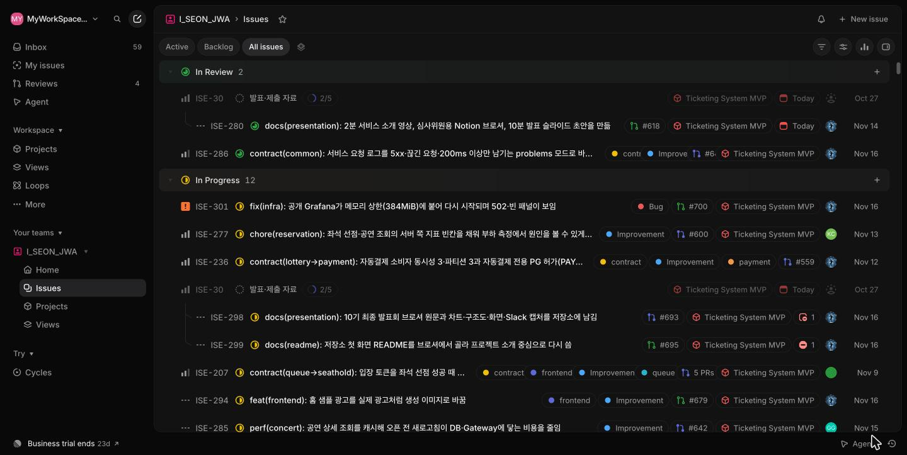
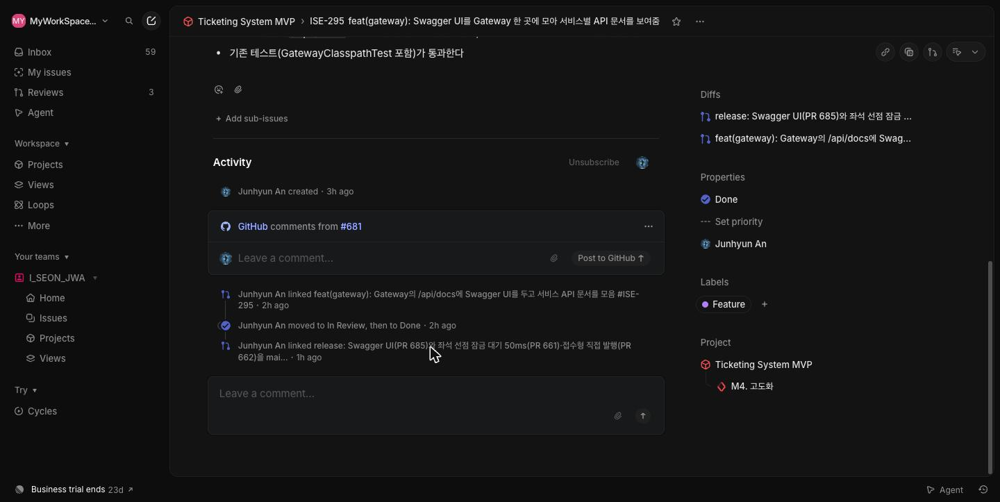
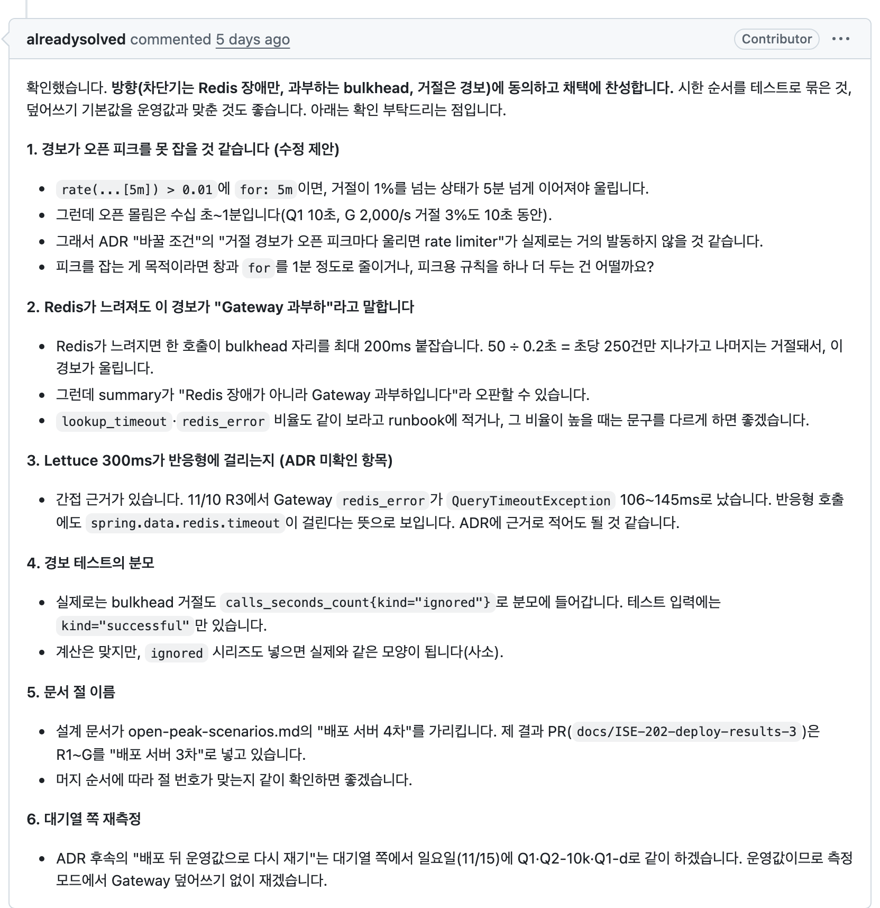

# 프로젝트 소개

발표 첫 부분에 쓸 자료를 둔다. 티켓 오픈 순간 폭주 트래픽이라는 문제, 그 문제를 숫자로 보인 목표, 팀 구성과 담당이다.

정본:
- 문제 정의와 해법: [SA](../../core/SA%20MASTER.md) 1-1·1-2
- 사용자 시나리오와 페르소나: SA 2장
- 목표 수치와 숫자 근거: SA 3장
- 기능 분담: SA 6-1

| 날짜 | 파일 | 내용 |
|---|---|---|
| 2026-11-13 | [2026-11-13-linear-collaboration-source.md](2026-11-13-linear-collaboration-source.md) | Linear 협업 발표 소스. 공통부문 겹침(10/27 브랜치 5개), Linear·GitHub 연결, 담당·상태로 겹침과 막힘을 먼저 발견, ISE-19 계약 4종 분리로 교착 해소, 고른 이유(GitHub 연동·브랜치 관리·가벼움·한 달 무료), 예상 질문 |
| 2026-11-14 | [2026-11-14-final-talk-script.md](2026-11-14-final-talk-script.md) | 최종 발표 10분 대본 초안(발표 이강민). Slides 아티팩트 20장의 발표자 노트, 구성과 시간, 숫자 주의, 예상 질문. 주인공은 AI 축(제약·장치·일하는 방식·성장). 11/16에 발표 중심을 백엔드 설계·구현의 지표로 바꿔 이 구성은 대체됨([판단 기록](../../ai-judgments/junhyun/2026-11-16-final-talk-center-backend-metrics.md)) |
| 2026-11-16 | [2026-11-16-brochure.md](2026-11-16-brochure.md) | 10기 최종 발표회 브로셔 원문(노션 [5조] 이선좌 페이지에 반영). 첫 화면 숫자 카드, 서비스 소개·화면, 목표 판정표, 인프라, 주요 기능 8개, 적용 기술·도입하지 않은 것, 기술적 의사결정 10개, 트러블슈팅(측정 환경·차트·이야기 6개·한계), CONTRIBUTORS, AI 활용 성과 및 회고. `:::`로 시작하는 줄은 노션의 토글·콜아웃·열 나누기 자리다 |
| 2026-11-16 | Linear 화면 4장: [이슈 목록](2026-11-16-collab-linear-issues.jpg), [GitHub 연동(ISE-295)](2026-11-16-collab-linear-github-sync.jpg), [contract 이슈(ISE-207)](2026-11-16-collab-linear-contract.jpg), [마일스톤](2026-11-16-collab-linear-milestones.jpg) | Linear로 이슈를 관리하고 GitHub와 연결한 모습. 상태별 이슈와 연결된 PR 번호·라벨, PR이 붙고 In Review → Done으로 넘어간 기록, 상대 담당을 멘션한 계약 이슈와 PR 5개, M1~M4 완료율. 11/16 Chrome 캡처(1440×723). 브로셔 갤러리 카드 "협업: Linear·GitHub 연동과 PR 상호 리뷰"에 넣었다 |
| 2026-11-16 | PR 상호 리뷰 6장: [#26](2026-11-16-collab-pr-review-26-0.png), [#283](2026-11-16-collab-pr-review-283-0.png), [#458](2026-11-16-collab-pr-review-458-0.png)·[#458 답글](2026-11-16-collab-pr-review-458-1.png), [#487](2026-11-16-collab-pr-review-487-0.png), [#526](2026-11-16-collab-pr-review-526-0.png), 캡처 스크립트 [2026-11-16-collab-pr-review-shots.mjs](2026-11-16-collab-pr-review-shots.mjs) | 다섯 명이 모두 등장하는 사람 사이 리뷰. #26 강민 → 영은(진입 Lua 빈틈, 머지 전 반영 요청), #283 준현 → 효승(응답 형식 정리), #458 준현 → 권우(추첨 경로의 같은 결함) 뒤 강민이 맡아 ISE-251로 고침, #487 영은 → 강민(경보가 오픈 피크를 놓치는 문제 등 6가지), #526 강민 → 준현(jar로 기본값 확인 뒤 승인). 공개 저장소라 로그인 없는 Playwright로 2배 해상도 캡처 |
| 2026-11-16 | [2026-11-16-brochure-cards/](2026-11-16-brochure-cards/) | 브로셔 갤러리 카드 썸네일 19장(검정 바탕, 흰 글씨 키워드, 1600×900의 2배). `make-thumbnails.py`가 SVG를 만들고 `script/render-diagram.sh`로 PNG를 내보낸다. 카드 순서와 키워드는 스크립트의 `CARDS`에 있다. 협업(Linear) 카드는 썸네일 대신 Linear 화면을 쓴다. 19번은 보안 카드(서버 접근 통제·비밀값·애플리케이션 보안) |

## 미리보기

Linear 이슈 목록과 GitHub 연동:

PR 상호 리뷰(예: #487 영은 → 강민):

