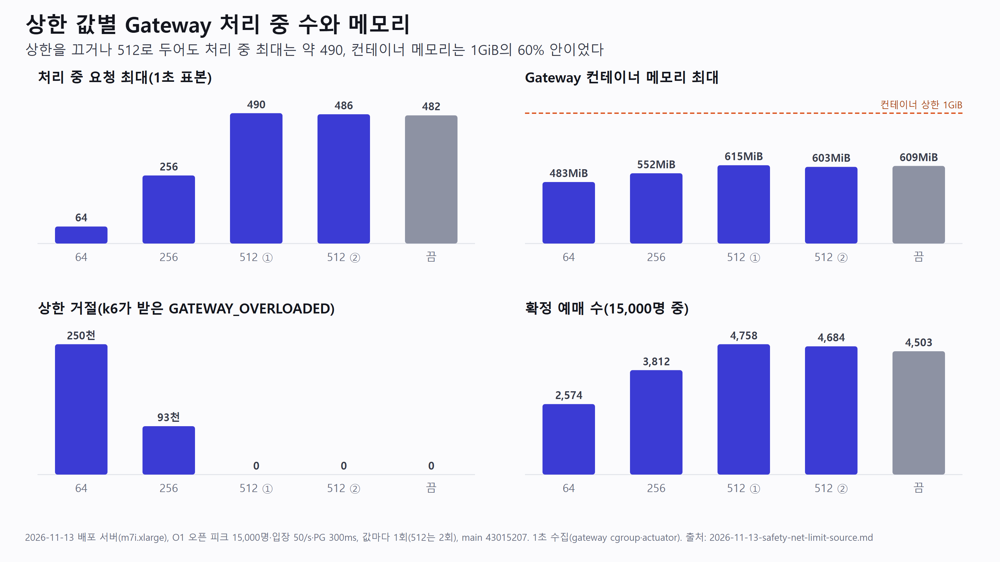
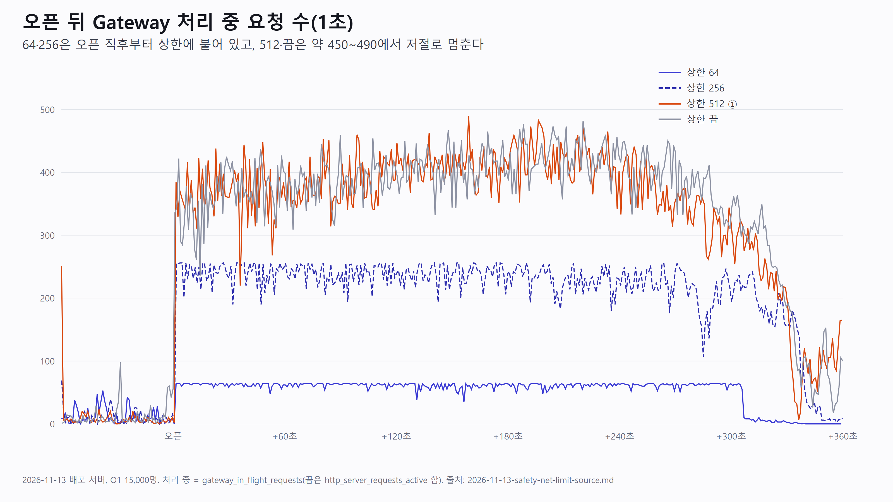

# Gateway 동시 처리 상한: 섞인 트래픽에서 안전망 값 정하기 (발표 소스, 2026-11-13)

Gateway 맨 앞 동시 처리 수 상한(`InFlightLimitHandlerDecorator`, 운영값 64)을 실제 예매 흐름(O1)으로 64·256·512·끔으로 바꿔 잰 결과다. 발표 자료는 이 소스를 줄여 만든다. 숫자는 2026-11-13 배포 서버 측정에서만 옮겼다.

- 조건: 배포 서버 `m7i.xlarge`(4 vCPU), main `43015207`, 부하 발생기 EC2(`c6i.xlarge`). O1 오픈 피크 한 흐름(공연 상세 → 대기열 진입 → 순번 조회 → 입장 토큰 → 좌석 조회 → 선점 → 결제 → 확정), 사용자 15,000명·VU 500, 오픈 전 120초·뒤 420초, 입장 50/s, Mock PG 승인 지연 300ms, 회차마다 새 15,000석 회차
- 반복: 64·256·끔은 1회, 512는 2회. 반복 변동은 512 두 회차 차이(메모리 12.5MiB, 처리 중 4, 확정 74건)로만 안다
- 판단 기록: [`2026-11-13-in-flight-limit-as-safety-net-first.md`](../../ai-judgments/kangmin/2026-11-13-in-flight-limit-as-safety-net-first.md). 개념 노트: [`2026-11-13-global-in-flight-limit-vs-mixed-traffic.md`](../../learning/kangmin/qna/2026-11-13-global-in-flight-limit-vs-mixed-traffic.md)

## 장면 1. 왜 다시 쟀나

- 핵심 메시지: 64는 순번 조회 한 API(체류 40~45ms)로만 정한 값이다. 좌석 조회(응답 약 820KB)·결제(PG 300ms)가 섞이면 근거가 없다.
- 발표자 메모: 상한은 요청 시작부터 응답 끝까지 자리를 잡는다. 느린 요청이 자리를 오래 잡으면 빠른 요청이 거절될 수 있다는 것이 출발 질문이다. 상한의 원래 목적은 5차 측정 OOM을 막는 메모리 안전망이다.

## 장면 2. 결과 한 장

| 상한 | 처리 중 최대(1초) | 컨테이너 메모리 최대 | 힙 최대 | 상한 거절 | 확정 예매 | 좌석 조회 p95 |
|---|---|---|---|---|---|---|
| 64 | 64 | 483MiB | 194MiB | 250,448 | 2,574 | 497ms |
| 256 | 256 | 552MiB | 237MiB | 93,037 | 3,812 | 1,224ms |
| 512 ① | 490 | 615MiB | 278MiB | 0 | 4,758 | 1,888ms |
| 512 ② | 486 | 603MiB | 283MiB | 0 | 4,684 | 1,887ms |
| 끔 | 482(활성 요청) | 609MiB | 284MiB | — | 4,503 | 1,964ms |

- 핵심 메시지: 상한을 끄거나 512로 두어도 처리 중은 약 490에서 멈추고, 메모리는 1GiB의 60% 안, OOM 0이었다.
- 정합성: 모든 회차에서 결제 승인 수 = 확정 수, SOLD 좌석 = 확정 예매 좌석, 좌석 중복 0.

## 장면 3. 64가 가벼운 요청을 막는 모습

- 핵심 메시지: 64·256은 오픈 직후부터 상한에 붙어 있다. 대기열이 빠지는 구간(L64, 오픈 +3.5~4.5분)에 64자리 중 약 45~55개를 좌석 조회·선점·확정 조회가 차지했고, 순번 조회가 초당 94~245건 거절됐다.
- 그때 Gateway CPU는 1코어의 74~85%로 여유가 있었고 서버 전체 CPU는 100%였다(예매 서비스·DB). 자리를 오래 잡게 만든 것은 Gateway가 아니라 예매 서비스 포화다.
- 사용자 영향: O1에서는 좌석 조회·선점이 503이면 그 사용자가 실패로 끝난다. 그래서 64의 확정은 2,574건으로 512의 약 절반이다.
- 그래프 데이터: 1초 수집 CSV(`gateway_in_flight_requests`, 끔은 `http_server_requests_active_seconds_count` 합). k6 쪽 경로별 동시 수는 응답 시간 합 / 구간 길이로 낸 추정이다.

## 장면 4. 그래서 안전망 값은

- 핵심 메시지: 메모리 안전망으로만 보면 512는 잰 값으로 기준 안이다(힙 278~283MiB, 512MiB의 54~55%, 기준 70% 이하). 이 부하에서는 정상 요청을 막지 않는다.
- 256은 과부하에서 거절 약 9.3만 건으로 예매 서비스 500을 절반쯤 줄이지만(2,305 대 4,510~4,762), 질문 3의 부작용(가벼운 요청 거절)이 남는다.
- 결정: 강민(미정). 하위 서비스 보호는 Gateway 통합 상한보다 경로별 상한이나 예매 서비스 쪽 보호(커넥션 풀·bulkhead)가 맡는 편이 맞다는 방향이다.

## 덤: 측정하다 Prometheus를 죽인 일

- k6 결과를 Prometheus로 밀어 넣는 remote write를 켰더니, 확정 조회 URL(`/api/v1/reservations/{예매 id}`)마다 시계열이 생겨 71만 개까지 늘었다. 메모리 상한 768MiB에서 OOM이 났다(19:20 KST).
- 시계열 수(카디널리티)는 태그 값 조합 수다. 서버 지표는 Spring이 URL을 틀로 묶어 주지만 k6는 묶지 않는다. 뒤 회차는 remote write를 끄고 원자료 CSV로 계산했다.
- 트러블슈팅·"측정 도구도 부하를 받는다" 장면 재료다.

## 예상 질문

| 질문 | 답 |
|---|---|
| 512에서 메모리가 넘칠 수는 없나 | 이 부하는 처리 중이 약 490에서 저절로 멈춰 512에 닿지 않았다. 512에 닿을 때의 메모리는 직선 추정으로 약 620MiB(계산값)이고 아직 재지 않았다 |
| 왜 256이 아니라 512인가 | 상한의 목적을 메모리 안전망으로 두었기 때문이다. 256은 부하 제한으로도 일해 느린 요청이 가벼운 요청을 밀어내는 부작용이 생긴다 |
| 사용자 수를 줄여 CPU 여유가 있을 때도 쟀나 | 5,000명으로도 오픈 뒤 서버 CPU가 100%였다. 좌석 조회·선점 양은 입장 50/s로 정해지기 때문이다(그 회차는 Prometheus 과부하가 겹쳐 참고만) |
| 1회 측정으로 충분한가 | 512만 2회 반복했고 차이가 작았다. 64·256·끔은 1회라 반복 변동을 모른다 |

## 숫자 사용 주의

- 같은 날 같은 조건끼리만 비교한다. 오전 G1(순번 조회만) 숫자와 섞지 않는다.
- "처리 중 최대"는 1초 표본이라 실제 순간 최댓값보다 작을 수 있다.
- 확정 수는 O1의 실패 처리(좌석·선점 503이면 그 사용자 종료)에 영향을 받는다. 서버 처리량으로 읽지 않는다.

## 출처

- 측정 기록: 측정자 개인 문서 `docs/context/safety-net-measure-2026-11-13.md`(git 제외), 원자료 `docs/context/safety-net-2026-11-13-raw/`
- 그림 원본: [`2026-11-13-safety-net-limit-charts.py`](2026-11-13-safety-net-limit-charts.py) → SVG(`2026-11-13-safety-net-limit-summary.svg`, `…-inflight.svg`) → PNG(Chrome 헤드리스 2배)
- 상한 덮어쓰기: `loadtest/deploy/compose.gateway-inflight.yml`. 시나리오: `loadtest/k6/scenarios/o1-open-peak.js`
