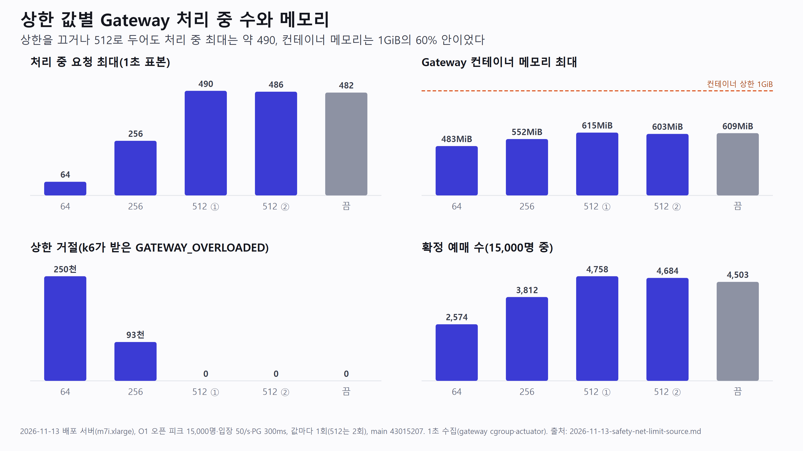
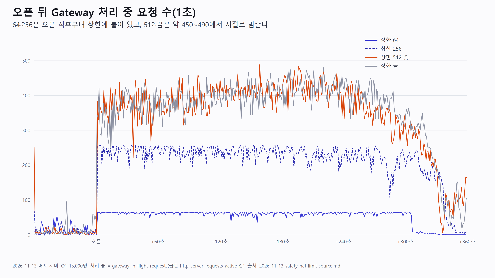

# 성능 측정

부하 측정 그래프, 개선 전후 비교 수치(동기형·접수형 선점 비교 등), Grafana·k6 결과 캡처를 둔다.

수치는 측정 조건이 없으면 비교할 수 없다. 그래프마다 표의 `조건` 칸에 측정 날짜, 서버 크기, 시나리오 ID(예: [open-peak-scenarios](../../design/infra/open-peak-scenarios.md)의 G1), 부하 모양(VU·도착률), 원본 결과 링크를 적는다.

정본:
- 측정 도구와 환경: [`design/infra/load-test.md`](../../design/infra/load-test.md), ADR [0046](../../decisions/0046-load-test-k6.md)
- 오픈 피크 측정 계획과 시나리오: [`design/infra/open-peak-load-plan.md`](../../design/infra/open-peak-load-plan.md), [`open-peak-scenarios.md`](../../design/infra/open-peak-scenarios.md)
- 좌석 선점 동시성 결과: [`design/reservation/concurrency-results.md`](../../design/reservation/concurrency-results.md)
- 추첨 측정: [`design/lottery/numbers-and-measurement.md`](../../design/lottery/numbers-and-measurement.md)
- 실행 기록: [`test-scenarios/runs/`](../../test-scenarios/README.md)

| 날짜 | 파일 | 내용 | 조건 |
|---|---|---|---|
| 2026-11-13 | [2026-11-13-safety-net-limit-source.md](2026-11-13-safety-net-limit-source.md), 그림 `2026-11-13-safety-net-limit-summary`·`-inflight`(.svg·.png, 원본 `-charts.py`) | Gateway 동시 처리 상한 64·256·512·끔을 O1 섞인 흐름으로 비교. 장면 4개, 예상 질문, 숫자 사용 주의. remote write 카디널리티로 Prometheus OOM 난 일 | 배포 서버 m7i.xlarge, O1 15,000명·VU 500·입장 50/s·PG 300ms, 값마다 1회(512는 2회), main 43015207 |

## 미리보기

