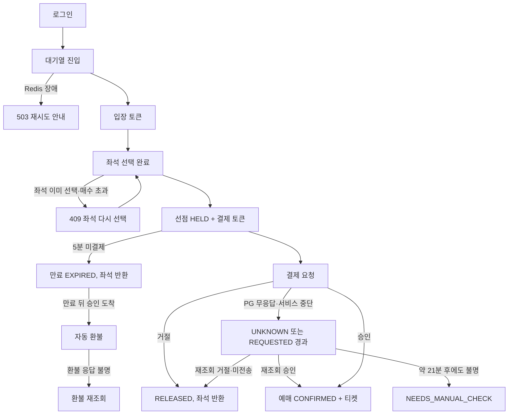

# SA 피드백 반영 개선안 (2026-10-26)

[04 피드백 정리](04-mentor-feedback-1026.md)의 논의 사항 N1~N12를 SA 문서에 어떻게 반영할지 구체안으로 쓴다. 팀 합의 전 제안이다. 합의된 것만 SA 문서와 `docs/decisions/`에 옮긴다.

## 표기와 한계
- `[가정]`은 이 문서에서 정리자가 잡은 시작값이다. 측정한 값이 아니다.
- `(팀 확인)`은 SA v2의 실제 정의를 보지 못해 초안으로 쓴 부분이다. SA v2 14장과 대조한다.
- 코드나 SQL은 설계 초안이며 실행해 검증하지 않았다.

## 1. 한눈에 보기

| # | 개선안 | 바뀌는 곳 | 계약 영향 | 시기 |
|---|---|---|---|---|
| 1 | 입장 판정은 seq 기준으로 확정 | Redis 키·Lua | 입장 토큰 | 10/27 |
| 2 | 결제 토큰·입장 토큰 키 분리, `typ`·`aud` 검증, 결제 토큰 만료 10초 앞당김 | 토큰 서명 규칙 | 입장·결제 토큰 | 10/27 |
| 3 | 동기형/접수형 명칭 분리, 선점 응답에 결제 토큰 포함 | API 표, 응답 형식 | 선점 결과 | 10/27 |
| 4 | v2 접수 요청 테이블 + outbox | 상태 머신, 테이블, 이벤트 명세 | 선점 결과, 이벤트 | 10/27 |
| 5 | 환불 테이블과 상태, 재확인 스케줄러(결제·환불 공용) | 상태 머신, 테이블, 숫자 기준 | 결제 결과 이벤트 | 10/27 방향, MVP 구현 |
| 6 | Redis 호출 타임아웃·서킷 브레이커, 기능별 fail-open/closed | Gateway 설정, 숫자 기준 | 없음 | 10/27 초안, MVP 구현 |
| 7 | quota 행 보장 후 조건부 UPDATE | 선점 쿼리 | 없음 | MVP |
| 8 | 보안그룹 규칙표, 관리자 UI는 127.0.0.1 바인딩 + SSH 터널 | 인프라 설계도 | 없음 | MVP(10/29) |
| 9 | 입장 속도를 선점 API 포화점에서 역산 | 숫자 기준, 부하 테스트 | 없음 | 기준선 측정 후 |
| 10 | EC2 메모리 예산표 | 인프라 설계도 | 없음 | MVP 초 |
| 11 | 부분 유니크 ADR, 레이스 컨디션 비교 기록 | 결정 기록 | 없음 | MVP |
| 12 | 서비스 플로우 차트, 페르소나 유저스토리, 적재량 추정, 법률 조사 계획 | 문서 | 없음 | 차트 MVP, 나머지 이후 |

## 2. 개선안 상세

### 2-1. 입장 판정을 seq 기준으로 확정 (N7)
- 규칙: 진입 시 `INCR queue:{scheduleId}:seq`로 받은 번호가 seq다. 입장 스케줄러가 `admitted`를 초당 N(50) 만큼 올린다. 폴링에서 `seq <= admitted`면 입장 토큰을 발급한다.
- 표시용 순번: `max(0, seq - admitted)`로 O(1) 계산한다. ZSET은 "계정당 1자리"와 이탈 제거(`ZREM`)에만 쓴다.
- 알려진 비용: 이탈자의 번호도 `admitted`가 지나가므로 그 슬롯만큼 실제 입장 속도가 N보다 낮아진다. 이탈이 많으면 N을 높여 보정하고, 이 한계를 문서에 적는다.
- 반영: SA v2 14-8, Redis 키 표의 `(팀 확인)` 제거.

### 2-2. 토큰 규칙 (N3)

| 항목 | 입장 토큰 | 결제 토큰 |
|---|---|---|
| 발급 | Reservation | Reservation |
| 검증 | Gateway | Payment |
| 서명 키 | `ENTRY_TOKEN_SECRET` | `PAYMENT_TOKEN_SECRET` |
| 필수 claim | `typ=entry`, `aud=gateway`, `sub=userId`, `schedule`, `exp`, `jti` | `typ=payment`, `aud=payment-service`, `sub=userId`, `rid=reservationId`, `amount`, `exp`, `jti` |
| 검증 규칙 | 서명, `typ`, `aud`, `exp` 모두 통과해야 함 | 같음 + `rid`·`amount`를 서버 값과 대조 |

- 키를 분리하면 Gateway는 결제 키를, Payment는 입장 키를 갖지 않아 서로의 토큰을 위조할 수 없다. `typ`·`aud`는 키가 실수로 같아져도 교차 사용을 막는 이중 방어다.
- HMAC은 검증 키로 서명도 할 수 있다. 코멘트가 지적한 "Gateway·Payment도 토큰을 만들 수 있음"은 이 구조의 한계다. 비대칭 서명(발급자 개인키, 검증자 공개키)으로 풀 수 있으나 키 관리 비용이 늘어 MVP 이후로 둔다.
- 결제 토큰 만료: `exp = hold_expires_at - 10초`. 10초는 Gateway 요청 타임아웃 3초 + 결제 결과의 예매 반영 2초 + 여유 5초다 `[가정]`.
- 이것이 막는 것은 토큰 검증을 통과한 정상 승인이 만료 뒤에 도착하는 경우다. PG 타임아웃으로 UNKNOWN이 된 결제는 나중에 APPROVED가 되므로 만료 뒤 승인(E8)은 사라지지 않는다. 자동 환불은 그대로 필요하다.
- 비용: 사용자의 결제 가능 시간이 5분에서 4분 50초로 준다.

### 2-3. API 표기와 선점 응답 (N4)
- 선점 방식 명칭: `v1/v2` 대신 동기형(sync)과 접수형(async)으로 쓴다. 경로의 `/api/v1`만 버전 표기로 남긴다. 문서, 측정 결과 파일명, 설정 키(`seat-hold.mode=sync|async`)를 한 번에 바꾼다.
- 응답에 결제 토큰 포함: 선점 성공 응답과 접수 결과 조회 응답(`HELD`)에 결제 토큰을 같이 준다. 지금은 `HELD` 뒤에 `GET /reservations/{id}`를 한 번 더 불러야 토큰을 받으므로 호출 1회가 줄어든다.
- 접수 결과 조회(`GET /reservations/requests/{requestId}`)는 `data.status`가 `REQUESTED / HELD / REJECTED` 중 하나다. `HELD`면 `data.reservation` 블록을 같이 주고, `REJECTED`면 `data.reasonCode`를 준다. 클라이언트는 이 한 응답으로 다음 화면을 정한다.
- 결제 응답도 같은 원칙이다. 승인, 거절, UNKNOWN 모두 `data.status`로 구분하고 HTTP 코드는 200/202만 쓴다.
- 모드는 서버 설정이라 한 시점에는 한 방식만 동작한다. 클라이언트는 `data.status`가 `HELD`(즉시)인지 `REQUESTED`(접수)인지만 처리한다.

### 2-4. v2 접수 요청 테이블 (N1)
현행(DB 행 없이 Kafka 직접 발행)을 접수 요청 행 + outbox로 바꾼다.

```sql
-- reservation DB (초안, 팀 확인)
CREATE TABLE seat_hold_request (
  request_id     UUID PRIMARY KEY,          -- Idempotency-Key에서 파생
  user_id        BIGINT       NOT NULL,
  schedule_id    BIGINT       NOT NULL,
  seat_ids       BIGINT[]     NOT NULL,
  status         VARCHAR(20)  NOT NULL CHECK (status IN ('REQUESTED','HELD','REJECTED')),
  reservation_id BIGINT,                    -- HELD일 때
  reason_code    VARCHAR(40),               -- REJECTED일 때
  created_at     TIMESTAMPTZ  NOT NULL DEFAULT now(),
  updated_at     TIMESTAMPTZ  NOT NULL DEFAULT now()
);
```

- API 한 트랜잭션: `seat_hold_request(REQUESTED)` INSERT + `outbox(SeatHoldRequested)` INSERT. 같은 `request_id`가 다시 오면 PK 충돌로 기존 행을 반환해 멱등이 된다. 이 경로에서는 좌석 행을 잠그지 않는다.
- 소비자 한 트랜잭션: 선점 시도(quota → 좌석 → 예매) 후 `seat_hold_request`를 `HELD` 또는 `REJECTED`로 갱신하고 `processed_event`를 기록한다.
- 고아 방지: 소비 재시도 3회 실패로 DLQ에 간 요청은 DLQ 처리기가 `REJECTED(PROCESSING_FAILED)`로 바꾼다. `REQUESTED`가 30초 `[가정]` 넘게 남은 행은 모니터링 대상이고, 조회 응답에 `REQUESTED`를 그대로 주되 `nextPollAfterSeconds`를 늘린다.
- 이벤트 명세 변경: `seat-hold.request`의 발행 방식을 "직접 발행(acks=all, 실패 시 503)"에서 "Outbox"로 바꾼다. 브로커가 죽어도 접수는 DB에 남는다.
- 대가: API 경로에 INSERT 2건이 생긴다. 좌석 행 락 경합은 없는 INSERT라 가볍지만, 처리량 영향은 측정 전이다. v2 재측정에서 동기형, 현행안, 이 안 세 가지를 같은 환경에서 비교한다.
- 이 안으로 SA 문서의 `REQUESTED: v2 응답 상태, DB 행 없음` 문구와 D4 설명이 바뀐다.

### 2-5. 환불 모델과 재확인 스케줄러 (N2)

**결제 상태 보강**
- `REQUESTED`는 `pg_order_id`를 저장한 뒤 PG를 호출하므로, Payment가 PG 호출 중에 죽어도 PG에 `pg_order_id`로 물어볼 수 있다. 그래서 `requested_at`이 10초 `[가정]` 넘은 `REQUESTED`도 UNKNOWN과 같은 재조회 대상으로 넣는다. 10초는 PG 응답 타임아웃 2초에 여유를 둔 값이다.
- 재조회 결과: PG가 승인으로 답하면 `APPROVED`, 거절이면 `DECLINED`, 주문 자체를 모르면(`NOT_FOUND`) PG 호출이 일어나지 않은 것이므로 `DECLINED(NOT_SENT)`로 닫는다.

**환불 테이블 (초안, 팀 확인)**
```sql
CREATE TABLE refund (
  id           BIGINT GENERATED ALWAYS AS IDENTITY PRIMARY KEY,
  payment_id   BIGINT       NOT NULL UNIQUE,   -- 결제 1건당 환불 1건 (전액 환불만)
  pg_refund_id UUID         NOT NULL UNIQUE,   -- PG 호출 전에 생성해 멱등키로 사용
  amount       NUMERIC(15,0) NOT NULL,
  reason       VARCHAR(30)  NOT NULL,          -- EXPIRED_PAID, CANCELED 등
  status       VARCHAR(20)  NOT NULL CHECK (status IN
               ('REQUESTED','REFUNDED','FAILED','UNKNOWN','NEEDS_MANUAL_CHECK')),
  attempt      SMALLINT     NOT NULL DEFAULT 0,
  next_check_at TIMESTAMPTZ,
  created_at   TIMESTAMPTZ  NOT NULL DEFAULT now(),
  updated_at   TIMESTAMPTZ  NOT NULL DEFAULT now()
);
```
- 멱등: `RefundRequested`를 소비할 때 `INSERT ... ON CONFLICT (payment_id) DO NOTHING`. 만료 뒤 승인(E8)과 사용자 취소가 같은 결제에 동시에 환불을 요청해도 한 건만 생긴다.
- 환불은 결제가 `APPROVED`로 확정된 뒤에만 시작한다. 결제가 UNKNOWN인 동안 만료되면, 나중에 `PaymentApproved`가 오고 Reservation이 `RefundRequested`를 내므로 순서가 지켜진다.
- 결제 `REFUNDED` 전이는 환불이 `REFUNDED`가 될 때 한다.
- Mock PG에는 환불 조회(`GET /mock-pg/refunds/{pgRefundId}`)와 환불 멱등 처리가 필요하다. 지금 API 표에는 `POST /mock-pg/refunds`만 있다. 이강민 담당과 확인한다.

**재확인 스케줄러**
- 하나의 스케줄러가 `next_check_at <= now()`인 `REQUESTED(경과분)`, `UNKNOWN`, 환불 `REQUESTED/UNKNOWN`을 `SKIP LOCKED`로 집어 처리한다.
- 간격 `[가정]`: 10초 × 6회(약 1분) → 1분 → 5분 → 15분 → `NEEDS_MANUAL_CHECK`. 총 약 21분이다.
- `NEEDS_MANUAL_CHECK`는 종결 상태이고 Grafana에 건수 지표와 알림 기준을 둔다. 운영자가 PG 콘솔에서 확인해 수동으로 닫는다.
- 코멘트의 "몇 초는 Kafka, 몇 분 이상은 스케줄러"는 이렇게 반영한다. 몇 초 단위의 일시 실패는 Kafka 소비 재시도(1·2·4초)가 맡고, 그래도 확정되지 않으면 행 상태가 남아 스케줄러가 이어받는다. 상태의 기준은 항상 DB 행이라 둘 중 하나가 빠져도 건이 사라지지 않는다.

### 2-6. Redis 느려짐과 fail-open/closed (N8)

**공통 방어** `[가정]`
- Gateway의 모든 Redis 호출에 타임아웃 100ms를 둔다. 정상 Redis 응답은 1ms 안팎이라 100ms는 이상 징후다.
- Redis 호출을 Resilience4j 서킷 브레이커로 감싼다. 최근 20회 중 50%가 실패하거나 50ms 넘게 걸리면 OPEN, 10초 뒤 HALF_OPEN에서 5회 시험한다.
- OPEN 동안은 Redis에 가지 않고 아래 표의 정책을 즉시 적용한다. 느려진 Redis 때문에 Gateway 스레드가 쌓이는 것을 막는 것이 목적이다.

| 기능 | OPEN 시 정책 | 응답 | 이유와 감수하는 위험 |
|---|---|---|---|
| 대기열 진입·입장 판정 | closed | 503 + `Retry-After` | 속도 통제 없이 입장시키면 선점 API가 폭주를 받는다 |
| 좌석 조회·선점의 입장 토큰 검증 | 서명 검증은 Redis 없이 통과, 폐기 목록 확인만 생략 | 정상 | 입장 토큰은 서명과 `exp`로 자체 검증되므로 Redis가 없어도 검증 가능 |
| 로그아웃 블랙리스트 확인 | open | 정상 | 로그아웃된 Access 토큰이 최대 30분 통한다. 결제는 별도 결제 토큰이 있어 피해 범위가 제한된다. 보안 요구가 더 높으면 closed로 바꾼다(팀 결정) |
| 사용자 요청 제한 | 인스턴스 로컬 카운터로 낮춰 open | 정상 | 정확도는 떨어지지만 뒷단 보호는 유지 |
| 공연 정보·좌석 캐시 | open, DB 조회로 대체 | 정상 | DB 보호를 위해 대체 조회는 초당 상한을 둔다 |

- 검증 시나리오 추가: E11 "Redis 응답 지연 주입 → 서킷 OPEN, 대기열은 503, 조회·결제는 정상". 지연 주입 도구는 정하지 않았다. Toxiproxy 같은 프록시나 `DEBUG SLEEP`이 후보이며 도입 전 확인이 필요하다.
- 지표 추가: Redis 명령 지연 p95, 서킷 상태, OPEN 횟수.

### 2-7. quota 행 보장 (N5)
```sql
-- 선점 트랜잭션 첫 단계 (초안)
INSERT INTO user_schedule_quota (user_id, schedule_id, held_count)
VALUES (:userId, :scheduleId, 0)
ON CONFLICT (user_id, schedule_id) DO NOTHING;

UPDATE user_schedule_quota
   SET held_count = held_count + :n
 WHERE user_id = :userId AND schedule_id = :scheduleId
   AND held_count + :n <= :maxPerUser;
-- 0행이면 한도 초과(409 PURCHASE_LIMIT_EXCEEDED). 행은 위에서 보장되었다.
```
- 같은 사용자의 동시 요청이 INSERT에서 부딪혀도 한쪽은 대기 후 `DO NOTHING`이 되고, 이어지는 UPDATE의 행 락이 직렬화한다. D1을 막는 방식은 그대로다.
- 만료·취소·거절 시 `held_count`를 감소시키는 경로가 빠지면 한도가 새는 고아가 된다. 대사 쿼리에 `held_count`와 활성 `reservation_seat` 수의 불일치 검사를 넣는다.

### 2-8. 외부 노출과 관리자 UI 접근 (N9)

**보안그룹** `(팀 확인)`

| 포트 | 대상 | 인바운드 허용 | 비고 |
|---|---|---|---|
| 22 | SSH | 팀원 IP만 | 키 인증만 허용 |
| 8080 | gateway | 전체(0.0.0.0/0). 부하 측정 중에는 측정 기기 IP로 제한 | 유일한 서비스 진입점 |
| 3000 | grafana | 허용 없음 | SSH 터널로만 접근 |
| 8085, 9090, 9411, 8761 | kafka-ui, prometheus, zipkin, eureka | 허용 없음 | 같음 |
| 8081~8083, 8090, 5433~5435, 6379, 9092 | 서비스, mock-pg, DB, Redis, Kafka | 허용 없음 | compose 내부 네트워크 전용 |

- 이중 방어: compose에서 관리자 UI는 `127.0.0.1:3000:3000`처럼 로컬에만 바인딩하고, 내부 전용 서비스는 `ports`를 열지 않고 `expose`만 쓴다. 보안그룹 설정이 틀려도 호스트 외부로 열리지 않는다.
- 접근 매뉴얼(초안): `ssh -L 3000:localhost:3000 -L 8085:localhost:8085 -L 9411:localhost:9411 <user>@<ec2>` 후 브라우저에서 `localhost:3000`. 시연도 발표자 노트북에서 터널을 열고 보여 주면 포트를 공개할 필요가 없다. 04 문서 N9에서 시연 기간 한시 공개를 검토하라고 했으나, 터널로 충분하므로 이 안으로 바꾼다.
- 요청 차단 계층: 보안그룹(포트·IP) → Gateway(JWT, 입장 토큰, 요청 제한, 오픈 전 시각 검사) → 서비스(권한, 도메인 규칙) → DB(제약). 이 순서를 인프라 설계도에 한 장 표로 넣는다.
- 부하 도구는 다른 기기에서 8080으로 들어온다. 측정 시작 전에 해당 IP를 허용하는 단계를 측정 절차에 넣는다.

### 2-9. 입장 속도 역산 (N10)
- 문서의 "최대 동시 입장 = N × T"는 리틀의 법칙 `L = λ × W`에서 `W`를 토큰 유효 시간 T(상한)로 둔 식이라 L의 상한(50 × 600 = 30,000)이다. 입장 속도는 상한이 아니라 선점 API가 감당할 동시 사용자 수에서 역산해야 한다.
- 역산식: 입장자 한 명이 평균 `r`(요청/초)을 내고 선점 API의 포화 처리량이 `μ`(요청/초)이면 동시 입장자 `L_max = μ / r`. 입장 속도 `λ = L_max / W`(W는 평균 체류 시간).
- 계산 예(모든 값 `[가정]`): μ = 200, r = 0.2, W = 150초 → L_max = 1,000, λ ≈ 6.7명/초. 현재 초안 50명/초는 이 예보다 훨씬 크다.
- 결론: 50은 기준선 측정 전 임시값이다. v1 기준선에서 포화점 μ와 실제 W를 측정한 뒤 N을 역산하고, T는 W의 몇 배로 정한다. 이 식과 측정 절차를 "숫자 기준" 절에 적는다.

### 2-10. EC2 메모리 예산표 (N10)
컨테이너 상한과 JVM 힙 상한을 한 표로 둔다. 아래는 시작값이며 `docker stats`로 부하 중 사용량을 측정해 바꾼다.

| 구성 | 힙 상한(`-Xmx`) | 컨테이너 상한 |
|---|---|---|
| gateway | 512m | 768m |
| eureka | 256m | 512m |
| user-service | 384m | 640m |
| reservation-service | 768m | 1,152m |
| payment-service | 512m | 768m |
| mock-pg | 256m | 512m |
| postgres × 3 (reservation 1,024m, 나머지 512m씩) | - | 2,048m |
| redis (`maxmemory` 약 400m) | - | 512m |
| kafka (KRaft, 힙 1g) | 1,024m | 1,536m |
| kafka-ui | - | 512m |
| prometheus | - | 768m |
| grafana | - | 384m |
| zipkin | - | 768m |
| 합계 | | 10,880m(약 10.6GB) |

- 합계를 EC2 메모리의 75% 이하로 두면 필요 메모리는 약 14.5GB이고, 16GB급 인스턴스가 최소다 `[가정]`. 8GB급은 이 구성으로는 맞지 않는다. 8GB를 써야 하면 zipkin·kafka-ui·prometheus를 제외하거나 상한을 줄이는 대안을 따로 정한다.
- 컨테이너 상한이 힙보다 큰 이유는 메타스페이스, 스레드 스택, 네이티브 메모리 때문이다. 상한 간격(약 256~384m)이 충분한지는 측정으로 확인한다.
- 측정 PC에서 로컬로 돌릴 때도 같은 표를 쓰고 PC 메모리와 비교한다. 측정 환경 기록표에 `-Xmx`와 컨테이너 상한을 넣는다.
- 단일 EC2 한계 문구(SA 6장에 추가): "배포는 EC2 1대의 docker compose다. 서비스 단위 장애 격리는 컨테이너 수준이며 인스턴스 장애 시 전체가 중단된다. 운영 환경이라면 서비스별 다중 인스턴스와 매니지드 DB·Redis·Kafka로 분리한다."

### 2-11. 결정 기록 두 건 (N6)
**ADR 1: 부분 유니크 인덱스** `(팀 확인: SA v2 14장의 실제 정의와 대조)`
```sql
-- 판매 중인 좌석은 한 예매 좌석에만 속한다 (D2)
CREATE UNIQUE INDEX uq_reservation_seat_active
  ON reservation_seat (schedule_seat_id) WHERE status IN ('HELD','CONFIRMED');

-- 같은 예매에 살아 있는 결제는 한 건 (D3)
CREATE UNIQUE INDEX uq_payment_reservation_active
  ON payment (reservation_id) WHERE status IN ('REQUESTED','APPROVED','UNKNOWN');
```
- 포함할 내용: 목적, 대상 상태와 그렇게 정한 이유(`DECLINED`·`RELEASED`는 제외해야 재시도·재선택이 가능), 인덱스를 우회하는 경로가 없는지, 위반 시 서비스의 처리(409 변환), 동시 요청 테스트 방법.

**ADR 2: 레이스 컨디션 해결 방식**
- 결론: 조건부 UPDATE + 부분 유니크(DB가 기준)를 유지한다.
- 근거: 분산락은 DB 제약이 어차피 필요해 이중이 되고, 락 만료와 Redis 지연이 선점 경로를 막는다. Redis Lua 선점은 Redis 유실 시 판정이 틀려 DB 2차 방어가 필수이므로 v2 설계와 함께 따로 다룬다.
- 검증: E1을 같은 좌석 동시 100요청으로 실행해 1건 성공, 나머지 409, 중복 판매 0건을 기록한다.

### 2-12. 문서 보강 초안 (N11)

**서비스 플로우 차트 (실패 분기 포함)**


**페르소나 유저스토리 초안**

| 페르소나 | 유저스토리 (상황 → 하려는 일 → 기대, 실패 시 기대) |
|---|---|
| P1 도예린 | 퇴근 후 친구와 앉을 2석을 잡으려 오픈 시각에 대기한다. 내 순번과 예상 시간이 보이고, 입장하면 한 번에 2석을 잡는다. 이미 팔린 좌석이면 줄을 다시 서지 않고 좌석만 다시 고른다. 결제가 불확실하면 "확인 중"이라고 알려 주고 결과를 반드시 알려 준다. |
| P2 오민재 | 오픈 시각에 수업이라 접속할 수 없다. 응모 기간에 응모하고 결제 수단을 등록해 두면 당첨 시 자동 결제와 발권을 기대한다. 결제가 실패하면 자리를 잃지 않았는지 알림으로 알 수 있어야 한다. |
| P3 서유진 | 공연·회차·좌석을 등록하고 판매 기록이 지워지지 않고 상태로 남아 정산 분쟁 때 근거가 되길 기대한다. 같은 좌석이 두 번 팔리면 안 된다. |
| P4 한도운 | 오픈 시각에 대시보드에서 대기열 길이, 오류율, 결제 불명 건수를 본다. 처리 못 한 건(DLQ, 수동 확인 대기)이 쌓이면 바로 알아채고 원인을 추적한다. |

**테이블 적재량 추정**: 1공연 2회차, 회차당 15,000석 기준이다. 숫자는 모두 `[가정]`이다.

| 테이블 | 추정 행 수 | 산식 |
|---|---|---|
| venue_seat | 15,000 | 시드 |
| schedule_seat | 30,000 | 15,000 × 2회차 |
| reservation | 12,000~40,000 | 확정 약 12,000(30,000석 ÷ 평균 2.5매) + 만료·실패는 확정의 최대 2배 |
| reservation_seat | 30,000~100,000 | reservation × 평균 2.5매 |
| reservation_status_history | 36,000~120,000 | reservation × 평균 3회 전이 |
| ticket | 30,000 이하 | 확정 좌석 수 |
| user_schedule_quota | 입장자 수 × 회차 | 입장자 50,000명이면 100,000행 |
| payment / history | 15,000 / 45,000 | 확정 + 거절·UNKNOWN 소수, 이력 평균 3건 |
| outbox, processed_event, idempotency_record | 수만 건 | 7일 후 정리하므로 7일치 이벤트 수 |

- 이 규모의 용량은 1GB를 넘지 않을 것으로 보인다(행 크기는 미측정). 따라서 적재량 추정의 용도는 용량보다 보관·정리 정책과 인덱스 크기 확인이다. 병목은 용량이 아니라 같은 좌석 행에 몰리는 쓰기 동시성이다.

**법률 조사 계획**: 아래는 확인된 법령이 아니라 조사 질문이다.

| 조사 질문 | 이어질 수 있는 설계 |
|---|---|
| 결제·계약 기록의 보관 의무 기간과 근거 조항 | 판매 기록을 삭제하지 않고 상태로 남김(SA 5장에 5년 보관 반영됨) |
| 청약철회·환불 관련 규정이 공연 티켓에도 적용되는가, 예외는 무엇인가 | 취소·환불 정책(결정 기록 #16), 환불 상태 모델 |
| 부정 판매(매크로, 암표)를 다루는 규정과 사업자의 책임 | 매수 제한, 입장 토큰, 추첨 배분 |
| 개인정보 보관·파기 기간, 결제 수단 정보 취급 기준 | 회원 데이터, 빌링키 보관 방식 |
- 조사 결과는 법령명, 조항, 확인한 날짜를 적고 "법률 → 설계 결정" 한 줄 요약을 발표 소재로 쓴다.

## 3. 새 테스트 케이스
SA 1장의 E1~E10에 이어 아래를 제안한다.

| # | 상황 | 기대 결과 |
|---|---|---|
| E11 | Redis 응답 지연 주입 | 서킷 OPEN, 대기열은 503, 조회·결제는 정상 |
| E12 | Payment가 PG 호출 중 중단 | 10초 넘은 `REQUESTED`가 재조회로 확정 |
| E13 | 같은 결제에 환불 요청 중복 | PG 환불 1회, 환불 행 1건 |
| E14 | 입장 토큰으로 결제 API 호출, 결제 토큰으로 좌석 API 호출 | 모두 401/403 |
| E15 | v2 소비 실패로 DLQ 도달 | 접수 결과 조회가 `REJECTED(PROCESSING_FAILED)` |
| E16 | 처음 접속한 사용자의 첫 선점 | quota 행이 만들어지고 정상 선점 |

## 4. 적용 순서

| 시기 | 항목 | 이유 |
|---|---|---|
| 10/27 합의 전 | 2-1, 2-2, 2-3, 2-4, 2-5(방향), 2-6(초안) | 서비스 사이 계약(토큰, 선점 결과, 결제 결과 이벤트, 응답)과 테이블 구조를 바꾼다. 늦어지면 구현을 다시 한다 |
| MVP(10/29~11/6) | 2-5 구현, 2-6 구현, 2-7, 2-8, 2-10, 2-11, 플로우 차트 | 각 담당 영역 안의 변경이거나 배포 전에 필요 |
| 기준선 측정 후 | 2-9 | 측정값이 있어야 역산 가능 |
| 11/9 이후 | 페르소나, 적재량, 법률, 비대칭 토큰 서명 | 설계 변경으로 이어질 가능성이 낮거나 발표 소재 |

## 5. 확인하지 않은 것
- SA v2 14장의 실제 테이블·인덱스 정의(2-4, 2-5, 2-11의 SQL은 초안이다).
- 시작값 전부(타임아웃, 간격, 메모리, 입장 속도 계산 예). 기준선 측정 전이다.
- 접수 요청 테이블 안의 처리량 영향.
- Mock PG의 환불 조회·멱등 지원 여부, Redis 지연 주입 도구.
- 관련 법령의 이름과 조항.
